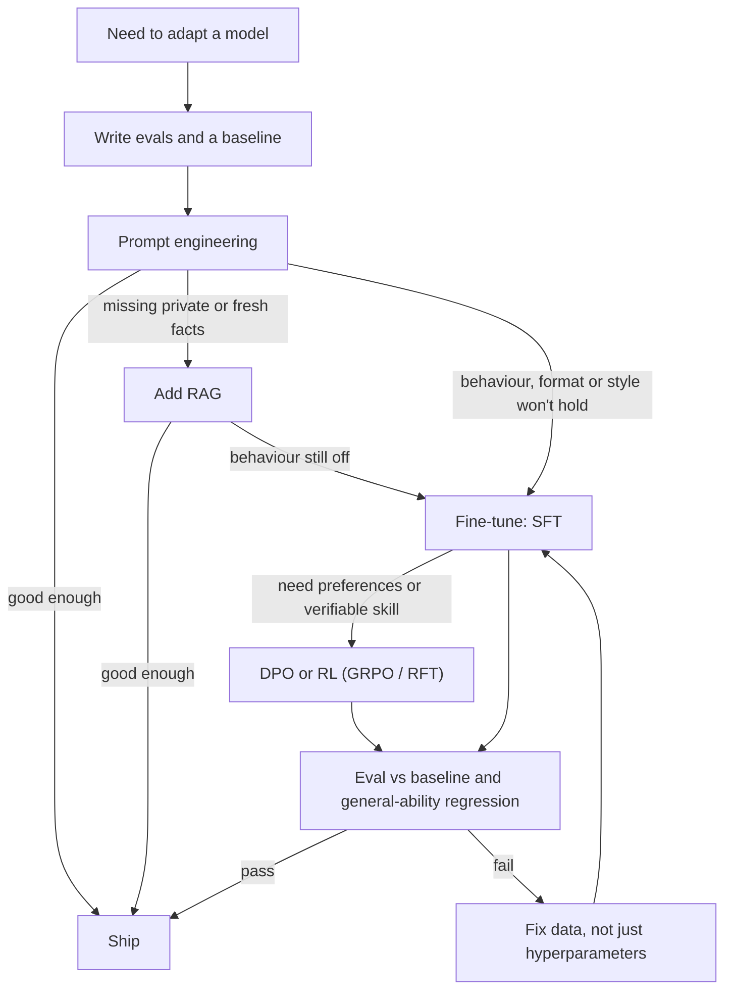

**Fine-tuning** means continuing to train a pre-trained language model's weights on a smaller, targeted dataset so that it behaves differently: it follows a format, adopts a style, gets better at a narrow task, or makes different choices. Compare the cheaper alternatives. [Prompting](prompt-engineering.md) changes *how you ask*. [RAG](retrieval-augmented-generation.md) changes *what the model can see* at query time. Fine-tuning changes *how the model behaves*, and it costs the most effort of the three ([notebook](../sources/notebook-finetune-rag-prompt.md)). [Post-training](llm-training-pipeline.md) has three families: supervised fine-tuning (SFT), [preference optimization](preference-optimization.md) (RLHF, DPO, GRPO), and [distillation](knowledge-distillation.md). Each can update all weights or only a small adapter ([PEFT/LoRA](peft-and-lora.md)).

## Fine-tune, prompt, or RAG?

| | Prompting | RAG | Fine-tuning |
|---|---|---|---|
| Changes | How you ask | What it knows *now* | How it behaves |
| Effort | Lowest | Medium (retrieval infra) | Highest (data, training, evals) |
| Freshness | n/a | Live: update the index | Stale: retrain to update |
| Iteration | Instant | Fast | Slow |
| Best for | Most tasks; try first | Private or changing facts, citations | Durable format, style, niche skill; shrinking long prompts |

Source: [notebook](../sources/notebook-finetune-rag-prompt.md). The vendors give the same order. OpenAI says to write evals first, then prompt, and to fine-tune only if the use case calls for it ([OpenAI](../sources/openai-model-optimization-guide.md)). Google says to start with prompting and to analyse failures before adding data ([Vertex AI](../sources/vertex-ai-gemini-tuning.md)).

**Fine-tuning is the wrong tool for teaching facts.** The research supports this:

- RAG consistently beat unsupervised fine-tuning (continued training on documents) for knowledge injection, for both familiar and entirely new facts ([Ovadia et al.](../sources/ovadia-fine-tuning-or-retrieval.md)).
- SFT examples containing facts the model didn't already know are learned more slowly. Once learned, they *linearly increase* hallucination. Fine-tuning mostly teaches a model to use knowledge it got in pre-training ([Gekhman et al.](../sources/gekhman-fine-tuning-new-knowledge.md)). See [hallucination](hallucination.md).
- LIMA aligned a 65B model with only 1,000 curated SFT examples. This supports the view that alignment mostly teaches format and style on top of knowledge from pre-training ([LIMA](../sources/lima-zhou-2023.md)).

Fine-tuning does pay off in these cases ([OpenAI](../sources/openai-model-optimization-guide.md), [Vertex AI](../sources/vertex-ai-gemini-tuning.md)):

- strict output formats ([structured outputs](structured-outputs.md)), classification and extraction
- a consistent tone
- fixing instruction-following failures
- more examples than fit in a prompt
- replacing a long [few-shot](few-shot-prompting.md) prompt, which cuts per-call cost and latency
- a smaller, cheaper model for one task (often by [distillation](knowledge-distillation.md))

Mature systems combine all three: a fine-tuned model for behaviour, retrieved facts for grounding, and a well-built prompt ([notebook](../sources/notebook-finetune-rag-prompt.md)).

*Synthesis:* the diagram combines the notebook's decision order with the vendor eval loops.

## The methods

- **SFT (supervised fine-tuning).** Token-level cross-entropy (negative log-likelihood) on target sequences. Padding is always masked. For prompt/completion data TRL also masks the prompt by default, so loss falls only on the completion; for conversational data, masking everything but assistant turns is opt-in (`assistant_only_loss=True`) ([TRL](../sources/hugging-face-trl-docs.md)). InstructGPT's first stage was SFT on about 13k labeller demonstrations ([InstructGPT](../sources/instructgpt-ouyang-2022.md)).
- **Preference tuning (DPO and similar).** Trains on chosen/rejected pairs. Suits subjective qualities such as tone or summary focus. See [preference optimization](preference-optimization.md).
- **Reinforcement fine-tuning (RFT/RLFT).** Reward functions score sampled outputs. It suits verifiable, multi-step tasks. Vertex AI says it can need only dozens to a few hundred prompts ([Vertex AI](../sources/vertex-ai-gemini-tuning.md)); Bedrock scores responses with reward functions such as AWS Lambda ([Bedrock](../sources/bedrock-model-customization.md)). See [reinforcement fine-tuning](reinforcement-fine-tuning.md).
- **Continued pre-training.** Next-token training on raw domain text. It forgets the most and is the weakest way to add facts ([LoRA Learns Less](../sources/lora-learns-less-forgets-less.md), [Ovadia et al.](../sources/ovadia-fine-tuning-or-retrieval.md)).

### Full fine-tuning vs PEFT

Full fine-tuning updates every parameter. You need memory for the weights, the gradients and the Adam optimizer states. On GPT-3 175B that meant 1.2 TB of training VRAM, against 350 GB with LoRA ([LoRA](../sources/lora-hu-2021.md)). PEFT freezes the base model and trains a small adapter. QLoRA goes further and freezes the base in 4-bit ([quantization](quantization.md)), which fits a 65B model on one 48 GB GPU ([QLoRA](../sources/qlora-dettmers-2023.md)).

The trade-offs: LoRA "learns less and forgets less". It underperforms full fine-tuning on large code and math corpora but keeps more of the base model's abilities ([Biderman et al.](../sources/lora-learns-less-forgets-less.md)). On small-to-medium SFT sets and on RL, LoRA applied to all layers matches full fine-tuning ([LoRA Without Regret](../sources/lora-without-regret.md)). Vertex AI offers both: parameter-efficient tuning is cheaper and needs less data, while full tuning may score higher but costs more to train *and serve* ([Vertex AI](../sources/vertex-ai-gemini-tuning.md)). Details are on [PEFT and LoRA](peft-and-lora.md).

## Data preparation

Data quality matters more than any hyperparameter:

- **Quality over quantity.** LIMA got there with 1,000 curated examples ([LIMA](../sources/lima-zhou-2023.md)). QLoRA trained over 1,000 models and found that a small, high-quality dataset beat larger ones ([QLoRA](../sources/qlora-dettmers-2023.md)). Vertex AI recommends hundreds to thousands of well-labelled examples for SFT and puts quality ahead of volume ([Vertex AI](../sources/vertex-ai-gemini-tuning.md)).
- **Formats.** TRL accepts plain `text`, `prompt`/`completion`, or conversational `messages` (role/content). It applies the model's chat template for you. Preference data is `prompt`/`chosen`/`rejected` ([TRL](../sources/hugging-face-trl-docs.md)). Vendor APIs take JSONL ([OpenAI](../sources/openai-model-optimization-guide.md)).
- **Chat template and EOS.** Train with the same template you'll serve with. A mismatched EOS token gives a model that never stops. For example, TRL notes that Qwen2.5 base needs `eos_token="<|im_end|>"` ([TRL](../sources/hugging-face-trl-docs.md)).
- **Loss masking.** Train on completions or assistant turns only. Unsloth reports a small accuracy gain, larger in multi-turn data ([Unsloth](../sources/unsloth-lora-hyperparameters.md)).
- **Packing.** Concatenating short examples into fixed-length blocks cuts padding waste (TRL `packing=True`, Axolotl multipacking) ([TRL](../sources/hugging-face-trl-docs.md), [Axolotl](../sources/axolotl-docs.md)).
- **Avoid unknown facts in SFT targets.** They raise hallucination ([Gekhman et al.](../sources/gekhman-fine-tuning-new-knowledge.md)). *Synthesis:* filter or rewrite answers whose facts the base model can't support, and put those facts in RAG instead.
- **Hold-out evals** on representative real data, plus general-capability regression tests ([OpenAI](../sources/openai-model-optimization-guide.md)). See [LLM evaluation](llm-evaluation.md).

## Key hyperparameters (starting points)

| Knob | Typical start | Notes |
|---|---|---|
| Learning rate | 2e-5 full SFT (TRL default); 1e-4 to 2e-4 LoRA; 1e-6 to 5e-6 DPO/GRPO | LoRA's optimal LR is about 10× full fine-tuning's |
| Epochs | 1–3 | More epochs overfit instruction data |
| Effective batch | ~16 | LoRA is hurt more by very large batches |
| Max length | 1024 (TRL default) | Truncation can cut off answers or image tokens |

Sources: [TRL](../sources/hugging-face-trl-docs.md), [Unsloth](../sources/unsloth-lora-hyperparameters.md), [LoRA Without Regret](../sources/lora-without-regret.md). Unsloth treats a training loss below ~0.2 as a sign of overfitting ([Unsloth](../sources/unsloth-lora-hyperparameters.md)).

## Failure modes

- **Catastrophic forgetting.** Narrow fine-tuning erodes general skills. In 1B–7B models, continual instruction tuning eroded domain knowledge, reasoning and reading comprehension, and the damage grew with scale in that range. Prior general instruction tuning reduced it ([Luo et al.](../sources/luo-catastrophic-forgetting-2023.md)). A concrete case: mid-training Qwen3-8B on internal documents dropped IF-eval from 85% to 45%. Mixing 30% chat data only partly helped (79%). On-policy distillation of that mixed checkpoint, with the original Qwen3-8B as teacher, restored it to 83% while keeping most of the new knowledge ([Thinking Machines](../sources/on-policy-distillation-thinking-machines.md)). Mitigations: LoRA, which forgets less ([Biderman et al.](../sources/lora-learns-less-forgets-less.md)); mixing in general data; mixing pre-training gradients, as PPO-ptx does against the RLHF "alignment tax" ([InstructGPT](../sources/instructgpt-ouyang-2022.md)); a distillation recovery pass.
- **Hallucination from new facts** ([Gekhman et al.](../sources/gekhman-fine-tuning-new-knowledge.md)).
- **Overfitting.** The model memorises templates and loses diversity. Fix it with fewer epochs, a lower LR, more varied data or early stopping ([Unsloth](../sources/unsloth-lora-hyperparameters.md)).
- **Staleness and lock-in.** Facts baked into the weights go stale ([notebook](../sources/notebook-finetune-rag-prompt.md)). A tuned model is tied to its base model's lifecycle. OpenAI's fine-tuned models stop working when their base model is retired ([OpenAI deprecations](../sources/openai-deprecations-fine-tuning.md)).
- **Safety regression.** *Synthesis:* fine-tuning can wear away refusal behaviour learned in the base model's preference tuning. Re-run [safety evals](llm-red-teaming.md) after every tune (see [guardrail tooling](guardrail-tooling.md)).

## Managed fine-tuning APIs (as of 2026-11-14)

| Vendor | Methods | Tunable models (examples) | Notes |
|---|---|---|---|
| OpenAI | SFT, DPO, vision SFT | gpt-4.1 / 4.1-mini (SFT, DPO); gpt-4o (vision). gpt-4.1-nano is still listed in the guide but its base model shut down on 2026-10-23 | **Winding down.** Closed to orgs that never fine-tuned since 2026-05-07, and to orgs with no fine-tuned-model inference in the past 60 days since 2026-07-02; existing customers can't create jobs from 2027-01-06. gpt-4.1, gpt-4.1-mini, gpt-4o and gpt-4o-mini (and their fine-tunes) shut down 2027-01-14 ([guide](../sources/openai-model-optimization-guide.md), [deprecations](../sources/openai-deprecations-fine-tuning.md)) |
| Google [Vertex AI](google-vertex-ai.md) | SFT, preference tuning, RLFT; checkpoints and continuous tuning | Gemini 3.5 Flash/Flash-Lite, 3.1 Flash-Lite, 2.5 Pro/Flash/Flash-Lite (varies by method) | PEFT or full ([Vertex AI](../sources/vertex-ai-gemini-tuning.md)) |
| [Amazon Bedrock](amazon-bedrock.md) | SFT, reinforcement fine-tuning (Lambda rewards), distillation | Nova family, Claude 3 Haiku, Llama 3.x | Billed per training token × epochs, plus monthly storage ([Bedrock](../sources/bedrock-model-customization.md)) |

*Synthesis:* the managed path is shrinking at OpenAI. Open-weight fine-tuning ([open-weight models](open-weight-models.md)) with TRL, Unsloth or Axolotl gives you portability and control over the model's lifecycle, but you own serving it ([LLM inference serving](llm-inference-serving.md)).

## Open-source tooling

- **Hugging Face TRL.** The reference post-training library: `SFTTrainer`, `DPOTrainer`, `GRPOTrainer`, `RewardTrainer`, `KTOTrainer`, distillation trainers, PEFT and [vLLM](vllm.md) integration ([TRL](../sources/hugging-face-trl-docs.md)). See [Hugging Face ecosystem](hugging-face-ecosystem.md).
- **Unsloth.** Single-node speed and memory. It claims about 2× faster training and up to 70% less VRAM, and sells itself on QLoRA and GRPO on consumer GPUs. It exports to GGUF for [local LLMs](local-llms.md) ([Unsloth](../sources/unsloth-lora-hyperparameters.md)).
- **Axolotl.** A whole pipeline in one YAML file. Supports full, LoRA, QLoRA, DPO/KTO/ORPO and GRPO, and scales across GPUs with FSDP2 and DeepSpeed ([Axolotl](../sources/axolotl-docs.md)).

*Synthesis:* pick Unsloth for fast single-GPU experiments, Axolotl for reproducible multi-GPU runs driven by config, and TRL when you need to customise the algorithm or are using it underneath the other two anyway.

## When to use, and when not

- **Use it** when prompting and RAG plateau on a *behavioural* gap you can measure, you have at least a few hundred high-quality examples, and you have an eval harness. It is also the right move when cost or latency at scale justifies moving a long prompt into the weights, or distilling into a smaller model ([cost and latency optimization](cost-and-latency-optimization.md)).
- **Don't use it** to add or update facts (use RAG), to cover poor prompt design, without evals, or when the base model will be retired before you recoup the effort.

## Sources

- [Notebook: Fine-tuning vs RAG vs Prompting](../sources/notebook-finetune-rag-prompt.md)
- [LIMA](../sources/lima-zhou-2023.md)
- [Does Fine-Tuning on New Knowledge Encourage Hallucinations?](../sources/gekhman-fine-tuning-new-knowledge.md)
- [Fine-Tuning or Retrieval?](../sources/ovadia-fine-tuning-or-retrieval.md)
- [Catastrophic forgetting in continual fine-tuning](../sources/luo-catastrophic-forgetting-2023.md)
- [LoRA Learns Less and Forgets Less](../sources/lora-learns-less-forgets-less.md)
- [LoRA Without Regret](../sources/lora-without-regret.md)
- [InstructGPT](../sources/instructgpt-ouyang-2022.md)
- [On-Policy Distillation](../sources/on-policy-distillation-thinking-machines.md)
- [OpenAI model optimization guide](../sources/openai-model-optimization-guide.md)
- [OpenAI deprecations: fine-tuning wind-down](../sources/openai-deprecations-fine-tuning.md)
- [Vertex AI Gemini tuning](../sources/vertex-ai-gemini-tuning.md)
- [Amazon Bedrock model customization](../sources/bedrock-model-customization.md)
- [Hugging Face TRL docs](../sources/hugging-face-trl-docs.md)
- [Unsloth LoRA hyperparameters guide](../sources/unsloth-lora-hyperparameters.md)
- [Axolotl docs](../sources/axolotl-docs.md)
- [LoRA](../sources/lora-hu-2021.md)
- [QLoRA](../sources/qlora-dettmers-2023.md)
