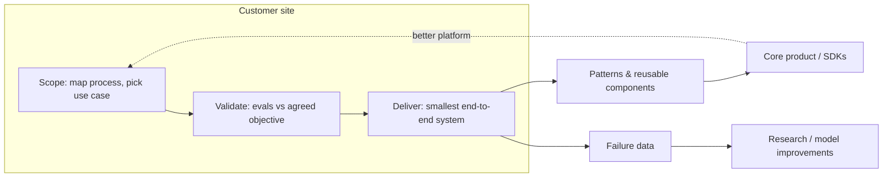

A **forward deployed engineer (FDE)** is a software engineer who embeds with a specific customer, writes and debugs production code on that customer's systems to make the vendor's platform solve a real problem, and carries what they learn back into the core product. The role was created at Palantir in the early 2010s under the internal name "Delta"; Palantir contrasts a Dev, who builds one capability for many customers, with a Delta, who serves one customer with many capabilities ([Pragmatic Engineer](../sources/pragmatic-engineer-forward-deployed-engineers.md)). Since 2025 the model has been adopted by frontier labs (OpenAI, Anthropic) and many AI application startups, because getting LLM systems from demo to production inside large enterprises needs engineering on site ([a16z](../sources/a16z-services-led-growth.md)).

## What an FDE does

Across sources the job has four parts:

1. **Scope the problem with the customer.** Map the process on site, find the highest-value use case, and agree what success means. See [AI use-case discovery](ai-use-case-discovery.md).
2. **Build on the customer's infrastructure.** At OpenAI, solutions architects mostly advise and build proofs of concept on anonymised or offline data, while FDEs write code inside the customer environment and absorb more ambiguity ([Pragmatic Engineer](../sources/pragmatic-engineer-forward-deployed-engineers.md)).
3. **Take it to production.** Evals, [guardrails](agent-guardrails.md), integration, rollout. See [POC to production](poc-to-production.md).
4. **Feed the product and research.** Turn field work into reusable patterns, product features and model improvements.

Concrete examples of what LLM-lab FDEs ship:

- **Anthropic** (Applied AI FDE posting, 2025-26): production Claude applications inside customer systems, with named deliverables of [MCP](model-context-protocol.md) servers, [sub-agents](subagents.md) and [agent skills](agent-skills.md). FDEs also document repeatable deployment patterns for Product and Engineering. The posting asks for production LLM experience ([prompting](prompt-engineering.md), agents, evaluation frameworks, scaled deployment), strong Python, about 25% travel and a $200k-$300k base. Pay and travel differ across Anthropic's FDE postings: other locations and a federal-civilian variant listed higher ranges, and the federal variant 25-50% travel ([Anthropic posting](../sources/anthropic-fde-applied-ai-job-posting.md)).
- **OpenAI**: the FDE team was proposed in early 2025 and grew from 2 to more than 10 engineers. Engagements run in three phases: scoping (a few days onsite mapping processes and prototyping, often with [synthetic data](synthetic-data-generation.md)), validation (build evals and confirm the scope is the most valuable one), and delivery (the smallest end-to-end solution, demoed onsite). Field data from a call-centre [voice](voice-agents.md) project went back to research and improved the Realtime API for all customers. OpenAI's solutions architecture team created the Swarm framework, since replaced by the [OpenAI Agents SDK](openai-agents-sdk.md), to which the SA and FDE teams now contribute ([Pragmatic Engineer](../sources/pragmatic-engineer-forward-deployed-engineers.md)). OpenAI describes itself as organised into Research, Applied and Deployment teams, and uses iterative deployment to feed customer learning back into products ([OpenAI, AI in the Enterprise](../sources/openai-ai-in-the-enterprise.md)).

*Synthesis: the diagram combines OpenAI's three-phase engagement and the feedback loops described in the Pragmatic Engineer and Anthropic sources.*

## How it differs from adjacent roles

| Role | Primary output | Writes production code on customer systems? | Time horizon | Success metric |
|---|---|---|---|---|
| **FDE** | Working production system plus product feedback | Yes | Months; stays with the account | Customer outcome and product leverage |
| Solutions architect / engineer | Architecture advice, POCs, demos | Rarely; often anonymised or offline data | Weeks per deal | Technical win, adoption |
| Sales engineer | Demo and deal support | No | Pre-sales | Quota / closed revenue |
| Implementation / customer success | Configuration and onboarding | Configuration, not product code | Post-sales | Time to go-live, retention |
| Consultant | Recommendations, sometimes a custom build | Sometimes; not tied to a product | One-off | Billable delivery |

Sources: [Pragmatic Engineer](../sources/pragmatic-engineer-forward-deployed-engineers.md), [First Round](../sources/first-round-hiring-forward-deployed-engineers.md). First Round stresses that an FDE is not an implementation role: Palantir's model relied on FDEs doing decentralised product development, building increments from concrete customer use cases. Quota-style metrics are a sign that the job is really sales.

## Skills

- **Engineering depth.** Palantir ran FDE candidates through the same interview loops as software engineers, plus open-ended problems drawn from real customer situations ([First Round](../sources/first-round-hiring-forward-deployed-engineers.md)). For LLM work this means [agent design](agent-design-patterns.md), [tool](tools.md) and [MCP](mcp-in-practice.md) integration, [RAG](retrieval-augmented-generation.md), [evals](llm-evaluation.md) and [observability](llm-observability.md).
- **Comfort with ambiguity and unusual environments.** Palantir FDEs work on air-gapped networks, and others work on factory floors and aircraft assembly lines ([Pragmatic Engineer](../sources/pragmatic-engineer-forward-deployed-engineers.md); [First Round](../sources/first-round-hiring-forward-deployed-engineers.md)).
- **Business curiosity and communication.** First Round lists curiosity about the customer's business as a hiring trait, and Anthropic's posting asks for communication with technical and non-technical stakeholders ([First Round](../sources/first-round-hiring-forward-deployed-engineers.md); [Anthropic posting](../sources/anthropic-fde-applied-ai-job-posting.md)).
- **Product sense and saying no.** Knowing which customer request generalises and which is bespoke debt. The best hires are independent, outcome-oriented, gritty and constant builders ([First Round](../sources/first-round-hiring-forward-deployed-engineers.md)).

## When the FDE model fits, and when it doesn't

First Round's diagnostic is an upmarket enterprise focus, a product vision open to being shaped by customers, and heterogeneous customers with hard problems. Product-led or freemium motions fit poorly. Looker only funded FDE-style pre-sales once per-customer economics worked, at about $25k per customer per year ([First Round](../sources/first-round-hiring-forward-deployed-engineers.md)). Andrusko's gate scores problem criticality, customer concentration, domain fragmentation and regulatory/data complexity. Low scores point to product-led growth ([a16z, Palantirization](../sources/a16z-palantirization-of-everything.md)).

**Economics.** Services-heavy models lower gross margin early on. ServiceNow went public at 63.2% and Workday at 54.1%, against roughly 80% for typical SaaS, and both later reached the mid-to-high 70s. Schmidt argues young AI companies should optimise total gross profit and use deep integration as a moat ([a16z, services-led growth](../sources/a16z-services-led-growth.md)).

## Failure modes

- **The services trap.** Copying only Palantir's embedded layer, without its platform, produces many unmaintainable bespoke deployments. Andrusko warns such companies risk becoming an "Accenture for X" with a nicer front end ([a16z, Palantirization](../sources/a16z-palantirization-of-everything.md)).
- **Endless custom work** with no software upside, and one-off features built without product sense ([First Round](../sources/first-round-hiring-forward-deployed-engineers.md)).
- **Mis-hiring.** Using the FDE title for what is really a sales, pre-sales or junior implementation job ([First Round](../sources/first-round-hiring-forward-deployed-engineers.md); [a16z](../sources/a16z-palantirization-of-everything.md)).
- **Blanket deployment.** Sending FDEs to every account instead of reserving them for high-value ones, as Ironclad (legal engineers for high-ACV customers only) and Serval (now customers with 1,000+ employees) do ([First Round](../sources/first-round-hiring-forward-deployed-engineers.md)).
- **No exit plan.** The remedy is to treat forward deployment as scaffolding: time-box deployments (his example is a 90-day sprint to production), cap engineering headcount relative to each account's ARR, turn custom code into templates each quarter, prefer configuration over code, and place FDEs inside the product org ([a16z, Palantirization](../sources/a16z-palantirization-of-everything.md)).

## Practical guidance

Synthesis: for an engineer moving into an LLM FDE role, the sources point to these habits:

- Start every engagement by writing down the success metric and building a small eval set before writing agent code. OpenAI's validation phase and Morgan Stanley's eval-first rollout both do this ([Pragmatic Engineer](../sources/pragmatic-engineer-forward-deployed-engineers.md); [OpenAI](../sources/openai-ai-in-the-enterprise.md)). See [verification and evals](verification-and-evals.md).
- Build the smallest end-to-end slice on real customer data and real systems. A polished demo on toy data is a solutions-architect artefact, not an FDE one.
- Keep a running "field notes" log of each generalisable pattern (an MCP connector, an eval harness, a guardrail) and push it upstream. That leverage is what separates an FDE from a consultant.
- Before saying yes to a request, ask whether a second customer would want it.

## Sources

- [Forward Deployed Engineers (The Pragmatic Engineer)](../sources/pragmatic-engineer-forward-deployed-engineers.md)
- [So You Want to Hire a Forward Deployed Engineer (First Round Review)](../sources/first-round-hiring-forward-deployed-engineers.md)
- [The Palantirization of Everything (a16z)](../sources/a16z-palantirization-of-everything.md)
- [Trading Margin for Moat / Services-Led Growth (a16z)](../sources/a16z-services-led-growth.md)
- [Forward Deployed Engineer, Applied AI (Anthropic job posting)](../sources/anthropic-fde-applied-ai-job-posting.md)
- [AI in the Enterprise (OpenAI)](../sources/openai-ai-in-the-enterprise.md)
