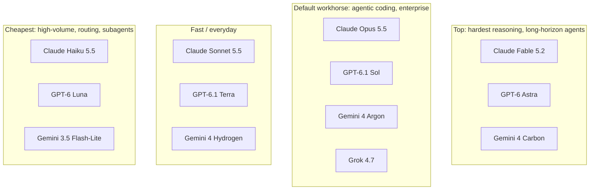

The **frontier model landscape** is the set of most capable proprietary LLMs you reach only through a vendor API or a cloud marketplace: Anthropic's Claude, OpenAI's GPT, Google's Gemini and xAI's Grok. Each vendor ships a **tiered family**: a top reasoning model, a balanced workhorse, and one or two cheap, fast models. All of them share one API shape: token-metered pricing, a large [context window](context-window.md), [tool use](function-calling.md), and an adjustable amount of [reasoning](reasoning-models.md). This page is a dated snapshot (read **2026-11-14**). Names and prices change every few months, so check the vendor pages linked under Sources before you quote a number to a customer. For self-hostable alternatives, see [open-weight models](open-weight-models.md). For how to pick a model, see [model selection](model-selection.md).

## The tier structure

Synthesis: every vendor now sells the same three-to-four-rung ladder, and the tier names map across vendors roughly as follows.

Synthesis: this mapping is approximate. It is based on each vendor's own positioning text and list price, not on head-to-head evals.

## Snapshot table (list prices, USD per 1M tokens, read 2026-11-14)

| Vendor | Model (API ID) | Context | Max output | Input / Output | Positioning |
|---|---|---|---|---|---|
| Anthropic | Claude Fable 5.2 (`claude-fable-5-2`) | 1M | 128K | $8 / $40 | Demanding reasoning, long-horizon agentic work |
| Anthropic | Claude Opus 5.5 (`claude-opus-5-5`) | 1M | 128K | $4 / $20 | Recommended default; long-running agentic coding and knowledge work |
| Anthropic | Claude Sonnet 5.5 (`claude-sonnet-5-5`) | 1M | 128K | $2 / $10 | Speed and intelligence balance |
| Anthropic | Claude Haiku 5.5 (`claude-haiku-5-5`) | 1M | 128K | $0.10 / $0.50 (≤100K prompt) | Classification, extraction, routing |
| OpenAI | GPT-6 Astra (`gpt-6-astra`) | 1.05M | 128K | $10 / $50 | Most capable |
| OpenAI | GPT-6.1 Sol (`gpt-6.1-sol`) | 1.05M | 128K | $2 / $10 | Near-Astra at lower cost |
| OpenAI | GPT-6.1 Terra (`gpt-6.1-terra`) | 1.05M | 128K | $1 / $5 | Visual reasoning, computer use, writing |
| OpenAI | GPT-6 Luna (`gpt-6-luna`) | 1.05M | 128K | $0.10 / $0.50 | High-volume, focused tasks |
| Google | Gemini 4 Carbon (`gemini-4-carbon`) | 1M | 64K (1M long decode) | $2 / $10, rising to $4 / $20 on 2026-12-01 | Strongest reasoning, complex SWE |
| Google | Gemini 4 Argon (`gemini-4-argon`) | 1M | 64K (1M long decode) | same as Carbon | Efficient frontier reasoning |
| Google | Gemini 4 Hydrogen (`gemini-4-hydrogen`) | 1M | 64K (1M long decode) | $1.50 / $7.50 | Everyday coding and agents |
| Google | Gemini 3.5 Flash-Lite | n/a on page | n/a | $0.30 / $2.50 | Fastest, cheapest 3.5 |
| xAI | Grok 4.7 (`grok-4.7`) | 500K | n/a | $2 / $6 (<200K prompt; $4 / $12 at or above 200K) | Code and chat |
| xAI | Grok 4.3 / 4.20 | 1M | n/a | $1.25 / $2.50 (<200K) | Reasoning, non-reasoning, multi-agent variants |

For comparison, DeepSeek's hosted API (serving [open-weight](open-weight-models.md) checkpoints) charges $0.30 / $1.20 for `deepseek-flash` and $1.32 / $3.96 for `deepseek-v4-pro` at peak, with half price off-peak.

Knowledge cutoffs: June 2026 for all current Claude models; 2026-04-30 to 2026-06-01 for the GPT-6 family; May 2026 for Grok 4.7. The Gemini 4 Carbon page does not state one.

## How the vendors differ

**Reasoning control.** All four expose a dial that trades thinking tokens for quality (see [test-time compute](test-time-compute.md) and [extended thinking](extended-thinking.md)):

- **Claude:** adaptive thinking plus an `effort` parameter (`low` to `max`). On Fable 5.2 and Opus 5.5, thinking is always on and cannot be disabled. Default effort is `medium` on Opus 5.5 and Haiku 5.5, and `high` on Fable 5.2 and Sonnet 5.5.
- **OpenAI:** reasoning effort from `low` to `max` on Astra and Sol. Terra and Luna also accept `none`. The o-series (o3, o3-pro) now appears only as legacy entries on the pricing page.
- **Gemini 4 Carbon:** thinking levels `low`, `medium` and `high`.
- **xAI:** separate reasoning and non-reasoning model IDs (grok-4.20).

**Pricing mechanics that change the real bill:**

| Lever | Anthropic | OpenAI | Google | xAI |
|---|---|---|---|---|
| Cached input | 0.1x base by default; 0.05x on Opus/Sonnet 5.5; 0.025x on Fable. Cache writes cost 1.25x (5 min) or 2x (1 h) | 0.1x on Astra and Luna; 0.05x on Sol and Terra | 0.05x on Gemini 4; 0.1x on Flash, Flash-Lite and 3.1 Pro; plus storage per hour on some models | 0.15x to 0.25x (e.g. $0.50 on Grok 4.7) |
| Batch | 50% off | Batch/Flex 50% off | Batch/Flex 50% off | n/a on page |
| Premium speed | Fast mode, up to 2.5x output speed (Opus 5.5 at $8/$40, Fable 5.2 at $16/$80) | Fast mode (renamed from Priority on 2026-07-30), 2x | Priority about 1.8x | n/a |
| Long-context step | None on 4.6+ (except Haiku 5.5 above 100K) | Above 272K input (e.g. Astra $20/$75) | 3.1 Pro above 200K | ≥200K prompt doubles the rate for *all* tokens |
| [Data residency](data-retention-and-residency.md) | `inference_geo: "us"` costs 1.1x | Regional endpoints +10% (models released on or after 2026-03-05) | n/a | n/a |

See [prompt caching](prompt-caching.md), [batch processing](batch-processing.md) and [cost and latency optimization](cost-and-latency-optimization.md).

Synthesis: list price per token is a poor proxy for cost. Cache-read discounts range from 4x (Grok 4.7) to 40x (Fable 5.2), and long-context steps can double a bill. Reasoning models also spend tokens on thinking (Google states that output prices include thinking tokens), so measure cost per completed task instead (see [model selection](model-selection.md)).

**Distribution.** Claude is served on [Anthropic's API](anthropic-messages-api.md), Amazon Bedrock, Google Cloud (Google-managed and Anthropic-managed), Microsoft Foundry and Claude Platform on AWS, with platform-specific IDs (e.g. `anthropic.claude-opus-5-5` on Bedrock). Partner clouds set their own prices and retirement dates. [Gemini](gemini-api.md) is on AI Studio and Vertex; see [Amazon Bedrock](amazon-bedrock.md), [Google Vertex AI](google-vertex-ai.md) and [Azure AI Foundry](azure-ai-foundry.md).

**Modalities.** All current Claude models take text and image input and return text. Gemini 4 adds audio, video and PDF input, and has separate Live, TTS, image and video models. GPT-6.1 Terra is positioned for visual reasoning and [computer use](computer-use-agents.md). See [multimodal models](multimodal-models.md).

**Access restrictions.** Claude Mythos 5.2 has Fable 5.2's capabilities but is open only to organisations verified through Anthropic programmes. Gemini 4 Carbon and Argon have no free tier, and free-tier data on other Gemini models may be used to improve Google products.

## Lifecycle and versioning

- **Pinned IDs:** every Claude model ID is a pinned snapshot, including the dateless IDs used from 4.6 on. xAI uses `<model>` (latest stable), `<model>-latest` and `<model>-<date>` (pinned). DeepSeek retires names and redirects them (e.g. `deepseek-v4-flash` is now served by V4.1-Flash-1017).
- **Retirement:** Anthropic commits to retirement dates no sooner than September to November 2027 for the current models. Google will route Gemini 2.5 Pro and 2.5 Flash requests to 3.8 Flash and 3.5 Flash-Lite from 2026-12-01.
- **Breaking changes between generations are common:** Opus 5.5, for example, breaks integrations that force tool use or turn thinking off. Always read the migration notes.
- **Scheduled price changes:** Gemini 4 Carbon/Argon prices double on 2026-12-01, and Flash prices double on 2027-01-01. Budget for these.

## Limitations and failure modes

- **Vendor benchmarks are not comparable.** Each vendor picks its own [harnesses](harness-engineering.md) and effort settings. Use [benchmarks](benchmarks.md) only as a shortlist filter, then run your own [evals](llm-evaluation.md).
- **A large context window does not guarantee recall.** A 1M-token window still suffers [long-context degradation](long-context-degradation.md).
- **The snapshot decays fast.** In 2026 each vendor shipped several generations. Synthesis: treat any model name in a design document as configuration, not architecture.

## When to use which (practical)

Synthesis, grounded in each vendor's own recommendation:

- **Default for agentic and coding work:** Claude Opus 5.5 (Anthropic's stated default), GPT-6.1 Sol, or Gemini 4 Argon. Pick by eval result and by ecosystem fit (which cloud the customer already uses, data residency requirements).
- **Hardest problems and multi-hour autonomy:** Fable 5.2, GPT-6 Astra or Gemini 4 Carbon. Only escalate here after an effort sweep on the default model shows a gap.
- **High-volume extraction, classification and routing:** Haiku 5.5, GPT-6 Luna or Gemini 3.5 Flash-Lite. All cost about $0.10 to $0.30 per million input tokens.
- **Native audio/video input or Google grounding:** Gemini.
- **Self-hosting, data sovereignty or [fine-tuning](fine-tuning.md) the weights:** use [open-weight models](open-weight-models.md) instead.

## Sources

- [Claude models overview](../sources/anthropic-models-overview.md)
- [Anthropic pricing](../sources/anthropic-pricing.md)
- [OpenAI models](../sources/openai-models-docs.md)
- [OpenAI pricing](../sources/openai-api-pricing.md)
- [Gemini models](../sources/google-gemini-models-docs.md)
- [Gemini API pricing](../sources/google-gemini-api-pricing.md)
- [xAI models and pricing](../sources/xai-grok-models-docs.md)
- [DeepSeek API pricing](../sources/deepseek-api-pricing.md)
- [Choosing a model (Anthropic)](../sources/anthropic-choosing-a-model.md)
