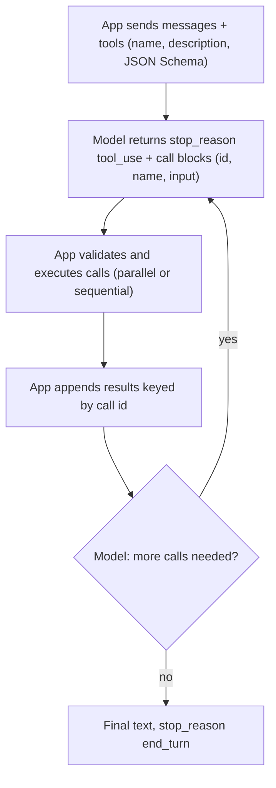

**Function calling** (Anthropic calls it *tool use*) is the vendor-API protocol that lets a model ask the application to run a function. The developer declares tools as a name, a natural-language description and a JSON Schema for the arguments. The model decides whether to call one and returns a structured call (name, arguments, call id) instead of, or alongside, text. The application executes it and sends the result back tagged with the same id, and the model continues. The model never executes anything itself. It only emits a request, and that is why function calling is the basic building block of the [agent loop](agent-loop.md) and of [tools](tools.md) in general ([Anthropic](../sources/anthropic-tool-use-docs.md), [OpenAI](../sources/openai-function-calling-guide.md), [Gemini](../sources/gemini-function-calling-docs.md)).

## The round trip

Under the hood, the tool definitions are rendered into the prompt. On Claude, the API builds a dedicated system prompt from them, which costs about 286 to 804 extra input tokens depending on model and `tool_choice` (286 on Opus 5.5 and Sonnet 5.5; 675, or 804 with a forced choice, on Opus 4.7), on top of the definitions themselves ([Anthropic](../sources/anthropic-tool-use-docs.md)). OpenAI likewise injects definitions into the context, where they count against the window and are billed as input ([OpenAI](../sources/openai-function-calling-guide.md)). Synthesis: every tool you declare is paid for on every turn, so tool definitions belong in the cached prefix (see [prompt caching](prompt-caching.md)).

## Vendor comparison (as of 2026-11)

| | Anthropic Messages API | OpenAI Responses API | Gemini API |
|---|---|---|---|
| Declaration | `tools: [{name, description, input_schema, input_examples?, strict?, defer_loading?}]` | `tools: [{type:"function", name, description, parameters, strict?}]` | function declarations (name, description, parameters) |
| Call object | `tool_use` content block with `id`, `name`, `input` (object) | `function_call` output item with `call_id`, `name`, `arguments` (JSON **string**) | function-call part with `id` |
| Result object | `tool_result` block with `tool_use_id`, optional `is_error` | `function_call_output` item with `call_id` | function result matched by `id` |
| Stop signal | `stop_reason: "tool_use"` | output contains `function_call` items | function-call parts in the candidate |
| Choice control | `tool_choice`: `auto`, `any`, `tool` (named), `none` | `tool_choice`: `auto`, `required`, named function, `allowed_tools`, `none` | mode `AUTO`, `ANY` (+ `allowed_function_names`), `NONE`, `VALIDATED` |
| Parallel off-switch | `disable_parallel_tool_use: true` inside `tool_choice` | `parallel_tool_calls: false` | not documented as a switch; calls are independent |
| Schema enforcement | `strict: true` per tool (grammar-constrained) | `strict: true` (Responses tries to normalise to strict by default) | `ANY` and `VALIDATED` enforce schema adherence |

Sources: [Anthropic](../sources/anthropic-tool-use-docs.md), [OpenAI](../sources/openai-function-calling-guide.md), [Gemini](../sources/gemini-function-calling-docs.md).

### Tool choice details that bite

- **Anthropic `any`/`tool` prefill the assistant turn.** The model emits no prose before the call, and thinking is skipped on every model that accepts forced calls. Forced choice is rejected (400) with manual extended thinking and on the newest models (Opus 5.5, Sonnet 5.5, Fable/Mythos 5.1+). On those, use `auto` plus `strict: true`, or [structured outputs](structured-outputs.md) for a fixed response shape ([Anthropic](../sources/anthropic-tool-use-docs.md)).
- **Changing `tool_choice` breaks the cache.** On Claude, it invalidates cached message blocks. On OpenAI, `allowed_tools` exists so you can restrict the callable subset without changing `tools`, which keeps the prefix cacheable ([Anthropic](../sources/anthropic-tool-use-docs.md), [OpenAI](../sources/openai-function-calling-guide.md)).
- **Gemini `VALIDATED`** is the default when function declarations are combined with built-in tools or structured output (`AUTO` stays the default when only function declarations are enabled). The model may answer in text or call a function, but calls are schema-checked, and Google documents it as producing fewer malformed calls than `AUTO` ([Gemini](../sources/gemini-function-calling-docs.md)).

## Parallel tool calls

All three vendors let one model turn contain several independent calls.

- **Anthropic:** parallel calls are on by default. The API doesn't prescribe execution order, so you can run calls concurrently or sequentially. You must return *one* `tool_result` per `tool_use`, all in a *single* user message, placed *before* any text. Sending results as separate user messages is the most common mistake, and it "teaches" the model to stop parallelising. If you skip a call (for example because an earlier dependent call failed), still return a result with `is_error: true`. With `auto`, `disable_parallel_tool_use: true` means at most one call; with `any`/`tool`, exactly one ([Anthropic](../sources/anthropic-tool-use-docs.md)).
- **OpenAI:** `parallel_tool_calls: false` limits the model to zero or one call. Built-in tools can't be part of a parallel batch. Reasoning items returned with tool calls must be passed back with the outputs ([OpenAI](../sources/openai-function-calling-guide.md)).
- **Gemini:** results can be returned in any order because the API matches them by `id`, so you can run functions asynchronously and append results as they complete. *Compositional* calling, where one call depends on another's output, happens over successive turns. Thinking models attach a `thought_signature` to call parts, and you must echo it back unmodified in its original part; Google states this is mandatory for function calling on Gemini 3, and the SDKs handle it automatically ([Gemini](../sources/gemini-function-calling-docs.md)).

Synthesis: parallelism is a latency optimisation the model proposes. The application decides whether it's safe. Run read-only calls concurrently and side-effecting or order-dependent ones sequentially.

## Schemas, strictness and argument quality

Without strict mode, arguments are *usually* valid but not guaranteed. A model may also invent values for missing required parameters: Claude Sonnet is documented as sometimes guessing a location rather than asking ([Anthropic](../sources/anthropic-tool-use-docs.md)). Strict mode compiles the schema into a grammar (see [structured outputs](structured-outputs.md)). On Claude, strict tools have hard limits: 20 strict tools, 24 optional parameters and 16 union-typed parameters per request ([Anthropic structured outputs](../sources/anthropic-structured-outputs-docs.md)). OpenAI strict mode requires `additionalProperties: false` and every field in `required`, with optionality expressed as `["type", "null"]` ([OpenAI](../sources/openai-function-calling-guide.md)).

OpenAI also offers **custom tools**: free-text input constrained by a Lark or regex grammar instead of JSON. They are useful for emitting code, SQL or a DSL where JSON escaping hurts ([OpenAI](../sources/openai-function-calling-guide.md)).

## Streaming tool calls

Arguments stream as partial JSON strings. Claude sends `input_json_delta` events (buffered per complete key/value unless `eager_input_streaming` is on for the tool). OpenAI sends `response.function_call_arguments.delta`/`.done`. Accumulate the fragments and parse when the block closes ([Anthropic streaming](../sources/anthropic-streaming-docs.md), [OpenAI](../sources/openai-function-calling-guide.md)). See [streaming](streaming.md).

## Scaling to many tools

OpenAI's soft guideline is to keep fewer than about 20 functions available at the start of a turn. For larger catalogues, mark tools `defer_loading: true` and let a `tool_search` tool load them on demand; OpenAI documents this for `gpt-5.4` and later only ([OpenAI](../sources/openai-function-calling-guide.md)). Claude has the equivalent `defer_loading` plus a tool search server tool, and Anthropic recommends namespacing names by service (`github_list_prs`) and consolidating related actions into one tool with an `action` parameter ([Anthropic](../sources/anthropic-tool-use-docs.md)). Overlapping tools cause wrong picks ([Anatomy of an agent](../sources/anatomy-of-a-modern-ai-agent.md)). [MCP](model-context-protocol.md) standardises how tool catalogues are exposed across vendors.

## Failure modes

- **Wrong or no tool chosen.** Usually a description problem. Anthropic's top recommendation is detailed descriptions of at least 3 to 4 sentences covering what the tool does, when to use it and what each parameter means ([Anthropic](../sources/anthropic-tool-use-docs.md)).
- **Hallucinated arguments** for required fields the user never supplied. Validate them server-side and let the tool return an error the model can act on.
- **Broken history.** Missing `tool_result` for a `tool_use`, mismatched ids, text before results, or (Gemini) dropped thought signatures. The API rejects some of these, and others silently degrade behaviour.
- **`stop_reason: "max_tokens"` mid-call**, which leaves arguments truncated. Check `stop_reason` before executing ([Messages API reference](../sources/anthropic-messages-api-reference.md)).
- **Reasoning-extraction refusals.** A parameter that asks the model for its step-by-step reasoning can trigger a refusal on Claude. Ask for a short explanation instead ([Anthropic](../sources/anthropic-tool-use-docs.md)).
- **Security.** Tool results are untrusted input that can carry [prompt injection](prompt-injection.md). Gate side-effecting tools with [guardrails](agent-guardrails.md).

## When to use / when not

- **Use** function calling when the model must *act* or *fetch* mid-conversation: retrieval, lookups, writes, multi-step agents.
- **Don't use** a fake tool just to get JSON out. Native [structured outputs](structured-outputs.md) are the right tool for shaping the final answer, and Gemini's and OpenAI's docs draw exactly this line ([Gemini](../sources/gemini-function-calling-docs.md), [OpenAI](../sources/openai-function-calling-guide.md)). Synthesis: the old "single forced tool as JSON mode" trick is also unavailable on the newest Claude models, which reject forced `tool_choice`.

## Sources

- [Anthropic Tool Use Docs](../sources/anthropic-tool-use-docs.md)
- [OpenAI Function Calling Guide](../sources/openai-function-calling-guide.md)
- [Gemini API Function Calling Docs](../sources/gemini-function-calling-docs.md)
- [Anthropic Structured Outputs Docs](../sources/anthropic-structured-outputs-docs.md)
- [Anthropic Streaming Messages Docs](../sources/anthropic-streaming-docs.md)
- [Anthropic Messages API reference](../sources/anthropic-messages-api-reference.md)
- [The Anatomy of a Modern AI Agent](../sources/anatomy-of-a-modern-ai-agent.md)
