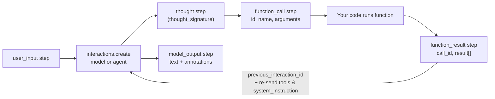

The **Gemini API** (`generativelanguage.googleapis.com`, keyed through Google AI Studio) is Google's developer API for Gemini models. As of November 2026 it has two generation surfaces. The **Interactions API** (`POST /v1beta/interactions`, GA since June 2026) is recommended for new projects, and new capabilities launch there first. The older **`generateContent`** API (`contents` made of `parts`, plus `generationConfig`) is legacy but fully supported ([Interactions docs](../sources/gemini-interactions-api-docs.md)). An interaction is a stored, chronological list of **steps** (thoughts, `function_call`, `function_result`, `model_output`) that can be chained server-side, run in the background, or target an *agent* (e.g. Deep Research) instead of a model. Enterprise deployments of the same models go through [Google Vertex AI](google-vertex-ai.md), which has its own quotas and governance.

## Interactions vs generateContent

| Aspect | Interactions API | generateContent (legacy) |
|---|---|---|
| Unit | `input` → `steps` (typed) | `contents[].parts[]` → `candidates` |
| State | stored by default; `previous_interaction_id` | stateless; you resend `contents` |
| Agents | `deep-research-*`, `antigravity-*` preview IDs | no |
| Background | `background=true` | no |
| Batch API | not yet | yes |
| Explicit caching | not yet (implicit via chaining) | yes (`cachedContents`) |
| Streaming | `step.start` / `step.delta` / `step.stop` events | `streamGenerateContent` |

Sources: [Interactions docs](../sources/gemini-interactions-api-docs.md), [streaming](../sources/gemini-streaming-interactions-docs.md), [context caching](../sources/gemini-context-caching-docs.md).

**State semantics.** `store` defaults to true. Paid-tier interactions are kept 55 days (configurable to 7, 14, 28 or 55) and free-tier ones 1 day. Only inputs and outputs carry across `previous_interaction_id`: `tools`, `system_instruction` and `generation_config` (including `thinking_level`) are scoped to one interaction and must be re-sent each turn. `store=false` disables both chaining and background mode ([Interactions docs](../sources/gemini-interactions-api-docs.md)). Synthesis: this is the same trap as OpenAI's `previous_response_id`, which also forgets `instructions`.

## Tools

**Custom functions** are `{type: "function", name, description, parameters}`. The model emits `function_call` steps (`id`, `name`, `arguments`); you return `function_result` steps with `call_id` and a `result` array of content blocks, which on Gemini 3+ can include images, documents, audio or video. `tool_choice` is `auto`, `any`, `none` or `validated`, and `allowed_tools` restricts the set ([Interactions function calling](../sources/gemini-function-calling-docs.md)). `VALIDATED` (the default when built-in tools or structured output are combined) enforces schema adherence and reduces malformed calls. Parallel results may come back in any order and are matched by ID ([function calling](../sources/gemini-function-calling-docs.md)). See [function calling](function-calling.md).

**Built-in tools:**

| Tool | Key facts |
|---|---|
| `google_search` | Interactions output has `google_search_call` and `google_search_result` (with `search_suggestions` HTML you must render) plus `url_citation` annotations. On Gemini 3+: 5,000 free queries/month, then $14 per 1,000 queries, with a default 1,500 RPD ([Search grounding](../sources/gemini-google-search-grounding-docs.md)) |
| Code execution | Python only, 30 s per run, fixed libraries, auto-retries up to 5 times; no tool fee, tokens billed ([code execution](../sources/gemini-code-execution-docs.md)) |
| `file_search` | Hosted RAG over persistent stores: chunking config, AIP-160 metadata filters, `file_citation` annotations. Storage and query embeddings are free and indexing is billed. Cannot be combined with Search grounding or URL context ([File Search](../sources/gemini-file-search-docs.md)) |
| URL context, Maps grounding, computer use | listed as supported on Gemini 4 Carbon ([models](../sources/google-gemini-models-docs.md)) |

Remote MCP is not yet supported on Gemini 3 in the Interactions API ([Interactions docs](../sources/gemini-interactions-api-docs.md)).

## Thinking

Thinking is on by default for current models. `thinking_level` takes `minimal` / `low` / `medium` / `high`, with `xhigh` only on Gemini 4 Hydrogen and `minimal` unsupported on Gemini 4. Defaults vary by model. Thought summaries are opt-in (`thinking_summaries: "auto"`). **Thought signatures** are encrypted reasoning state: the server manages them in stateful mode, but in stateless mode you must resend every thought step unmodified, including built-in tool signatures. Thinking is billed as output, and `max_output_tokens` includes it ([thinking docs](../sources/gemini-thinking-docs.md); see [extended thinking](extended-thinking.md)). In `generateContent`, signatures ride on function-call parts and must not be merged or moved ([function calling](../sources/gemini-function-calling-docs.md)).

Sampling: on Gemini 3.6 Flash and newer, `temperature`, `topP` and `topK` are silently ignored ([generateContent reference](../sources/gemini-generate-content-api.md)). Synthesis: Anthropic returns 400 for the same thing, so code that tunes temperature fails loudly on Claude and silently on Gemini.

## Caching, files, tokens

- **Implicit caching** is automatic on Gemini 2.5+ with no guaranteed savings. It needs a 4,096-token minimum on Gemini 3/4, and on Gemini 4 agent loops the new request must add at least 2,050 tokens for the whole previous request to be cached. **Explicit caching** (`cachedContents` with a TTL, default 1 hour, plus hourly storage fees) is generateContent-only and not available on Gemini 4 ([context caching](../sources/gemini-context-caching-docs.md); see [prompt caching](prompt-caching.md)). Cached input costs 0.05x of base on Gemini 4 ([pricing](../sources/google-gemini-api-pricing.md)).
- **Files API:** 2 GB per file and 20 GB per project. Files auto-delete after **48 hours**, and use is free. Upload when a request exceeds 100 MB (PDF limit 50 MB) ([Files API](../sources/gemini-files-api-docs.md)). Synthesis: the 48-hour expiry contrasts with Anthropic and OpenAI files, which persist until deleted. Durable corpora belong in File Search stores.
- **Tokens:** Gemini 4 shares one 1,048,576-token window across input, thinking and output (65,536 default output cap). Images cost 258 tokens per 768 px tile and audio 32 tokens per second ([tokens](../sources/gemini-token-docs.md)).
- **Structured output** strips some JSON Schema keywords silently (`minLength`, `maxLength`, `uniqueItems`...) and returns 400 for over-complex schemas ([structured outputs](../sources/gemini-structured-outputs-docs.md)).

## Limits, tiers, pricing

Limits apply **per project, not per key**: RPM, input TPM and RPD (reset at midnight Pacific), plus rolling 10-minute spend caps that return `429 RESOURCE_EXHAUSTED`. Tiers depend on cumulative spend *and* account age: Tier 2 needs $100 and 3 days, Tier 3 needs $1,000 and 30 days ([rate limits](../sources/gemini-api-rate-limits-docs.md); see [rate limits and retries](rate-limits-and-retries.md)). Batch and Flex are half price and Priority about 1.8x. Gemini 4 Carbon/Argon prices double on 2026-12-01, and free-tier data on some models may be used to improve Google products ([pricing](../sources/google-gemini-api-pricing.md); see [batch processing](batch-processing.md)). Model lineup: Gemini 4 Carbon / Argon / Hydrogen, with 2.5 Pro/Flash deprecated and rerouted from 2026-12-01 ([models](../sources/google-gemini-models-docs.md)).

## OpenAI-compatible endpoint

Base URL `.../v1beta/openai/`. It supports Chat Completions (tools, images, audio, structured output, `service_tier`), embeddings, images and batch. It does **not** support the Responses API or a standalone Files API. `reasoning_effort` maps to `thinking_level` (to `thinking_budget` on 2.5), and `none` turns thinking off only on 2.5 models other than 2.5 Pro; Gemini 2.5 Pro, 3 and 4 cannot disable it. Native features need `extra_body` (`thinking_config`, `cached_content`). The layer is beta, and unknown parameters are silently ignored ([OpenAI compat](../sources/gemini-openai-compatibility-docs.md)).

## Failure modes and gotchas

- Forgetting to re-send `tools`/`system_instruction` with `previous_interaction_id` silently changes behaviour ([Interactions docs](../sources/gemini-interactions-api-docs.md)).
- Editing, merging or dropping thought steps or signatures in stateless mode breaks multi-turn tool use ([thinking docs](../sources/gemini-thinking-docs.md), [function calling](../sources/gemini-function-calling-docs.md)).
- `max_output_tokens` hit mid-reasoning gives a billed, incomplete response ([thinking docs](../sources/gemini-thinking-docs.md)).
- Expecting explicit caching or Batch on Interactions, or explicit caching on Gemini 4 ([Interactions docs](../sources/gemini-interactions-api-docs.md), [context caching](../sources/gemini-context-caching-docs.md)).
- Errors mid-stream arrive as an `error` event (e.g. `gateway_timeout`) ([streaming](../sources/gemini-streaming-interactions-docs.md)).

## When to use / when not

Synthesis:
- **Use Interactions** for new work, agents, Deep Research, and long-running background jobs, but decide deliberately between server-side state (55-day retention by default on paid tier) and stateless replay.
- **Stay on generateContent** when you need the Batch API, explicit caching on Gemini 3.x, or Python automatic function calling.
- **Use Vertex AI** instead of AI Studio keys for enterprise IAM, VPC-SC, data residency and provisioned throughput.
- **Prefer Gemini** for very long multimodal inputs (video/audio) and Google Search grounding. Compare with the [OpenAI Responses API](openai-responses-api.md) and the [Anthropic Messages API](anthropic-messages-api.md); [Google ADK](google-adk.md) is the agent framework on top.

## Sources

- [Interactions API](../sources/gemini-interactions-api-docs.md)
- [Function calling in the Interactions API](../sources/gemini-function-calling-docs.md)
- [Function calling docs](../sources/gemini-function-calling-docs.md)
- [generateContent / GenerationConfig reference](../sources/gemini-generate-content-api.md)
- [Streaming interactions](../sources/gemini-streaming-interactions-docs.md)
- [Thinking docs](../sources/gemini-thinking-docs.md)
- [Context caching](../sources/gemini-context-caching-docs.md)
- [Files API](../sources/gemini-files-api-docs.md)
- [File Search](../sources/gemini-file-search-docs.md)
- [Grounding with Google Search](../sources/gemini-google-search-grounding-docs.md)
- [Code execution](../sources/gemini-code-execution-docs.md)
- [Structured outputs](../sources/gemini-structured-outputs-docs.md)
- [Token docs](../sources/gemini-token-docs.md)
- [Rate limits](../sources/gemini-api-rate-limits-docs.md)
- [Batch API](../sources/gemini-batch-api-docs.md)
- [OpenAI compatibility](../sources/gemini-openai-compatibility-docs.md)
- [Gemini models](../sources/google-gemini-models-docs.md)
- [Gemini API pricing](../sources/google-gemini-api-pricing.md)
