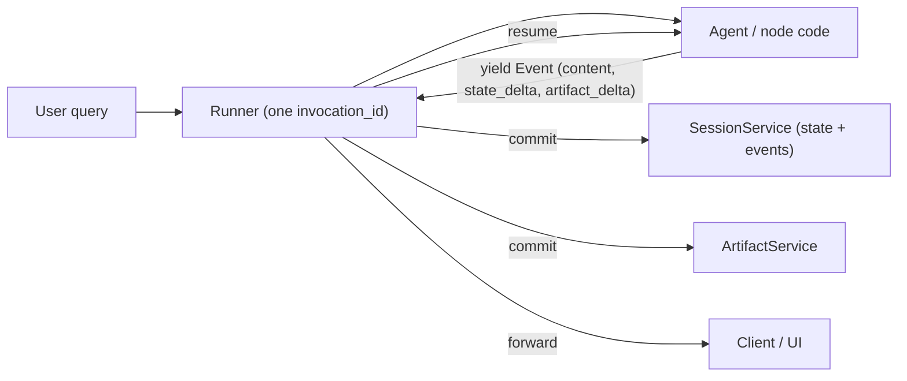

**Google ADK (Agent Development Kit)** is Google's open-source, code-first framework for building, evaluating and deploying agents. It has SDKs for Python (`google-adk`), TypeScript (`@google/adk`), Go, Java and Kotlin, and its docs now live at adk.dev ([ADK docs](../sources/google-adk-docs-overview.md)). It puts model-driven agents (`LlmAgent`) and deterministic orchestration in one framework, and it ships sessions, state, memory, artifacts, callbacks, a web dev UI (`adk web`), an [evaluation framework](agent-evaluation.md) and one-command deployment to Google Cloud (Agent Runtime, Cloud Run, GKE). [Gemini](gemini-api.md) is the default model, and adapters cover Claude, OpenAI, Ollama, vLLM and [LiteLLM](llm-gateways.md) ([ADK docs](../sources/google-adk-docs-overview.md)). The biggest recent change is **ADK 2.0**, which went GA for Python on 2026-05-19, Go on 2026-06-30 and TypeScript on 2026-08-21. It replaced the hierarchical agent executor with a graph-based **Workflow Runtime** in which agents, tools and functions are all nodes ([ADK 2.0](../sources/google-adk-2-0-release-notes.md)).

## Core primitives

| Primitive | Role |
|---|---|
| `Agent` / `LlmAgent` | Model, `instruction` (may template `{state_key}`), `tools`, `sub_agents`, `output_key`, input/output schemas |
| [Tools](tools.md) | Python functions (auto-schema), OpenAPI, [MCP](model-context-protocol.md), `AgentTool` (an agent called as a tool), built-ins |
| Workflow agents (1.x) | `SequentialAgent`, `ParallelAgent`, `LoopAgent`: deterministic orchestration with no LLM deciding the order |
| Graph / dynamic workflows (2.0) | Nodes and edges with code-based routing, or orchestration in plain async code |
| `Runner` | Drives one invocation, commits events through services |
| `SessionService`, `ArtifactService`, `MemoryService` | Conversation and state persistence, binary artifacts, [cross-session memory](agent-memory.md) |
| Callbacks / plugins | Before/after agent, model and tool hooks, used for [guardrails](agent-guardrails.md) and logging |

## The runtime: events, Runner and state commits

ADK's runtime is event-sourced. Agent, tool and callback code **yields `Event`s**. The `Runner` takes each event, applies its `state_delta` and `artifact_delta` through the `SessionService`, appends it to history, forwards it to the UI, and only then resumes the agent ([event loop](../sources/google-adk-event-loop-docs.md)).

Consequences you will hit:

- A state change is durable only **after its event is processed**. Reads before that are "dirty reads", and they are lost if the invocation fails ([event loop](../sources/google-adk-event-loop-docs.md)).
- Partial [streaming](streaming.md) events are displayed, but their actions are never committed ([event loop](../sources/google-adk-event-loop-docs.md)).
- `run_async` is the real entry point. Blocking synchronous I/O inside a tool stalls the loop ([event loop](../sources/google-adk-event-loop-docs.md)).

### Session state scopes

`session.state` is a serialisable key-value scratchpad, scoped by key prefix ([state](../sources/google-adk-session-state-docs.md)):

| Prefix | Scope | Persistence |
|---|---|---|
| *(none)* | This session | With a persistent SessionService |
| `user:` | All sessions of this user in the app | Database / Vertex AI services |
| `app:` | All users of the app | Database / Vertex AI services |
| `temp:` | This invocation only (shared with sub-agents) | Never |

Write state via `output_key` (an agent's final text lands in a key), `EventActions.state_delta`, or `context.state` inside tools and callbacks. **Never mutate `session.state` directly** on a fetched session: it bypasses the event log, may not persist, and risks races. `InMemorySessionService` is for development only and isn't thread-safe. `DatabaseSessionService` locks per session. `VertexAiSessionService` is managed ([state](../sources/google-adk-session-state-docs.md)).

## Orchestration: from workflow agents to graphs

**1.x style.** The 1.x way to orchestrate is to compose `LlmAgent`s under **workflow agents**. `SequentialAgent` runs sub-agents in order, `ParallelAgent` fans them out, and `LoopAgent` repeats them. None of them consults a model for ordering, so execution is predictable ([workflows](../sources/google-adk-workflows-docs.md), [Notebook](../sources/notebook-adk.md)). Data usually moves through state: one agent's `output_key` is read by the next agent's `{placeholder}`. `LoopAgent` stops at `max_iterations` (the Python default is `None`) or when a sub-agent sets `escalate`, typically through an exit tool. Without one of these it can loop forever, and prompt-based exit phrases are brittle ([workflows](../sources/google-adk-workflows-docs.md)). This maps directly onto the sequential, parallel, loop and coordinator patterns Google catalogues in its [design-pattern guide](../sources/google-cloud-choose-agentic-design-pattern.md). See [agent design patterns](agent-design-patterns.md).

**2.0 style.** Google's stated motivation is that model-led orchestration (routing, scheduling, error handling) is slow, costly and variable, and that prompting and guardrails "can only go so far" ([Why ADK 2.0](../sources/google-why-we-built-adk-2.md)). ADK 2.0 adds three styles ([workflows](../sources/google-adk-workflows-docs.md), [collaboration](../sources/google-adk-collaborative-workflows-docs.md)):

- **Graph workflows.** Nodes are LLM agents, function or tool nodes, or sub-workflows. Edges start at `START`. Conditional edges dispatch on a `route` value that a node emits, and fan-out and join nodes are supported. A node's output feeds the next node's input directly, without going through state.
- **Dynamic workflows.** Orchestration is written in ordinary Python or async code, with loops, retries and recursion, for flows too irregular for a static graph.
- **Collaborative workflows.** A coordinator has `sub_agents`, and each sub-agent gets an auto-generated delegation tool and a **mode**. `chat` (the default) lets the user talk freely, and control returns only on transfer. `task` may ask clarifying questions and returns on `finish_task`; it must be a leaf, and it is disabled inside graphs in Python v2.0.0. `single_turn` takes no user input and can run in parallel. Task and single-turn agents run in isolated session branches.

In Google's illustrative refund benchmark (a Gemini Flash model with mock APIs, not a production measurement), routing with a workflow instead of a free agent cut tokens from 5,152 to 2,265 and latency from 7.2 s to 5.7 s. The post also argues that a graph narrows [prompt-injection](prompt-injection.md) impact because no edge exists for unauthorised actions ([Why ADK 2.0](../sources/google-why-we-built-adk-2.md)). Synthesis: this is the same "deterministic skeleton, LLM at the leaves" move that [LangGraph](langgraph.md) and Microsoft's [Agent Framework](autogen.md) workflows make.

> **Contradiction:** The ADK 2.0 release page says only the TypeScript `SequentialAgent`/`ParallelAgent`/`LoopAgent` emit deprecation warnings ([ADK 2.0](../sources/google-adk-2-0-release-notes.md)). The template-workflow docs mark them deprecated in Python, TypeScript, Go and Kotlin ([workflows](../sources/google-adk-workflows-docs.md)). Treat them as legacy for new code either way.

## A2A: agents across process boundaries

ADK can expose an agent as an [Agent2Agent](agent2agent-protocol.md) server and consume remote agents through `RemoteA2aAgent`, a client proxy that handles networking, auth and formatting ([A2A](../sources/google-adk-a2a-docs.md)). Use A2A when the other agent is a separate service, owned by another team, written in another language or framework, or needs a formal contract. Use local [sub-agents](subagents.md) for internal structure, latency-sensitive paths and shared state, because A2A adds network and serialisation overhead. Python support is full. Go, Java and Kotlin A2A support is experimental ([A2A](../sources/google-adk-a2a-docs.md)).

## Limitations and failure modes

- **Churn.** ADK is young, and 2.0 broke custom agents (`BaseAgent` now subclasses `BaseNode`, so `_run_async_impl` overrides are bypassed). The event schema also changed, which breaks rigid session stores, and Google advises updating every reader application before writing 2.0 sessions to a shared database ([ADK 2.0](../sources/google-adk-2-0-release-notes.md), [Notebook](../sources/notebook-adk.md)).
- **Exception handling.** Broad `except Exception` blocks hide failures from 2.0's automatic retries, and catching `BaseException` breaks [human-in-the-loop](human-in-the-loop.md) pauses ([ADK 2.0](../sources/google-adk-2-0-release-notes.md)).
- **Google-centric happy path.** It is model-agnostic in principle, but the smoothest path is Gemini plus Google Cloud. Its community is also smaller than [LangChain](langchain.md)'s ([Notebook](../sources/notebook-adk.md)).
- **State pitfalls.** Dirty reads, `{key}` templating that errors on missing keys (use `{key?}`), and literal braces in instructions that collide with templating ([state](../sources/google-adk-session-state-docs.md)).
- **Runaway loops.** A `LoopAgent` without `max_iterations` relies on the model remembering to escalate ([workflows](../sources/google-adk-workflows-docs.md)).

## When to use it, and when not

Use it on Google Cloud / Gemini, when you want deterministic multi-agent workflows *and* LLM agents in one framework, when you need multi-language SDKs (Go and Java are rare elsewhere), or when you need native A2A and built-in evaluation. For new designs, start from 2.0 graph or dynamic workflows and put LLM agents at the nodes that genuinely need judgement.

Look elsewhere if you need maximum low-level control over state and checkpointing in Python or JS ([LangGraph](langgraph.md)), a minimal OpenAI-centric loop ([OpenAI Agents SDK](openai-agents-sdk.md)), a full computer-use agent ([Claude Agent SDK](claude-agent-sdk.md)), or API stability over features. Google's own pattern guide adds that predictable single-call tasks often need no agent at all ([design patterns](../sources/google-cloud-choose-agentic-design-pattern.md)). See also [Google Vertex AI](google-vertex-ai.md).

## Sources

- [ADK documentation home](../sources/google-adk-docs-overview.md)
- [Welcome to ADK 2.0](../sources/google-adk-2-0-release-notes.md)
- [Why we built ADK 2.0](../sources/google-why-we-built-adk-2.md)
- [ADK workflows, graph workflows and LoopAgent](../sources/google-adk-workflows-docs.md)
- [Collaborative workflows](../sources/google-adk-collaborative-workflows-docs.md)
- [Session state](../sources/google-adk-session-state-docs.md)
- [Event loop](../sources/google-adk-event-loop-docs.md)
- [A2A in ADK](../sources/google-adk-a2a-docs.md)
- [Agent Development Kits (Notebook)](../sources/notebook-adk.md)
- [Choose a design pattern for your agentic AI system](../sources/google-cloud-choose-agentic-design-pattern.md)
