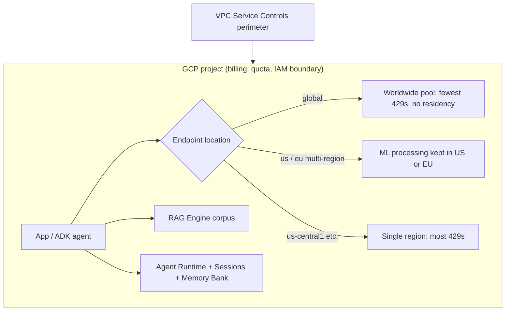

**Google Vertex AI** is Google Cloud's managed ML and generative-AI platform. It serves Gemini and partner models (Claude, Grok, DeepSeek and others) through Model Garden ([release notes](../sources/gemini-enterprise-agent-platform-release-notes.md)). It adds tuning, managed RAG and agent hosting, all governed by GCP projects, IAM and VPC Service Controls ([notebook](../sources/notebook-gcp-services.md)). **Naming warning:** on **April 22, 2026** Google folded Vertex AI into **Gemini Enterprise Agent Platform** ("Agent Platform"). Agent Engine became **Agent Runtime**, Vertex AI RAG Engine became **RAG Engine**, Vertex AI Studio became **Agent Studio**, Vertex AI Search became **Agent Search**, and Vector Search 2.0 became **Agent Retrieval**. API hostnames (`aiplatform.googleapis.com`) and SDKs carry the old name ([release notes](../sources/gemini-enterprise-agent-platform-release-notes.md)). This page keeps "Vertex AI" because customers and code still use it.

## Models

- **First-party Gemini.** In late 2026 the GA set includes the Gemini 2.5, 3.x Flash and Gemini 4 families. Gemini 4 Argon went GA on October 13, Carbon on November 10 and Hydrogen on November 12, 2026. Hydrogen is a *short-term release* with only a 45-day minimum retirement notice ([release notes](../sources/gemini-enterprise-agent-platform-release-notes.md)).
- **Partner models.** H2 2026 additions include Claude Opus 5.5 (September 22), Sonnet 5.5 (September 28) and Haiku 5.5 (October 7), plus Grok 4.6/4.7 and DeepSeek-V4.1-Flash (preview) ([release notes](../sources/gemini-enterprise-agent-platform-release-notes.md)).
- **Lifecycle.** Expect frequent retirements:
  - Gemini 2.0 Flash and 2.0 Flash-Lite were discontinued June 1, 2026, including their Provisioned Throughput.
  - A batch of managed open-model (`-maas`) endpoints was deprecated July 21 and retired October 21, 2026. It covered DeepSeek, GLM, GPT-OSS, Kimi, Llama, MiniMax, Qwen and multilingual E5.

  Pin versions and track the notes ([release notes](../sources/gemini-enterprise-agent-platform-release-notes.md)).
- **Model Garden** catalogues foundation, fine-tunable and task-specific models. Open models self-deploy to your own endpoints on vLLM (GPU), Hex-LLM (TPU), xDiT or Hugging Face DLCs, billed for compute. Org policies can allowlist vetted models. Models that can execute remote code can still be deployed, so review them ([Model Garden](../sources/vertex-ai-model-garden.md); see [LLM inference serving](llm-inference-serving.md)).
- **Tuning** for Gemini: SFT, preference tuning and RL fine-tuning, with continuous tuning from checkpoints ([tuning](../sources/vertex-ai-gemini-tuning.md); [fine-tuning](fine-tuning.md)).

## Endpoints and data residency

| Endpoint | Routing | Residency | Notes |
|---|---|---|---|
| `global` | Worldwide pool | None; processing location unknowable | Lowest 429 rate. No tuning, no RAG corpora, no Anthropic/open-MaaS batch, PT only for listed models |
| `us` / `eu` multi-region | Within jurisdiction | ML processing kept in US or EU | Use Private Service Connect, not Private Google Access |
| Regional (`europe-west4`…) | One region | Endpoint alone is *not* a residency guarantee | Highest 429 rate |

*Source: [locations](../sources/vertex-ai-locations-endpoints.md), read 2026-11-14.*

Data handling beyond the endpoint ([data governance](../sources/vertex-ai-data-governance.md)):

- **No training use.** Customer data isn't used for training without permission.
- **Implicit caching is on by default.** It lives in memory and on a durable store, is project-scoped, and is deleted within 24 h. The durable tier has no CMEK and can be disabled per project.
- **Zero data retention (ZDR)** requires all of the following:
  - request-response logging off;
  - Live API session resumption off;
  - Interactions API `store=false`;
  - no Google Search grounding, which keeps logs 3 days (use Web Grounding for Enterprise instead).
  - no Google Maps grounding, which stores prompts, context and output for 30 days.

  Partner OpenAI models log for 30 days unless ZDR is approved per project.

## Consumption options, quotas and Provisioned Throughput

| Option | Price vs Standard | Behaviour |
|---|---|---|
| Standard PayGo | 1× | Shared pool; org-level prioritized TPM by usage tier; 429 on contention |
| Priority PayGo (GA May 2026) | Premium | Priority processing, ramp limit |
| Flex PayGo | ~50% off | Slower, more throttling |
| Batch | ~50% off | Asynchronous ([batch processing](batch-processing.md)) |
| Provisioned Throughput | Fixed term: 1 wk / 1 mo / 3 mo / 1 yr (1 yr ~26% cheaper than 1 mo) | Dedicated, served ahead of PayGo; tokens-per-second latency SLA since May 19, 2026 |

*Sources: [consumption options](../sources/vertex-ai-consumption-options.md), [release notes](../sources/gemini-enterprise-agent-platform-release-notes.md).*

**Standard PayGo usage tiers** replaced the older "dynamic shared quota" framing ([usage tiers](../sources/vertex-ai-standard-paygo-usage-tiers.md)):

- **No hard per-project quota.** Your 30-day spend sets an organization-level *prioritized* TPM per model:
  - Pro-class models: 0.5M → 10M TPM across tiers 1–4.
  - Flash-class models: 2M → 50M TPM.
- **Above the threshold, traffic may still succeed**, but it is throttled first.
- **A 429 means contention**, not an exhausted quota.
- **Remedies:** exponential backoff, smoothing spikes *within* each minute, and using `global`.

**Provisioned Throughput** is bought in **GSUs** ([PT](../sources/vertex-ai-provisioned-throughput.md)):

- **Burndown rates** convert traffic into input-token-equivalents per second. For Gemini 3.6 Flash: 675 tok/s per GSU, input 1×, cached input 0.1×, output 5×, minimum purchase 1 GSU.
- **Sizing formula** (Gemini 3.6 Flash, no caching): GSUs = ⌈(input + 5 × output tokens per query) × QPS / 675⌉. Google's worked example is 10 QPS × (1,500 input + 300 output) = 30,000 tok/s, which gives 45 GSUs. Other models have different rates.
- **Unused capacity** does not roll over.

Recommended pattern: cover the steady baseline with PT, spill over to Standard or Priority PayGo, and route backlogs to Batch or Flex ([consumption options](../sources/vertex-ai-consumption-options.md)). Synthesis: because [prompt caching](prompt-caching.md) cuts PT burndown to 0.1×, a stable cached prefix directly lowers how many GSUs you need.

## RAG Engine

RAG Engine is a managed [RAG](retrieval-augmented-generation.md) pipeline: ingest (local files, Cloud Storage, Drive) → chunk → embed → index into a **RAG corpus** → retrieve → ground generation ([RAG Engine](../sources/vertex-ai-rag-engine.md)).

- **[Chunking](chunking.md) defaults:** `chunk_size` 1,024 tokens, `chunk_overlap` 256.
- **Parsing:** layout-aware parsing via the Document AI layout parser.
- **Storage:** a RAG-managed Spanner instance can be the [vector store](vector-databases.md), and it is billed to you.
- **Constraints:**
  - Supports VPC-SC and CMEK, but **not data residency or Access Transparency controls**.
  - RAG corpora are not available on `global`.
  - `us-central1`, `us-east1`, `us-east4` and `europe-west1` require allowlisting; new projects should try other regions.

Synthesis: for strict-residency customers, RAG Engine may be disqualified. A self-built pipeline on a regional vector database is then the alternative.

## Agent Runtime (formerly Agent Engine)

Agent Runtime is a managed, serverless host for agents built with [ADK](google-adk.md), [LangGraph](langgraph.md), LangChain, LlamaIndex, AG2 or custom code, with [A2A](agent2agent-protocol.md) support ([Agent Runtime](../sources/gemini-enterprise-agent-platform-agent-runtime.md)). Companion services:

- **Sessions** for conversation state.
- **Memory Bank** for long-term [agent memory](agent-memory.md).
- **Code Execution** sandbox.
- **Example Store**, evaluation, feedback, and Cloud Trace / Logging observability.

Security:

- VPC-SC covers Runtime, Sessions, Memory Bank and Code Execution.
- A Private Service Connect interface connects agents to your VPC.
- CMEK for deployed agents works **only on single-region endpoints**.

Governance layer added in 2026 ([release notes](../sources/gemini-enterprise-agent-platform-release-notes.md)):

- **Agent Gateway**, **Agent Registry** and **Agent Observability** (GA June 2026).
- **Agent Identity API** (preview).
- **Model Armor** on Agent Gateway.
- **Semantic governance policies** (preview), which screen agent actions against intent.

Compare [agent guardrails](agent-guardrails.md).

## Networking: VPC Service Controls

A VPC-SC perimeter blocks exfiltration of training data, models and inference traffic, and denies callers outside it unless an access level allows them ([VPC-SC](../sources/vertex-ai-vpc-service-controls.md)). Failure modes to plan for:

- **No internet egress.** Agent Runtime loses default egress; outbound tool calls need a proxy VM with Cloud NAT.
- **Disabled features.** URL-context fetching and request/response logging stop working.
- **Model Garden endpoints** must be private.
- **Creation order matters.** Endpoints and agents created *before* the project joined the perimeter are unprotected or break.
- **Private paths don't close public ones.** Private Service Connect and Private Google Access give private routes, but only VPC-SC removes public access.

## When to use / when not

Synthesis, drawn from the sources above:

- **Use Vertex / Agent Platform** when the customer is on GCP (BigQuery, GKE, Workspace), when Gemini's long context or multimodality fits the task, or when they want Gemini and Claude under one GCP bill and IAM model.
- **Use `global` plus Standard PayGo** for prototypes and most traffic where processing location doesn't matter. **Switch to `us`/`eu` endpoints** the moment a DPA or regulator specifies a processing location, and re-check which features (RAG corpora, tuning, PT models) remain available there.
- **Buy PT** only for a measured steady baseline with latency SLOs. Don't size PT for peaks.
- **Avoid** RAG Engine where residency controls are mandatory, and avoid Google Search grounding where zero retention is contractual.
- Compare [Amazon Bedrock](amazon-bedrock.md) and [Azure AI Foundry](azure-ai-foundry.md); see also [enterprise LLM deployment](enterprise-llm-deployment.md) and [AI governance and compliance](ai-governance-and-compliance.md).

## Sources

- [Gemini Enterprise Agent Platform release notes (2026)](../sources/gemini-enterprise-agent-platform-release-notes.md)
- [Generative AI locations and endpoints](../sources/vertex-ai-locations-endpoints.md)
- [Consumption options](../sources/vertex-ai-consumption-options.md)
- [Standard PayGo and usage tiers](../sources/vertex-ai-standard-paygo-usage-tiers.md)
- [Provisioned Throughput and GSU sizing](../sources/vertex-ai-provisioned-throughput.md)
- [Model Garden](../sources/vertex-ai-model-garden.md)
- [RAG Engine](../sources/vertex-ai-rag-engine.md)
- [Agent Runtime overview](../sources/gemini-enterprise-agent-platform-agent-runtime.md)
- [Data governance](../sources/vertex-ai-data-governance.md)
- [VPC Service Controls](../sources/vertex-ai-vpc-service-controls.md)
- [Tune Gemini models](../sources/vertex-ai-gemini-tuning.md)
- [GCP Services & IaC (Notebook)](../sources/notebook-gcp-services.md)
