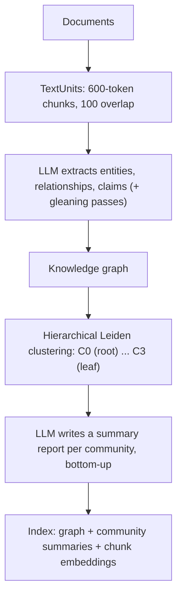

**GraphRAG** is a family of [RAG](retrieval-augmented-generation.md) methods that index a corpus as a graph of entities and relationships instead of (or as well as) a flat list of chunks. In Microsoft's formulation, an LLM extracts the graph, the graph is clustered into a hierarchy of communities, and each community is summarized ahead of time. Queries can then walk relationships (multi-hop) or map-reduce over community summaries to answer *global* questions such as "what are the main themes in this dataset?", which plain top-k retrieval cannot assemble because no single chunk holds the answer ([Edge et al.](../sources/edge-2024-graphrag.md), [Notebook](../sources/notebook-rag-cag.md)).

## Indexing pipeline

Sources: [Edge et al.](../sources/edge-2024-graphrag.md), [Microsoft docs](../sources/microsoft-graphrag-docs.md).

- **Extraction.** An LLM reads each chunk and outputs entities, relationships and key claims. Chunk size matters: at 600 tokens GPT-4 found almost twice as many entity references as at 2,400 ([Edge et al.](../sources/edge-2024-graphrag.md)).
- **Gleanings.** After extraction, the LLM is asked whether it missed entities and, if so, prompted to find them, up to a set number of rounds. This recovers recall with larger chunks ([Edge et al.](../sources/edge-2024-graphrag.md)).
- **Communities.** Leiden clustering is applied recursively until leaf communities can't be split further, giving levels C0 (root, fewest summaries) through C3 (leaf, most) ([Edge et al.](../sources/edge-2024-graphrag.md)).
- **Community summaries** are generated bottom-up so higher levels summarize lower ones ([Microsoft docs](../sources/microsoft-graphrag-docs.md)).

## Query modes

| Mode | Best for | How it works |
|---|---|---|
| Global search | "Summarize the corpus", themes, trends | Map: chunks of shuffled community summaries each produce a partial answer with a 0-100 helpfulness score; zero scores dropped. Reduce: highest-scoring partials packed into an 8k-token context for the final answer ([Edge et al.](../sources/edge-2024-graphrag.md)) |
| Local search | "Everything about entity X and its connections" | Start at entities named in the query, fan out to neighbours, relationships, claims and linked chunks ([Microsoft docs](../sources/microsoft-graphrag-docs.md)) |
| DRIFT search | Entity questions that need broader context | Local search enriched with community information ([Microsoft docs](../sources/microsoft-graphrag-docs.md)) |
| Basic search | Simple lookups | Plain top-k vector RAG baseline ([Microsoft docs](../sources/microsoft-graphrag-docs.md)) |

## Evidence

On two corpora (podcast transcripts about 1M tokens, news about 1.7M tokens), global GraphRAG beat vector RAG on **comprehensiveness** (72-83% win rates) and **diversity** (62-82%), judged by an LLM ([LLM-as-judge](llm-as-judge.md)) and cross-checked with claim counting. Vector RAG still won on **directness**. Root-level (C0) summaries needed over 97% fewer tokens than map-reducing the raw text while still winning 72% on comprehensiveness ([Edge et al.](../sources/edge-2024-graphrag.md)). Limits of the evidence: only two corpora, LLM judges, and fabrication rates not measured ([Edge et al.](../sources/edge-2024-graphrag.md)).

## Cost and LazyGraphRAG

The big cost is indexing: an LLM pass over the entire corpus, far more expensive than [embedding](embeddings.md) chunks, and the graph must be kept fresh ([Notebook](../sources/notebook-rag-cag.md)). Microsoft's **LazyGraphRAG** (Nov 2024) attacks this ([LazyGraphRAG](../sources/microsoft-lazygraphrag.md)):

| | GraphRAG | LazyGraphRAG | Vector RAG |
|---|---|---|---|
| Index-time extraction | LLM entity/relation extraction + LLM summaries | NLP noun-phrase extraction, no LLM summaries | Embeddings only |
| Index cost | Highest | About vector-RAG cost, about 0.1% of GraphRAG | Low |
| Query-time LLM work | Map-reduce over precomputed summaries | Best-first + breadth-first community search with an LLM relevance assessor, under a "relevance test budget" | Single generation |
| Reported quality | Strong on global | Matches GraphRAG global at over 700x lower query cost; at 4% of its query cost, beat all compared methods on local and global queries | Strong on local lookups |

LazyGraphRAG results come from Microsoft's own evaluation on 5,590 AP news articles with 100 synthetic queries and LLM judging ([LazyGraphRAG](../sources/microsoft-lazygraphrag.md)). The Notebook also mentions LightRAG as a lighter variant ([Notebook](../sources/notebook-rag-cag.md)).

## Operational notes

- **Prompt tuning is expected.** Microsoft strongly recommends [tuning the extraction prompts](prompt-engineering.md) to your domain; default prompts may not give the best results ([Microsoft docs](../sources/microsoft-graphrag-docs.md)).
- **Upgrades are disruptive.** Minor version bumps require `graphrag init --force`, which overwrites config and prompts, so back them up ([Microsoft docs](../sources/microsoft-graphrag-docs.md)).
- **Extraction quality drives everything** ([Notebook](../sources/notebook-rag-cag.md)). Synthesis: entity resolution (merging "IBM" and "International Business Machines") is a frequent silent failure that fragments the graph.

## Failure modes

- Indexing bill and time surprise on large corpora (Synthesis from the cost description above).
- Overkill for fact lookups, where vector RAG is cheaper and more direct ([Notebook](../sources/notebook-rag-cag.md), [Edge et al.](../sources/edge-2024-graphrag.md)).
- Staleness: incremental updates to the graph and community summaries are harder than upserting a vector ([Notebook](../sources/notebook-rag-cag.md)).
- Graph-based agentic RAG systems face scalability limits and dependence on high-quality graph data ([Singh et al.](../sources/singh-2025-agentic-rag-survey.md)).

## When to use / when not

- **Use** for connected, entity-rich corpora (investigations, research collections, org knowledge) where questions span many documents or need a "big picture" ([Notebook](../sources/notebook-rag-cag.md)).
- **Try LazyGraphRAG-style** approaches first when budget is tight or the corpus changes ([LazyGraphRAG](../sources/microsoft-lazygraphrag.md)).
- **Don't** use it as the default for lookup-style Q&A; start with [hybrid search](hybrid-search.md) + [reranking](reranking.md) and add a graph only when evals show multi-hop or global questions failing ([Notebook](../sources/notebook-rag-cag.md)).
- Synthesis: if the data is already structured (a CRM, an ERP), query it directly with [text-to-SQL](text-to-sql.md) rather than re-deriving a graph from prose.

Related: [agentic RAG](agentic-rag.md) (graph-based agentic architectures), [chunking](chunking.md).

## Sources

- [Edge et al. 2024: From Local to Global, a Graph RAG Approach](../sources/edge-2024-graphrag.md)
- [Microsoft GraphRAG documentation](../sources/microsoft-graphrag-docs.md)
- [Microsoft Research: LazyGraphRAG](../sources/microsoft-lazygraphrag.md)
- [Notebook: RAG vs CAG vs GraphRAG](../sources/notebook-rag-cag.md)
- [Singh et al. 2025: Agentic RAG survey](../sources/singh-2025-agentic-rag-survey.md)
