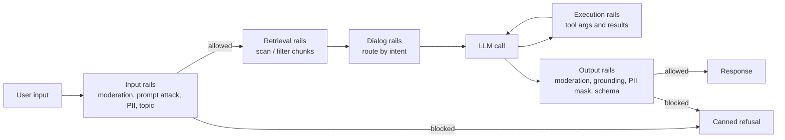

**Guardrail tooling** is the software that sits around a model call and checks what goes in and what comes out: user prompts, [retrieved documents](retrieval-augmented-generation.md), [tool](tools.md) arguments and results, and the final response. Each check is a classifier, a rule, or a second LLM call, and each ends in an action: allow, block, mask, rewrite, re-ask, or log. Guardrails are separate from the model's own trained refusals. They are configured by the developer at runtime, independent of the model, and auditable ([Rebedea et al.](../sources/rebedea-2023-nemo-guardrails.md)). They complement [agent guardrails](agent-guardrails.md) (sandboxing, permissions), which limit what an agent *can do* rather than what text passes through.

## Where checks run

NeMo Guardrails names five interception points, and the other tools use a subset of them ([NeMo docs](../sources/nemo-guardrails-docs.md)):

A common gap is that **tool traffic is often not checked**. Bedrock content filters and its prompt-attack filter do not evaluate `toolResult`, tool specs, or tool-call arguments ([Bedrock docs](../sources/aws-bedrock-guardrails.md)). OpenAI inline moderation checks tool arguments and outputs but not tool names, descriptions or schemas ([OpenAI](../sources/openai-moderation-guide.md)). Azure Prompt Shields can scan agent tool responses, but only in preview ([Azure](../sources/azure-ai-content-safety-docs.md)). Synthesis: in agentic systems, indirect [prompt injection](prompt-injection.md) arrives through tool results, so you must wire a document-attack check onto that path yourself.

## The tools

### NeMo Guardrails (NVIDIA, open source)

NeMo Guardrails is a Python library and server that acts as a proxy between the application and the LLM. It is configured with `config.yml`, `prompts.yml` and Colang flows (Colang 1.0 is the default, 2.0 is also supported), plus Python actions ([NeMo docs](../sources/nemo-guardrails-docs.md)).

- **Self-check rails.** `self check input` and `self check output` run a separate LLM call with a yes/no policy prompt. In the tutorial, a blocked request costs 1 LLM call and an allowed one costs 2.
- **Dialog rails.** Three chained calls: canonical user intent ([few-shot](few-shot-prompting.md) examples retrieved by [embedding](embeddings.md) similarity), then the next step, then the bot message. They cannot be batched, so latency and cost are about 3x a plain call ([Rebedea et al.](../sources/rebedea-2023-nemo-guardrails.md)). `rails.dialog.single_call` merges them into one call.
- **Model-backed rails.** These call dedicated safety models (Nemotron content-safety, Llama Guard), a [jailbreak](jailbreaks.md)-detection NIM, topic control, [PII](pii-and-data-privacy.md) detectors (Presidio, GLiNER) and third-party APIs.
- **Knobs.** `rails.input.parallel` and `rails.output.parallel` run rails concurrently. Streaming output rails take `chunk_size` (200 tokens), `context_size` (50) and `stream_first` (true, meaning tokens are streamed *before* the chunk is checked).
- **Evidence.** In the paper's 200-prompt test (100 harmful, 100 helpful), input and output rails on gpt-3.5-turbo blocked about 99% of harmful [red-team](llm-red-teaming.md) prompts and about 2% of helpful ones. Without rails, gpt-3.5-turbo already refused 93% of the harmful prompts on its own; the bigger gain was on text-davinci-003 (24% without rails, 97% with both rails, at a cost of 5% of helpful prompts blocked). The sample is small and the models are old.

### Guardrails AI (open source)

Guardrails AI is a validator framework rather than a dialog manager. A `Guard` combines validators (regex, PII, toxicity, schema and more). Validators came from the Guardrails Hub; a 2026-07-06 notice moves them to plain PyPI packages and ended hosted remote inference on 2026-08-25. Each validator has an `on_fail` policy ([Guardrails AI](../sources/guardrails-ai-docs.md)):

| `on_fail` | Effect |
|---|---|
| `NOOP` (default) | pass through, log the failure |
| `EXCEPTION` | raise |
| `REASK` | re-prompt the LLM with the validator's error |
| `FIX` / `FIX_REASK` | programmatic repair, then re-validate and re-ask if still failing |
| `FILTER` | structured output only: drop the failing field |
| `REFRAIN` | return nothing |

`Guard.for_pydantic` gives you [structured outputs](structured-outputs.md) with re-asking. `guardrails start` serves each guard behind an OpenAI-compatible URL. Note that the default is `NOOP`: a guard you forget to configure will only log failures, never block them.

### Llama Guard and Prompt Guard (Meta, open weights)

These are two different classifiers for two different threats:

- **Llama Guard** is a harm classifier. It is an LLM prompted with a taxonomy that labels a prompt or a response as `safe` or `unsafe` plus category codes. Llama Guard 4 is 12B, multimodal, with the MLCommons S1-S14 taxonomy. It is covered in detail under [content moderation](content-moderation.md) ([Inan et al.](../sources/inan-2023-llama-guard.md), [LG4 card](../sources/llama-guard-4-model-card.md)).
- **Prompt Guard 2** is an injection/jailbreak detector. It is a DeBERTa encoder (86M multilingual, or 22M) that outputs benign or malicious, where "malicious" means an attempt to override earlier instructions, whether or not the content is harmful. Context is 512 tokens, so longer text is split and scanned in parallel. On an A100, a 512-token input takes 92.4 ms (86M) or 19.3 ms (22M). On AgentDojo, at a 3% utility cost, it prevents 81.2% (86M) or 78.4% (22M) of attacks, versus 67.6% for Prompt Guard 1 ([PG2 card](../sources/llama-prompt-guard-2-model-card.md)).
- They are complementary: the Llama Guard 4 card itself notes that Llama Guard can be prompt-injected and points to Prompt Guard for that.

### Amazon Bedrock Guardrails (managed)

A Bedrock guardrail is a versioned policy bundle ([Bedrock docs](../sources/aws-bedrock-guardrails.md)):

- **Policies.** Content filters (Hate, Insults, Sexual, Violence, Misconduct, Prompt Attack) with NONE/LOW/MEDIUM/HIGH strength per direction; denied topics; word filters; PII block or mask plus regex; contextual grounding; Automated Reasoning checks.
- **How to attach it.** Attach it to `InvokeModel` or `Converse`, or call `ApplyGuardrail` standalone to guard any model, including non-AWS ones (see [Amazon Bedrock](amazon-bedrock.md)).
- **Evaluation and billing.** Input policies run in parallel. A blocked input skips the model call, and billing is per policy evaluated.
- **Gotcha: input tags.** With `InvokeModel` and `InvokeModelWithResponseStream`, prompt-attack detection only runs on text wrapped in `guardContent` input tags. Without tags it silently does nothing. Tags are also how you keep the [system prompt](system-prompts.md) and RAG context from triggering false positives. The prompt-attack filter never evaluates tool results or tool definitions.
- **Grounding checks.** Thresholds run from 0 to 0.99. Limits are 100k characters of source, 1k of query and 5k of response.
- **Tiers.** The Standard tier adds code-aware detection and prompt-leakage detection, and requires cross-Region inference.

### Azure AI Content Safety (managed)

Azure AI Content Safety is a standalone API, and the engine behind Foundry guardrails ([Azure](../sources/azure-ai-content-safety-docs.md); see [Azure AI Foundry](azure-ai-foundry.md)):

- **Harm severity.** Graded on 0-7 for text, 0/2/4/6 for images.
- **Prompt Shields.** Separates *user prompt attacks* from *document attacks*: one `userPrompt` and up to 5 `documents`, each returning `attackDetected`. Spotlighting base64-encodes documents to mark them as low-trust.
- **Other detectors.** Groundedness (preview, and among the preview features scheduled to retire on 2027-04-30), protected-material detection (lyrics, articles, recipes, code), and task adherence for agent tool calls.
- **Where blocking happens.** The standalone API never blocks; your code decides. In Foundry, user-prompt attack detection is on by default but document-attack detection is **off by default**. Foundry moderates the first 1,000 text characters free; the standalone API bills all characters.

### OpenAI moderation (managed, free)

`omni-moderation-latest` classifies text and images into 13 categories with scores. It can run standalone or inline in the [Responses API](openai-responses-api.md). It is a harm classifier only, with no injection detection ([OpenAI](../sources/openai-moderation-guide.md)). Details are in [content moderation](content-moderation.md).

## Comparison

| Tool | Type | Harm categories | Prompt attack | Grounding | PII | Deploy | Main cost |
|---|---|---|---|---|---|---|---|
| NeMo Guardrails | orchestration framework | via self-check or safety models | heuristics, self-check, NIM | fact-check / hallucination rails | Presidio, GLiNER… | self-host / K8s | extra LLM calls |
| Guardrails AI | validator framework | via Hub validators | via validators | via validators | yes | library / server | reasks |
| Llama Guard 4 | open classifier (12B) | S1-S14 | no | no | S7 privacy category | self-host GPU | GPU inference |
| Prompt Guard 2 | open classifier (86M/22M) | no | yes (binary) | no | no | self-host | ~20-90 ms |
| Bedrock Guardrails | managed policy bundle | 5 + prompt attack | yes (needs tags) | yes | mask/block + regex | AWS, `ApplyGuardrail` | per policy evaluated |
| Azure Content Safety | managed APIs | 4, 0-7 severity | Prompt Shields | preview (retiring 2027-04-30) | not documented in the cited pages | Azure | per call, rate-limited |
| OpenAI moderation | managed API | 13 | no | no | no | OpenAI | free |

Synthesis: the table compresses the sources above; "no" means the source documents no such feature.

## Input and output validation patterns

Synthesis, built from the sources cited inline:

1. **Cheap first, expensive last.** Run regex, word lists and small encoders (Prompt Guard at about 20 ms) before [LLM-based judges](llm-as-judge.md) (Llama Guard, self-check). Run independent checks in parallel (Bedrock evaluates input policies in parallel; in NeMo set `rails.input.parallel` / `rails.output.parallel`, which default to false).
2. **Check provenance, not just content.** Classify the user turn and third-party content separately: Bedrock input tags, Azure `userPrompt` vs `documents`. A trusted system prompt can look like an injection, which is why AWS asks you to tag only the user's text.
3. **Output = untrusted.** Validate structure (schema, `FILTER`/`REASK`), [grounding](hallucination.md) (Bedrock contextual grounding, Azure groundedness), and leakage (PII masking) before anything reaches a user, a SQL engine or a tool ([notebook](../sources/notebook-web-ai-security.md)).
4. **Streaming trade-off.** Checking every chunk before release adds latency. Releasing first (Bedrock `ASYNCHRONOUS`, NeMo `stream_first: true`) can briefly expose bad content, and Bedrock cannot mask PII in async mode. OpenAI inline moderation of a stream only returns results after generation ends. See [streaming](streaming.md).
5. **Detect before block.** Every managed service has a detect-only mode (Bedrock action `NONE`, Azure annotate, OpenAI scores). Run in shadow mode, measure false positives on real traffic, then turn on blocking.
6. **Defense in depth.** No classifier is a boundary. Meta, Microsoft and NVIDIA all say to layer these tools. Anthropic's browser-agent work combines training with classifiers and still reports 1.4-2.4% attack success (1.4% for its best model) against an adaptive Best-of-N attacker with 100 attempts per environment ([Anthropic](../sources/anthropic-2025-prompt-injection-defenses-browser.md)). The design goal is that a successful injection cannot do damage ([agent guardrails](agent-guardrails.md)).

## Failure modes

- **Over-blocking.** Constitutional Classifiers cost +0.38 percentage points of refusals and 23.7% compute overhead ([Sharma et al.](../sources/sharma-2025-constitutional-classifiers.md)). NeMo's moderation rails blocked about 2% of helpful prompts on gpt-3.5-turbo (5% on text-davinci-003).
- **Silent misconfiguration.** The Bedrock prompt-attack filter does nothing without input tags. Guardrails AI defaults to `NOOP`. Azure document shields are off by default.
- **Guard models are attackable.** Llama Guard 4 is an LLM and can be prompt-injected. Prompt Guard can be evaded by adaptive attackers.
- **Drift.** AWS updates its guardrail detection models automatically and OpenAI upgrades its moderation model continuously, so thresholds tuned today can move. Re-run your evals ([LLM evaluation](llm-evaluation.md)).
- **Language coverage.** Prompt Shields is trained mostly on English. Prompt Guard 22M is weak outside English. Llama Guard 4 multilingual recall is 43%.
- **Latency stacking.** NeMo dialog rails take about 3x the calls of an unguarded request. Each extra LLM judge adds a full round trip ([cost and latency](cost-and-latency-optimization.md)).

## When to use which

Synthesis:

- **Already on AWS or Azure:** use the native service (Bedrock Guardrails, Foundry guardrails). You get audit, versioning and billing integration. Use `ApplyGuardrail` for models outside the platform.
- **Self-hosted or data must stay on-prem:** Prompt Guard 2 on inputs and retrieved chunks, plus Llama Guard 4 (or another [open-weight](open-weight-models.md) safety model) on input and output.
- **Need conversational policy (stay on topic, scripted flows):** NeMo Guardrails dialog rails, if you can pay the extra calls.
- **Mostly structural or business-rule validation (schemas, PII, competitor names):** Guardrails AI validators or plain code.
- **Cheap baseline harm screen on OpenAI:** the free moderation endpoint, with thresholds you set yourself.
- **Not a substitute** for least privilege, [sandboxing](code-execution-sandboxes.md) and [human approval](human-in-the-loop.md) on agent actions.

## Sources

- [NVIDIA NeMo Guardrails documentation](../sources/nemo-guardrails-docs.md)
- [Rebedea et al. 2023, NeMo Guardrails](../sources/rebedea-2023-nemo-guardrails.md)
- [Guardrails AI library and docs](../sources/guardrails-ai-docs.md)
- [Inan et al. 2023, Llama Guard](../sources/inan-2023-llama-guard.md)
- [Llama Guard 4 model card](../sources/llama-guard-4-model-card.md)
- [Llama Prompt Guard 2 model card](../sources/llama-prompt-guard-2-model-card.md)
- [OpenAI moderation guide](../sources/openai-moderation-guide.md)
- [Amazon Bedrock Guardrails documentation](../sources/aws-bedrock-guardrails.md)
- [Azure AI Content Safety documentation](../sources/azure-ai-content-safety-docs.md)
- [Sharma et al. 2025, Constitutional Classifiers](../sources/sharma-2025-constitutional-classifiers.md)
- [Anthropic, Mitigating prompt injections in browser use](../sources/anthropic-2025-prompt-injection-defenses-browser.md)
- [Notebook: Web, API & AI Security](../sources/notebook-web-ai-security.md)
