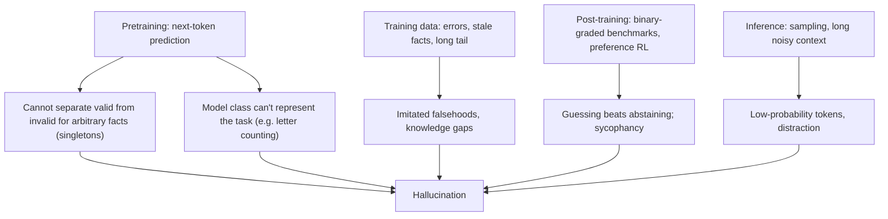

A **hallucination** is model output that is fluent and plausible but false, unverifiable, or unsupported by the input it was given ([Huang et al.](../sources/survey-on-hallucination-in-llms.md)). It is not a bug in one model but a statistical consequence of how language models are trained and graded: a next-token predictor that cannot tell a valid statement from an invalid one will sometimes generate the invalid one, and benchmarks that score "I don't know" as wrong teach it to guess rather than abstain ([Kalai et al., 2025](../sources/why-language-models-hallucinate.md)). For an engineer the practical consequences are: hallucination can be reduced but not eliminated, it must be measured per use case, and the system around the model (grounding, verification, abstention paths) matters more than the prompt alone. It is the most consequential of the [LLM limitations](llm-limitations.md).

## Taxonomy

The standard split is **factuality** versus **faithfulness** ([Huang et al.](../sources/survey-on-hallucination-in-llms.md)):

| Type | Subtype | Example | Typical fix |
|---|---|---|---|
| Factuality: contradiction | Entity error | Names the wrong inventor | Grounding in retrieved sources |
| | Relation error | Right entities, wrong relationship | Grounding, verification questions |
| Factuality: fabrication | Unverifiability | Invented citation, API, case law | Require citations; check they exist |
| | Overclaim | A local truth stated as universal | Calibrated wording, review |
| Faithfulness | Instruction inconsistency | Ignores the requested format or scope | Clearer instructions, [structured outputs](structured-outputs.md) |
| | Context inconsistency | Contradicts the document it was given | Quote-first prompting, entailment checks |
| | Logical inconsistency | Reasoning steps contradict the answer | [Reasoning models](reasoning-models.md), self-consistency |

In [RAG](retrieval-augmented-generation.md) systems, faithfulness (is the answer supported by the retrieved context?) is usually what you can measure and control; factuality also depends on whether retrieval found the right document.

A finer distinction matters for detection: **confabulations** are wrong *and arbitrary*, so the answer changes if you resample, whereas **systematic errors** (learned from bad data, or reasoning failures) are wrong but stable ([Farquhar et al.](../sources/semantic-entropy-hallucination-detection.md)). Sampling-based detectors catch the first kind only.

## Why models hallucinate

*Diagram: Synthesis of Kalai et al. and Huang et al.*

- **Pretraining makes some error unavoidable.** Kalai et al. reduce generation to a binary "is this output valid?" classification and prove the generative error rate is at least roughly twice the classification error. For arbitrary facts with no learnable pattern (birthdays, phone numbers, obscure citations), the hallucination rate is bounded below by the **singleton rate**, the fraction of such facts seen exactly once in training: if 20% of birthday facts appear once, expect hallucination on at least about 20% of birthday questions ([source](../sources/why-language-models-hallucinate.md)). This is why long-tail entities are the riskiest queries.
- **Poor model fit.** Some tasks cannot be represented well by the model's architecture or [tokenization](tokenization.md): DeepSeek-V3 miscounted the Ds in "DEEPSEEK" across ten trials while the reasoning model R1 got it right ([source](../sources/why-language-models-hallucinate.md)).
- **Data problems.** Imitated misinformation, missing long-tail and post-cutoff knowledge, and fine-tuning data that teaches facts the base model did not know (which can *increase* hallucination) ([Huang et al.](../sources/survey-on-hallucination-in-llms.md)). Knowledge is also patchier than the advertised cutoff suggests ([Cheng et al.](../sources/dated-data-knowledge-cutoffs.md)).
- **Post-training rewards guessing.** Base models are fairly well calibrated, but calibration degrades after RL post-training. Nine of ten popular [benchmarks](benchmarks.md) analysed (GPQA, MMLU-Pro, SWE-bench, HLE, ...) give zero credit for abstaining, so guessing always maximises expected score ([Kalai et al.](../sources/why-language-models-hallucinate.md)). [Preference training](preference-optimization.md) also rewards agreeable answers over correct ones ([sycophancy](../sources/towards-understanding-sycophancy.md)).
- **Inference conditions.** Higher sampling temperature raises the chance of low-probability tokens ([Huang et al.](../sources/survey-on-hallucination-in-llms.md); see [sampling parameters](sampling-parameters.md)). Long contexts with similar-but-wrong distractors raise hallucination rates, with model families differing: in Chroma's tests GPT models hallucinated most under distractors while Claude models more often abstained ([Chroma](../sources/chroma-context-rot.md); see [long-context degradation](long-context-degradation.md)).

There is a real trade-off with abstention. Anthropic found Claude 2.1, trained to reduce inaccurate claims, became reluctant to answer from a single out-of-place sentence in a long document; a one-line prefill lifted accuracy on that test from 27% to 98% ([Anthropic](../sources/claude-2-1-long-context-prompting.md)). Pushing hallucination down can push refusals up.

## Detection

| Method | How it works | Catches | Cost / limits |
|---|---|---|---|
| Semantic entropy | Sample ~10 answers, cluster by mutual entailment, entropy over clusters | Confabulations (AUROC 0.79 vs 0.69 for token entropy) | ~10x generation cost; misses consistent errors; needs claim decomposition for long text ([Farquhar et al.](../sources/semantic-entropy-hallucination-detection.md)) |
| Best-of-N consistency | Run the prompt several times and compare | Unstable answers | N x cost ([Claude Docs](../sources/claude-docs-reduce-hallucinations.md)) |
| Token log-probabilities / entropy | Low-confidence tokens flag risk | Some factual errors | Needs logprob access; post-RL calibration is weaker ([Huang et al.](../sources/survey-on-hallucination-in-llms.md)) |
| Entailment / NLI or [LLM-as-judge](llm-as-judge.md) | Check each claim against the source | Faithfulness errors in RAG | Judge has its own error rate |
| External fact-checking | Retrieve evidence per claim | Factual errors | Retrieval quality bounds it |

Track a hallucination or groundedness rate as an explicit metric in [LLM evaluation](llm-evaluation.md) ([Notebook](../sources/notebook-prompt-engineering.md)).

## Mitigation

Ordered roughly from cheapest to most expensive:

1. **Give the model an out.** Explicitly allow "I don't know"; Anthropic says this can drastically reduce false information ([Claude Docs](../sources/claude-docs-reduce-hallucinations.md); also in the owner's [Notebook](../sources/notebook-prompt-engineering.md)). Kalai et al. propose stating a confidence threshold t, with wrong answers penalised t/(1-t) (e.g. t = 0.75 gives a 3-point penalty), so answering only pays when P(correct) > t ([source](../sources/why-language-models-hallucinate.md)).
2. **Ground in supplied context.** [RAG](retrieval-augmented-generation.md) and an instruction to use only the provided documents ([Claude Docs](../sources/claude-docs-reduce-hallucinations.md)). For agents, tell the model never to speculate about files it has not opened ([Anthropic prompting guide](../sources/anthropic-prompting-best-practices.md)).
3. **Quote first, then answer.** For documents over about 20k tokens, extract verbatim quotes and reason only from them ([Claude Docs](../sources/claude-docs-reduce-hallucinations.md)).
4. **Cite and verify.** Require a supporting quote per claim, then a pass that retracts claims without one ([Claude Docs](../sources/claude-docs-reduce-hallucinations.md)). Provider citation features and [structured outputs](structured-outputs.md) make this checkable in code (Synthesis).
5. **Chain-of-Verification (CoVe).** Draft, plan verification questions, answer them *without seeing the draft*, revise. On Llama 65B it raised Wikidata list precision from 0.17 to 0.36 and biography FactScore from 55.9 to 71.4 ([Dhuliawala et al.](../sources/chain-of-verification.md)). The owner's [CoVe experiment](../sources/notebook-21-chain-of-verification.md) implements it in four [LangChain](langchain.md) calls.
6. **Sample and compare / abstain on disagreement** (semantic entropy, best-of-N), escalating uncertain cases to a [human](human-in-the-loop.md).
7. **Lower temperature** for factual tasks (reduces sampling-induced errors, not knowledge gaps).
8. **Model choice and training:** larger and [reasoning models](reasoning-models.md) fix some poor-model errors (letter counting); [fine-tuning](fine-tuning.md) on facts the model lacks is risky ([Huang et al.](../sources/survey-on-hallucination-in-llms.md)).

None of these eliminate hallucination; validate critical outputs ([Claude Docs](../sources/claude-docs-reduce-hallucinations.md)).

## When to worry most

Synthesis: risk is highest for (a) long-tail entities, numbers, dates and citations (singleton facts), (b) questions about events after or near the knowledge cutoff, (c) long noisy contexts with near-miss distractors, (d) tasks where the user signals a preferred answer, and (e) any setting graded only on "answered or not". It is lowest for transformation tasks over a supplied short input (summarise, extract, classify) where outputs can be checked against the source. Design the [guardrails](agent-guardrails.md) and [verification](verification-and-evals.md) accordingly: deterministic checks (does the cited file, URL, or SKU exist?) beat asking the model whether it is sure.

## Sources

- [Why Language Models Hallucinate (Kalai et al.)](../sources/why-language-models-hallucinate.md)
- [A Survey on Hallucination in LLMs (Huang et al.)](../sources/survey-on-hallucination-in-llms.md)
- [Semantic entropy (Farquhar et al., Nature)](../sources/semantic-entropy-hallucination-detection.md)
- [Chain-of-Verification (Dhuliawala et al.)](../sources/chain-of-verification.md)
- [Reduce hallucinations (Claude Docs)](../sources/claude-docs-reduce-hallucinations.md)
- [Prompting best practices (Anthropic)](../sources/anthropic-prompting-best-practices.md)
- [Context Rot (Chroma)](../sources/chroma-context-rot.md)
- [Long context prompting for Claude 2.1](../sources/claude-2-1-long-context-prompting.md)
- [Towards Understanding Sycophancy](../sources/towards-understanding-sycophancy.md)
- [Dated Data: knowledge cutoffs](../sources/dated-data-knowledge-cutoffs.md)
- [Notebook: Chain-of-Verification experiment](../sources/notebook-21-chain-of-verification.md)
- [Notebook: Prompt & Context Engineering](../sources/notebook-prompt-engineering.md)
