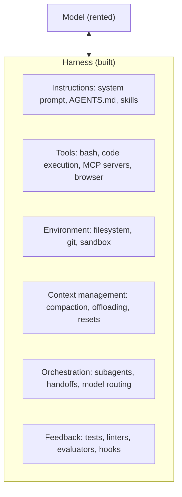
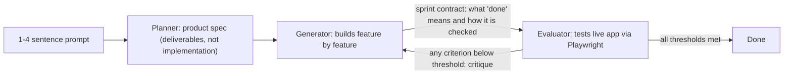

**Harness engineering** is the discipline of building and tuning the *harness*: every piece of code, configuration and execution logic around a model that is not the model itself. LangChain states it as **Agent = Model + Harness** ([LangChain](../sources/langchain-anatomy-of-an-agent-harness.md)). The model supplies reasoning and generation. The harness supplies what a raw model lacks: durable state, the ability to run code, current knowledge, an environment to act in, and checks on its own output. The term spread with OpenAI's February 2026 Codex write-up, which recast the engineer's job as designing environments, specifying intent and building feedback loops rather than writing code ([OpenAI](../sources/openai-harness-engineering-codex.md); [owner post](../sources/harness-engineering-blog-post.md)).

It overlaps with [context engineering](context-engineering.md), which is one harness layer, and wraps the [agent loop](agent-loop.md), which is the harness's core control flow.

## Mechanics: the layers of a harness

LangChain lists the components as system prompts; tools, skills and MCP servers (including their descriptions); bundled infrastructure (filesystem, sandbox, browser); orchestration (subagent spawning, handoffs, model routing); and hooks or middleware for steps that must run deterministically ([LangChain](../sources/langchain-anatomy-of-an-agent-harness.md)). The owner's post groups them into six layers:

| Layer | What it gives the model | Typical pieces |
|---|---|---|
| Instructions | Goals, conventions, a map of the codebase | [System prompts](system-prompts.md), [instruction files](agent-instruction-files.md) such as AGENTS.md, [skills](agent-skills.md) |
| Tools | Ways to act and to fetch post-cutoff knowledge | [Tools](tools.md), bash, [MCP](model-context-protocol.md), web search, browser automation |
| Environment | A workspace that outlives a context window | Filesystem, git, [sandboxes](code-execution-sandboxes.md) |
| Context management | Room to keep working as context fills | [Compaction](context-compaction.md), tool-output offloading, context resets |
| Orchestration | Decomposition and specialisation | [Subagents](subagents.md), [handoffs](agent-handoffs.md), [model routing](model-routing-and-fallbacks.md) |
| Feedback | Evidence that work is actually done | Tests, linters, structural checks, evaluator agents, [hooks](agent-hooks-and-middleware.md) |

Details that matter more than they look:

- **The filesystem is the base layer.** It is the agent's workspace, overflow for context, the place state survives across sessions, and the surface agents and humans share. Git adds versioning and rollback ([LangChain](../sources/langchain-anatomy-of-an-agent-harness.md)).
- **General code execution beats many bespoke tools.** A bash tool lets the agent build the tool it needs ([LangChain](../sources/langchain-anatomy-of-an-agent-harness.md)).
- **Sandboxes make autonomy affordable.** Isolated per-task environments with optional command allow-lists and network isolation, preloaded with runtimes, test CLIs and a browser so the agent can verify its own work ([LangChain](../sources/langchain-anatomy-of-an-agent-harness.md)).
- **Context-rot countermeasures are harness code.** Compaction near capacity; offloading large tool outputs to disk while keeping the head and tail in context; progressive disclosure via skills so tool descriptions don't flood the window at start-up ([LangChain](../sources/langchain-anatomy-of-an-agent-harness.md)). See [long-context degradation](long-context-degradation.md).
- **Long-horizon loops.** "Ralph loops" intercept the model's attempt to stop and re-inject the original prompt into a fresh context, with progress carried in files and git ([LangChain](../sources/langchain-anatomy-of-an-agent-harness.md)).
- **Hooks make behaviour deterministic.** Rather than asking the model to run the linter, the harness runs it after each edit and feeds errors back ([owner post](../sources/harness-engineering-blog-post.md)).

## Long-running harnesses (Anthropic)

### Nov 2025: state outside the model

Justin Young's post starts from multi-session app builds where each new context window begins with no memory. With compaction alone, Opus 4.5 failed in two ways: **one-shotting** (trying too much, running out of context mid-feature, leaving undocumented half-work) and **premature victory** (a later session sees progress and declares the job done) ([Anthropic, Nov 2025](../sources/anthropic-effective-harnesses-long-running-agents.md)).

The fix was structural:

- An **initializer agent** runs once and writes `init.sh`, a progress log, an initial commit and a JSON feature list (200+ items for a claude.ai clone, all marked failing).
- A **coding agent** runs every later session: read the progress notes and git log, review the feature list, run a basic end-to-end test, implement **one feature**, commit with a descriptive message.
- The feature list is **JSON, not Markdown**, because the model is less likely to rewrite JSON inappropriately; agents may only flip the pass status.
- Agents marked features done after unit tests or curl calls. Prompting them to test as a user through browser automation (Puppeteer MCP) substantially improved results. Native alert modals stayed invisible to the agent.

### Mar 2026: separate generator and evaluator

Prithvi Rajasekaran's follow-up targets two problems: coherence loss as context fills, and agents grading their own mediocre work generously. A separate, skeptical evaluator proved easier to tune than a self-critical generator ([Anthropic, Mar 2026](../sources/anthropic-harness-design-long-running-apps.md)).

- **Gradeable criteria.** For frontend design: design quality, originality (penalising template defaults and "AI slop"), craft, functionality, with the first two weighted higher. The evaluator was calibrated with few-shot score breakdowns.
- **Sprint contracts.** Generator and evaluator agree in writing on what done means before each sprint; one sprint had 27 criteria, each with a hard threshold.
- **Resets vs compaction.** Sonnet 4.5 showed "context anxiety" (wrapping up early as it believed it neared the limit), so the harness used context resets with a structured handoff. Opus 4.5 largely removed the behaviour, and the later harness ran one continuous session with automatic compaction. Compaction keeps continuity but gives no clean slate; resets give a clean slate at the cost of orchestration, tokens and latency.
- **Cost.** Retro game maker on Opus 4.5: solo run 20 min and $9 with a broken core feature; full harness 6 h and $200 with a playable game, over 20x the cost.
- **Ablation on Opus 4.6.** Removing one component at a time, the author dropped the sprint construct and moved QA to a single pass at the end, but kept the planner (without it the generator under-scoped) and the evaluator. A digital audio workstation build then took about 3 h 50 min and $124.70.

The stated rule: an evaluator is worth its cost only when the task sits beyond what the model does reliably alone. Each harness component encodes an assumption about a model weakness, and those assumptions go stale ([Anthropic, Mar 2026](../sources/anthropic-harness-design-long-running-apps.md)).

> **Contradiction:** the [owner post](../sources/harness-engineering-blog-post.md) presents "context resets over compaction" as a general lesson of the March 2026 harness. The [original](../sources/anthropic-harness-design-long-running-apps.md) ties resets to Sonnet 4.5's context anxiety and says the later harness, on newer models, went back to continuous sessions with compaction.

## OpenAI Codex practices (Feb 2026)

Ryan Lopopolo's post describes a team building an internal product from an empty repository with Codex writing all the code: about a million lines in five months, averaging 3.5 PRs per engineer per day as the team grew to seven engineers. Early progress was slow because the environment was underspecified, not because the agent couldn't code ([OpenAI](../sources/openai-harness-engineering-codex.md)). The original blocked this wiki's fetcher; the practices below are those that agreeing summaries attribute to it:

- **AGENTS.md as a map.** A short file (about 100 lines) pointing into a structured `docs/` tree of architecture notes, design docs, checked-in execution plans and policies, instead of one large instruction file. See [agent instruction files](agent-instruction-files.md).
- **Mechanical architecture.** A fixed layering checked by custom linters and structural tests; failure messages are written as fix instructions for the agent.
- **Application legibility.** Chrome DevTools in the agent runtime so [Codex](coding-agents.md) can reproduce bugs and check UI; per-worktree app instances with logs, metrics and traces visible to the agent.
- **Garbage collection.** A recurring doc-gardening agent and background agents that catch pattern drift and open small clean-up PRs.
- **Agent review.** Review is mostly agent-to-agent, with human review optional.

## Comparisons

- **vs prompt engineering:** [prompt engineering](prompt-engineering.md) tunes the text sent to the model; harness engineering also changes what the model can do, see and be checked against. The Anthropic Nov 2025 fixes were mostly structural (files, git, test tooling), not wording ([Anthropic, Nov 2025](../sources/anthropic-effective-harnesses-long-running-agents.md)).
- **vs context engineering:** [context engineering](context-engineering.md) decides what enters the window on each call. Harness engineering contains it and adds the environment, orchestration and feedback layers.
- **vs agent frameworks:** frameworks such as [LangGraph](langgraph.md) or the [Claude Agent SDK](claude-agent-sdk.md) supply harness parts. The harness is the configured whole for one model on one task. Synthesis: picking a framework is one decision inside harness engineering, not a substitute for it.
- **Harness vs model on benchmarks:** LangChain reports the same model scoring very differently on Terminal-Bench 2.0 depending on the harness, and moved its own coding agent from roughly top 30 to top 5 by changing only the harness ([LangChain](../sources/langchain-anatomy-of-an-agent-harness.md)). A [benchmark](benchmarks.md) score measures model plus harness.

## Limits and failure modes

- **Cost and latency.** The Anthropic three-agent harness cost over 20x a solo run on the same prompt ([Anthropic, Mar 2026](../sources/anthropic-harness-design-long-running-apps.md)). See [cost and latency optimization](cost-and-latency-optimization.md).
- **Stale scaffolding.** Components built for one model's weakness become overhead on the next; the sprint structure was removed for Opus 4.6. An aggressive all-at-once simplification also underperformed, so ablate one piece at a time ([Anthropic, Mar 2026](../sources/anthropic-harness-design-long-running-apps.md)).
- **Harness overfitting.** Models post-trained with a harness in the loop can overfit to its tool formats; the best harness for a task is not necessarily the one the model was trained with ([LangChain](../sources/langchain-anatomy-of-an-agent-harness.md)).
- **Self-evaluation bias.** Generators praise their own work, especially on subjective tasks ([Anthropic, Mar 2026](../sources/anthropic-harness-design-long-running-apps.md)). See [LLM-as-judge](llm-as-judge.md).
- **False "done".** Without user-level testing, agents declare features complete after unit tests or curl ([Anthropic, Nov 2025](../sources/anthropic-effective-harnesses-long-running-agents.md)).
- **Perception gaps.** Things the harness can't show the agent stay invisible, such as native alert modals under browser automation ([Anthropic, Nov 2025](../sources/anthropic-effective-harnesses-long-running-agents.md)).
- **Entropy.** Agents produce stale docs and drifting patterns as fast as code, which OpenAI's team handled with scheduled clean-up agents ([OpenAI](../sources/openai-harness-engineering-codex.md)).
- Synthesis: more tools, sandboxes and autonomy widen the attack surface. A harness that combines private data, untrusted input and outbound channels creates the [lethal trifecta](lethal-trifecta.md); [guardrails](agent-guardrails.md) and sandbox network rules belong in the harness too.

## Practical guidance

Drawn from the owner's eight principles ([owner post](../sources/harness-engineering-blog-post.md)), each grounded above:

1. **Treat agent failures as harness bugs first.** Ask what the agent couldn't see, couldn't check, or wasn't stopped from doing. Run, watch it fail, classify ([error analysis](error-analysis.md)), patch the harness, repeat.
2. **Put state in files, not in the context window.** Progress logs, JSON feature lists, plans and git history survive resets; prefer formats the model is unlikely to rewrite.
3. **Make feedback mechanical.** Tests, linters, type checkers and structural rules the agent can run, with error messages written as fix instructions. Wire them as hooks so they always run.
4. **Let the agent see what the user sees.** Browser automation, screenshots, logs, traces. "It compiles" is not "it works".
5. **Separate making from judging.** A skeptical evaluator with explicit, calibrated, thresholded criteria and a pre-agreed definition of done.
6. **Keep instructions small and navigable.** A short map into deeper docs beats one large file.
7. **Schedule the clean-up.** Recurring agents for doc freshness and pattern drift.
8. **Re-justify every component on each model upgrade.** Ablate one component at a time; spend the freed budget on the next task at the edge of what the model can do.

Synthesis: for a forward-deployed engineer, the harness is the part of the system you own and can debug. Log full traces ([LLM observability](llm-observability.md)), keep an eval set that exercises the harness rather than just the model ([agent evaluation](agent-evaluation.md)), and record which model weakness each component exists to cover, so the next model upgrade becomes a planned ablation rather than guesswork.

## Sources

- [Source: Harness Engineering: The Work Around the Model](../sources/harness-engineering-blog-post.md) (owner blog post, 2026-11-14)
- [Source: The Anatomy of an Agent Harness](../sources/langchain-anatomy-of-an-agent-harness.md) (LangChain, 2026-03-10)
- [Source: Effective harnesses for long-running agents](../sources/anthropic-effective-harnesses-long-running-agents.md) (Anthropic, 2025-11-26)
- [Source: Harness design for long-running application development](../sources/anthropic-harness-design-long-running-apps.md) (Anthropic, 2026-03-24)
- [Source: Harness engineering: leveraging Codex in an agent-first world](../sources/openai-harness-engineering-codex.md) (OpenAI, 2026-02-11)
