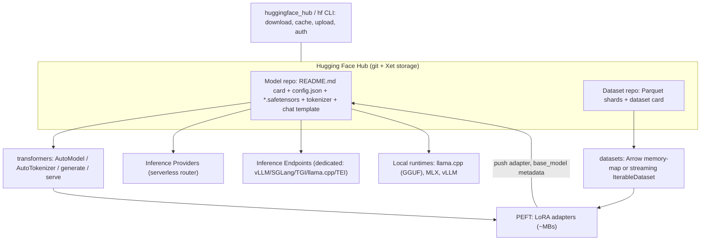

**Hugging Face** is the de facto distribution layer for [open-weight models](open-weight-models.md). The **Hub** hosts git-versioned repos of models, datasets and Spaces, each documented by a card. A set of open-source libraries reads and writes those repos: **transformers** (model definitions and inference), **datasets** (data loading), **PEFT** (adapter fine-tuning), **safetensors** (the weight format) and **huggingface_hub** (the client and the `hf` CLI). Two paid products serve the models: **Inference Providers**, a serverless router to partner clouds, and **Inference Endpoints**, dedicated managed deployments. Hugging Face describes Transformers v5 as the model-definition layer that training tools, serving engines and [local runtimes](local-llms.md) all build on ([Transformers v5](../sources/transformers-v5-blog.md)).

Synthesis: the diagram arranges the components described in the sources below.

## The Hub: repos, revisions, cache

- Every repo is versioned. `revision` accepts a branch, a tag, `refs/pr/N` or a **full** commit hash ([download guide](../sources/huggingface-hub-download-guide.md)). Synthesis: pin a commit hash in production, because a repo's `main` can change under you, including its chat template or generation config.
- `snapshot_download` with `allow_patterns`/`ignore_patterns` avoids pulling duplicate formats, for example legacy `.bin` files when you only need safetensors. Files land in a content-addressed cache under `HF_HOME`, and the returned paths must not be edited. `hf download --dry-run` shows sizes first. Transfers go through `hf_xet` (chunk-deduplicated Xet storage), which replaced `hf_transfer` ([download guide](../sources/huggingface-hub-download-guide.md)).
- **Gated repos** require each individual user to accept terms (automatic or manual approval, plus custom form fields such as company or intended use) and to authenticate with a token for scripted downloads. Authors can revoke access at any time and can block EU users ([gated models](../sources/hugging-face-gated-models-docs.md)). Synthesis: in a customer deployment, CI and container builds need a service token whose user has been approved for the gate. A missing approval surfaces as a 401/403 at build time, not at design time.

## Model cards and licences

A model card is the repo's `README.md`: YAML metadata plus prose covering intended use, limitations and bias, training data and procedure, and evaluation ([model cards](../sources/hugging-face-model-cards-docs.md)). The metadata fields an engineer should read:

| Field | Why it matters |
|---|---|
| `license` (or `other` + `license_name` + `license_link`) | Legal terms; drives the Hub's license filter |
| `base_model` / `base_model_relation` (finetune, adapter, quantized, merge) | Lineage: a fine-tune or quantization usually inherits the base model's licence obligations |
| `library_name`, `pipeline_tag` | Which loader and task apply; repos created after Aug 2024 must state `library_name: transformers` explicitly |
| `datasets`, `model-index` / eval results | Training data provenance and self-reported scores |
| `extra_gated_*` | Whether access needs approval and what you agreed to |

Source: [model cards](../sources/hugging-face-model-cards-docs.md), [gated models](../sources/hugging-face-gated-models-docs.md).

"Open weights" spans a wide licence range. Gemma 4's Hugging Face card states Apache 2.0 ([Gemma 4](../sources/gemma-4-docs.md)). The Llama 4 Community License requires a separate licence above 700M monthly active users, "Built with Llama" attribution, and a "Llama" prefix on derivative model names ([Llama 4 licence](../sources/llama-4-license.md)). Qwen's 2.4T model adds revenue- and MAU-based conditions on top of an otherwise permissive licence ([Qwen3.8](../sources/qwen3-8-model-cards.md)). OSI's definition does not count weights alone as open source, because it also requires data information and code ([OSI](../sources/osi-open-source-ai-definition.md)). Synthesis: always read the licence file, not just the tag, and trace `base_model` back to the root, because a permissively tagged fine-tune of a restricted base is still bound by the base terms. See [AI governance and compliance](ai-governance-and-compliance.md).

## safetensors and the pickle problem

Legacy PyTorch checkpoints are pickles, and unpickling can import and call arbitrary functions (`exec`/`eval` via the GLOBAL/REDUCE opcodes). The Hub's ClamAV and pickle-import scans are best-effort only. Safetensors fixes this by storing only an 8-byte header length, a JSON header (dtype, shape, offsets) and raw bytes. Duplicate keys and overlapping or unindexed ranges are rejected, and loading is lazy and zero-copy from the page cache ([safetensors](../sources/safetensors-and-pickle-security.md)). Synthesis: prefer safetensors, refuse `.bin`/`.pt` from untrusted authors, and treat `trust_remote_code=True` as running the repo's Python on your machine, which is a [supply-chain risk](llm-security-risks.md).

## transformers

- **Loading:** `AutoModelForCausalLM.from_pretrained(id, device_map="auto", dtype=..., quantization_config=BitsAndBytesConfig(load_in_4bit=True))` spreads weights across devices and can [quantize](quantization.md) as it loads ([generation docs](../sources/transformers-generation-and-chat-templates.md)).
- **v5 (release candidate announced 2025-12-01; stable 5.x releases followed, and the PEFT docs reference v5.17.0 by late 2026):** PyTorch-only, with modular model files and a pluggable `AttentionInterface` (FlashAttention, FlexAttention, SDPA). `tokenizers` is the single tokenizer backend. Continuous batching, [paged attention](kv-cache.md) and `transformers serve` (OpenAI-compatible) are built in, quantization is first-class, and GGUF loading is supported. The library supports over 400 architectures ([Transformers v5](../sources/transformers-v5-blog.md), [PEFT quicktour](../sources/hugging-face-peft-quicktour.md)). The feature list comes from the RC announcement, so check current release notes for details that may have changed.
- **Generation pitfalls:** `generate()` stops at 20 new tokens and is greedy unless `generation_config.json` says otherwise. Batches must be left-padded. Chat input must go through `apply_chat_template(..., add_generation_prompt=True)`. If you render to text and tokenize later, pass `add_special_tokens=False` to avoid duplicated BOS ([generation docs](../sources/transformers-generation-and-chat-templates.md)). See [tokenization](tokenization.md) and [sampling parameters](sampling-parameters.md).
- **Not a production server by default.** Synthesis: use transformers for research, evals, fine-tuning and as the reference implementation. For throughput, serve the same checkpoint with vLLM or SGLang (see [LLM inference serving](llm-inference-serving.md)). TGI accepts only minor fixes now ([TGI](../sources/tgi-docs.md)).

## datasets

Map-style `Dataset`s are memory-mapped Apache Arrow tables. Loading English Wikipedia (about 18 GB) uses about 50 MB of RAM and iterates at gigabits per second. `streaming=True` returns an `IterableDataset` that reads lazily, which suits FineWeb's 45 TB split, and Parquet column and filter pushdown is supported. The trade-offs: no random access, an approximate buffer shuffle (default 1,000 examples) that needs `set_epoch`, the rule that `take`/`skip` must come after `shuffle`, and buffered examples lost on resume ([datasets](../sources/hf-datasets-arrow-and-streaming.md)).

## PEFT

PEFT wraps a base model so that only adapter parameters train. LoRA with r=8 on `q_proj` of Llama-3.2-1B trains 0.04% of the parameters, and a saved adapter is only `adapter_config.json` plus `adapter_model.safetensors` (about 6 MB for OPT-350m against about 700 MB of base weights) ([PEFT quicktour](../sources/hugging-face-peft-quicktour.md)). `target_modules="all-linear"`, DoRA, rsLoRA, `merge_and_unload()` and weighted adapter merging are in the LoRA guide ([PEFT LoRA guide](../sources/hugging-face-peft-lora-guide.md)). Multiple named adapters can share one base and be swapped with `set_adapter` ([PEFT quicktour](../sources/hugging-face-peft-quicktour.md)). The [owner's tutorial](../sources/notebook-finetune-rag-prompt.md) frames LoRA/PEFT as the cheap way to fine-tune for behaviour, not knowledge. Details are in [PEFT and LoRA](peft-and-lora.md) and [fine-tuning](fine-tuning.md).

## Hosted inference: Providers vs Endpoints

| | Inference Providers | Inference Endpoints |
|---|---|---|
| Model | Serverless; Hugging Face proxies to partner clouds (Groq, Cerebras, Together, Fireworks, etc.) | Dedicated containers on hardware you choose |
| Engines | The provider's | vLLM, SGLang, TGI, llama.cpp, TEI, or a custom container |
| API | OpenAI-compatible `router.huggingface.co/v1` (chat only); `InferenceClient` for other tasks | The engine's API (usually OpenAI-compatible) |
| Routing / scaling | `:fastest` (default), `:cheapest`, `:preferred`, or a named provider; [failover](model-routing-and-fallbacks.md) in auto mode | Autoscaling including scale-to-zero (cold starts) |
| Billing | Pay-as-you-go at provider rates, no markup; monthly credits on PRO and Team/Enterprise | Hourly instance rate charged per minute while initializing or running, times replicas |
| Use when | Trying many open models, bursty or low volume, no infra | Private or fine-tuned models, steady traffic, isolation and compliance needs |

Sources: [Inference Providers](../sources/hf-inference-providers-docs.md), [Inference Endpoints](../sources/hf-inference-endpoints-docs.md). Synthesis: with Providers, *which* company's hardware served a request can change unless you pin a provider. That matters for data-residency reviews and for reproducing evals, because quantization and serving stacks differ between providers.

## Practical guidance

- **Evaluating a model:** read the card and the licence, trace `base_model`, check that safetensors weights are present, pin a commit, and confirm the chat template in `tokenizer_config.json`/`chat_template.jinja` matches what your runtime applies. Then run your own [evals](llm-evaluation.md), since card scores are self-reported.
- **Going to production:** use Providers for a quick trial, Endpoints or your own vLLM for a dedicated deployment, and GGUF/MLX conversions for [on-device use](local-llms.md). For cloud-native alternatives see [Amazon Bedrock](amazon-bedrock.md), [Google Vertex AI](google-vertex-ai.md) and [Azure AI Foundry](azure-ai-foundry.md).

## Sources

- [Transformers v5 blog](../sources/transformers-v5-blog.md)
- [Transformers docs: Text generation and Chat templates](../sources/transformers-generation-and-chat-templates.md)
- [huggingface_hub download guide](../sources/huggingface-hub-download-guide.md)
- [Hub docs: Model Cards](../sources/hugging-face-model-cards-docs.md)
- [Hub docs: Gated models](../sources/hugging-face-gated-models-docs.md)
- [safetensors and pickle security](../sources/safetensors-and-pickle-security.md)
- [Datasets docs: Arrow and Streaming](../sources/hf-datasets-arrow-and-streaming.md)
- [PEFT overview and Quicktour](../sources/hugging-face-peft-quicktour.md)
- [PEFT LoRA developer guide](../sources/hugging-face-peft-lora-guide.md)
- [Inference Providers docs](../sources/hf-inference-providers-docs.md)
- [Inference Endpoints docs](../sources/hf-inference-endpoints-docs.md)
- [TGI docs](../sources/tgi-docs.md)
- [Llama 4 Community License](../sources/llama-4-license.md)
- [Gemma 4 docs](../sources/gemma-4-docs.md)
- [Qwen3.8 model cards](../sources/qwen3-8-model-cards.md)
- [OSI Open Source AI Definition](../sources/osi-open-source-ai-definition.md)
- [Notebook: Fine-tuning vs RAG vs Prompting](../sources/notebook-finetune-rag-prompt.md)
