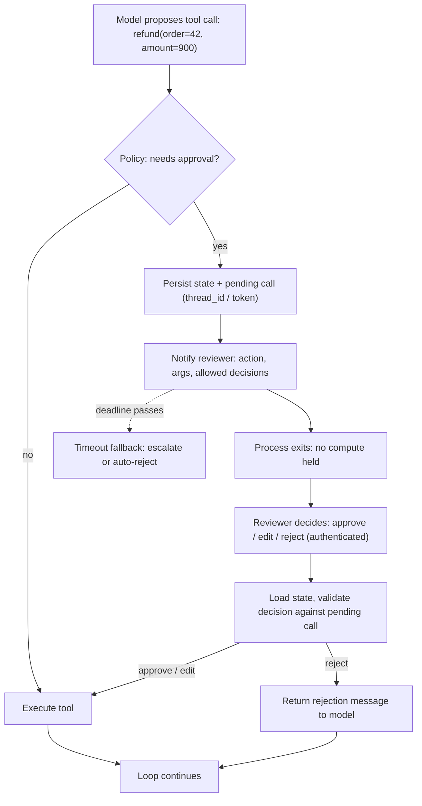

**Human-in-the-loop (HITL)** means an agent stops at chosen points and waits for a person before going on. The person can approve, edit, or reject a proposed action, answer a question, or take the task over. Two things are needed to build it. The first is a **policy** that decides *when* to pause: specific [tools](tools.md), risky arguments, failure thresholds, or the model's own uncertainty. The second is a **durable pause**, a way to save the run, release the process, and resume it minutes or days later on whichever machine is available. Without the second part, an approval gate only works while one process stays alive. That is why HITL in practice rests on [durable agent execution](durable-agent-execution.md). HITL is one layer of [agent guardrails](agent-guardrails.md). It does not replace sandboxing or least privilege ([Meta Rule of Two](../sources/meta-2025-agents-rule-of-two.md)).

## The interaction patterns

| Pattern | Who initiates | Example |
|---|---|---|
| **Approval gate** (approve / reject) | Policy on a tool call | Refund, send email, `git push`, payment |
| **Edit before execute** | Policy; reviewer changes args | Fix the recipient or amount, then run |
| **Respond / substitute** | Reviewer answers in place of the tool | Human supplies the result directly |
| **Ask for input** | Agent asks a question | "Which of these two approaches?" |
| **Interrupt / steer** | Human stops a running agent | Correct a wrong assumption mid-task |
| **Escalation / handoff** | Failure threshold or risk score | Hand the case to a human agent |
| **Review the artifact** | Agent finishes; human gates the merge | Copilot cloud agent PRs (see [coding agents](coding-agents.md)) |

Sources: [LangChain HITL](../sources/langchain-human-in-the-loop-middleware-docs.md), [OpenAI HITL](../sources/openai-agents-sdk-human-in-the-loop-docs.md), [Anthropic autonomy study](../sources/anthropic-2026-measuring-agent-autonomy.md), [OpenAI practical guide](../sources/openai-practical-guide-building-agents.md), [Copilot cloud agent](../sources/github-copilot-cloud-agent-docs.md).

## How the durable pause works

Synthesis: combines the interrupt/resume flows in the LangGraph, OpenAI Agents SDK, Workflow SDK and Restate docs.

What each framework provides:

- **LangGraph** calls `interrupt(value)` inside a node. A checkpointer and a stable `thread_id` are required. The payload surfaces as `__interrupt__`, and `invoke(Command(resume=v), config)` resumes. **On resume the whole node re-runs from its first line**, so code before the interrupt must be idempotent. Multiple interrupts in one node are matched by order. Never wrap `interrupt()` in a bare `try/except`. `interrupt_before`/`interrupt_after` are debugging tools, not a HITL mechanism ([LangGraph persistence](../sources/langgraph-persistence-docs.md), [notebook experiment](../sources/notebook-11-human-in-the-loop.md)). See [LangGraph](langgraph.md).
- **[LangChain](langchain.md) `HumanInTheLoopMiddleware`** sets `interrupt_on={tool: True | False | InterruptOnConfig}`. The decisions are `approve`, `edit`, `reject` and `respond`. Deny side-effecting tools with `reject`, because `respond` looks like a successful tool result to the model. Batched mode needs ordered decisions. Per-call mode (`langchain>=1.4.6`) keys decisions by interrupt ID. A conditional `when` predicate must evaluate the same on resume ([LangChain HITL](../sources/langchain-human-in-the-loop-middleware-docs.md)).
- **OpenAI Agents SDK** sets `needs_approval=True` or an async predicate on the args. A paused run returns `result.interruptions`. You then call `to_state()`, then `state.approve()`/`reject()` (sticky via `always_approve`), then `Runner.run(agent, state)`. `state.to_json()` / `RunState.from_json()` let the run wait across processes ([OpenAI HITL](../sources/openai-agents-sdk-human-in-the-loop-docs.md)). See [OpenAI Agents SDK](openai-agents-sdk.md).
- **Claude Agent SDK** checks permissions in order: [hooks](agent-hooks-and-middleware.md), deny rules, ask rules, permission mode, allow rules, and finally the `canUseTool` callback. Deny rules hold even in `bypassPermissions`. Auto-approved calls never reach `canUseTool`, so use a `PreToolUse` hook to see them. Headless deployments use an explicit `allowedTools` list plus `dontAsk` mode ([permissions](../sources/claude-agent-sdk-permissions-docs.md)). See [Claude Agent SDK](claude-agent-sdk.md).
- **[Vercel AI SDK](vercel-ai-sdk.md) 7** offers tool approval policies (require, auto-approve, auto-deny, or a typed function) at the call or agent level. Optional **HMAC signing binds the approved inputs to the approval token**, so arguments cannot be swapped after approval. `needsApproval` is deprecated in favour of `toolApproval`. The loop stops when a tool needs approval ([AI SDK 7](../sources/vercel-ai-sdk-7-changelog.md), [AI SDK docs](../sources/ai-sdk-docs.md)). `WorkflowAgent` makes the wait durable ([Vercel guide](../sources/vercel-durable-ai-agents-guide.md)).
- **Durable engines.** The Workflow SDK uses `createHook({token: "approval:<id>"})` + `resumeHook()`, raced against `sleep("7d")` ([Workflow SDK](../sources/vercel-workflow-sdk-docs.md)). Restate uses awakeables resolved over HTTP, with the timer and the promise both persisted, so the remaining wait time survives restarts ([Restate](../sources/restate-durable-execution-docs.md)). Inngest uses `step.waitForEvent` with `match` on e.g. `data.invoiceId`, which returns `null` on timeout ([Inngest](../sources/inngest-durable-execution-docs.md)). In Temporal, an approval callback in Workflow context waits on a Signal or Update ([Temporal integration](../sources/temporal-openai-agents-sdk-integration.md)).
- **[LlamaIndex](llamaindex.md)** uses `InputRequiredEvent`/`HumanResponseEvent`. In web apps, snapshot the context, cancel, and restore when the answer arrives. `ctx.wait_for_event()` replays the code before it, so prefer separate steps ([LlamaIndex](../sources/llamaindex-workflows-docs.md)). **[Microsoft Agent Framework](microsoft-agent-framework.md)** offers `ctx.request_info()` and approval-required tools ([MAF workflows](../sources/microsoft-agent-framework-workflows-docs.md)).

## Deciding when to pause

- **By action risk.** OpenAI's guide names high-risk actions (cancellations, large refunds, payments) and **failure thresholds** (too many retries, repeated misunderstanding) as triggers ([OpenAI guide](../sources/openai-practical-guide-building-agents.md)). Meta's **[Rule of Two](lethal-trifecta.md)**: when an agent combines untrusted input, sensitive data/systems, and state change or external communication in one session, it should not run autonomously. It needs HITL or another reliable check ([Rule of Two](../sources/meta-2025-agents-rule-of-two.md); see [prompt injection](prompt-injection.md)).
- **By argument, not just tool.** Use predicates (`needs_approval` callable, `when`): for example, auto-approve refunds under a threshold and gate larger ones. Restate's example gates claims above 1,000 USD ([Restate](../sources/restate-durable-execution-docs.md)).
- **By sandbox boundary.** Codex asks before leaving the sandbox, using the network or running untrusted commands (`on-request`). It uses `never` only for CI, and only together with a sandbox. An optional reviewer agent screens requests and fails closed ([Codex](../sources/openai-codex-sandbox-approvals.md)). See [code execution sandboxes](code-execution-sandboxes.md).
- **At the artifact.** Copilot's cloud agent cannot merge or approve its own PRs. The requester cannot approve their own agent PR, and Actions on agent PRs wait for a write-access user's approval ([Copilot](../sources/github-copilot-cloud-agent-docs.md)).
- **Let the model ask.** On complex tasks, Claude Code stops itself to ask more often than humans interrupt it. Its top reasons are presenting a choice (35%), gathering diagnostics (21%), and clarifying vague requests (13%) ([autonomy study](../sources/anthropic-2026-measuring-agent-autonomy.md)).

## Approval fatigue and escalation UX

Per-step approval does not scale, and people stop reading what they approve. Meta notes that "blindly approved" confirmations still fail ([Rule of Two](../sources/meta-2025-agents-rule-of-two.md)). Anthropic's Feb 2026 data shows that **experienced users auto-approve more** (about 20% of sessions under 50 sessions, over 40% by 750) **but interrupt more** (about 5% to 9% of turns). Oversight moves from approving each step to monitoring and intervening. Anthropic recommends designing for visibility and easy intervention rather than mandating approval of every action ([autonomy study](../sources/anthropic-2026-measuring-agent-autonomy.md)).

Synthesis, practical UX rules drawn from the above:

- Show the reviewer the **exact action and arguments**, a diff or preview of the effect, why the agent wants it, and the allowed decisions. Escape tool names and arguments before rendering them ([OpenAI HITL](../sources/openai-agents-sdk-human-in-the-loop-docs.md)).
- Offer **edit**, not just yes/no, and return rejection reasons to the model so it can re-plan.
- Use **sticky/scoped approvals** ("always allow `read_file`") for low-risk tools, so attention goes to the risky ones.
- Every wait needs a **deadline and a fallback**: escalate to another reviewer, auto-reject, or route to an automated evaluator as in Restate's example. Notify through the channel where reviewers already work (Slack, email, dashboard).
- Record approver identity, decision, and the final arguments for audit ([AI governance](ai-governance-and-compliance.md)).

## Security of the approval channel

The resume endpoint becomes the most privileged API in the system:

- **Authenticate and authorize the approver.** A Workflow SDK hook token *identifies* the run but does not authenticate the caller. Store an `approverId` and check it, and verify webhook signatures ([Workflow SDK](../sources/vercel-workflow-sdk-docs.md), [Vercel guide](../sources/vercel-durable-ai-agents-guide.md)). See [agent authentication and authorization](agent-authentication-and-authorization.md).
- **Bind the approval to the inputs** (AI SDK HMAC signing), and validate decision IDs against the server-stored pending calls ([AI SDK 7](../sources/vercel-ai-sdk-7-changelog.md), [OpenAI HITL](../sources/openai-agents-sdk-human-in-the-loop-docs.md)).
- **Resume atomically, once.** A snapshot must not be resumable twice. Serialized state is not authenticated, so keep it server-side and load only trusted snapshots ([OpenAI HITL](../sources/openai-agents-sdk-human-in-the-loop-docs.md)).
- **Approval does not mean exactly-once.** A tool that was approved can still be retried after a crash, so idempotency keys remain necessary ([OpenAI HITL](../sources/openai-agents-sdk-human-in-the-loop-docs.md)).
- **Mint tokens in a step.** In replayed workflow code, random values are seeded and predictable ([Workflow SDK](../sources/vercel-workflow-sdk-docs.md)).

## Failure modes

| Failure | Cause | Fix |
|---|---|---|
| Side effect runs twice on resume | LangGraph re-runs the node; code before `interrupt()` not idempotent | Put the interrupt first, or split nodes |
| Decisions applied to wrong calls | Batched decisions out of order; non-deterministic interrupt order | Per-call mode keyed by ID |
| Pause silently skipped | `try/except` swallowing the interrupt exception | Never catch-all around interrupts ([ADK 2.0](../sources/google-adk-2-0-release-notes.md) warns of the same; see [Google ADK](google-adk.md)) |
| Rejected action reported as success | Using `respond` instead of `reject` | `reject` for side-effecting tools |
| Approval lost on deploy/crash | In-memory saver, process-bound wait | Persistent checkpointer or durable engine |
| Run hangs forever | No timeout on the wait | Race against durable sleep; fallback path |
| Forged approval | Unauthenticated resume endpoint | Authn/z, signatures, input binding |
| Rubber-stamping | Too many low-value prompts | Risk-based gating, sticky approvals, monitoring |

Sources: as cited above.

## When to use / when not

Synthesis:

- **Use HITL** for irreversible or externally visible actions (payments, outbound email, deletes, production deploys), regulated decisions, whenever the Rule-of-Two trifecta is present, and during early rollout to collect failure data for [evals](verification-and-evals.md) ([OpenAI guide](../sources/openai-practical-guide-building-agents.md)). Only 0.8% of sampled API tool calls looked irreversible ([autonomy study](../sources/anthropic-2026-measuring-agent-autonomy.md)), so gate that small fraction tightly rather than gating everything.
- **Prefer other controls** for reversible, read-only, or sandboxed work: sandboxes, allowlists, [guardrail tooling](guardrail-tooling.md), and post-hoc review of artifacts such as PRs.
- **Avoid synchronous HITL** in latency-critical paths such as [voice agents](voice-agents.md). Escalate to a human handoff instead.

## Sources

- [LangGraph persistence, checkpointers and interrupts](../sources/langgraph-persistence-docs.md)
- [LangChain human-in-the-loop middleware](../sources/langchain-human-in-the-loop-middleware-docs.md)
- [OpenAI Agents SDK human-in-the-loop](../sources/openai-agents-sdk-human-in-the-loop-docs.md)
- [Claude Agent SDK permissions](../sources/claude-agent-sdk-permissions-docs.md)
- [AI SDK 7 changelog](../sources/vercel-ai-sdk-7-changelog.md)
- [AI SDK docs](../sources/ai-sdk-docs.md)
- [Vercel Workflow SDK docs](../sources/vercel-workflow-sdk-docs.md)
- [Vercel: building durable AI agents](../sources/vercel-durable-ai-agents-guide.md)
- [Restate durable execution and HITL pattern](../sources/restate-durable-execution-docs.md)
- [Inngest execution model and waitForEvent](../sources/inngest-durable-execution-docs.md)
- [Temporal OpenAI Agents SDK integration](../sources/temporal-openai-agents-sdk-integration.md)
- [LlamaIndex Workflows docs](../sources/llamaindex-workflows-docs.md)
- [Microsoft Agent Framework workflows](../sources/microsoft-agent-framework-workflows-docs.md)
- [Codex approvals and security](../sources/openai-codex-sandbox-approvals.md)
- [GitHub Copilot cloud agent](../sources/github-copilot-cloud-agent-docs.md)
- [OpenAI: a practical guide to building agents](../sources/openai-practical-guide-building-agents.md)
- [Meta: Agents Rule of Two](../sources/meta-2025-agents-rule-of-two.md)
- [Anthropic: measuring agent autonomy in practice](../sources/anthropic-2026-measuring-agent-autonomy.md)
- [Google ADK 2.0 release notes](../sources/google-adk-2-0-release-notes.md)
- [Notebook experiment 11: human-in-the-loop](../sources/notebook-11-human-in-the-loop.md)
