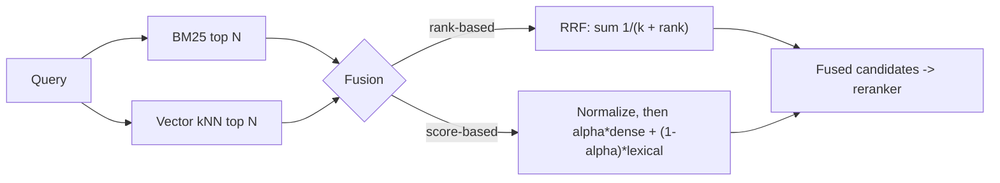

**Hybrid search** runs a lexical (keyword, usually BM25) search and a dense (embedding) search over the same corpus and merges the two result lists into one ranking. Lexical search matches exact terms: product codes, error strings, names, acronyms. Dense search matches meaning: paraphrases and synonyms. Each catches what the other misses, which is why the owner's guide recommends hybrid search wherever "exact IDs/keywords matter alongside meaning" ([Notebook](../sources/notebook-rag-cag.md)). In Anthropic's tests, adding BM25 to contextual embeddings cut retrieval failures from 3.7% to 2.9% ([Anthropic](../sources/anthropic-contextual-retrieval.md)).

## The two retrievers

**BM25 (sparse / lexical).** A bag-of-words score summed over query terms ([Elastic](../sources/elastic-practical-bm25.md)):

- **IDF:** rare terms count more than common ones.
- **Term-frequency saturation, `k1` (default 1.2):** repeated occurrences add less and less; lower k1 saturates faster.
- **Length normalization, `b` (default 0.75):** long documents are penalized; `b = 0` turns this off.

It needs no model, is cheap, explainable, and handles out-of-vocabulary strings an embedder never saw. It fails on synonyms and paraphrase.

**Dense retrieval.** An [embedding model](embeddings.md) maps query and chunk into vectors; an [ANN index](ann-indexes.md) in a [vector database](vector-databases.md) finds nearest neighbours. It captures meaning but can blur exact identifiers. There is also a theoretical ceiling: for a given embedding dimension, only a bounded number of distinct top-k result sets is reachable by any query, and state-of-the-art embedders fail a deliberately simple benchmark built to need many combinations ([Weller et al.](../sources/limits-of-embedding-retrieval.md)). Synthesis: that limit is one argument for keeping a non-embedding retriever in the loop.

## Fusion

The two retrievers produce scores on incomparable scales (BM25 is unbounded; cosine is in [-1, 1]), so you either fuse by **rank** or **normalize** the scores.

### Reciprocal rank fusion (RRF)

For each document, sum `1 / (k + rank)` over every list it appears in; `k = 60` was fixed in the original paper's pilot study and never tuned ([Cormack et al.](../sources/cormack-2009-reciprocal-rank-fusion.md)). Properties:

- Uses only ranks, so no score normalization and no training data.
- Top ranks dominate, but lower ranks still count; `k` damps a single system that puts an outlier first.
- A document found by both retrievers gets two contributions, so agreement is rewarded.
- In the 2009 study it beat every individual system and the Condorcet and CombMNZ fusion methods ([Cormack et al.](../sources/cormack-2009-reciprocal-rank-fusion.md)).

Worked example (Synthesis): a doc ranked 1st by BM25 and 3rd by vectors scores 1/61 + 1/63 = 0.0323; a doc ranked 1st by vectors only scores 1/61 = 0.0164. Agreement wins.

### Convex combination (weighted scores)

Normalize each score list (e.g. min-max), then `alpha * dense + (1 - alpha) * lexical`. Bruch et al. found a tuned convex combination beats RRF in and out of domain, that RRF is sensitive to its parameters, and that tuning alpha needs only a small labelled set ([Bruch et al.](../sources/bruch-2022-fusion-functions-hybrid-retrieval.md)).

> **Contradiction:** Cormack et al. present RRF with a fixed k = 60 as robust and consistently better than alternatives ([source](../sources/cormack-2009-reciprocal-rank-fusion.md)); Bruch et al. report RRF is parameter-sensitive and beaten by a tuned convex combination ([source](../sources/bruch-2022-fusion-functions-hybrid-retrieval.md)). Synthesis: the reconciliation is practical. RRF is the safe zero-training default; a weighted blend wins if you have labelled queries to tune alpha.

## In real engines

| Engine | API | Key knobs |
|---|---|---|
| Elasticsearch / OpenSearch-style | `rrf` retriever wrapping a `standard` (BM25) and a `knn` retriever | `rank_constant` (default 60, higher = flatter), `rank_window_size` (results per child before fusion; larger is better and slower). No scroll, sort or rescore; paging past the window returns nothing ([Elastic docs](../sources/elasticsearch-rrf-retriever-docs.md)) |
| Weaviate | `hybrid` query | `alpha` (1 = pure vector, 0 = pure keyword), `fusionType` Ranked vs Relative Score (Relative Score default since v1.24), `maxVectorDistance` (vector side only), `queryProperties` with boosts like `title^2` ([Weaviate docs](../sources/weaviate-hybrid-search-docs.md)) |

Synthesis: Postgres can do the same by combining full-text search and pgvector results in SQL and computing RRF yourself; many vector databases now ship built-in sparse + dense fusion.

## Learned sparse and multi-vector alternatives

Synthesis: learned sparse models (SPLADE-style term expansion) and multi-vector late interaction (see [ColBERT under reranking](reranking.md)) sit between BM25 and single-vector dense retrieval. They can replace one side of a hybrid, at the cost of larger indexes.

## Failure modes

- **Unbalanced candidate pools:** fusing top 10 from each side when the right doc is 40th in both. Retrieve wide (Anthropic retrieved 150 before reranking) ([Anthropic](../sources/anthropic-contextual-retrieval.md)).
- **Score fusion without normalization:** BM25's unbounded scores swamp cosine (Synthesis).
- **BM25 on poor tokenization:** language analyzers, stemming and stop words decide what "exact match" means; code and IDs may need a custom analyzer (Synthesis).
- **Chunks without context** hurt both sides; contextual BM25 (indexing the LLM-written context with the chunk) helped in Anthropic's tests ([Anthropic](../sources/anthropic-contextual-retrieval.md)).

## When to use / when not

- **Use** for enterprise and technical corpora full of identifiers, jargon and names; it is a cheap, reliable gain and pairs naturally with a [reranker](reranking.md) ([Notebook](../sources/notebook-rag-cag.md)).
- **Dense only** may suffice for conversational, paraphrase-heavy content with few exact identifiers (Synthesis).
- **BM25 only** is a strong baseline when you can't host embeddings; measure before assuming dense wins (Synthesis).

## Sources

- [Elastic: Practical BM25, Part 2](../sources/elastic-practical-bm25.md)
- [Cormack, Clarke & Büttcher 2009: Reciprocal Rank Fusion](../sources/cormack-2009-reciprocal-rank-fusion.md)
- [Bruch, Gai & Ingber 2022: Fusion Functions for Hybrid Retrieval](../sources/bruch-2022-fusion-functions-hybrid-retrieval.md)
- [Elasticsearch docs: RRF retriever](../sources/elasticsearch-rrf-retriever-docs.md)
- [Weaviate docs: Hybrid search](../sources/weaviate-hybrid-search-docs.md)
- [Anthropic: Introducing Contextual Retrieval](../sources/anthropic-contextual-retrieval.md)
- [Weller et al.: Theoretical Limitations of Embedding-Based Retrieval](../sources/limits-of-embedding-retrieval.md)
- [Notebook: RAG vs CAG vs GraphRAG](../sources/notebook-rag-cag.md)
