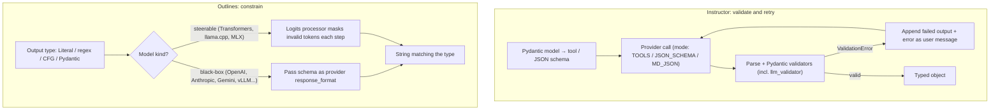

**Instructor** and **Outlines** are the two reference Python libraries for getting typed objects out of LLMs, and they embody opposite strategies. **Instructor** (Jason Liu / 567-labs, MIT, v1.17 as of 2026-09) wraps a provider SDK, sends a Pydantic model as a tool or schema, *validates* the reply with Pydantic after generation, and *re-asks* the model with the validation error until it passes or retries run out ([Instructor](../sources/instructor-docs.md)). **Outlines** (.txt, Apache-2.0, v1.3 as of 2026-08) *constrains* generation itself: for local models it masks invalid tokens at every step so the output cannot violate the type; for API models it hands the schema to the provider's strict mode ([Outlines](../sources/outlines-docs.md)). One fixes errors after the fact; the other makes structural errors impossible. Both sit on top of the provider features described in [structured outputs](structured-outputs.md) and the engine mechanics in [constrained decoding](constrained-decoding.md).



Synthesis: diagram assembled from both libraries' docs ([Instructor](../sources/instructor-docs.md), [Outlines](../sources/outlines-docs.md)).

## Instructor: how it works

**Client and call.** `instructor.from_provider("openai/gpt-4o-mini")` (also Anthropic, Google, Ollama, Groq, Mistral, Cohere, DeepSeek, vLLM, llama-cpp-python; `async_client=True` for async) returns a patched client. Patching wraps `create()` and adds three parameters: `response_model`, `max_retries` (default 0) and `context` ([Instructor](../sources/instructor-docs.md)).

```python
import instructor
from pydantic import BaseModel, field_validator

class Invoice(BaseModel):
    vendor: str
    total: float
    currency: str

    @field_validator("currency")
    @classmethod
    def iso(cls, v):
        if len(v) != 3 or not v.isupper():
            raise ValueError("currency must be an ISO 4217 code like 'EUR'")
        return v

client = instructor.from_provider("anthropic/claude-sonnet-4-5")
inv = client.chat.completions.create(
    response_model=Invoice,
    max_retries=2,
    messages=[{"role": "user", "content": text}],
)
```

**Modes** decide how the schema reaches the model, and therefore whether there is any decoding-time guarantee ([Instructor](../sources/instructor-docs.md)):

| Mode | Mechanism | Guarantee at generation time |
|---|---|---|
| `TOOLS` (default for OpenAI, Anthropic, Google) | schema sent as a function/tool definition; arguments parsed | only if the provider enforces strict tools |
| `JSON_SCHEMA` | provider-native schema enforcement (`response_format` etc.) | yes, within the provider's schema subset |
| `MD_JSON` | prompt for JSON, extract from text or a code fence | none; fallback for models without tools |
| `PARALLEL_TOOLS` | several tool calls in one response | as `TOOLS` |
| `RESPONSES_TOOLS` | tools via OpenAI Responses API | as `TOOLS` |

Provider-specific names (`ANTHROPIC_TOOLS`, `TOOLS_STRICT`, `ANTHROPIC_JSON`, `MISTRAL_STRUCTURED_OUTPUTS`…) are deprecated aliases of these core modes ([Instructor](../sources/instructor-docs.md)).

**Reask loop.** On a Pydantic `ValidationError` or JSON decode error, Instructor appends the model's failed output and a user message carrying the error text, then calls again. Because Pydantic errors name the field and the reason, the model gets targeted feedback. `max_retries=2` means up to two re-attempts and does not guarantee success; exhaustion raises `InstructorRetryException` with `n_attempts` and `failed_attempts` ([Instructor](../sources/instructor-docs.md)). This is the same pattern as Pydantic AI's output retries, where validation failures are sent back to the model and the output retry budget defaults to 1 ([Pydantic AI](../sources/pydantic-ai-docs.md)).

**Validators are the real value.** Field and model validators can encode business rules no grammar can: cross-field checks, lookups against runtime `context` (for example, "this quote must appear in the source document"), or `llm_validator`, which asks an LLM to judge a field against a natural-language rule ([Instructor](../sources/instructor-docs.md)). Synthesis: that turns Instructor into a lightweight [guardrail](agent-guardrails.md) and [verification](verification-and-evals.md) layer, at the cost of extra calls.

**Retries and cost control.** There are two retry layers: the SDK's transport retries (`OpenAI(max_retries=…)`) and Instructor's validation retries. Instructor does not retry rate-limit or connection errors by default. You can pass a Tenacity `Retrying` as `max_retries` (then set SDK retries to 0 to avoid nesting), and bound cost with `timeout` and `token_budget`. The docs suggest 2–3 attempts for validation errors, and `disable_pydantic_error_url()` to trim error-message tokens ([Instructor](../sources/instructor-docs.md)). See [rate limits and retries](rate-limits-and-retries.md).

**Streaming.** `create_partial` / `Partial[Model]` yields progressively filled objects (fields `None` until generated); `create_iterable` yields list items one by one; hooks (`client.on("completion:error", …)`) support logging ([Instructor](../sources/instructor-docs.md)). See [streaming](streaming.md).

## Outlines: how it works

```python
import outlines
from typing import Literal
from transformers import AutoTokenizer, AutoModelForCausalLM

model = outlines.from_transformers(
    AutoModelForCausalLM.from_pretrained("microsoft/Phi-3-mini-4k-instruct"),
    AutoTokenizer.from_pretrained("microsoft/Phi-3-mini-4k-instruct"),
)
label = model("Classify: 'changed my life!'", Literal["Positive", "Negative", "Neutral"])
review_json = model(prompt, ProductReview, max_new_tokens=200)   # a JSON string
review = ProductReview.model_validate_json(review_json)
```

The call is always `model(prompt, output_type)`. Output types are Python basic types, `Literal` choices, Pydantic/JSON Schema, regex and CFGs ([Outlines](../sources/outlines-docs.md)). Internally, Python types become `Term`s; JSON Schema and CFG terms go to the backend directly, and everything else is lowered to a regex ([Outlines](../sources/outlines-docs.md)).

- **Steerable models** (Transformers, llama.cpp, MLX-LM): a `SteerableGenerator` builds and caches a logits processor that sets illegal tokens to −∞ each step. Backends: `outlines_core` (Rust FSM index, the Willard–Louf method; default for regex and JSON Schema), `llguidance` (the only one for CFGs), `xgrammar`; override with `backend=` ([Outlines](../sources/outlines-docs.md), [Willard & Louf](../sources/efficient-guided-generation-outlines.md)).
- **Black-box models** (OpenAI, Anthropic, Gemini, Mistral, vLLM, SGLang, TGI, Ollama): Outlines converts the type into the provider's `response_format` and the provider enforces it. Even for vLLM (including offline vLLM) and Ollama, Outlines delegates to the engine's own structured-output support rather than masking itself ([Outlines](../sources/outlines-docs.md)).
- **Compilation**: a steerable generator caches its logits processor and only resets its state per call ([Outlines](../sources/outlines-docs.md)), but FSM-index compilation for JSON schemas was measured at 3.5–8.1 s in early 2025 ([JSONSchemaBench](../sources/jsonschemabench-2025.md)), so Synthesis: the FSM backend pays off on repeated schemas.

## Comparison

| | Instructor | Outlines |
|---|---|---|
| Core idea | validate after generation, re-ask on failure | mask during generation |
| Structural guarantee | only via provider strict mode (`JSON_SCHEMA`, strict tools) | yes on steerable models; provider's on black-box models |
| Semantic validation | yes (any Python validator, `llm_validator`, `context`) | no; you validate the returned string yourself |
| Output types | Pydantic models (also lists, partials) | Literal, regex, CFG, JSON Schema/Pydantic, basic types |
| Latency profile | 1 call when valid; +1 full call per retry | single pass; compile cost on first use; per-token mask cost |
| Token cost | grows with each retry (conversation resent) | no retries; forced tokens can even be fast-forwarded |
| Best fit | hosted APIs, business-rule validation, multi-provider apps | self-hosted / local models, classification, regex IDs, DSLs |
| Ecosystem | ports in TS, Go, Ruby, Elixir, Rust | Python; .txt also sells a hosted API |

Sources: [Instructor](../sources/instructor-docs.md), [Outlines](../sources/outlines-docs.md), [llguidance](../sources/llguidance-github.md).

Synthesis: they are complements, not rivals. The strongest production pattern is **constrain, then validate**: enforce structure with the provider's strict mode or an Outlines-style engine so parse failures vanish, then run Pydantic validators for meaning, with one or two bounded retries. Instructor in `JSON_SCHEMA` mode on a strict-capable provider is exactly that. Pydantic AI offers the same three options as `NativeOutput`, tool output and `PromptedOutput` ([Pydantic AI](../sources/pydantic-ai-docs.md)); see [Pydantic AI](pydantic-ai.md).

## Failure modes

1. **Retry storms (Instructor).** Without a stop condition or `token_budget`, a schema the model can't satisfy burns calls; each retry also resends the failed output ([Instructor](../sources/instructor-docs.md)). Track `failed_attempts` in [observability](llm-observability.md).
2. **False confidence in `TOOLS`/`MD_JSON`.** These modes give no decoding guarantee; malformed or missing fields are only caught by validation ([Instructor](../sources/instructor-docs.md)).
3. **Schema translation loss.** The Pydantic model is the source of truth, but providers accept subsets: Anthropic rejects numeric bounds (its SDK moves them into descriptions and re-validates), OpenAI requires every field to be `required`, Gemini silently drops length keywords ([Anthropic](../sources/anthropic-structured-outputs-docs.md), [OpenAI](../sources/openai-structured-outputs-guide.md), [Gemini](../sources/gemini-structured-outputs-docs.md)). Synthesis: Pydantic constraints that the provider ignores are enforced only by the client-side validation step, which is a good reason to keep it.
4. **Truncation and refusals** pass through both libraries as provider behaviour: check stop reasons before parsing ([OpenAI](../sources/openai-structured-outputs-guide.md), [Anthropic](../sources/anthropic-structured-outputs-docs.md)).
5. **Enum drift.** A hosted model may return `"positive"` for `"Positive"` ([Anthropic](../sources/anthropic-structured-outputs-docs.md)); a Pydantic `Enum`/`Literal` will reject it and trigger a retry. Synthesis: add a `BeforeValidator` that normalises case to avoid paying for a retry.
6. **Engine coverage gaps (Outlines).** On hard real-world schemas, the FSM backend accepted very few (0.03 empirical coverage on "GitHub Hard" in JSONSchemaBench), so switch backend (`llguidance`) for complex or recursive schemas ([JSONSchemaBench](../sources/jsonschemabench-2025.md), [Outlines](../sources/outlines-docs.md)).
7. **Quality pressure.** Answer-first schemas force the model to commit before reasoning; see the quality discussion in [constrained decoding](constrained-decoding.md).

## When to use which

- **Hosted frontier model, simple schema:** use the provider's native structured outputs (SDK `parse()` helpers) directly; add Instructor only if you need validators, retries or multiple providers ([structured outputs](structured-outputs.md)).
- **Business rules, extraction with provenance checks, multi-provider:** Instructor in `TOOLS` or `JSON_SCHEMA` mode, `max_retries` 1–3, Tenacity for transport errors ([Instructor](../sources/instructor-docs.md)).
- **Local / open-weight model, classification, regex-shaped IDs, SQL or DSL grammar:** Outlines on a steerable model, or the server's grammar support (vLLM, llama.cpp) ([Outlines](../sources/outlines-docs.md)). See [local LLMs](local-llms.md).
- **Inside an agent framework:** prefer the framework's own output typing ([Pydantic AI](pydantic-ai.md), [LangChain](langchain.md)) rather than layering Instructor on top.
- **Not for:** free-form prose, or forcing a schema on a model that lacks the information (it will fabricate to fit; give it a null or "not found" option) ([OpenAI](../sources/openai-structured-outputs-guide.md)). The owner's rule of thumb applies: for anything code consumes, ask for a schema, not prose ([Notebook](../sources/notebook-prompt-engineering.md)).

## Sources

- [Instructor Documentation and README](../sources/instructor-docs.md)
- [Outlines Documentation and README](../sources/outlines-docs.md)
- [Efficient Guided Generation for LLMs (Outlines paper)](../sources/efficient-guided-generation-outlines.md)
- [llguidance README](../sources/llguidance-github.md)
- [JSONSchemaBench](../sources/jsonschemabench-2025.md)
- [Pydantic AI Docs](../sources/pydantic-ai-docs.md)
- [OpenAI Structured Outputs Guide](../sources/openai-structured-outputs-guide.md)
- [Anthropic Structured Outputs Docs](../sources/anthropic-structured-outputs-docs.md)
- [Gemini Structured Outputs Docs](../sources/gemini-structured-outputs-docs.md)
- [Notebook: Prompt & Context Engineering](../sources/notebook-prompt-engineering.md)
