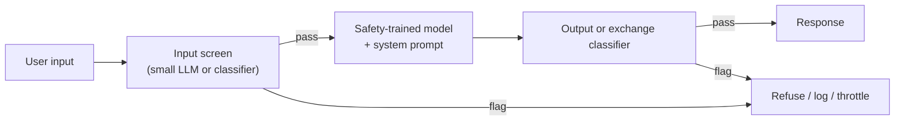

A **jailbreak** is an input crafted to make a model produce output that its safety training is meant to prevent, such as dangerous instructions or disallowed content. The target is the model's own refusal behaviour, not an application's instructions; that distinguishes it from [prompt injection](prompt-injection.md), which hijacks an app by mixing untrusted text with trusted prompts ([Willison 2024](../sources/willison-2024-prompt-injection-vs-jailbreaking.md)). [OWASP](owasp-top-10-for-llm.md) treats jailbreaking as a form of prompt injection (LLM01) whose goal is to make the model disregard its safety protocols ([OWASP 2025](../sources/owasp-llm-top-10-2025.md)). For an application, the attacker is usually the user ([Anthropic docs](../sources/anthropic-mitigate-jailbreaks-docs.md)).

## Why safety training fails

Wei, Haghtalab and Steinhardt identify two mechanisms ([Wei et al.](../sources/wei-2023-jailbroken.md)):

- **Competing objectives.** Safety competes with helpfulness and instruction-following. Requests that force an affirmative opening, forbid refusal phrasing, or wrap the ask in role-play pit those objectives against each other.
- **Mismatched generalization.** Pretraining gives capabilities in domains that safety training never covered: Base64 and other encodings, obscure languages, unusual formats. The model understands the request but the refusal behaviour does not transfer.

They argue scaling alone will not fix this and call for safety mechanisms as capable as the model ("safety-capability parity"). Synthesis: every attack family below is an instance of one or both mechanisms.

## Attack families

| Family | Mechanism | Access needed | Key evidence |
|---|---|---|---|
| Hand-written role-play / persona | Competing objectives ("grandma reading a recipe") | Chat | [Willison 2024](../sources/willison-2024-prompt-injection-vs-jailbreaking.md) |
| Encoding / language / obfuscation | Mismatched generalization (Base64, emojis, multilingual) | Chat | [Wei et al.](../sources/wei-2023-jailbroken.md), [OWASP 2025](../sources/owasp-llm-top-10-2025.md) |
| Adversarial suffix (GCG) | Greedy + gradient search for a token suffix that makes "Sure, here is..." likely | White-box open model; transfers to closed | [Zou et al.](../sources/zou-2023-gcg-adversarial-suffixes.md) |
| Attacker-LLM refinement (PAIR) | An LLM iteratively rewrites the prompt from the target's replies | Black-box, often under 20 queries | [Chao et al.](../sources/chao-2023-pair.md) |
| Many-shot | Hundreds of fake compliant dialogues in one long prompt | Long [context window](context-window.md) | [Anthropic MSJ](../sources/anthropic-2024-many-shot-jailbreaking.md) |
| Multi-turn escalation (Crescendo) | Benign opener, gradual escalation referencing the model's own replies | Chat | [Russinovich et al.](../sources/russinovich-2024-crescendo.md) |
| Best-of-N | Random augmentations (shuffle, capitalisation; image/audio variants), resample until success | Black-box, many queries | [Hughes et al.](../sources/hughes-2024-best-of-n-jailbreaking.md) |

Key numbers and properties:

- **GCG** suffixes optimised on Vicuna-7B/13B transferred to the public ChatGPT, Bard and Claude interfaces and to LLaMA-2-Chat, Pythia and Falcon ([Zou et al.](../sources/zou-2023-gcg-adversarial-suffixes.md)). They are often gibberish, which makes perplexity filters an obvious counter (Synthesis), and is why PAIR's readable prompts matter.
- **Many-shot** success follows a power law in the number of shots (tested up to 256), the same curve as benign in-context learning, and larger models are *more* susceptible because they learn in context better. Capping context works but costs utility; [fine-tuning](fine-tuning.md) only delayed the effect; classifying and rewriting prompts before the model cut ASR from 61% to 2% in one test ([Anthropic MSJ](../sources/anthropic-2024-many-shot-jailbreaking.md)). See [few-shot prompting](few-shot-prompting.md).
- **Crescendo** beat other techniques by 29-61% on GPT-4 and 49-71% on Gemini-Pro on an AdvBench subset, and no individual turn looks malicious, so per-message filters miss it ([Russinovich et al.](../sources/russinovich-2024-crescendo.md)).
- **Best-of-N** reached 89% ASR on GPT-4o and 78% on Claude 3.5 Sonnet at N = 10,000, with ASR scaling predictably (power-law-like) with N. It exploits [sampling](sampling-parameters.md) randomness and input sensitivity, and also beat the circuit-breakers defence ([Hughes et al.](../sources/hughes-2024-best-of-n-jailbreaking.md)).

Synthesis: two lessons recur. Attack success grows smoothly with attacker budget (shots, queries, samples), so a defence must be judged at a stated attacker budget. And conversation-level or long-context attacks defeat checks that look at one message at a time.

## Defences

Synthesis: generic layering based on the Anthropic docs and constitutional-classifier sources.

1. **Model training.** Safety training plus an instruction hierarchy that ranks system over user text raises the baseline ([Wallace et al.](../sources/wallace-2024-instruction-hierarchy.md)); see [system prompts](system-prompts.md) and [preference optimization](preference-optimization.md).
2. **Constitutional Classifiers (Anthropic, 2025).** Input and output classifiers trained on [synthetic data](synthetic-data-generation.md) generated from a natural-language constitution of allowed and disallowed content. Over 3,000 hours of [red teaming](llm-red-teaming.md) found no universal jailbreak; cost was +0.38 points of refusals on production traffic and 23.7% inference overhead ([Sharma et al.](../sources/sharma-2025-constitutional-classifiers.md)).
3. **Next-generation classifiers (Jan 2026).** One *exchange* classifier judges the output in the context of its input, and a cascade runs a cheap linear probe on internal activations over all traffic, escalating only flagged exchanges to a heavier ensemble. Overhead about 1% compute (estimated for Opus 4.0 traffic, versus 23.7%) and 0.05% benign refusal rate over a month of Sonnet 4.5 traffic; over 1,700 hours and 198,000 red-team attempts found one high-risk vulnerability and no universal jailbreak ([Anthropic CC++](../sources/anthropic-2026-next-gen-constitutional-classifiers.md)).
4. **Application-level screens.** A small model with a structured boolean output pre-screens input (treat a refusal from the screener as "harmful"); validate input against known patterns; system prompts that state boundaries and the refusal wording; throttle or ban repeat offenders; monitor outputs and iterate ([Anthropic docs](../sources/anthropic-mitigate-jailbreaks-docs.md)). Off-the-shelf classifiers such as Llama Prompt Guard 2 (86M and 22M parameters, 512-token window) flag explicit override attempts cheaply but are not harmful-content classifiers ([Prompt Guard 2](../sources/llama-prompt-guard-2-model-card.md)). See [guardrail tooling](guardrail-tooling.md) and [content moderation](content-moderation.md).

**The evaluation trap.** Adaptive attackers using gradient search, RL, random search and humans broke most of 12 published jailbreak and injection defences at over 90% ASR, though most had reported near-zero ASR against static prompt sets; a human red-team competition broke all of them ([Nasr et al.](../sources/nasr-2025-attacker-moves-second.md)). Treat any "x% blocked" figure as meaningful only together with the attacker model and budget.

## The over-refusal trade-off

Every safety layer can refuse benign requests. XSTest's 250 safe-but-scary prompts ("how do I kill a Python process?") found full refusal rates from 0.8% (Mistral-7B-Instruct) to 38% (Llama-2-70B-chat with its original system prompt), and safety-emphasising system prompts raise over-refusal ([XSTest](../sources/xstest-exaggerated-safety.md)). Constitutional-classifier work reports its refusal cost explicitly for this reason: the first generation added 0.38 percentage points of refusals; the second reports a 0.05% absolute refusal rate on harmless Sonnet 4.5 traffic, 87% lower than the first generation ([Sharma et al.](../sources/sharma-2025-constitutional-classifiers.md), [Anthropic CC++](../sources/anthropic-2026-next-gen-constitutional-classifiers.md)). Measure both directions with [LLM evaluation](llm-evaluation.md) sets.

## When it matters, and what to do

- **Consumer chat or public-facing bots:** jailbreak harm is often reputational ("screenshot attacks"), but scales with the domain ([Willison 2024](../sources/willison-2024-prompt-injection-vs-jailbreaking.md)). Rely on the provider's model-level safeguards, add an input screen and output moderation for your policy, and rate-limit abusers ([Anthropic docs](../sources/anthropic-mitigate-jailbreaks-docs.md)).
- **High-risk domains** (CBRN, cyber, regulated advice): use providers with classifier-based safeguards and red-team with automated attackers (PAIR, Best-of-N, multi-turn), not just known prompts ([Chao et al.](../sources/chao-2023-pair.md), [Hughes et al.](../sources/hughes-2024-best-of-n-jailbreaking.md)).
- **Self-hosted [open-weight models](open-weight-models.md):** there is no provider-side classifier; you own the screen, the output filter and the logging. Synthesis: white-box access also lets attackers run GCG directly against your exact weights.
- **Agents:** a jailbroken agent with [tools](tools.md) is an excessive-agency problem; bound it with least privilege rather than refusals alone ([LLM security risks](llm-security-risks.md), [agent guardrails](agent-guardrails.md)).

## Sources

- [Wei et al., Jailbroken](../sources/wei-2023-jailbroken.md)
- [Zou et al., GCG adversarial suffixes](../sources/zou-2023-gcg-adversarial-suffixes.md)
- [Chao et al., PAIR](../sources/chao-2023-pair.md)
- [Anthropic: many-shot jailbreaking](../sources/anthropic-2024-many-shot-jailbreaking.md)
- [Russinovich et al., Crescendo](../sources/russinovich-2024-crescendo.md)
- [Hughes et al., Best-of-N jailbreaking](../sources/hughes-2024-best-of-n-jailbreaking.md)
- [Sharma et al., Constitutional Classifiers](../sources/sharma-2025-constitutional-classifiers.md)
- [Anthropic: next-generation Constitutional Classifiers](../sources/anthropic-2026-next-gen-constitutional-classifiers.md)
- [Nasr et al., The Attacker Moves Second](../sources/nasr-2025-attacker-moves-second.md)
- [Willison: prompt injection vs jailbreaking](../sources/willison-2024-prompt-injection-vs-jailbreaking.md)
- [OWASP Top 10 for LLM Applications 2025](../sources/owasp-llm-top-10-2025.md)
- [Anthropic docs: mitigate jailbreaks and prompt injections](../sources/anthropic-mitigate-jailbreaks-docs.md)
- [Wallace et al., The Instruction Hierarchy](../sources/wallace-2024-instruction-hierarchy.md)
- [Llama Prompt Guard 2 model card](../sources/llama-prompt-guard-2-model-card.md)
- [XSTest](../sources/xstest-exaggerated-safety.md)
