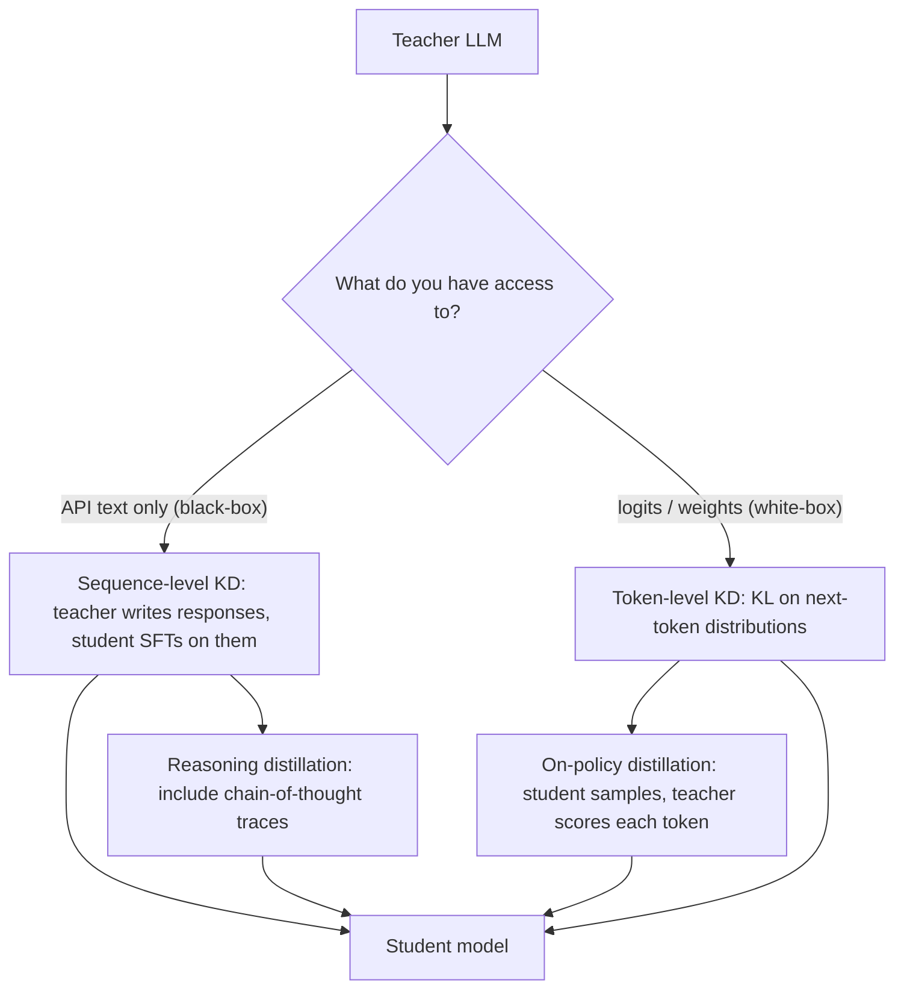

**Knowledge distillation** trains a small **student** model to reproduce the behaviour of a large, already-trained **teacher**. The student learns from the teacher's full output distribution, or from text the teacher generated, rather than only from ground-truth labels. That gives it a richer training signal, so it ends up better than an identical model trained on the labels alone ([Hinton et al.](../sources/hinton-distillation-2015.md), [notebook](../sources/notebook-knowledge-distillation.md)). For LLMs, distillation is how many small open models and small reasoning models get their abilities. It also often gives the best [cost and latency](cost-and-latency-optimization.md) for a narrow task.

## Classic distillation: soft targets and temperature

A confident model's softmax is nearly one-hot, which hides how it ranks the wrong answers. Hinton's fix is to raise the softmax **temperature** `q_i = exp(z_i/T) / Σ exp(z_j/T)` for both teacher and student during training, then return to T=1 at inference ([Hinton et al.](../sources/hinton-distillation-2015.md)). The softened probabilities over wrong classes are the teacher's "dark knowledge" about which things resemble which ([notebook](../sources/notebook-knowledge-distillation.md)).

```
L = α · T² · KL( softmax(z_teacher/T) ‖ softmax(z_student/T) ) + (1 − α) · CE( y, softmax(z_student) )
```

- **T² factor.** Soft-target gradients scale as 1/T², so multiplying by T² keeps the two terms balanced as T changes. Hinton found it best to give the hard-label term the lower weight ([Hinton et al.](../sources/hinton-distillation-2015.md)).
- **Choosing T.** Typically 2–10, with 3–5 a common start ([notebook](../sources/notebook-knowledge-distillation.md)). On MNIST, students with 300+ units per layer did about equally well at any T above 8. Tiny students (30 units) did best at T of 2.5–4 ([Hinton et al.](../sources/hinton-distillation-2015.md)).
- **α.** Often 0.5–0.9. Use α=1 when the transfer set has no labels ([notebook](../sources/notebook-knowledge-distillation.md)).
- **Evidence.** A small MNIST net fell from 146 to 74 errors when trained on soft targets from a 67-error teacher. Soft targets also acted as a regulariser: a speech model trained on 3% of the data generalised well with soft targets but overfit with hard labels ([Hinton et al.](../sources/hinton-distillation-2015.md)).

Kinds of knowledge transferred ([notebook](../sources/notebook-knowledge-distillation.md)):

- **response-based:** match the outputs
- **feature-based:** match hidden layers
- **relation-based:** match relationships between examples

Training schemes ([notebook](../sources/notebook-knowledge-distillation.md)):

- **offline:** frozen teacher
- **online:** teacher and student trained together
- **self-distillation:** the model teaches itself

## Distillation for LLMs



*Synthesis:* the taxonomy combines the notebook, GKD and Thinking Machines sources.

- **Sequence-level / black-box.** The teacher generates outputs, often via an API, and the student is fine-tuned on that text with ordinary SFT. This is how many instruction-tuned open models were bootstrapped ([notebook](../sources/notebook-knowledge-distillation.md)). Managed versions exist: on [Amazon Bedrock](amazon-bedrock.md) you pick a teacher and a student and supply prompts. Bedrock generates the teacher's responses and fine-tunes the student ([Bedrock](../sources/bedrock-model-customization.md)).
- **White-box / token-level.** With teacher logits available you can match the full per-token distribution, not just sampled text ([notebook](../sources/notebook-knowledge-distillation.md)). This requires a shared tokenizer, or a mapping between tokenizers.
- **Reasoning distillation.** DeepSeek generated about 800k samples (about 600k reasoning traces, filtered for correctness by rejection sampling, plus about 200k non-reasoning) with DeepSeek-R1. With **SFT only, no RL**, it distilled them into Qwen2.5 (1.5B–32B) and Llama (8B, 70B) students. The distilled Qwen-32B clearly beat the same base model trained with more than 10k steps of large-scale RL. The authors concluded that for small models, distilling from a stronger model is both more effective and cheaper than RL ([R1](../sources/deepseek-r1-paper.md)). See [reasoning models](reasoning-models.md).
- **On-policy distillation (GKD).** Plain sequence-level distillation trains the student on sequences it wouldn't produce itself, so its errors compound at inference. GKD trains on the student's *own* samples with teacher feedback, and allows divergences other than forward KL when the student can't represent the teacher's full distribution ([GKD](../sources/gkd-agarwal-2023.md)). Thinking Machines uses per-token reverse KL to the teacher on student rollouts as a dense reward. In its own experiment, a Qwen3-8B student went from 60% to 70% on AIME'24 in about 150 steps, matching RL, at an estimated 9–30× less compute than continuing SFT on teacher outputs (30× when the teacher's sampling cost is counted). The post also cites the Qwen3 technical report, where on-policy distillation scored 74.4% on AIME'24 with about 1,800 GPU-hours against 67.6% for RL with about 17,920 ([Thinking Machines](../sources/on-policy-distillation-thinking-machines.md)). TRL ships `DistillationTrainer` (stable) and `GKDTrainer` (experimental) ([TRL](../sources/hugging-face-trl-docs.md)).
- **Distillation as repair.** After mid-training Qwen3-8B on internal documents dropped IF-eval from 85% to 45% (79% when 30% chat data was mixed in), on-policy distillation with the *original* model as teacher restored it to 83% and kept most of the new knowledge. This is a tool against catastrophic forgetting in [fine-tuning](fine-tuning.md) ([Thinking Machines](../sources/on-policy-distillation-thinking-machines.md)).

| Variant | Teacher access | Student training | Cost | Main weakness |
|---|---|---|---|---|
| Sequence-level (SFT on teacher text) | Text | Off-policy SFT | Teacher generation + SFT | Compounding errors off the teacher's path; inherits teacher mistakes |
| Token-level KD | Logits | KL on teacher distributions | Teacher forward passes | Needs white-box access and compatible tokenizers |
| Reasoning traces | Text | SFT on CoT | Long sequences | Student imitates the *form* of reasoning beyond its capacity |
| On-policy (GKD / reverse KL) | Log-probs on student samples | RL-like, dense per-token reward | Student sampling + teacher scoring | More infrastructure than SFT |

The weaknesses column draws on [GKD](../sources/gkd-agarwal-2023.md), [Thinking Machines](../sources/on-policy-distillation-thinking-machines.md) and the [notebook](../sources/notebook-knowledge-distillation.md). The "beyond its capacity" point is *Synthesis*.

## Limits and failure modes

- **Teacher ceiling and errors.** The student inherits the teacher's biases and hallucinations, and can't exceed what the teacher knows on a given example. A miscalibrated teacher passes on bad targets ([notebook](../sources/notebook-knowledge-distillation.md)).
- **Capacity gap.** A teacher far larger than the student can transfer *worse*. A mid-size "teacher assistant" can bridge the gap ([notebook](../sources/notebook-knowledge-distillation.md)). Hinton also saw very small students prefer lower temperatures ([Hinton et al.](../sources/hinton-distillation-2015.md)).
- **Transfer-set coverage.** Distillation moves knowledge but doesn't create it. Gaps in the prompts become gaps in the student ([notebook](../sources/notebook-knowledge-distillation.md)).
- **Licensing.** Several commercial terms of service forbid using outputs to train competing models. Check before black-box distillation ([notebook](../sources/notebook-knowledge-distillation.md)).
- **Exposure bias** in off-policy distillation ([GKD](../sources/gkd-agarwal-2023.md), [Thinking Machines](../sources/on-policy-distillation-thinking-machines.md)).

## When to use, and when not

- **Use it** when inference cost or latency dominates and the task is narrow enough for a small model; when you must deploy on-device or on cheaper hardware ([local LLMs](local-llms.md)); when you want a small reasoning model (distillation beat RL for small models in R1); or to collapse an ensemble or a long-prompt pipeline into one model ([notebook](../sources/notebook-knowledge-distillation.md), [R1](../sources/deepseek-r1-paper.md)).
- **Skip it** when there is no strong teacher, no representative prompt set, or the licence forbids it, or when a smaller off-the-shelf model already meets your [evals](llm-evaluation.md).
- **Stack it.** Distillation composes with [quantization](quantization.md) and pruning: distil first, then quantize the student ([notebook](../sources/notebook-knowledge-distillation.md)). The student is usually trained with [LoRA](peft-and-lora.md) or full SFT.

## Sources

- [Notebook: Knowledge Distillation](../sources/notebook-knowledge-distillation.md)
- [Distilling the Knowledge in a Neural Network (Hinton et al., 2015)](../sources/hinton-distillation-2015.md)
- [GKD: On-Policy Distillation of Language Models](../sources/gkd-agarwal-2023.md)
- [On-Policy Distillation (Thinking Machines)](../sources/on-policy-distillation-thinking-machines.md)
- [DeepSeek-R1](../sources/deepseek-r1-paper.md)
- [Amazon Bedrock model customization](../sources/bedrock-model-customization.md)
- [Hugging Face TRL docs](../sources/hugging-face-trl-docs.md)
