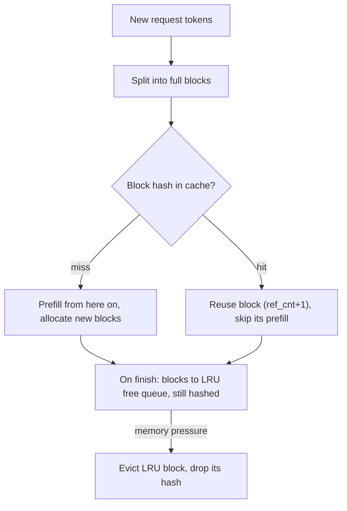

The **KV cache** stores the attention key and value vectors of every token a sequence has seen so far, in every layer. Each new token's query attends to all previous keys and values. Caching them means a decode step computes K/V only for the new token instead of reprocessing the whole prefix. The cost is memory that grows linearly with sequence length and batch size. In serving, the KV cache, not compute, usually limits how many requests fit on a GPU. That makes its size and management central to [LLM inference serving](llm-inference-serving.md) ([NVIDIA](../sources/nvidia-mastering-llm-inference-optimization.md), [Kwon et al.](../sources/vllm-pagedattention-paper.md)). For attention basics see [transformer architecture](transformer-architecture.md).

## Size math

Per token, across the whole model:

```
kv_bytes_per_token = 2 (K and V) × num_layers × num_kv_heads × head_dim × bytes_per_element
kv_bytes_total     = kv_bytes_per_token × total tokens resident (Σ over sequences of context length)
```

([NVIDIA](../sources/nvidia-mastering-llm-inference-optimization.md)). With full multi-head attention, `num_kv_heads × head_dim = hidden_size`.

Worked examples:

| Model | Layers | KV heads × head dim | Dtype | Per token | One sequence |
|---|---|---|---|---|---|
| OPT-13B (MHA) | 40 | 5120 | FP16 | ~800 KB | 1.6 GB at 2,048 tokens ([Kwon et al.](../sources/vllm-pagedattention-paper.md)) |
| Llama 2 7B (MHA) | 32 | 4096 | FP16 | 0.5 MiB | ~2 GB at 4,096 tokens ([NVIDIA](../sources/nvidia-mastering-llm-inference-optimization.md)) |
| Qwen2.5-72B (GQA, 8 KV heads) | 80 | 8 × 128 = 1024 | BF16 | 320 KiB | 10 GiB at 32,768 tokens |
| Same model, FP8 KV | 80 | 1024 | FP8 | 160 KiB | 5 GiB at 32,768 tokens |

The Qwen rows are computed from its [config](../sources/qwen2-5-72b-instruct-config.md): 2 × 80 × 8 × 128 × 2 B = 327,680 B. Synthesis: without GQA (64 KV heads) the same model would need 2.5 MiB per token, which is 8x more. A 32k-token context would then take 80 GiB (about 86 GB), more than the entire memory of an 80 GB GPU.

**GPU memory budget.** Synthesis: total ≈ weights + KV cache + activations/workspace. Weights ≈ parameters × bytes per parameter (a 7B model at FP16 is about 14 GB, per [NVIDIA](../sources/nvidia-mastering-llm-inference-optimization.md)). vLLM pre-allocates whatever its `gpu_memory_utilization` fraction leaves after the weights as KV blocks ([vLLM docs](../sources/vllm-optimization-and-tuning-docs.md)). Concurrency ≈ KV budget / (per-token KV × average resident context). For example, a 72B model in BF16 (~145 GB of weights) on 2×80 GB GPUs leaves at most about 10-15 GB, and less after activations and the headroom `gpu_memory_utilization` keeps back: at best roughly one 32k-token sequence. Quantizing the weights to FP8 frees about 70 GB, enough for about seven more such sequences. This is why [quantization](quantization.md) often buys throughput, not just a lower GPU count. Anyscale made the same point empirically: a 13B model on a 40 GB A100 holds only about 14k tokens of state ([Anyscale](../sources/anyscale-continuous-batching.md)).

## Why decode is memory-bound

Each decode step reads every weight plus the KV cache of every sequence in the batch, but does little arithmetic per byte. Model Bandwidth Utilization therefore counts weight bytes plus KV bytes per output-token time ([Databricks](../sources/databricks-llm-inference-performance-engineering.md)). Long contexts make KV reads a growing share of each step.

## Shrinking the cache at the architecture level

- **MQA** keeps one K/V head shared by all query heads. It is fast but can lose quality ([GQA paper](../sources/gqa-grouped-query-attention.md)).
- **GQA** shares each K/V head across a group of query heads, so the cache shrinks by query heads / KV heads (8x for Qwen2.5-72B). Uptrained GQA gets close to MHA quality at close to MQA speed, and conversion costs about 5% of pre-training compute ([GQA paper](../sources/gqa-grouped-query-attention.md)). Llama 2 70B uses it ([NVIDIA](../sources/nvidia-mastering-llm-inference-optimization.md)).
- **MLA** (Multi-head Latent Attention, DeepSeek-V2) caches a compressed latent vector instead of per-head K/V. DeepSeek reports a 93.3% smaller KV cache and 5.76x the maximum throughput of DeepSeek 67B ([DeepSeek-V2](../sources/deepseek-v2-mla.md)).

These are fixed at training time. A deployer chooses them by choosing the model (see [open-weight models](open-weight-models.md)).

## Managing the cache in the engine

### Paging (PagedAttention)

Contiguous per-request reservation wasted 60-80% of KV memory: only 20.4%-38.2% held real tokens. vLLM splits the cache into fixed blocks (16 tokens by default), allocates them on demand and indexes them through a block table. Reference counts and copy-on-write let parallel samples and beams share blocks ([Kwon et al.](../sources/vllm-pagedattention-paper.md)). When blocks run out, sequences are preempted and later recomputed (the vLLM V1 default) or swapped to CPU ([vLLM docs](../sources/vllm-optimization-and-tuning-docs.md)).

### Prefix caching (cross-request reuse)

When requests share a prefix (system prompt, tool definitions, few-shot examples, chat history, a RAG document), the engine can reuse the cached KV for it and skip that part of prefill. This cuts TTFT and compute. Two designs:



Diagram of vLLM's scheme, drawn from the [vLLM prefix caching docs](../sources/vllm-automatic-prefix-caching-docs.md).

| | vLLM Automatic Prefix Caching | SGLang RadixAttention |
|---|---|---|
| Index | Hash per full block, chained: hash(parent hash, tokens, extras) | Radix tree over token sequences (on CPU) |
| Granularity | Full blocks only; a partial last block is not reused | Tree nodes, KV paged with one token per page |
| Eviction | LRU free queue with ref counts; a sequence's tail block goes first | LRU over leaf nodes, recursively |
| Isolation | LoRA ID, multimodal hashes and `cache_salt` mixed into the hash | Not described in source |
| Extras | `sha256` default (since v0.11); `xxhash` is faster but non-cryptographic | Cache-aware scheduling to raise hit rate; no measurable overhead on misses |

Sources: [vLLM docs](../sources/vllm-automatic-prefix-caching-docs.md), [LMSYS blog](../sources/lmsys-sglang-radixattention-blog.md), [SGLang paper](../sources/sglang-paper.md).

Hosted APIs expose the same mechanism as [prompt caching](prompt-caching.md). At cluster scale, routers send requests to replicas that already hold the prefix, and KV can be offloaded to CPU, SSD or remote tiers (NVIDIA Dynamo's KV-aware routing and KV Block Manager) ([Dynamo](../sources/nvidia-dynamo.md)).

### Quantized KV cache

vLLM's `kv_cache_dtype="fp8"` (or `fp8_e4m3`, `fp8_e5m2`) stores K/V in one byte per value, half of BF16. That means more resident tokens and longer contexts. Uncalibrated scales default to 1.0. Calibrating scales on a dataset with LLM Compressor is recommended for accuracy, and sensitive layers such as sliding-window attention can be kept in native precision with `--kv-cache-dtype-skip-layers` ([vLLM KV quantization docs](../sources/vllm-quantized-kv-cache-docs.md)). Databricks reports that INT8 KV likewise roughly halves KV memory ([Databricks](../sources/databricks-llm-inference-performance-engineering.md)).

## Failure modes and pitfalls

- **Out-of-blocks preemption:** latency cliffs under load when long contexts × high concurrency exceed the KV budget ([vLLM docs](../sources/vllm-optimization-and-tuning-docs.md)).
- **Prefix-cache misses from tiny prompt changes:** a block's hash chains on its parent, so one differing token early in the prompt (a timestamp, a reordered tool list) invalidates every later block ([vLLM docs](../sources/vllm-automatic-prefix-caching-docs.md)). Synthesis: put stable content first and volatile content last, as in [context engineering](context-engineering.md).
- **Side channels in multi-tenant serving:** cache hits are faster, so an attacker can probe for other tenants' prompts by timing. Use `cache_salt` per trust group and avoid non-cryptographic hashes in multi-tenant setups ([vLLM docs](../sources/vllm-automatic-prefix-caching-docs.md)).
- **Advertised vs servable context:** a model's maximum [context window](context-window.md) may not be servable at useful concurrency once the KV math is done. Synthesis.

## When to care

Synthesis: do the per-token KV calculation for every self-hosted deployment before picking GPUs. Enable prefix caching whenever prompts share long stable prefixes, which covers agents, RAG with fixed instructions and multi-turn chat. Turn on FP8 KV when you are KV-bound (frequent preemption, low batch size) and evaluations show no regression. Prefer GQA/MLA models for long-context, high-concurrency services.

## Sources

- [Mastering LLM Techniques: Inference Optimization (NVIDIA)](../sources/nvidia-mastering-llm-inference-optimization.md)
- [PagedAttention / vLLM (SOSP 2023)](../sources/vllm-pagedattention-paper.md)
- [Qwen2.5-72B-Instruct config](../sources/qwen2-5-72b-instruct-config.md)
- [GQA paper](../sources/gqa-grouped-query-attention.md)
- [DeepSeek-V2 (MLA)](../sources/deepseek-v2-mla.md)
- [vLLM docs: Automatic Prefix Caching](../sources/vllm-automatic-prefix-caching-docs.md)
- [LMSYS: RadixAttention and SGLang](../sources/lmsys-sglang-radixattention-blog.md)
- [SGLang paper](../sources/sglang-paper.md)
- [vLLM docs: Quantized KV Cache](../sources/vllm-quantized-kv-cache-docs.md)
- [vLLM docs: Optimization and Tuning](../sources/vllm-optimization-and-tuning-docs.md)
- [Databricks: LLM Inference Performance Engineering](../sources/databricks-llm-inference-performance-engineering.md)
- [Anyscale: continuous batching](../sources/anyscale-continuous-batching.md)
- [NVIDIA Dynamo](../sources/nvidia-dynamo.md)
