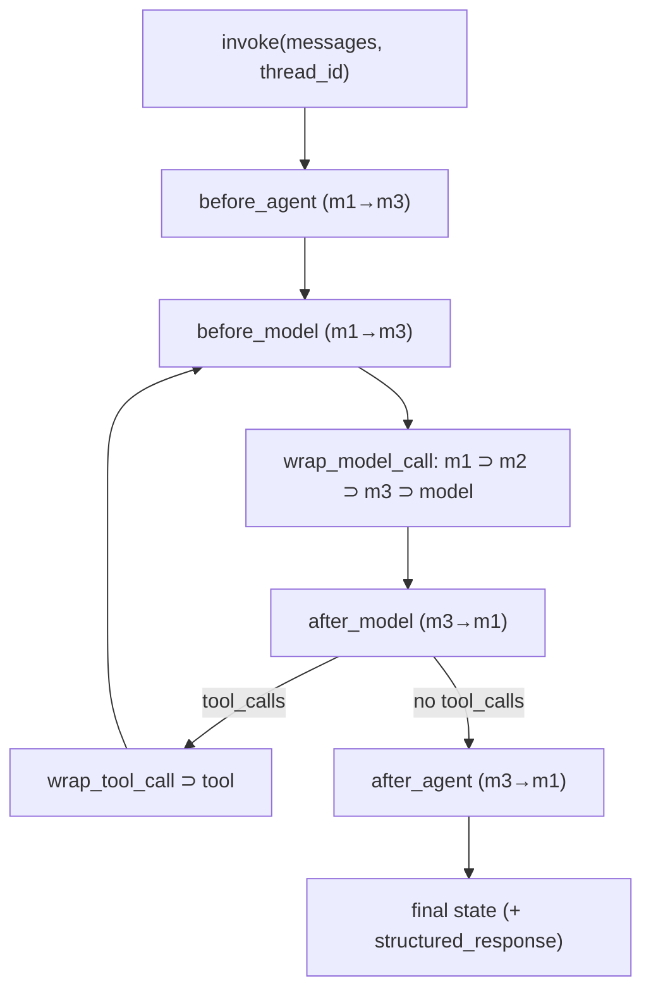

**LangChain** is an open-source framework (Python and JavaScript) for building LLM applications from standard, provider-neutral components: chat models, messages, prompts, [tools](tools.md), retrievers and output parsers, all implementing one `Runnable` interface. Since **v1.0 (22 October 2025)** its centre of gravity is a single agent harness, `create_agent`, which runs a model-calls-tools loop on top of [LangGraph](langgraph.md) and is customised through **middleware**. Legacy chains moved to `langchain-classic`, and observability comes from [LangSmith](langsmith.md). ([announcement](../sources/langchain-langgraph-1-0-announcement.md), [agents docs](../sources/langchain-agents-middleware-docs.md))

## Package layout and versions

| Package | Contents |
|---|---|
| `langchain-core` | Base abstractions: `Runnable`, messages, `content_blocks`, prompts, tools, retriever interface, callbacks |
| `langchain` (1.x) | `langchain.agents` (`create_agent`, middleware), `langchain.messages`, `langchain.tools`, `langchain.chat_models` (`init_chat_model`), `langchain.embeddings` |
| `langchain-<provider>` | Integrations such as `langchain-openai`, `langchain-anthropic`, `langchain-aws`, `langchain-google-genai`, `langchain-ollama` |
| `langchain-classic` | Pre-1.0 chains, legacy retrievers, indexing API, hub, `langchain-community` re-exports |

Version facts (as of 2026-11): 1.0 promises no breaking changes until 2.0 and requires Python 3.10+. Features have kept landing in minors: profile-based structured output strategy selection (1.1), `ProviderStrategy(strict=...)` (1.2), `ToolErrorMiddleware` (1.3.14), `ModelRefusalMiddleware` (1.4.9), beta model routing and auto-mode middleware (1.5.0). `langgraph.prebuilt.create_react_agent` is deprecated in favour of `create_agent`. ([announcement](../sources/langchain-langgraph-1-0-announcement.md), [docs](../sources/langchain-agents-middleware-docs.md))

## The Runnable interface and LCEL

Every component is a `Runnable` with `invoke`/`ainvoke`, `batch`/`abatch`, `batch_as_completed`, `stream`/`astream` and `astream_events`. **LCEL** (LangChain Expression Language) is operator overloading on that interface: `a | b` builds a `RunnableSequence`, and a dict in a pipe becomes a `RunnableParallel` that runs its branches concurrently. ([runnable source](../sources/langchain-core-runnable-source.md))

What the source shows about the "free" features:

- Only `invoke` is abstract. Default `ainvoke` runs `invoke` in a thread executor, and default `stream` yields **one** final chunk. You only get real token streaming from components that override `stream`, such as chat models.
- Default `batch` uses a thread pool and default `abatch` uses bounded `asyncio.gather` (`max_concurrency`). Neither is a provider batch API ([batch processing](batch-processing.md) is a separate thing).
- `with_retry()` defaults to 3 attempts with exponential jitter on any `Exception`. `with_fallbacks([...])` tries alternatives in order and can pass the exception on through `exception_key`. `bind`, `with_config`, `assign`, `pick` and `map` return wrapper runnables.
- Config (`tags`, `metadata`, `callbacks`, `max_concurrency`) is copied into every child call. That propagation is how LangSmith builds nested traces.
- `astream_events` defaults to `version="v2"`. `"v1"` is deprecated, and `"v3"` exists only on chat models and compiled graphs.

The canonical LCEL RAG chain, as in the owner's tutorial, is `{"context": retriever, "question": RunnablePassthrough()} | prompt | model | StrOutputParser()` ([notebook](../sources/notebook-llm-apps.md)).

Synthesis: LCEL still fits linear, stateless pipelines like the one above. Once you need loops, branching on model output, persistence or pauses, the 1.0 docs steer you to `create_agent` or a LangGraph `StateGraph` rather than to longer chains.

## Chat models

`init_chat_model("provider:model", temperature=..., max_tokens=..., timeout=..., max_retries=...)` returns a provider-specific `BaseChatModel` behind a uniform API. `max_retries` defaults to 6 with exponential backoff, and 4xx client errors are not retried. ([models docs](../sources/langchain-models-tools-retrieval-docs.md))

- **Output:** `AIMessage` with `.content`, `.tool_calls`, `.usage_metadata` (including cache and reasoning tokens) and `.content_blocks`, a provider-agnostic list of text, reasoning, tool-call and server-tool-result blocks introduced in 1.0.
- **Tools:** `bind_tools(tools, tool_choice=..., parallel_tool_calls=False)`. See [function calling](function-calling.md).
- **Structured output:** `with_structured_output(schema, method="json_schema" | "function_calling" | "json_mode", include_raw=True)`. With `include_raw=True` you get the raw message and a `parsing_error` instead of an exception. See [structured outputs](structured-outputs.md).
- **Capabilities:** the beta `model.profile` dict (e.g. `max_input_tokens`, `tool_calling`, `reasoning_output`) is what lets agents choose strategies automatically. `reasoning_effort` is a standard parameter.
- **Runtime switching:** `configurable_fields` lets you change model or provider per call through `config["configurable"]`.
- **Limits:** `InMemoryRateLimiter` caps request count, not tokens. Prompt caching is still provider-specific (`cache_control`, `prompt_cache_key`) or handled by middleware (see [prompt caching](prompt-caching.md)).

## Tools and retrievers

`@tool` turns a typed function into a tool: the docstring becomes the description and the type hints become the schema. `config` and `runtime` are reserved parameter names. A `runtime: ToolRuntime` parameter injects state, context, store, stream writer and `tool_call_id`, and is hidden from the model. A tool can return a `Command` to update agent state, but it must include a matching `ToolMessage`. `return_direct=True` only short-circuits when every tool in a parallel batch sets it. ([tools docs](../sources/langchain-models-tools-retrieval-docs.md))

For [RAG](retrieval-augmented-generation.md) the building blocks are loaders, splitters (see [chunking](chunking.md)), [embeddings](embeddings.md), [vector stores](vector-databases.md) and retrievers. The docs distinguish three architectures:

- **2-step RAG:** fixed call count and predictable latency.
- **[Agentic RAG](agentic-rag.md):** retrieval exposed as a tool, so the agent decides when to retrieve. More flexible, but latency varies.
- **Hybrid:** adds query-rewrite and validation loops.

## v1 agents: `create_agent` and middleware

`create_agent(model, tools, system_prompt, middleware=[...], response_format, state_schema, context_schema, checkpointer, name)` compiles a LangGraph graph whose state is `AgentState`, with an append-only `messages` list. Multi-turn memory needs a checkpointer plus a `thread_id`. ([agents docs](../sources/langchain-agents-middleware-docs.md))

**Hook model.** Node-style hooks (`before_agent`, `before_model`, `after_model`, `after_agent`) return dict updates that are merged through reducers. Wrap-style hooks (`wrap_model_call`, `wrap_tool_call`) receive a `handler` and may call it zero times (short-circuit), once, or several times (retry). Ordering rules for `[m1, m2, m3]`:

- `before_*` hooks run in list order.
- `after_*` hooks run in reverse order.
- `wrap_*` hooks nest, with the first middleware outermost.

Hooks can return `jump_to` (`"end"`, `"tools"`, `"model"`) if they declare `can_jump_to`. When two middleware write the same non-reducer field, the outermost one wins, and updates from discarded retry attempts are dropped.

**Built-in middleware (1.5.x):**

| Need | Middleware | Key knobs |
|---|---|---|
| Context growth | `SummarizationMiddleware`, `ContextEditingMiddleware` | `trigger`, `keep` (default 20 msgs); clear tool outputs past 100k tokens, keep 3 |
| Human approval | `HumanInTheLoopMiddleware` | `interrupt_on={tool: {...allowed_decisions}}`; needs checkpointer |
| Runaway loops / cost | `ModelCallLimitMiddleware`, `ToolCallLimitMiddleware` | `thread_limit`, `run_limit`, `exit_behavior` |
| Transient failures | `ModelRetryMiddleware`, `ToolRetryMiddleware`, `ModelFallbackMiddleware`, `ToolErrorMiddleware` | retry middleware: default 2 retries after the first call (3 attempts), backoff factor 2.0, jitter |
| Data protection | `PIIMiddleware` | `strategy` = redact (default) / block / mask / hash; input, output, tool results |
| Planning / tool overload | `TodoListMiddleware`, `LLMToolSelectorMiddleware` | `max_tools`, `always_include` |
| Testing | `LLMToolEmulator` | LLM-faked tool results |

`HumanInTheLoopMiddleware` and the call-limit middleware are the framework's built-in [guardrail](agent-guardrails.md) points. The sandboxing, shell and filesystem middleware (`ShellToolMiddleware`, `FilesystemFileSearchMiddleware`) and the `deepagents` add-ons (filesystem, `task` [subagents](subagents.md)) extend it towards [coding agents](coding-agents.md).

**Structured output in agents.** `response_format=Schema` auto-selects a strategy from the model profile (since 1.1):

- **`ProviderStrategy`:** native schema enforcement by the provider.
- **`ToolStrategy`:** a synthetic tool call. Validation errors are fed back as a `ToolMessage` and retried according to `handle_errors`. If the model emits two structured outputs in one turn, it is asked to retry with one.

A raw JSON-Schema dict must be wrapped in a strategy explicitly. The result appears in `result["structured_response"]`.

## Limitations and failure modes

- **Abstraction sprawl and churn.** Many layers and fast-moving APIs ([notebook](../sources/notebook-langchain-vs-llamaindex.md)). Pre-1.0 tutorials (`LLMChain`, `AgentExecutor`, `RetrievalQA`) now need `langchain_classic` imports.
- **Defaults that silently degrade.** A custom `RunnableLambda` in a chain does not stream tokens. Default `batch` is client-side threads, not a discounted batch API ([runnable source](../sources/langchain-core-runnable-source.md)).
- **Lowest-common-denominator risk.** Provider-specific features such as caching controls, server tools and strict modes arrive through `content_blocks`, profiles or provider middleware. Check the integration package before assuming parity. Synthesis: when a feature matters, read the provider integration's source.
- **Retry stacking.** Model `max_retries=6`, `ModelRetryMiddleware` and `with_retry` can multiply. Synthesis: pick one layer to own retries so worst-case latency stays bounded.
- **Middleware order bugs.** For example, placing PII redaction outside versus inside summarisation changes what the summariser sees. Ordering follows the nesting rules above ([docs](../sources/langchain-agents-middleware-docs.md)).

## When to use / when not

| Situation | Choice |
|---|---|
| Standard tool-calling agent, need approvals, summarisation, limits, PII quickly | `create_agent` + built-in middleware |
| Linear prompt → model → parser or 2-step RAG | LCEL chain (or plain SDK calls) |
| Custom control flow, multi-agent, long-running durable workflows | [LangGraph](langgraph.md) directly; embed `create_agent` graphs as nodes |
| Hard part is ingestion and retrieval quality | Consider [LlamaIndex](llamaindex.md), possibly as a tool inside a LangChain agent ([notebook](../sources/notebook-langchain-vs-llamaindex.md)) |
| One provider, few calls, minimal deps | Provider SDK directly. Synthesis: LangChain's value is portability, integrations and the middleware/LangSmith ecosystem; with one provider and no agent loop the extra layer adds little |

Alternatives at a similar level: [Pydantic AI](pydantic-ai.md), [OpenAI Agents SDK](openai-agents-sdk.md), [Claude Agent SDK](claude-agent-sdk.md), [Google ADK](google-adk.md), [Vercel AI SDK](vercel-ai-sdk.md). For the loop itself see [agent loop](agent-loop.md).

## Sources

- [LangChain and LangGraph reach v1.0 (announcement)](../sources/langchain-langgraph-1-0-announcement.md)
- [LangChain agents, middleware and structured output docs](../sources/langchain-agents-middleware-docs.md)
- [LangChain models, tools and retrieval docs](../sources/langchain-models-tools-retrieval-docs.md)
- [langchain-core Runnable implementation](../sources/langchain-core-runnable-source.md)
- [Notebook: Build LLM Apps](../sources/notebook-llm-apps.md)
- [Notebook: LangChain vs LlamaIndex](../sources/notebook-langchain-vs-llamaindex.md)
