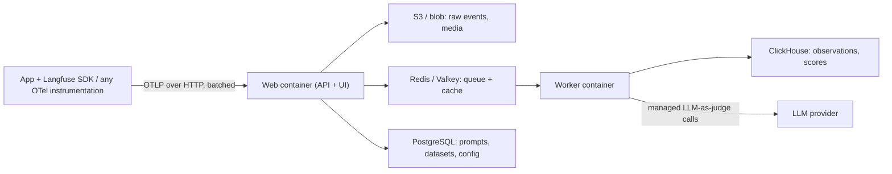

**Langfuse** is an open-source LLM engineering platform that combines three things usually bought separately: tracing ([LLM observability](llm-observability.md)), [prompt management](prompt-management.md), and [evaluation](llm-evaluation.md) (scores, datasets, experiments, [LLM-as-judge](llm-as-judge.md)). Its SDKs are built on OpenTelemetry, so any OTel instrumentation can feed it. The code is MIT licensed outside the `ee/` directories, and it runs either as Langfuse Cloud or self-hosted. That makes it the default open alternative to [LangSmith](langsmith.md) when data must stay in your own VPC ([observability docs](../sources/langfuse-observability-docs.md)).

## Data model

- **Observation:** one step: an LLM call, tool call, retrieval and so on. Typed as `event`, `span`, `generation`, `agent`, `tool`, `chain`, `retriever`, `evaluator`, `embedding` or `guardrail`. Only `generation` and `embedding` observations carry cost.
- **Trace:** all observations that share a `trace_id`. **Session:** an optional grouping of traces, such as one conversation. Trace-level `user_id`, `session_id`, tags and metadata propagate to every observation.
- **Score:** an evaluation result attached to a trace, observation, session or dataset run. Types are NUMERIC, CATEGORICAL, BOOLEAN or TEXT (1-500 characters; TEXT cannot be used in experiments, judges or analytics) ([evaluation docs](../sources/langfuse-evaluation-docs.md)).
- **Dataset / dataset item / dataset run:** versioned test cases (`input`, `expected_output`, metadata), and the record of one experiment over them.
- **Prompt:** a named, immutably versioned template with labels (see below).

Langfuse v4 (generally available August 2026) made **observations** the primary table: one row per LLM call, tool execution or agent step, stored denormalised so queries need no trace-observation join. By default the UI filters to root observations. The join-free model relies on recent SDKs (Python >= 4.7.0, JS/TS >= 5.4.0) that copy trace-level fields onto each observation. Langfuse Cloud becomes v4-only on **16 November 2026**, when legacy v3 APIs, features and ingestion are removed. Self-hosted deployments have no forced cutover, and v3 gets security patches through January 2027 ([v4 changelog](../sources/langfuse-pricing-and-v4.md)).

## Architecture (self-hosted)

These components come from the [observability docs](../sources/langfuse-observability-docs.md). Two operational facts follow. First, the SDKs send in background batches, so short-lived processes (serverless functions, CLI scripts, CI jobs) must call `flush()` or they lose traces. Second, the OTLP endpoint accepts HTTP only, not gRPC. Because the input is plain OTel, you can send the same spans to Datadog and to Langfuse, using an OTel Collector to filter which spans reach Langfuse. GenAI attributes such as `gen_ai.usage.*` map onto Langfuse fields ([OTel GenAI conventions](../sources/opentelemetry-genai-semantic-conventions.md)).

**Cost tracking:** Langfuse no longer runs a tokenizer to estimate usage, so your app must submit usage. Ingested `cost_details` take priority. Otherwise Langfuse computes cost as usage × the price of a model definition, matched by a regex on the model name, with optional pricing tiers (for example, a different rate above 200k input tokens). Usage buckets must not overlap: `input` excludes cached input. If they overlap, the cost is counted twice ([observability docs](../sources/langfuse-observability-docs.md)).

## Prompt management

Prompts are `text` or `chat`. Each save creates a new immutable version, and **labels** (`production` by default, `latest` maintained automatically, plus custom ones) point to versions. Code calls `get_prompt(name)`, which returns the `production` version, then `prompt.compile(**vars)` to fill `{{var}}`. Rollback means moving the label back to an older version. The SDK caches prompts with a 60 s TTL using stale-while-revalidate, so fetches add no latency. A versioned `config` JSON field can hold the model, temperature, `response_format` and `tools`. Linking a prompt to generations gives latency, token, cost and score metrics for each version ([prompt docs](../sources/langfuse-prompt-management-docs.md)). See [prompt management](prompt-management.md) for the general practice and how other vendors compare.

## Evaluation

- **Offline experiments:** `run_experiment(name, data, task, evaluators, run_evaluators, max_concurrency, metadata)` runs your task over local data or a hosted dataset (`dataset.run_experiment`). Every item becomes a trace. Item evaluators return `Evaluation(name, value, comment)`, and run-level evaluators compute aggregates such as average accuracy. A failure on one item doesn't stop the run. You can pin a dataset to a version timestamp to reproduce an earlier run. autoevals scorers plug in directly ([evaluation docs](../sources/langfuse-evaluation-docs.md)).
- **Online (managed) LLM-as-judge:** rules select incoming **observations** by observation and trace fields, with a sampling rate, and map `{{input}}`/`{{output}}`/`{{ground_truth}}` into a judge prompt. The judge must support [structured output](structured-outputs.md). Each judge run is itself traced, in the `langfuse-llm-as-a-judge` environment. Trace-level evaluators are deprecated and stop producing results on Langfuse Cloud after the v4 cutover on **16 November 2026**, so new setups should target observations, using the "Is Root Observation" filter for whole-request judgments. A judge sees only the matched observation, not its children. Retries are capped at four within 120 minutes. There is no rate limit, so you control volume and cost through filters and sampling. The vendor puts the cost at roughly $0.01-$0.10 per judged item.
- **Human:** annotation queues, UI scores (these need a score config first), and user feedback via API.
- **CI gating:** the `langfuse/experiment-action` GitHub Action runs experiment scripts on pull requests. A script raises `RegressionError(result, metric, value, threshold)` to fail the job, and the action posts a PR comment with scores and a link to the comparison view. It takes inputs to pin `dataset_version` and to decide whether regressions or script errors fail the job.

## Plans (as of 2026-11-14)

| Plan | Price/month | Included units | Data access |
|---|---|---|---|
| Hobby | free | 50k | 30 days |
| Core | $29 | 100k | 90 days |
| Pro | $199 (+$300 Teams add-on) | 100k | 3 years |
| Enterprise | $2,499 (Teams included) | 100k | 3 years |
| Self-hosted OSS | free | n/a | your infra |

Overage is $8 per 100k units, falling in steps to $6 above 50M units. The Teams add-on brings enterprise SSO and fine-grained RBAC. Protected prompt labels need Enterprise (or self-hosted Enterprise Edition), or Pro with the Teams add-on; Hobby and Core don't have them ([pricing](../sources/langfuse-pricing-and-v4.md), [prompt docs](../sources/langfuse-prompt-management-docs.md)).

## Langfuse vs alternatives

| | Langfuse | [LangSmith](langsmith.md) | [promptfoo](promptfoo.md) |
|---|---|---|---|
| Core shape | platform: traces + prompts + evals | platform, LangChain-native | CLI/library, YAML-first |
| Licence / hosting | MIT (non-`ee/`), cloud or self-host | proprietary; self-host on Enterprise | MIT, runs locally |
| Eval authoring | code (Python/TS) + UI judges | code + UI evaluators | declarative assertion catalogue |
| Online eval on prod traffic | yes (managed judges) | yes | no (offline only) |
| Red teaming | none | none | built in |

Langfuse's own migration guide lists the trade-offs of moving from promptfoo. You gain results that sit next to production traces, a review UI for non-engineers, and the same judges running offline and online. You give up promptfoo's 30+ declarative assertion types and per-assertion weights, and you lose red teaming. The guide recommends keeping promptfoo for red teaming, and notes that promptfoo can read Langfuse prompts via `langfuse://` ([migration guide](../sources/langfuse-migrate-from-promptfoo.md)). Anthropic's evals guide lists Langfuse next to [Braintrust](braintrust.md), LangSmith and [Phoenix](arize-phoenix.md), and argues that the quality of the tasks matters more than which framework you choose ([Anthropic](../sources/anthropic-demystifying-evals-for-ai-agents.md)).

## Failure modes and gotchas

- **Lost traces** in serverless functions or CI when `flush()` is never called.
- **Wrong cost** from overlapping usage buckets, a regex that matches the wrong model, or missing usage (no tokenizer fallback).
- **Stale prompt after promotion:** for up to the cache TTL after you move the `production` label, traces still show the old version. Use `cache_ttl_seconds=0` in dev and tests.
- **Unlinked prompt metrics:** only generation observations are linked to a prompt, and a call served from the fallback prompt creates no link.
- **Hard 404 on a missing label:** there is no fallback to `production`, so a typo in a label name breaks at runtime unless you configured a fallback prompt.
- **Judges that see too little:** an observation-level judge does not load child spans, so point it at the observation that actually holds the input and output.
- **Gate hiding regressions:** an average-score threshold can pass while a critical case newly fails. The docs recommend a reviewed baseline where no approved passing case may regress, and treating missing results as failures.

## When to use / when not

- **Use** when you need self-hosting or data residency, want tracing, prompts and evals in one OSS tool, use several frameworks (OTel-first ingestion means you aren't locked into one), or want non-engineers to edit prompts and review results.
- **Consider [LangSmith](langsmith.md)** if the stack is entirely [LangChain](langchain.md)/[LangGraph](langgraph.md) and SaaS is acceptable.
- **Pair with [promptfoo](promptfoo.md)** for declarative CI assertions and [red teaming](llm-red-teaming.md).
- Synthesis: running it yourself means operating four stateful systems (Postgres, ClickHouse, Redis, S3), so for small teams without residency constraints, Cloud is usually cheaper in engineer time.

## Sources

- [Langfuse observability documentation](../sources/langfuse-observability-docs.md)
- [Langfuse prompt management documentation](../sources/langfuse-prompt-management-docs.md)
- [Langfuse evaluation, experiments and CI/CD documentation](../sources/langfuse-evaluation-docs.md)
- [Langfuse pricing page and v4 changelog](../sources/langfuse-pricing-and-v4.md)
- [Migrate a Promptfoo eval suite to Langfuse](../sources/langfuse-migrate-from-promptfoo.md)
- [OpenTelemetry semantic conventions for generative AI](../sources/opentelemetry-genai-semantic-conventions.md)
- [Demystifying evals for AI agents (Anthropic)](../sources/anthropic-demystifying-evals-for-ai-agents.md)
