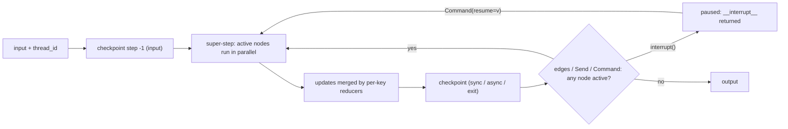

**LangGraph** is [LangChain](langchain.md)'s open-source orchestration runtime for stateful, long-running LLM applications. You declare a **typed shared state**, **nodes** (functions that read state and return partial updates) and **edges** (static or conditional control flow, cycles allowed). The compiled graph runs in discrete **super-steps** modelled on Google's Pregel, and an optional **checkpointer** saves state after every super-step. That checkpoint loop is what provides multi-turn memory, [durable execution](durable-agent-execution.md), `interrupt()`-based [human-in-the-loop](human-in-the-loop.md), and time travel. LangGraph 1.0 (22 Oct 2025) kept the core API unchanged, and LangChain's `create_agent` is itself compiled to a LangGraph graph. ([graph API docs](../sources/langgraph-graph-api-docs.md), [announcement](../sources/langchain-langgraph-1-0-announcement.md))

## Why a graph rather than a chain

A chain is a one-way pipe. Once an app must loop until done, branch on model output, coordinate several agents or wait for a human, it needs cycles and persisted state ([notebook](../sources/notebook-llm-apps.md)). The canonical [tool](tools.md) agent ([agent loop](agent-loop.md)) is `START → agent ⇄ tools → END`, built with `StateGraph`, `ToolNode` and the `tools_condition` router.

## Execution model

Synthesis: this diagram combines the super-step model, reducer merge and checkpoint/interrupt behaviour described across the [graph API](../sources/langgraph-graph-api-docs.md) and [persistence](../sources/langgraph-persistence-docs.md) docs.

- **State and reducers.** Each schema key is a channel with a reducer, declared as `Annotated[type, reducer]`. The default reducer overwrites. `operator.add` appends. `add_messages` appends and also *updates by message ID*, which matters when a human edits a tool call. `Overwrite(...)` bypasses a merging reducer to clear a field. Use a TypedDict schema for speed, or Pydantic when you need validation. Input and output schemas can be narrowed, and private channels hide internal scratch data.
- **Super-steps.** Nodes triggered at the same time share a super-step and run in parallel. The run ends when no node is active. Checkpoints are written only at super-step boundaries, never mid-node.
- **Edges and routing:**
  - `add_edge(a, b)` is a static edge.
  - `add_conditional_edges(src, router, path_map)` routes on the router's return value: a node name, `END`, a list (fan-out), or `Send` objects.
  - `Send(node, payload)` runs a worker once per item, with the count decided at runtime (map-reduce). Reducers merge the workers' outputs.
  - `Command(update=..., goto=...)` lets a node update state and route in one return. Add `graph=Command.PARENT` to route into the parent graph from a subgraph.
  - Do not combine a static edge with dynamic routing on the same node, because both paths will run.
- **Limits.** `recursion_limit` caps super-steps per run: 10,007 by default since 1.1.4, previously 10,000. Exceeding it raises `GraphRecursionError`. Set it as a top-level config key, not under `configurable`.
- **Dependencies.** Use `context_schema` plus `runtime.context` for per-run, non-persisted inputs such as a user ID or DB handle. `CachePolicy` caches a node's output keyed by its input.

## Persistence: checkpointers, threads, stores

Compile with `checkpointer=` and pass `{"configurable": {"thread_id": ...}}`. Each checkpoint is a `StateSnapshot` with these fields: `values`, `next`, `config` (`thread_id`, `checkpoint_ns`, `checkpoint_id`), `metadata` (`source`, `step`, `writes`), `created_at`, `parent_config` and `tasks`. A `START → A → B → END` graph writes four checkpoints. **Pending writes** store each finished node's output within a super-step, so when a sibling node fails, a resume does not re-run the nodes that already succeeded. ([persistence docs](../sources/langgraph-persistence-docs.md))

| Operation | Call |
|---|---|
| Next turn | `invoke({"messages": [...]}, config)` |
| Retry after error | `invoke(None, config)` |
| Answer an interrupt | `invoke(Command(resume=v), config)` |
| Inspect | `get_state(config)`, `get_state_history(config)` (newest first) |
| Replay | `invoke(None, old_snapshot.config)`. Re-executes later nodes, including LLM calls |
| Fork / edit | `update_state(config, values, as_node=...)` writes a new checkpoint through reducers |

**Durability modes** (`durability=`):

- `exit` persists only at the end of the run. It is fastest, but a crash mid-run leaves nothing to recover.
- `async` persists while the next step runs. A crash can lose the last checkpoints.
- `sync` persists before the next step starts. It is the safest and the slowest.

**Savers:**

- `InMemorySaver` (development only)
- `SqliteSaver` (local)
- `PostgresSaver` / `AsyncPostgresSaver` (production; `thread_id` under 255 characters)
- MongoDB and Cosmos DB savers

All implement `put`, `put_writes`, `get_tuple` and `list`. The default serializer is `JsonPlusSerializer`. `EncryptedSerializer` encrypts state at rest with AES, keyed by `LANGGRAPH_AES_KEY`. Checkpoints grow without bound, so prune them on a schedule. ([persistence docs](../sources/langgraph-persistence-docs.md))

Checkpointers are thread-scoped short-term memory. **Stores** (`put/get/search` over namespaces, with optional [embedding](embeddings.md) index) hold cross-thread long-term memory such as user profiles and facts ([memory docs](../sources/langgraph-memory-docs.md)). See [agent memory](agent-memory.md).

## Interrupts and human-in-the-loop

Calling `interrupt(payload)` inside a node raises a special exception. The runtime checkpoints state and returns `payload` to the caller under `__interrupt__`. The caller then resumes with `Command(resume=value)` on the **same `thread_id`**, and `interrupt()` returns `value`. ([interrupt docs](../sources/langgraph-persistence-docs.md))

Rules that follow from the runtime's design:

1. **The node restarts from its first line on resume.** Anything before `interrupt()` runs again, so make it idempotent or move side effects after the interrupt or into another node.
2. **Never wrap `interrupt()` in a bare `try/except`.** The except block swallows the pause exception.
3. **Multiple interrupts in one node are matched to resume values by order.** Keep that order deterministic, and don't loop `while True` around `interrupt()` inside one node. Use a conditional edge back to the node instead.
4. **Payloads must be JSON-serialisable.** When parallel branches interrupt at once, resume them with a dict of `{interrupt_id: value}`.
5. **Static breakpoints are for debugging.** `interrupt_before` / `interrupt_after` exist for stepping through a graph, not for production approval flows.

The owner's [refund-reply experiment](../sources/notebook-11-human-in-the-loop.md) uses exactly this pattern: draft, then a `human_gate` interrupt, then approve or reject via `Command(resume=...)`. At the LangChain level, `HumanInTheLoopMiddleware` packages it as approve/edit/reject decisions per tool ([middleware docs](../sources/langchain-agents-middleware-docs.md)). See [agent guardrails](agent-guardrails.md).

## Subgraphs and multi-agent structure

A compiled graph can be added directly as a node if it shares state keys with the parent (for example `messages`). Otherwise, call it from inside a node function that maps state in and out. Subgraph persistence modes ([graph docs](../sources/langgraph-graph-api-docs.md)):

| Mode | Set by | Behaviour |
|---|---|---|
| Per-invocation | default (`None`) | Fresh on each call; interrupts still work within that call |
| Per-thread | `checkpointer=True` | Accumulates state across calls on the thread. Cannot be called in parallel |
| Stateless | `checkpointer=False` | No checkpoints, so no interrupts |

Interrupts propagate to the root from any depth. `get_state(config, subgraphs=True)` shows nested state, but only for subgraphs LangGraph can discover statically (not ones invoked inside a tool). Supervisor, swarm and hierarchical patterns ([agent design patterns](agent-design-patterns.md), [subagents](subagents.md)) are built from these pieces plus `Command` [handoffs](agent-handoffs.md).

## Streaming and the Functional API

**Stream modes:**

- `values`: the full state after each step.
- `updates`: the per-node deltas.
- `messages`: LLM token chunks plus metadata.
- `custom`: whatever nodes or tools emit through `get_stream_writer()`.
- `checkpoints`, `tasks`, `debug`: runtime events.

Add `subgraphs=True` to include nested output. Version notes: the unified `version="v2"` stream parts need 1.1+, and `stream_events(version="v3")`, with separate projections for messages, values and subgraphs, arrived in 1.2 and is recommended for new apps. See [streaming](streaming.md). ([streaming docs](../sources/langgraph-graph-api-docs.md))

The **Functional API** (`@entrypoint`, `@task`) gives plain Python control flow the same runtime. Task results are checkpointed, so on resume the entrypoint replays from the top while finished tasks return their saved results. Side effects and non-determinism such as time or randomness must therefore live inside tasks. The docs recommend the Graph API for new work and the Functional API for wrapping existing code.

## Deployment

LangGraph apps can run self-managed (your own checkpointer and server) or on **LangSmith Deployment**, which LangGraph Platform was renamed to in October 2025, along with LangGraph Studio becoming LangSmith Studio. On that Agent Server, persistence is provisioned for you. Both the free Developer plan and Plus include one small serverless Agent Server, and further servers are metered by compute and memory ([LangSmith pricing source](../sources/langsmith-tracing-sdk-and-deployment.md), [persistence docs](../sources/langgraph-persistence-docs.md)). Tracing goes to [LangSmith](langsmith.md).

## Failure modes and trade-offs

- **Non-idempotent nodes.** Retries, resumes and replays re-run whole nodes, so an email sent before an `interrupt()` gets sent twice ([persistence docs](../sources/langgraph-persistence-docs.md)).
- **Reducer surprises.** An empty return on a merging reducer keeps the old data. `update_state` passes through reducers, so it appends rather than replaces unless you use `Overwrite`.
- **`InMemorySaver` in production.** State is lost on restart, and paused HITL threads vanish.
- **`exit` durability.** A crash before the first checkpoint makes the thread look as if it was never invoked: `invoke(None)` raises `EmptyInputError`.
- **Unbounded growth.** Checkpoints accumulate per step, and message state grows every turn. Pair the graph with trimming or summarisation (see [context engineering](context-engineering.md)) and pruning jobs.
- **Complexity cost.** Synthesis: for a single tool-calling loop, `create_agent` gives you the same runtime with less code. Drop to raw `StateGraph` when you need custom topology, deterministic workflow steps, or fine-grained latency and cost control. The [1.0 announcement](../sources/langchain-langgraph-1-0-announcement.md) gives the same positioning.

## When to use / when not

- **Use:** long-running or resumable workflows; approval gates; multi-agent supervisors or handoffs; deterministic steps mixed with LLM steps; when you need replay or forking for debugging and [evals](agent-evaluation.md).
- **Avoid or defer:** stateless one-shot calls or linear [RAG](retrieval-augmented-generation.md) (use LCEL or a plain SDK); teams wanting a higher-level role abstraction ([CrewAI](crewai.md), [AutoGen](autogen.md)); or durable-execution needs already met by a workflow engine. Synthesis: in that last case, call LLM steps as activities rather than adding a second checkpoint layer.

## Sources

- [LangGraph Graph API, Functional API, streaming and subgraph docs](../sources/langgraph-graph-api-docs.md)
- [LangGraph persistence, checkpointers and interrupts docs](../sources/langgraph-persistence-docs.md)
- [LangGraph memory docs](../sources/langgraph-memory-docs.md)
- [LangChain and LangGraph reach v1.0](../sources/langchain-langgraph-1-0-announcement.md)
- [LangChain agents and middleware docs](../sources/langchain-agents-middleware-docs.md)
- [LangSmith tracing SDK, OTel and deployment pricing](../sources/langsmith-tracing-sdk-and-deployment.md)
- [Notebook: Build LLM Apps](../sources/notebook-llm-apps.md)
- [Notebook experiment 11: Human-in-the-loop](../sources/notebook-11-human-in-the-loop.md)
