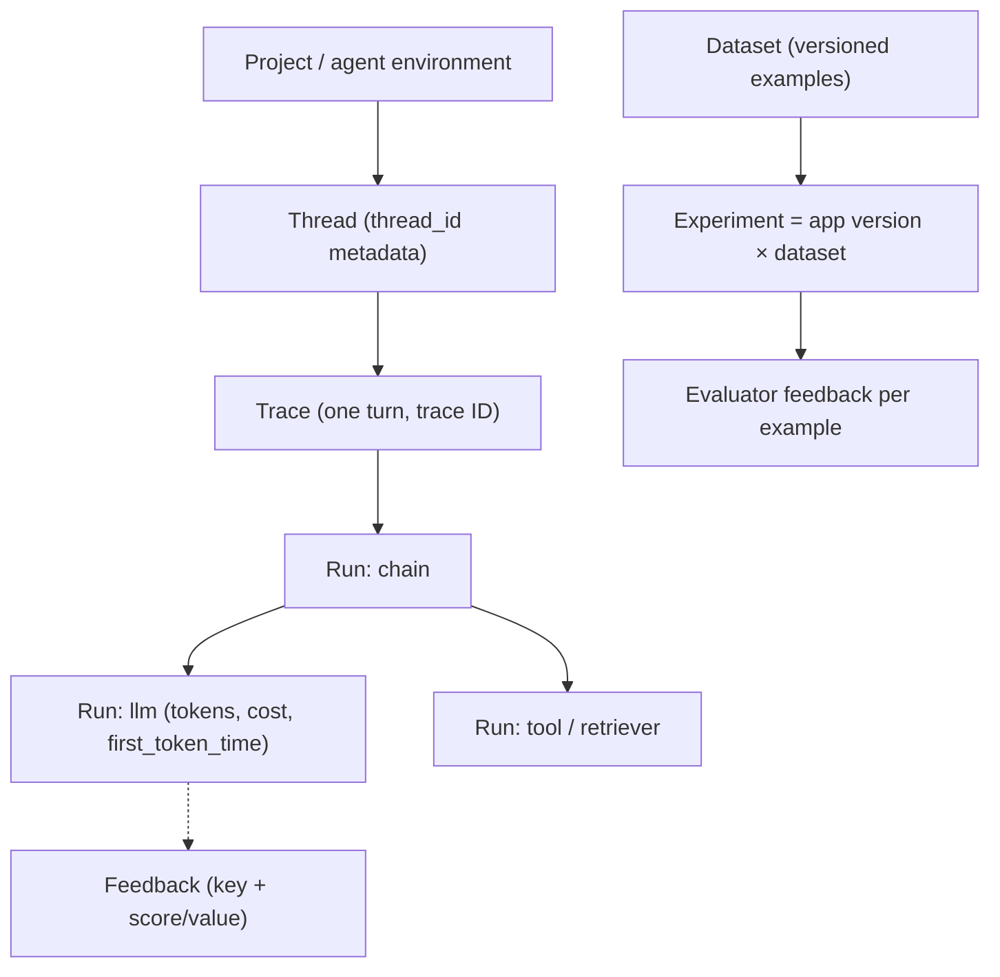

**LangSmith** is [LangChain](langchain.md)'s commercial platform for [LLM observability](llm-observability.md) and [evaluation](llm-evaluation.md). It records every step of an application as a tree of **runs** grouped into **traces** and **threads**. It also stores **datasets** of test examples, runs **experiments** that score an application version with evaluators, and (as **LangSmith Deployment**, formerly LangGraph Platform) hosts [LangGraph](langgraph.md) agents on an Agent Server. LangSmith is framework-agnostic: LangChain and LangGraph are traced automatically, and other code is traced through the SDK or OpenTelemetry. ([observability docs](../sources/langsmith-observability-docs.md), [tracing/deployment source](../sources/langsmith-tracing-sdk-and-deployment.md))

## Data model



Definitions ([observability docs](../sources/langsmith-observability-docs.md)):

- **Run:** one unit of work, comparable to an OTel span. Run types are `chain`, `llm`, `embedding`, `prompt`, `tool`, `retriever` and `parser`. A run carries inputs, outputs, error, tags, metadata, token counts, `total_cost`, and `first_token_time` for [streamed](streaming.md) calls.
- **Trace:** the runs sharing one trace ID, capped at **25,000 runs**. Further runs are rejected.
- **Thread:** the traces sharing a `thread_id` metadata value, i.e. one multi-turn conversation.
- **Feedback:** a key plus a score attached to a run. It comes from users, evaluators or annotators.
- **Workspace layout:** newer agent-based workspaces group traces by agent and environment (Production, Staging, Development, Local), and each environment is backed by a tracing project.

## Tracing: how data gets in

- **Zero-code for LangChain/LangGraph.** Set `LANGSMITH_TRACING=true` and `LANGSMITH_API_KEY`, and the callback config that LCEL copies into every child call builds the nested tree ([notebook](../sources/notebook-llm-apps.md), [runnable source](../sources/langchain-core-runnable-source.md)).
- **Arbitrary code.** Use the `@traceable(run_type=..., name=...)` decorator, wrap an OpenAI client with `wrap_openai`, use the Python `trace` context manager, or build runs by hand with the low-level `RunTree`. `RunTree` posts even when `LANGSMITH_TRACING` is off. `tracing_context(enabled=...)` toggles tracing at runtime ([SDK source](../sources/langsmith-tracing-sdk-and-deployment.md)).
- **OpenTelemetry.** The OTLP endpoint is the API URL plus `/otel`, authenticated with an `x-api-key` header. GenAI semantic-convention attributes map onto run fields, and OpenInference and Traceloop attributes are understood too. `LANGSMITH_OTEL_ENABLED` exports LangChain spans through OTel ([observability docs](../sources/langsmith-observability-docs.md)).
- **Sampling.** `LANGSMITH_TRACING_SAMPLING_RATE` (0 to 1) applies to SDK tracing ([observability docs](../sources/langsmith-observability-docs.md)).

Failure modes:

- **Lost traces in short-lived processes.** Upload runs on a background thread, so a serverless function or script can exit before its traces are sent. Call `client.flush()` in a `finally` block ([SDK source](../sources/langsmith-tracing-sdk-and-deployment.md)).
- **Silently dropped OTel spans.** Ingestion is asynchronous and returns 200 before processing. A span whose parent never arrives, for example because an upstream sampler dropped it, is discarded without error.
- **Oversized traces.** Beyond 25,000 runs the extra runs are rejected. Synthesis: very long [agent loops](agent-loop.md) or big batch jobs should be split into several traces.
- **Sensitive data.** Traces store full prompts and outputs. Synthesis: redact before tracing (for example with LangChain's `PIIMiddleware` or by masking inputs) and weigh retention when [PII](pii-and-data-privacy.md) is involved.

## Evaluation

A **dataset** is a versioned set of examples. Each example has `inputs`, optional reference outputs that only evaluators see, and optional metadata. **Splits** name subsets, and a dataset version can be tagged and pinned in CI. An **experiment** runs one application version over one dataset and stores the outputs, scores and traces, so several experiments can be compared side by side. ([evaluation docs](../sources/langsmith-evaluation-docs.md))

```python
client.evaluate(target, data="qa", evaluators=[correct],
                experiment_prefix="gpt-x baseline", max_concurrency=4)
```

Here `target(inputs) -> outputs`, and an evaluator such as `correct(inputs, outputs, reference_outputs) -> bool` returns feedback (`key`, `score` or `value`, optional `comment`). `aevaluate` is the async version for large jobs, and `openevals` ships prebuilt evaluators.

| Evaluator | Strength | Watch out for |
|---|---|---|
| Code (exact match, JSON valid, compiles) | Cheap, deterministic | Only checks what is mechanically checkable |
| [LLM-as-judge](llm-as-judge.md) | Scores open-ended quality; reference-free or reference-based | Judge bias and cost; [few-shot](few-shot-prompting.md) judge prompts help |
| Human (annotation queues, single or pairwise) | Ground truth, rubric-driven | Throughput; queues support multiple reviewers |
| Pairwise | Easier than absolute scoring | Needs two versions |

Offline evaluation runs on datasets that have references and supports benchmarking, regression tests and backtesting on historical data. **Online** evaluators run on production runs, where no reference exists, so only reference-free checks (safety, format, judge rubrics) apply there. Annotated production runs can be exported back into datasets, closing the loop ([evaluation docs](../sources/langsmith-evaluation-docs.md)). See [verification and evals](verification-and-evals.md).

## Plans, retention, hosting (as of 2026-11)

| Plan | Price | Included | Hosting |
|---|---|---|---|
| Developer | $0, 1 seat | 5k base traces/month, then pay-as-you-go; 1 small serverless Agent Server | Cloud |
| Plus | $39/seat/month, unlimited seats | 10k base traces/month, then pay-as-you-go; 1 small serverless Agent Server | Cloud |
| Enterprise | Custom | SSO/RBAC, SLA | Cloud, hybrid (self-hosted data plane) or fully self-hosted |

Base traces are kept for 14 days and extended traces (an upgrade billed separately) for 180 days. The SaaS deletes trace data 180 days after ingestion, but examples saved to datasets persist. Agent Server usage is metered in LSUs (1 LSU = $1), for example 0.0675 LSU per runtime vCPU-hour and 0.009 LSU per runtime GiB-hour. ([pricing source](../sources/langsmith-tracing-sdk-and-deployment.md), [observability docs](../sources/langsmith-observability-docs.md))

Synthesis: for data residency or regulated workloads, LangSmith self-hosting requires Enterprise. That is a common reason teams pick an open-source tracer (such as [Langfuse](langfuse.md) or [Arize Phoenix](arize-phoenix.md)) instead, or export OTel to their existing APM.

## When to use / when not

- **Use it** when the stack is LangChain/LangGraph (free auto-instrumentation and Studio/Deployment integration), when you want tracing, datasets, experiments and annotation queues in one tool, or when you deploy LangGraph agents on the Agent Server.
- **Consider alternatives** when data cannot leave your VPC without an Enterprise contract, when you are standardised on OTel backends, or for cost at very high trace volume (sampling helps). Synthesis: LangSmith's evaluation features don't require LangChain. Any function can be a `target`, so mixed-framework teams can still use it.

## Sources

- [LangSmith observability documentation](../sources/langsmith-observability-docs.md)
- [LangSmith evaluation concepts and SDK docs](../sources/langsmith-evaluation-docs.md)
- [LangSmith tracing SDK, OTel export and deployment pricing](../sources/langsmith-tracing-sdk-and-deployment.md)
- [langchain-core Runnable implementation](../sources/langchain-core-runnable-source.md)
- [Notebook: Build LLM Apps](../sources/notebook-llm-apps.md)
