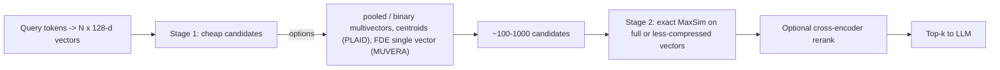

**Late-interaction retrieval** (multi-vector retrieval) encodes the query and each document *independently*, like a bi-encoder, but keeps **one vector per token** (or per image patch) instead of pooling everything into one vector. Relevance is computed "late", at query time, with a cheap operator called **MaxSim**: for each query vector, take its highest similarity to any document vector, and sum those maxima. Document vectors are precomputed offline, so only the query is encoded at search time. ColBERT introduced the idea and was two orders of magnitude faster, with four orders of magnitude fewer FLOPs per query, than BERT cross-encoder ranking, at competitive quality ([Khattab & Zaharia](../sources/khattab-2020-colbert.md)). ColPali applied it to page *images*, embedding each page as about 1,030 patch vectors and skipping OCR and layout parsing entirely ([ColPali](../sources/colpali-2024.md)).

## Where it sits

| Architecture | Doc representation | Query-time work | Quality | Storage |
|---|---|---|---|---|
| Single-vector bi-encoder ([embeddings](embeddings.md)) | 1 vector per chunk | 1 ANN search | Good; capped by dimension ([Weller et al.](../sources/limits-of-embedding-retrieval.md)) | Smallest |
| Learned sparse (SPLADE) | Sparse term weights | Inverted-index lookup | Strong out of domain ([ColBERTv2](../sources/santhanam-2021-colbertv2.md)) | Small |
| **Late interaction** (ColBERT, ColPali) | 1 vector per token/patch | Candidate generation + MaxSim | Near cross-encoder | 1-2 orders of magnitude more vectors |
| Cross-encoder ([reranking](reranking.md)) | Nothing precomputed | Full model per (query, doc) pair | Best | None, but cannot do first-stage search |

Qdrant defines the score as a sum, over each vector in the query matrix, of its maximum similarity to any vector in the document matrix, returning one score per point ([Qdrant](../sources/qdrant-multivectors-docs.md)). Synthesis: MaxSim lets each query term find its own best evidence anywhere in the document. A single pooled vector must average all topics in a chunk into one point, which is why late interaction holds up better on long, multi-topic chunks and on rare terms.

## Making it affordable: ColBERTv2, PLAID, pooling, MUVERA

The cost of late interaction is storage and candidate generation. Original ColBERT needed **154 GiB** to index MS MARCO's 9M passages ([ColBERTv2](../sources/santhanam-2021-colbertv2.md)).

- **Residual compression (ColBERTv2).** Token vectors cluster tightly by meaning. So each 128-dim vector is stored as the ID of its nearest centroid (4 bytes) plus a 1- or 2-bit-per-dimension residual: 20 or 36 bytes, against 256 bytes in fp16. The index shrinks to 16 GiB (1-bit) or 25 GiB (2-bit). That is about the size of a 768-dim float32 single-vector index of the same corpus, before HNSW overhead. Quality barely moves: [MRR](retrieval-metrics.md)@10 is 36.2 uncompressed, 36.2 at 2 bits and 35.5 at 1 bit ([ColBERTv2](../sources/santhanam-2021-colbertv2.md)). ColBERTv2 also added [distillation](knowledge-distillation.md) from a cross-encoder and reached 39.7 MRR@10 on MS MARCO dev, against 36.8 for SPLADEv2 ([ColBERTv2](../sources/santhanam-2021-colbertv2.md)).
- **Centroid pruning (PLAID).** Score each passage first as a cheap "bag of centroids", prune, and run full MaxSim only on survivors. That is up to 7x faster on GPU and 45x on CPU, at tens of milliseconds on GPU over 140M passages ([PLAID](../sources/santhanam-2022-plaid.md)).
- **Token pooling.** Cluster similar token vectors within a document and keep their means. Halving the count costs almost nothing; cutting 66-75% stays within 5% degradation on most datasets ([Clavié et al.](../sources/clavie-2024-token-pooling.md)). For visual models, pool factor 3 keeps 97.8% of performance with 66.7% fewer vectors ([colpali repo](../sources/colpali-engine-github.md)).
- **Fixed Dimensional Encodings (MUVERA).** Compress each vector set into one long vector whose inner product approximates MaxSim, retrieve with any standard single-vector [ANN index](ann-indexes.md), then rerank exactly. It needs 2-5x fewer candidates than prior heuristics, with 10% higher recall and 90% lower latency on BEIR ([MUVERA](../sources/dhulipala-2024-muvera.md)).
- **Binarization.** Vespa packs each 128-dim ColPali vector into 16 bytes (32x smaller). DocVQA nDCG@5 goes 52.4 (float) to 49.5 (Hamming), and back to 51.6 with float re-ranking of the top hits ([Vespa](../sources/vespa-2024-scaling-colpali.md)). See [quantization](quantization.md).

Synthesis: the diagram generalizes the two-stage designs in PLAID, MUVERA, Qdrant and Vespa; each source implements one stage-1 option.

## Visual documents: ColPali and ColQwen

ColPali fine-tunes the PaliGemma-3B vision-language model so that each image patch of a page yields a 128-dim vector. Queries are text tokens, and scoring is MaxSim ([ColPali](../sources/colpali-2024.md)). On ViDoRe it scored nDCG@5 81.3, against 67.0 for the best text pipeline (Unstructured parsing + captioning + BGE-M3). Indexing took 0.39 s per page versus 7.22 s for the parsing pipeline on an L4 ([ColPali](../sources/colpali-2024.md)). Successors swap the backbone. On ViDoRe v1: ColQwen2 v1.0 (Qwen2-VL-2B) 89.3, ColQwen2.5 v0.2 (3B) 89.4, tiny ColSmol-256M 80.1, and community ColQwen3 / ColQwen3.5 models (4-4.5B parameters) about 90.6-90.9 with 320-dim vectors (as of 2026-11). ColQwen uses dynamic image resolution; ColQwen2/2.5 v0.1 were trained with 768 patches per page. ColQwen and ColSmol are Apache 2.0; PaliGemma-based ColPali is under Gemma terms. `colpali-engine` is now deprecated in favour of Sentence Transformers v6 ([colpali repo](../sources/colpali-engine-github.md)).

ViDoRe V3 (2026) is a harder, end-to-end benchmark over 26k enterprise pages. Its results ([ViDoRe V3](../sources/vidore-v3-2026.md)):

- The best visual retriever (ColEmbed-3B-v2, 59.8 nDCG@10) beats the best text retrievers (about 50-51).
- Multi-vector beats single-vector at similar size: ColQwen2.5 scored 51.9, Nomic-3B 44.3.
- **But** a text retriever plus a strong *text* reranker reached 63.6, the best overall. The visual reranker barely helped.
- For generation, image context beats text context on hard queries, and image + text together is best.

Synthesis: visual late interaction is the best *first stage* for scans, slides, charts and table-heavy PDFs. It does not replace a good reranker or a [multimodal](multimodal-models.md) generator that actually sees the page. ColPali itself only retrieves ([ColPali](../sources/colpali-2024.md)). See [document processing](document-processing.md).

## Storage math

| Representation | Per item | Source |
|---|---|---|
| ColPali page, fp16 | about 1,030 x 128 x 2 B, about 257.5 KB | [ColPali](../sources/colpali-2024.md) |
| ColPali page, binarized | about 16 KB | [Vespa](../sources/vespa-2024-scaling-colpali.md) |
| ColPali page, row + column mean pooled | 32 + 32 vectors | [Qdrant tutorial](../sources/qdrant-pdf-retrieval-at-scale.md) |
| ColBERTv2 token vector | 20-36 B | [ColBERTv2](../sources/santhanam-2021-colbertv2.md) |
| Original ColBERT token vector | 256 B (fp16) | [ColBERTv2](../sources/santhanam-2021-colbertv2.md) |

Synthesis: at fp16, 1M pages of ColPali is about 257 GB of vectors. A 1024-dim float32 single vector per page is about 4 GB. Binarization brings ColPali to about 16 GB, and pooling plus binarization lower still. Budget for this before choosing the approach.

## Operational notes and failure modes

- **HNSW over raw patch vectors is slow to build.** Inserting one ColQwen page costs on the order of 49 million comparisons, and quantization does not reduce them. Qdrant's pattern: HNSW only on mean-pooled row/column multivectors, keep the full multivector with HNSW disabled (`m=0`), prefetch 100 from each pooled field and rerank with the full one. Indexing gets an order of magnitude faster ([Qdrant tutorial](../sources/qdrant-pdf-retrieval-at-scale.md)).
- **Database limits.** Qdrant requires sub-vectors x dimension < 1,048,576 per point (hard limit); MaxSim is its only multivector comparator ([Qdrant](../sources/qdrant-multivectors-docs.md)). Long documents must be pooled or split. See [vector databases](vector-databases.md).
- **Domain shift.** SPLADEv2 still beat ColBERTv2 on some out-of-domain sets, and under extreme resource limits simpler models may be preferable ([ColBERTv2](../sources/santhanam-2021-colbertv2.md)).
- **Model lock-in.** Synthesis: the index is tied to one model's token vectors. Switching models means re-encoding everything, as with single vectors, but at far higher volume.
- **Visual grounding is still weak.** Models rarely point at the right region of the page (F1 under 0.09 versus 0.60 between humans) ([ViDoRe V3](../sources/vidore-v3-2026.md)).

## When it beats single-vector, and when not

Use late interaction when:

- **Single vectors hit their ceiling.** Embedding dimension provably limits which top-k sets a single-vector retriever can return, and state-of-the-art embedders fail the simple LIMIT dataset built to show this ([Weller et al.](../sources/limits-of-embedding-retrieval.md)). Synthesis: symptoms are queries that combine several specific conditions, and long multi-topic chunks.
- **Documents are visual** (slides, scans, forms, charts): ColPali/ColQwen skip a fragile parse pipeline and beat parse-then-embed pipelines ([ColPali](../sources/colpali-2024.md), [ViDoRe V3](../sources/vidore-v3-2026.md)).
- **You need cross-encoder-like precision at first-stage scale**, or as a cheaper reranker ([Khattab & Zaharia](../sources/khattab-2020-colbert.md)).
- **You want one model for several modes.** BGE-M3 emits dense, sparse and multi-vector outputs from one pass, so you can do dense retrieval and then multi-vector rescoring without a second model ([BGE-M3](../sources/chen-2024-bge-m3.md)).

Prefer single-vector plus [hybrid search](hybrid-search.md) and a cross-encoder [reranker](reranking.md) when:

- Storage or memory budget is tight, or the vector database lacks multivector support (Synthesis).
- The corpus is clean text with short, single-topic chunks, where the gap is small (Synthesis).
- A text reranker already fixes precision: in ViDoRe V3 that pipeline won overall ([ViDoRe V3](../sources/vidore-v3-2026.md)).

Synthesis: a pragmatic middle path is single-vector or pooled first stage, then MaxSim rescoring of the top few hundred. It costs little, and it is what Qdrant's and MUVERA's designs amount to.

Related: [query transformation](query-transformation.md) and [contextual retrieval](contextual-retrieval.md) attack the same recall problem from the query and index-text sides.

## Sources

- [Khattab & Zaharia 2020: ColBERT](../sources/khattab-2020-colbert.md)
- [Santhanam et al. 2021: ColBERTv2](../sources/santhanam-2021-colbertv2.md)
- [Santhanam et al. 2022: PLAID](../sources/santhanam-2022-plaid.md)
- [Dhulipala et al. 2024: MUVERA](../sources/dhulipala-2024-muvera.md)
- [Clavié et al. 2024: Token Pooling](../sources/clavie-2024-token-pooling.md)
- [Chen et al. 2024: BGE-M3](../sources/chen-2024-bge-m3.md)
- [ColPali (Faysse et al.)](../sources/colpali-2024.md)
- [illuin-tech/colpali repository](../sources/colpali-engine-github.md)
- [ViDoRe V3](../sources/vidore-v3-2026.md)
- [Qdrant docs: multivectors](../sources/qdrant-multivectors-docs.md)
- [Qdrant tutorial: PDF Retrieval at Scale](../sources/qdrant-pdf-retrieval-at-scale.md)
- [Vespa: Scaling ColPali to billions of PDFs](../sources/vespa-2024-scaling-colpali.md)
- [Weller et al.: Theoretical Limitations of Embedding-Based Retrieval](../sources/limits-of-embedding-retrieval.md)
