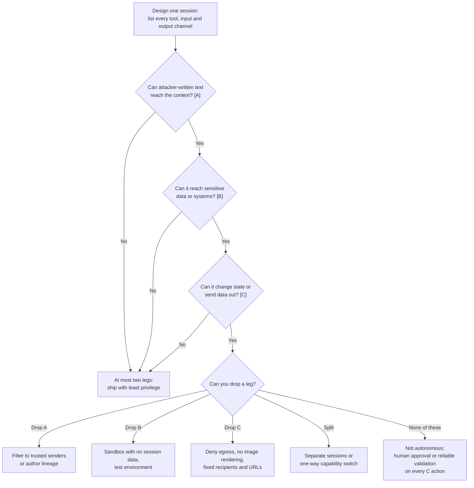

The **lethal trifecta** is Simon Willison's name (June 2025) for three agent capabilities that, combined, let an attacker steal data through [prompt injection](prompt-injection.md): **(1) access to private data**, **(2) exposure to untrusted content** (any text or image an attacker can get into the context), and **(3) the ability to communicate externally** (any channel that can carry data out). With all three in one context, an injected instruction can tell the model to read the private data and send it out, and no prompt-level warning reliably stops it. The fix is structural: remove one leg ([Willison](../sources/willison-2025-lethal-trifecta.md)). Meta's **Agents Rule of Two** (October 2025) generalises the idea into a design rule. In one session an agent may hold at most two of **[A]** untrustworthy input, **[B]** sensitive systems or private data, and **[C]** state change or external communication. If it needs all three, it must not run autonomously ([Meta](../sources/meta-2025-agents-rule-of-two.md)).

## The three legs, precisely

| Leg | What counts | Easy to miss |
|---|---|---|
| Private data | Anything the attacker should not see: inbox, repos, files, CRM records, secrets in env vars | Data the agent *can* reach through a tool, not just what is in context now |
| Untrusted content | Any input an attacker could have written: web pages, emails, issues, PDFs, search results, tool outputs | MCP tool descriptions ([Invariant Labs](../sources/invariant-2025-mcp-tool-poisoning.md)); memory or RAG content written earlier ([OWASP 2026](../sources/owasp-llm-top-10-2026.md)) |
| External communication | HTTP requests, API calls, email, writes to public places (issues, PRs) | Rendered Markdown images and links, link unfurling in chat tools ([markdown exfiltration](../sources/willison-markdown-exfiltration.md)) |

Sources: [Willison](../sources/willison-2025-lethal-trifecta.md), plus those in the table.

**Why it works.** An LLM follows instructions wherever they appear in its context and cannot reliably tell the user's instructions from text it was given to process. Willison named prompt injection in September 2022 after SQL injection for that reason: trusted and untrusted text get mixed in one channel ([Willison](../sources/willison-2025-lethal-trifecta.md)). The legs can come from different tools that the user combines, which [MCP](model-context-protocol.md) encourages, or from one tool. GitHub's official MCP server supplied all three. It could read attacker-written public issues, read private repos, and open public pull requests. A malicious issue got an agent to publish private repo names in a public PR ([GitHub MCP exploit](../sources/willison-2025-github-mcp-exploit.md)).

**Why filtering is not the answer.** Willison argues that a guardrail catching 95% of attacks fails by application-security standards, because the attacker only needs one attempt to work ([Willison](../sources/willison-2025-lethal-trifecta.md)). The evidence supports him. Adaptive attacks pushed 12 published defences, most of which reported near-zero success, to over 90% attack success ([Nasr et al.](../sources/nasr-2025-attacker-moves-second.md)). Anthropic's hardened browser agent still had 1.4% attack success (Opus 4.5) against an adaptive Best-of-N attacker, which Anthropic itself calls meaningful risk ([Anthropic](../sources/anthropic-2025-prompt-injection-defenses-browser.md)). Synthesis: classifiers and model training lower the attack rate; removing a leg is what bounds the damage.

## Agents Rule of Two

Meta's version keeps the three-way structure but widens two properties ([Meta](../sources/meta-2025-agents-rule-of-two.md)):

- **[A] Untrustworthy inputs.** The same as the trifecta's untrusted content.
- **[B] Sensitive systems or private data.** Wider than "private data". A Meta researcher later confirmed it covers any sensitive system ([Willison, Nov 2025](../sources/willison-2025-rule-of-two-and-attacker-moves-second.md)).
- **[C] Change state or communicate externally.** Adds state changes (deletes, purchases, deploys), so the rule covers harmful actions as well as data theft. Willison calls this the main extension over his trifecta, which only addresses exfiltration ([Willison, Nov 2025](../sources/willison-2025-rule-of-two-and-attacker-moves-second.md)).

Further rules from Meta ([Meta](../sources/meta-2025-agents-rule-of-two.md)):

- **The unit is a session** (one context window). A task that needs all three can be split across fresh sessions instead.
- **All three in one session means supervision.** Use [human-in-the-loop](human-in-the-loop.md) approval or another reliable validation step.
- **One-way switches are allowed.** For example, start in [AC] to browse the web, then turn off external communication for good before touching internal systems ([B]). The goal is to break the [A] → [B] → [C] path.
- **It is a floor, not a finish line.** It supplements least privilege and defence in depth. It does not address hallucinations, agent mistakes, spam, over-broad privileges in general, or low-impact injection outcomes such as misinformation in answers. Blindly approved confirmations still fail.
- Meta credits both Willison's trifecta and Chromium's Rule of 2 as its inspiration.

**The Chromium ancestor.** Chromium's Rule of 2 says code may combine at most two of untrustworthy input, a memory-unsafe language and high privilege. Its remedies carry over to agents: lower the privilege by doing the risky work in a sandboxed process, or **normalise** complex input into a simple structured format in a low-privilege process before privileged code reads it ([Chromium](../sources/chromium-rule-of-2.md)).

### Comparison

| | Chromium Rule of 2 | Lethal trifecta | Agents Rule of Two |
|---|---|---|---|
| Harm it prevents | Memory-corruption exploits | Data exfiltration | Exfiltration and harmful state changes |
| Properties | Untrusted input, unsafe language, high privilege | Private data, untrusted content, external communication | [A] untrusted input, [B] sensitive systems/data, [C] state change/external communication |
| Scope | A component or process | The agent's combined tools | One session (context window) |
| If all three are present | Change rejected in review | Accept that data can be stolen | No autonomy: human approval or reliable validation |

Sources: [Chromium](../sources/chromium-rule-of-2.md), [Willison](../sources/willison-2025-lethal-trifecta.md), [Meta](../sources/meta-2025-agents-rule-of-two.md).

## Applying it in agent design

Synthesis: a decision flow built from Meta's rule and the mitigations in the sources below. It is not a diagram from any single source.

### 1. Inventory the legs per session, not per tool

List what each session can read, what it can reach, and where its output can go. Count what tools *could* return, not what the happy path returns. Tool results, retrieved documents, memory and MCP tool descriptions are all inputs, and a rendered chat response can be an output channel ([markdown exfiltration](../sources/willison-markdown-exfiltration.md), [Invariant Labs](../sources/invariant-2025-mcp-tool-poisoning.md)). Synthesis: this inventory is part of [harness engineering](harness-engineering.md), because the harness, not the model, decides which [tools](tools.md) and channels a session has.

### 2. Drop a leg

Meta's worked examples show one way to remove each leg ([Meta](../sources/meta-2025-agents-rule-of-two.md)):

- **Drop [A] (keep [BC]).** An email agent reads mail only from trusted senders. An internal coding agent with production access filters every context source by author lineage, with a human process to grant exceptions.
- **Drop [B] (keep [AC]).** A web research assistant runs in a restrictive sandbox with no preloaded session data or cookies, and the user is told how their data may be shared. See [code execution sandboxes](code-execution-sandboxes.md).
- **Drop [C] (keep [AB]).** A travel assistant reads the web and private details but needs human confirmation to book or pay. Its web requests go only to URLs from trusted sources, not URLs the agent builds. An email agent sends only to trusted recipients or after a human reviews the draft.

Synthesis: dropping [C] is often the cheapest choice, and it has to be enforced at the network layer, as these sources show:

- Claude Code's sandbox sends all traffic through a proxy outside the sandbox with a domain allowlist. Without it, a compromised agent could exfiltrate SSH keys ([Claude Code sandboxing](../sources/anthropic-claude-code-sandboxing.md)).
- Codex turns the network off by default in its workspace sandbox. Cloud tasks go offline, with secrets removed, before the agent phase starts ([Codex](../sources/openai-codex-sandbox-approvals.md)).
- Vercel argues that egress control and credential brokering are part of the sandbox boundary. A registry can be allowed during setup and removed before untrusted code runs, which is a time-based version of Meta's one-way switch ([Vercel](../sources/vercel-2026-sandbox-network-boundary.md)).
- In chat UIs, do not render external images, disable link unfurling, and restrict outbound HTTP to GET/HEAD/OPTIONS where possible ([markdown exfiltration](../sources/willison-markdown-exfiltration.md)).

### 3. Split the work so no context holds all three

When a task needs all three legs, split it so that no single context window holds them together:

- **Dual LLM.** A privileged model with tools never sees untrusted text. A quarantined model without tools processes that text, and plain code passes values between them by reference ([Dual LLM](../sources/willison-2023-dual-llm-pattern.md)).
- **CaMeL.** Adds what Dual LLM lacks: provenance tracking and policy checks before each tool call. An injected quarantined model can no longer redirect *which* recipient or file is used. CaMeL solved 77% of AgentDojo tasks with provable security, against 84% for an undefended agent ([CaMeL](../sources/debenedetti-2025-camel.md)).
- **Lighter patterns.** Action-Selector, Plan-Then-Execute, LLM Map-Reduce and Context-Minimization apply one principle: once the agent has read untrusted input, that input must not be able to trigger consequential actions ([design patterns](../sources/beurer-kellner-2025-design-patterns-prompt-injection.md)).

Synthesis: [subagents](subagents.md) and [agent handoffs](agent-handoffs.md) are the usual way to put this into practice. A reader subagent with [A] but without [B] or [C] returns only structured fields ([structured outputs](structured-outputs.md)) to a parent that has [B] and [C]. This removes [A] from the parent only if the returned values cannot carry instructions. Free text from the reader re-adds [A], which is the Dual LLM rule that quarantined output must not flow back unconstrained.

### 4. If all three remain, gate [C] actions

Require approval for each state-changing or outbound action, and make the approval meaningful: show the recipient, the payload and where it came from. Meta warns that blindly approved confirmations still fail ([Meta](../sources/meta-2025-agents-rule-of-two.md)). See [human-in-the-loop](human-in-the-loop.md). Synthesis: put these checks in deterministic code, for example a pre-tool-use hook ([agent hooks and middleware](agent-hooks-and-middleware.md)) or the [authorization](agent-authentication-and-authorization.md) layer, not in the system prompt. Meta suggests MCP tool calls could declare a Rule of Two configuration so a policy layer allows, blocks or escalates them ([Meta](../sources/meta-2025-agents-rule-of-two.md)).

## Failure modes and limits

- **Hidden channels.** URL allowlists fail through allowlisted domains that store attacker data, expired domains and open redirects. Microsoft 365 Copilot's image filter missed reference-style Markdown (EchoLeak) ([markdown exfiltration](../sources/willison-markdown-exfiltration.md)). A "no external communication" claim holds only if every channel is closed.
- **One tool, all three legs.** One integration can supply every leg, as the GitHub MCP server did ([GitHub MCP exploit](../sources/willison-2025-github-mcp-exploit.md)). Inventory capabilities, not servers.
- **Untrusted content that looks trusted.** Tool descriptions can carry injections and change after approval (a "rug pull") ([Invariant Labs](../sources/invariant-2025-mcp-tool-poisoning.md)). Injections stored in memory or a RAG corpus reach later sessions, so a fresh session is not automatically clean ([OWASP 2026](../sources/owasp-llm-top-10-2026.md); see [agent memory](agent-memory.md)).
- **"Two legs" is not "safe".** [A] plus [C] without [B] can still cause harm, for example spam or attacks on third parties. Meta relabelled its pairwise overlaps from "safe" to "lower risk" ([Willison, Nov 2025](../sources/willison-2025-rule-of-two-and-attacker-moves-second.md)).
- **Data substitution and text manipulation.** Even with separated contexts, an injection can change *which* data flows where (CaMeL's fix for Dual LLM), or produce a misleading summary that the user then acts on. CaMeL does not cover the second case, phishing of the user, or some side channels ([CaMeL](../sources/debenedetti-2025-camel.md)).
- **Feature creep.** Willison warns that later features can quietly reintroduce leaks into a Dual LLM design ([Dual LLM](../sources/willison-2023-dual-llm-pattern.md)). Synthesis: re-run the leg inventory whenever a tool, connector or rendering feature is added, and treat it as a regression check.
- **End users can complete the trifecta themselves.** When a user combines tools, for example several MCP servers, no vendor can protect them ([Willison](../sources/willison-2025-lethal-trifecta.md)).
- **Background agents.** Human approval is disruptive for long-running jobs. Meta lists this as open research, possibly answered by oversight agents ([Meta](../sources/meta-2025-agents-rule-of-two.md)). Synthesis: until that research matures, background agents should be designed with only two legs.

## Related

- [Prompt injection](prompt-injection.md): the attack the trifecta bounds, and its exfiltration channels.
- [Agent guardrails](agent-guardrails.md): sandboxes, permissions and egress control that remove legs.
- [LLM security risks](llm-security-risks.md) and [OWASP Top 10 for LLM](owasp-top-10-for-llm.md): excessive agency and sensitive information disclosure.
- [MCP in practice](mcp-in-practice.md): tool combination and tool poisoning.

## Sources

- [Willison: The lethal trifecta for AI agents](../sources/willison-2025-lethal-trifecta.md)
- [Meta: Agents Rule of Two](../sources/meta-2025-agents-rule-of-two.md)
- [Willison: New prompt injection papers (Rule of Two, The Attacker Moves Second)](../sources/willison-2025-rule-of-two-and-attacker-moves-second.md)
- [Chromium: The Rule of 2](../sources/chromium-rule-of-2.md)
- [Willison: GitHub MCP exploited](../sources/willison-2025-github-mcp-exploit.md)
- [Willison: Markdown exfiltration](../sources/willison-markdown-exfiltration.md)
- [Invariant Labs: MCP tool poisoning](../sources/invariant-2025-mcp-tool-poisoning.md)
- [Beurer-Kellner et al.: Design patterns for securing LLM agents](../sources/beurer-kellner-2025-design-patterns-prompt-injection.md)
- [Willison: The Dual LLM pattern](../sources/willison-2023-dual-llm-pattern.md)
- [Debenedetti et al.: CaMeL](../sources/debenedetti-2025-camel.md)
- [Nasr et al.: The Attacker Moves Second](../sources/nasr-2025-attacker-moves-second.md)
- [Anthropic: Prompt injection defences in browser use](../sources/anthropic-2025-prompt-injection-defenses-browser.md)
- [Anthropic: Claude Code sandboxing](../sources/anthropic-claude-code-sandboxing.md)
- [Vercel: A sandbox without a network boundary](../sources/vercel-2026-sandbox-network-boundary.md)
- [OpenAI Codex: sandbox and approvals](../sources/openai-codex-sandbox-approvals.md)
- [OWASP Top 10 for LLM Applications 2026](../sources/owasp-llm-top-10-2026.md)
