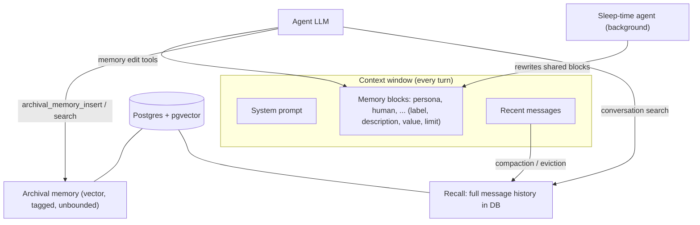

**Letta** is a framework and hosted platform for *stateful* agents: agents whose identity, memory and message history are kept by a server and survive across sessions. The agent edits its own memory with tools. Letta grew out of the MemGPT research project, which treated the [context window](context-window.md) like an operating system's RAM: the LLM pages information between a small in-context tier and large external stores ([MemGPT paper](../sources/packer-2023-memgpt.md)). The contrast with [Mem0](mem0.md) is the core design choice. In Mem0 an external pipeline extracts facts *around* the agent. In Letta the agent itself decides what to remember, and memory is part of the agent's runtime state. See [agent memory](agent-memory.md) for the broader landscape.

## Lineage: MemGPT's virtual context

MemGPT split context into tiers ([MemGPT paper](../sources/packer-2023-memgpt.md)):

- **Main context** (in the prompt): read-only system instructions; a fixed-size, read/write **working context** for key facts and persona; and a FIFO message queue whose head is a recursive summary of evicted messages.
- **External context**: **recall storage**, the full searchable message history, and **archival storage**, arbitrary text with vector search.
- **Memory pressure.** A warning at about 70% of the window prompts the model to save facts. At 100%, about half the queue is flushed into the summary. Both are example settings, not constants.
- A `request_heartbeat` flag let the model chain [tool](tools.md) calls without handing control back to the user.

MemGPT raised GPT-4's deep-memory-retrieval accuracy on Multi-Session Chat from 32.1% to 92.5%. Weaker models gained less, and the paper ties this to unreliable [function calling](function-calling.md) ([MemGPT paper](../sources/packer-2023-memgpt.md)).

## Memory model (server / API agents)

- **Memory blocks** (Letta's name for MemGPT's working context, called "core memory"). Each block has a `label`, a `description` (what the agent mainly uses to decide how to use the block), a `value`, a character `limit` and an optional `read_only` flag. Blocks are rendered into the prompt in a `<memory_blocks>` section showing current/limit character counts, so they never need retrieval. A block can be attached to several agents as **shared memory**. Writes replace the whole value, so concurrent writers get last-write-wins ([Letta memory docs](../sources/letta-memory-docs.md)).
- **Archival memory**: an effectively unlimited, taggable, semantically searchable store the agent curates through `archival_memory_insert` and `archival_memory_search` (tag filters, pagination). It cannot be pinned in context. Use it for documents, logs and history ([Letta memory docs](../sources/letta-memory-docs.md)).
- **Conversation (recall) search.** All state (messages, reasoning, tool calls) is persisted in a database. Messages evicted by compaction remain retrievable by the agent and through the API ([Letta memory docs](../sources/letta-memory-docs.md)).

Synthesis: blocks are the expensive tier, paid in tokens on every call. Keep them small and high-value, like a profile or a task state. Archival is the cheap tier, but the agent has to remember to search it. That is the same trade-off as [context engineering](context-engineering.md) generally.

## MemFS: memory as a git repository (2026)

Letta's current docs centre on **MemFS**. The agent's memory is a git repo of Markdown files with YAML frontmatter (`name`, `description`). Files at the repo root are loaded into the system prompt every turn. Subdirectories with their own `MEMORY.md` index load on demand. A memory's label maps to its path (`persona` becomes `persona.md`). Every edit is a commit: cloud agents push to a hosted repo, local agents keep it on disk. Agent-owned [skills](agent-skills.md) live under `$MEMORY_DIR/skills`. There is no semantic or vector index by default: the agent uses ordinary file-search and read tools. An optional MemFS Search mod adds keyword search, and semantic or [hybrid search](hybrid-search.md) needs QMD indexing on top. Cloud memory is capped at 5 MiB per repo on Free and 50 MiB on Pro, counted on the latest snapshot of each branch or tag, not git history (Nov 2026) ([Letta MemFS docs](../sources/letta-memfs-docs.md)).

Synthesis: MemFS is memory blocks re-expressed as files. Agents trained on coding handle file tools well, and git gives diffs, rollback and auditability for free. This follows from Letta's own finding that an agent with only generic file tools (grep plus semantic file search) scored 74.0% on [LoCoMo](benchmarks.md) with GPT-4o mini, above specialised memory systems ([Letta benchmark](../sources/letta-2025-filesystem-memory-benchmark.md)). It also matches the file-based memory used by [coding agents](coding-agents.md) and [agent instruction files](agent-instruction-files.md).

## Sleep-time compute and dreaming

The research basis is **sleep-time compute**. When a context exists before the query arrives, the model can process it offline and write down inferences. This needs about 5x less test-time compute for equal accuracy on stateful reasoning benchmarks, gains up to 13–18% accuracy as sleep-time compute scales, and cuts per-query cost 2.5x when amortised over related queries. The benefit tracks how predictable the queries are ([Lin et al.](../sources/lin-2025-sleep-time-compute.md)). See [test-time compute](test-time-compute.md).

In Letta 0.7.0 (April 2025), a sleep-time-enabled agent is a **pair**. The primary agent talks to the user and searches memory but cannot edit its core memory. A background sleep-time agent owns the memory-editing tools and rewrites the shared blocks. The background agent can run a stronger, slower model (e.g. gpt-4o-mini primary, gpt-4.1 or Claude Sonnet 3.7 sleeper) at a configurable frequency; more frequent runs cost more tokens. The aim is clean, consolidated memory instead of MemGPT-style accretion, plus memory work off the latency path ([Letta sleep-time blog](../sources/letta-2025-sleep-time-agents.md)). In Letta Code this became **dreaming**: background [subagents](subagents.md) work in git worktrees and trigger after N agent steps or on context compaction, with an optional review pass that costs extra tokens ([Letta MemFS docs](../sources/letta-memfs-docs.md), [Letta memory docs](../sources/letta-memory-docs.md)). Mem0's Platform has an analogous "Dream" consolidation feature ([Mem0 deployment docs](../sources/mem0-platform-vs-oss-docs.md)).

## The agent loop: MemGPT-style vs `letta_v1_agent`

| | MemGPT-style (legacy, still supported) | `letta_v1_agent` (Oct 2025) |
|---|---|---|
| Chaining tool calls | `request_heartbeat` argument | Native multi-step tool use |
| Replying to user | `send_message` tool | Plain assistant message |
| Reasoning | `thinking` argument on tools | Native [reasoning](reasoning-models.md) (encrypted, provider-specific) |
| Model requirement | Reliable tool calling | Any LLM; best with reasoning models |
| Caveats | Out-of-distribution for modern models | No prompted reasoning on non-reasoning models; tool rules can't constrain assistant messages |

Letta says keeping agents "in-distribution" for models like GPT-5 and Claude Sonnet 4.5 significantly improves performance ([Letta v1 agent](../sources/letta-2025-v1-agent.md)). Synthesis: much of MemGPT's machinery compensated for 2023-era models. As models absorb those behaviours, Letta's value shifts toward persistence, memory structure and hosting.

## Deployment and products

As of November 2026 Letta offers Letta Code (an open-source harness: CLI, web app, GitHub Action), the Letta Agent SDK, a self-hostable Letta App Server with channel integrations (Slack, Telegram, Discord and others), Letta Cloud, and Letta Desktop ([Letta MemFS docs](../sources/letta-memfs-docs.md)). The classic Docker server (`letta/letta`, port 8283, REST under `/v1`, Postgres with pgvector via `LETTA_PG_URI`, `SECURE=true` plus a password and E2B tool [sandboxing](code-execution-sandboxes.md) for untrusted users) is now marked as not actively maintained. Docker agents need an explicit [`embedding`](embeddings.md) model in `client.agents.create`, and they keep legacy memory blocks rather than MemFS by default ([Letta Docker docs](../sources/letta-docker-selfhosting-docs.md)).

Synthesis: the product surface moved quickly (MemGPT, then the Letta server and ADE, then Letta Code and MemFS). Pin versions and check the docs for which surface a feature lives on before you design around it.

## Failure modes

Synthesis unless noted:

- **The agent forgets to remember.** Self-managed memory depends on the model calling memory tools at the right moments. Weaker models do this badly ([MemGPT paper](../sources/packer-2023-memgpt.md)). Sleep-time agents and dreaming exist partly to move this out of the hot path ([Letta sleep-time blog](../sources/letta-2025-sleep-time-agents.md)).
- **Block bloat and token cost.** Every in-context character is billed on every turn. Blocks that hit their `limit` force lossy rewrites.
- **Shared-block races.** Whole-value writes give last-write-wins between agents ([Letta memory docs](../sources/letta-memory-docs.md)).
- **Persistent poisoning.** A malicious instruction written into a block is replayed on every future turn. Review memory diffs; MemFS makes them visible as git commits. See [prompt injection](prompt-injection.md).
- **Platform lock-in and churn.** Agent state lives in Letta's schema or repo format, and APIs have moved between product surfaces.

## When to use, when not

Synthesis:

- **Use Letta** for long-lived, individually identifiable agents: personal assistants, AI coworkers, coding agents with project memory, or customer-specific agents that must evolve. It also fits when you want the server to own persistence, history and compaction, and when an always-visible, agent-curated profile beats retrieved fragments.
- **Prefer [Mem0](mem0.md)** when you already have an agent framework and just need per-user facts injected, with no agent-side tool calls and memory as an API.
- **Prefer [LangGraph](langgraph.md) checkpointers plus a store, or a [vector database](vector-databases.md) you run yourself,** when you need full control of schema, tenancy and data residency, or when memory is really document retrieval ([RAG](retrieval-augmented-generation.md)).
- **Durability is a different problem.** Letta persists *memory*. For crash-safe *execution* of long workflows, see [durable agent execution](durable-agent-execution.md).

## Sources

- [MemGPT (Packer et al., 2023)](../sources/packer-2023-memgpt.md)
- [Letta docs: memory blocks and archival memory](../sources/letta-memory-docs.md)
- [Letta docs: MemFS, memory and dreaming, overview](../sources/letta-memfs-docs.md)
- [Letta docs: Docker self-hosting (deprecated)](../sources/letta-docker-selfhosting-docs.md)
- [Rearchitecting Letta's agent loop (2025)](../sources/letta-2025-v1-agent.md)
- [Sleep-time compute paper (Lin et al., 2025)](../sources/lin-2025-sleep-time-compute.md)
- [Letta blog: sleep-time compute (2025)](../sources/letta-2025-sleep-time-agents.md)
- [Letta: Is a filesystem all you need?](../sources/letta-2025-filesystem-memory-benchmark.md)
- [Mem0 docs: OSS overview and Platform vs OSS](../sources/mem0-platform-vs-oss-docs.md)
