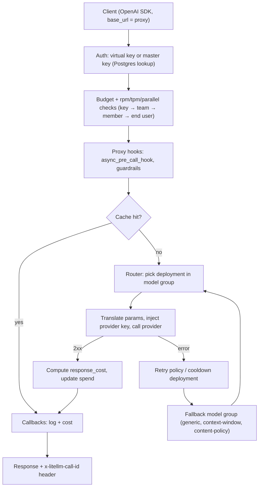

**LiteLLM** (by BerriAI) is an open-source library and server that puts 100+ model providers behind the OpenAI Chat Completions interface. It comes in two forms that share one codebase. The **Python SDK** (`litellm.completion()`, `embedding()`, a `Router`) translates OpenAI-style calls into each provider's native API inside your process. The **proxy** (marketed as the "AI Gateway") is a self-hosted HTTP server, so any OpenAI client works by changing `base_url`. On top of the SDK it adds virtual keys, budgets, rate limits, logging, guardrails, caching and an admin UI ([docs](../sources/litellm-sdk-and-config-docs.md), [README](../sources/litellm-github-readme.md)). It is the most common self-hosted example of an [LLM gateway](llm-gateways.md), and frameworks such as [Google ADK](google-adk.md) use it to reach non-native models ([notebook](../sources/notebook-adk.md)).

## SDK vs proxy

| | SDK | Proxy |
|---|---|---|
| Runs | In your Python process | As a separate service (Docker/Helm), with Postgres and Redis in production |
| Who holds provider keys | Your app (env vars) | The proxy; apps hold virtual keys |
| Routing, retries, fallbacks | `Router` object | Same Router, configured in `config.yaml` |
| Budgets, virtual keys, admin UI | No | Yes (Postgres required) |
| Proxy-only hooks (`async_pre_call_hook` etc.) | No | Yes |
| Fits | One Python app | A platform team serving many apps or languages |

Sources: [docs](../sources/litellm-sdk-and-config-docs.md), [proxy](../sources/litellm-proxy-docs.md), [logging](../sources/litellm-logging-callbacks-docs.md). Enterprise features (for example per-model budgets and some logging destinations) sit under a separate commercial licence ([README](../sources/litellm-github-readme.md), [budgets](../sources/litellm-budgets-rate-limits-docs.md), [logging](../sources/litellm-logging-callbacks-docs.md)).

## Model naming

There are two layers of names, and mixing them up causes many config bugs.

- **Provider strings** (SDK and `litellm_params.model`): `<provider>/<model>`, e.g. `anthropic/...`, `bedrock/...`, `vertex_ai/...`, `ollama/...`, `azure/<your-deployment-name>`. The prefix selects the translation code and credential env vars. `openai/<anything>` plus `api_base` targets any OpenAI-compatible server, such as [vLLM](vllm.md) or another [local LLM](local-llms.md) server ([docs](../sources/litellm-sdk-and-config-docs.md)).
- **Aliases** (proxy `model_name`): what clients send. Several `model_list` entries with the same `model_name` form a *model group* that the Router load-balances across. `model_group_alias` maps one alias onto another, and wildcards (`"*"`, `openai/*`) pass arbitrary names through ([docs](../sources/litellm-sdk-and-config-docs.md)).

```yaml
model_list:
  - model_name: chat-default            # alias clients send
    litellm_params:
      model: azure/my-eu-deployment     # provider string
      api_key: os.environ/AZURE_API_KEY_EU
      rpm: 600
  - model_name: chat-default            # same alias → same load-balancing group
    litellm_params:
      model: openai/my-model
      api_key: os.environ/OPENAI_API_KEY
```

Synthesis: the example above is illustrative; the model names are placeholders.

**Parameter translation.** OpenAI parameters are mapped per provider, and support varies by model within a provider. By default an unsupported parameter *raises an exception*. `drop_params=True` (global or per call) silently removes it instead, and `get_supported_openai_params()` reports what a model/provider pair accepts. Any non-OpenAI kwarg is passed straight into the provider request body. Provider errors are re-raised as OpenAI-style classes (`litellm.RateLimitError`, `litellm.AuthenticationError`, ...) ([docs](../sources/litellm-sdk-and-config-docs.md)).

Synthesis: `drop_params` trades a loud failure for a quiet behaviour change. A dropped `tools`, `response_format` or `seed` still returns a 200 with a different behaviour, which can break [structured outputs](structured-outputs.md) or [function calling](function-calling.md) on the fallback model only.

## Request path through the proxy

Synthesis (assembled from the proxy, budget, router and logging docs):



## Routing, retries, fallbacks

The Router, documented in [model routing and fallbacks](model-routing-and-fallbacks.md), works the same in the SDK and the proxy ([router](../sources/litellm-router-docs.md)):

- **Strategies** (`routing_strategy`): `simple-shuffle` (default; weighted random by `weight` or rpm/tpm), `latency-based-routing`, `usage-based-routing-v2`, `least-busy`, `cost-based-routing`, or custom. The docs warn that usage-based routing adds noticeable latency from its Redis operations and recommend `simple-shuffle` for production.
- **Retries:** `num_retries`, exponential backoff only on rate-limit errors, per-exception counts in `retry_policy`. The router sets the provider client's own `max_retries` to 0, so only one retry loop runs (see [rate limits and retries](rate-limits-and-retries.md)).
- **Cooldowns:** default `cooldown_time` is 5 s. Without `allowed_fails`, a 429 cools a deployment down at once, and so do 401/404/408 errors or a failure rate above 50% in the current minute. Setting `allowed_fails` switches to failure counting.
- **Fallbacks:** generic `fallbacks`, `context_window_fallbacks` (use `enable_pre_call_checks` to skip a model whose window is too small), `content_policy_fallbacks`, and `default_fallbacks`. `max_fallbacks` defaults to 5.
- **Session affinity** pins a session to one deployment (idle TTL 3600 s by default), which protects [prompt caching](prompt-caching.md).
- **Shared state:** without Redis, each proxy instance keeps its own cooldowns, usage counters and affinity pins.

## Keys, budgets and limits

Virtual keys (`POST /key/generate`) are scoped to models and carry `max_budget`, `budget_duration`, `rpm_limit`/`tpm_limit` and an owner (a user or a team). They can be rotated with a grace period ([proxy](../sources/litellm-proxy-docs.md)). Budgets are in USD, priced per request from LiteLLM's model cost map ([proxy](../sources/litellm-proxy-docs.md)), and exist at these levels ([budgets](../sources/litellm-budgets-rate-limits-docs.md)):

- **Global:** `litellm_settings.max_budget` with `budget_duration` (`30s`/`30m`/`30h`/`30d`).
- **Team**, **team member** (`max_budget_in_team`), **internal user**, **virtual key** (with several windows at once via `budget_limits`), **end user / customer** (`/budget/new` + `max_end_user_budget_id`), and **per model** on keys or users (`model_max_budget`, Enterprise).
- A key that belongs to a team is checked against the team and team-member budgets, not its owner's personal budget. v1.94.0 briefly enforced the owner's budget; v1.95.0 reverted it.
- Windows reset on calendar boundaries in UTC (`24h` at midnight, `7d` on Monday, `30d` on the 1st). A reset job runs about every 10 minutes by default.
- Rate limits: `rpm_limit`, `tpm_limit` and `max_parallel_requests` on keys, users and teams, plus `model_rpm_limit`/`model_tpm_limit`; key values override team values. `token_rate_limit_type` selects input, output or total tokens.

Failure semantics matter more than the knobs:

- **No Postgres → budgets fail open.** Requests keep flowing ([budgets](../sources/litellm-budgets-rate-limits-docs.md)).
- `fail_closed_budget_enforcement` and `fail_closed_rate_limit_enforcement` (503 when Redis cannot confirm counters) are opt-in ([budgets](../sources/litellm-budgets-rate-limits-docs.md)).
- `max_parallel_requests` returns an immediate 429 and does not queue, and per-deployment caps are per process ([router](../sources/litellm-router-docs.md)).
- Models priced at zero cost skip budget checks entirely, so a self-hosted model with no cost entry is effectively unbudgeted ([budgets](../sources/litellm-budgets-rate-limits-docs.md)).

## Logging callbacks

All observability goes through callbacks ([logging](../sources/litellm-logging-callbacks-docs.md)):

- **Named integrations:** `success_callback` / `failure_callback` / `callbacks` lists such as `["langfuse"]`, `["otel"]`, `["s3_v2"]`, Datadog, LangSmith, Arize, MLflow and more. In the proxy these sit under `litellm_settings`. See [Langfuse](langfuse.md) and [OpenTelemetry GenAI](opentelemetry-genai.md).
- **`CustomLogger` subclasses** registered via `litellm.callbacks` (SDK) or a dotted path to an *instance* (proxy). Request-level hooks: `log_pre_api_call`, `async_log_success_event`, `async_log_failure_event`. Per-attempt hooks (`async_*_deployment_hook`) fire once per retry or fallback attempt. Proxy-only hooks (`async_pre_call_hook`, `async_post_call_success_hook`) can rewrite requests and responses, the gateway form of [agent hooks and middleware](agent-hooks-and-middleware.md).
- **Payload:** callback kwargs include `response_cost`, `cache_hit` and your metadata. Success and failure events carry a `standard_logging_object` (StandardLoggingPayload), which may be absent on intermediate streaming events.
- **Privacy:** `turn_off_message_logging` keeps spend and metadata but drops prompts and responses. `redact_user_api_key_info` strips key identity for some integrations. Clients can send `no-log: true` unless `global_disable_no_log_param` is set. This interacts with [data retention and residency](data-retention-and-residency.md) and [PII handling](pii-and-data-privacy.md).
- **Loss under load:** the S3 logger queues per worker and drops entries older than 3600 s or past 50,000 queued items by default.

Synthesis: treat LiteLLM logs as cost and audit telemetry, not a guaranteed record. Put tracing that must not be lost in [LLM observability](llm-observability.md) tooling with its own delivery guarantees, and remember that per-attempt hooks are where retries and fallbacks become visible.

## Security record

A gateway concentrates every provider key in one place, so its CVEs are tier-0 incidents ([CSA](../sources/csa-litellm-cve-2026-42208-note.md)). The 2026 record:

| Date (2026) | Issue | Versions | Notes |
|---|---|---|---|
| Mar 24 | PyPI supply-chain compromise: 1.82.7 and 1.82.8 shipped a credential stealer | 1.82.7, 1.82.8 | Suspected entry via Trivy in CI; live about 40 min; pinned Docker image unaffected; v1.83.0 rebuilt, cosign-signed images ([advisory](../sources/litellm-security-update-march-2026.md)) |
| Apr 19-20 | CVE-2026-42208: pre-auth SQL injection via the `Authorization: Bearer` header during key verification, CVSS 9.3 | 1.81.16-1.83.6, fixed 1.83.7 | Exploitation seen about 36 h after advisory indexing; payloads targeted key, credential and config tables ([LiteLLM](../sources/litellm-cve-2026-42208-post.md), [CSA](../sources/csa-litellm-cve-2026-42208-note.md)); CISA KEV alert dated May 8 ([Security Affairs](../sources/securityaffairs-kev-litellm-cve-2026-42208.md)) |
| Jun 8 (KEV) | CVE-2026-42271: MCP server test endpoints ran caller-supplied commands as subprocesses with no role check, CVSS v4 8.7 | 1.74.2-1.83.6, fixed 1.83.7 | Any valid API key could run commands on the host ([Security Affairs](../sources/securityaffairs-kev-litellm-cve-2026-42271.md)) |
| May-Nov | GitHub advisories: Host-header auth bypass, salt-key reuse giving admin escalation, unauthenticated file read leaking the Enterprise master key (all critical); SSRF and credential exfiltration via request-body routing params and `user_config`; local file reads via credential/OIDC params | various | First page of the advisory list only ([advisories](../sources/litellm-github-security-advisories.md)) |

Synthesis: the pattern is consistent. Request-body fields that the proxy trusts (routing parameters, `user_config`, credential file paths, MCP server configs) give a caller with an ordinary key server-side fetches, file reads or execution. Exposed admin and test endpoints widen that. This maps onto [OWASP Top 10 for LLM](owasp-top-10-for-llm.md) supply-chain and excessive-agency risks and the broader [LLM security risks](llm-security-risks.md). Exploitation of 42208 began within days, so patch windows measured in weeks are too slow.

## Comparisons

- **vs hosted aggregators (OpenRouter, Vercel AI Gateway):** LiteLLM keeps the data path and keys in your VPC. You pay for that by running Postgres and Redis and owning upgrades and CVE response ([LLM gateways](llm-gateways.md)).
- **vs Kong / Envoy AI gateways:** those plug into existing API-gateway and Kubernetes practice. LiteLLM is Python-native, has the broadest provider translation and the richest LLM-specific budget hierarchy, and is the easiest to embed as an SDK ([LLM gateways](llm-gateways.md)).
- **vs a framework abstraction ([Vercel AI SDK](vercel-ai-sdk.md), [LangChain](langchain.md) model classes):** those normalise providers inside one language runtime. LiteLLM's proxy normalises them at the network layer for every language.

Synthesis: these comparisons summarise the gateway page plus this one; they are not vendor benchmarks.

## Practical guidance

Synthesis, grounded in the sources above:

1. **Choose the mode deliberately.** Use the SDK for a single Python service. Use the proxy once more than one team or language needs shared keys, budgets or audit.
2. **Pin and verify.** Use `-stable` images, which the README says pass 12-hour load tests, pinned by digest. Do not `pip install litellm` unpinned in CI, as the March 2026 incident showed ([advisory](../sources/litellm-security-update-march-2026.md), [README](../sources/litellm-github-readme.md)). Stay at or above the vendor's current recommended floor (v1.83.10-stable at the time of the 42208 post).
3. **Never expose the proxy or admin UI to the internet without a front door.** Put it behind a VPN or API gateway. Give provider keys least privilege and per-project scope, so that a database dump does not equal an org-wide compromise ([CSA](../sources/csa-litellm-cve-2026-42208-note.md)).
4. **Run Postgres and Redis in production** and decide fail-open vs fail-closed explicitly for budgets and rate limits.
5. **Use aliases, not provider strings, in apps.** Clients send `model_name`, and the platform team swaps deployments underneath.
6. **Avoid `drop_params` for capability-bearing params,** or verify that every fallback model supports `tools` and `response_format` before adding it to a chain.
7. **One retry layer.** Set client-side `max_retries=0` when calling the proxy, because the proxy already retries ([router](../sources/litellm-router-docs.md)).
8. **Keep semantic caching off agentic traffic** ([proxy](../sources/litellm-proxy-docs.md); see [semantic caching](semantic-caching.md)).
9. **Turn off message logging by default** and enable it per team where policy allows ([logging](../sources/litellm-logging-callbacks-docs.md)).

## Sources

- [LiteLLM docs: getting started, input params, config.yaml](../sources/litellm-sdk-and-config-docs.md)
- [LiteLLM GitHub README](../sources/litellm-github-readme.md)
- [LiteLLM Router docs](../sources/litellm-router-docs.md)
- [LiteLLM proxy docs](../sources/litellm-proxy-docs.md)
- [LiteLLM budgets and rate limits docs](../sources/litellm-budgets-rate-limits-docs.md)
- [LiteLLM logging and callbacks docs](../sources/litellm-logging-callbacks-docs.md)
- [LiteLLM security update, March 2026](../sources/litellm-security-update-march-2026.md)
- [LiteLLM blog: CVE-2026-42208](../sources/litellm-cve-2026-42208-post.md)
- [CSA research note on CVE-2026-42208](../sources/csa-litellm-cve-2026-42208-note.md)
- [Security Affairs: KEV listing of CVE-2026-42208](../sources/securityaffairs-kev-litellm-cve-2026-42208.md)
- [Security Affairs: KEV listing of CVE-2026-42271](../sources/securityaffairs-kev-litellm-cve-2026-42271.md)
- [LiteLLM GitHub security advisories](../sources/litellm-github-security-advisories.md)
- [ADK notebook](../sources/notebook-adk.md)
