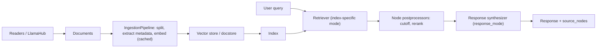
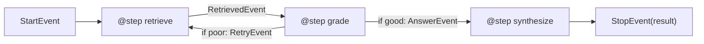

**LlamaIndex** is an open-source framework (Python, plus a TypeScript port) for connecting LLMs to your own data. Its centre of gravity is [retrieval-augmented generation](retrieval-augmented-generation.md): load data into `Document`s, split them into `Node`s, index them, then answer questions through a **query engine** that retrieves, post-processes and synthesizes. On top of that it offers agents and **Workflows**, an event-driven orchestration layer ([LlamaIndex docs](../sources/llamaindex-framework-docs.md), [Workflows docs](../sources/llamaindex-workflows-docs.md)). The owner's tutorial sums up the positioning: [LangChain](langchain.md) is breadth (orchestration, agents), LlamaIndex is depth on data ([Notebook](../sources/notebook-langchain-vs-llamaindex.md)). Framework version as of 2026-11-14: `llama-index` v0.14.25 (2026-09-21).

## The data model and pipeline

The docs describe five RAG stages: **loading, indexing, storing, querying, evaluation** ([docs](../sources/llamaindex-framework-docs.md)).

| Abstraction | What it is |
|---|---|
| `Document` | Container for any source: PDF, API output, DB rows |
| `Node` | The "atomic unit": a chunk of a Document with metadata and relationships to other nodes |
| Reader / connector | Loads data into Documents (hundreds on LlamaHub; `SimpleDirectoryReader` for folders) |
| `IngestionPipeline` | Ordered transformations (node parser, metadata extractors, [embedding model](embeddings.md)), optional direct write to a [vector store](vector-databases.md) |
| Index | Data structure over Nodes that exposes a retriever |
| Retriever | Fetches relevant Nodes for a query |
| Node postprocessor | Filters, re-weights or [reranks](reranking.md) retrieved Nodes |
| Response synthesizer | Turns query + Nodes into an answer via one or more LLM calls |
| Query / chat engine | Retriever → postprocessors → synthesizer, stateless (query) or conversational (chat) |

The `IngestionPipeline` **hashes and caches every node+transformation pair**, so re-running on unchanged inputs is near-instant once the cache is persisted. One sharp edge: when the pipeline writes to a vector store, embedding must be one of its stages, or building the index from that store later fails ([docs](../sources/llamaindex-framework-docs.md)). [Chunking](chunking.md) choices (`SentenceSplitter(chunk_size, chunk_overlap)`) live here.

## Index types

| Index | Build | Query behaviour | Use for |
|---|---|---|---|
| `VectorStoreIndex` | Embed each Node into a vector store | Top-k most similar Nodes → synthesizer | Default for semantic Q&A |
| `SummaryIndex` (was List) | Nodes as a sequential list | Loads **all** Nodes by default; optional embedding or keyword filters | Summarizing a whole corpus |
| `TreeIndex` | Hierarchical summaries over leaf Nodes | Traverse root → leaf; `child_branch_factor` (default 1) children per level | Hierarchical summarization |
| `KeywordTableIndex` | Keyword → Node map | Extract query keywords, match | Exact-term lookup |
| `PropertyGraphIndex` | LLM- or schema-driven knowledge-graph extraction, optional embeddings; can attach to Neo4j | Sub-retrievers combined: keyword/synonym expansion + vector retrieval over triples | [GraphRAG](graphrag.md)-style relational questions |

Source: [docs](../sources/llamaindex-framework-docs.md). `index.as_retriever(retriever_mode=...)` picks an index-specific retriever (e.g. a summary index's `"llm"` mode), or you construct the retriever class directly via the low-level composition API. A `RouterRetriever` uses a selector over candidate retrievers' metadata to pick one or more per query.

## Response modes: where LLM cost hides

The synthesizer's `response_mode` decides how many LLM calls a single query makes ([docs](../sources/llamaindex-framework-docs.md)):

| Mode | Mechanics | LLM calls | Good for |
|---|---|---|---|
| `compact` (default) | Pack as many chunks as fit in the [context window](context-window.md), then refine across packs | Few | General Q&A |
| `refine` | First chunk with `text_qa_template`, then each subsequent chunk with `refine_template` | One per chunk | Detailed answers |
| `tree_summarize` | Summarize packs, then recursively summarize the summaries | Log-depth tree | Summaries |
| `simple_summarize` | Truncate everything into one prompt | 1 | Fast summaries; loses detail |
| `accumulate` / `compact_accumulate` | Same query against each chunk, answers concatenated | Per chunk / pack | Per-document answers |
| `no_text` | Retrieve only; inspect `response.source_nodes` | 0 | Debugging retrieval |

Synthesis: `refine` with `similarity_top_k=10` means about ten sequential LLM calls per query, which matters for [cost and latency](cost-and-latency-optimization.md). `no_text` is the cheapest way to check whether a bad answer is a retrieval problem or a synthesis problem.

## Agents and Workflows

Agents are prebuilt workflows: `FunctionAgent` (native [function calling](function-calling.md)), `ReActAgent`, `CodeActAgent`, and `AgentWorkflow` for multi-agent [handoffs](agent-handoffs.md). [Tools](tools.md) are plain Python functions, described to the model by name, docstring and type hints, or **whole query engines wrapped as tools**. That last option is how LlamaIndex does [agentic RAG](agentic-rag.md). The APIs are async (`await agent.run(user_msg=...)`), and the docs warn that agents need capable models ([docs](../sources/llamaindex-framework-docs.md)).

**Workflows** are the lower-level layer ([Workflows docs](../sources/llamaindex-workflows-docs.md)):

- A `Workflow` subclass has `@step` async methods. Each step accepts one event type and returns another. The returned event's *type* routes to the next step. `StartEvent` and `StopEvent` are built in; events are Pydantic models.
- Branches are `if` statements that return different event types. Loops are steps that emit an event an earlier step handles. Fan-out is a step returning `list[Event]`, collected by another step.
- The `@step` decorator infers input and output types from annotations, and the workflow **validates the event graph before running** (start and stop events exist, every produced event has a consumer); `workflow.validate()` runs the check explicitly. `run()` returns a `WorkflowHandler` you can await or stream events from. Set a `timeout` in seconds.
- `Context` holds per-run state (`ctx.store.get/set`, atomic `edit_state()`, optional typed Pydantic state). Reusing a context carries state across runs. Heavy clients go in resources, not state, because state must serialize.
- [Human-in-the-loop](human-in-the-loop.md): emit `InputRequiredEvent`, consume `HumanResponseEvent`. In a web app, snapshot the context, cancel the handler, and restore it when the reply arrives.

Synthesis: an illustrative corrective-RAG loop expressed as typed events, not taken from the docs.

## Limitations and failure modes

- **Durability is do-it-yourself by default.** Workflows are ephemeral by default and there is no built-in checkpointer. You snapshot the context (e.g. on internal `StepStateChanged` events) and restore it with `Context.from_dict()`. A crash loses work since the last snapshot, and a step that was mid-flight reruns from the top (resume is at-least-once), so steps with side effects must be idempotent. The alternative is the optional DBOS runtime plugin (see [durable agent execution](durable-agent-execution.md)), which journals step transitions to a database so a crashed workflow can resume without your own snapshot loop ([Workflows docs](../sources/llamaindex-workflows-docs.md)).
- **`ctx.wait_for_event()` replays** all code before the wait each time an event arrives. The docs recommend the two-step event pattern instead.
- **Opinionated defaults hide decisions.** `VectorStoreIndex.from_documents(docs)` silently picks a splitter, embedding model and LLM (via global `Settings`), and `compact` mode silently packs chunks. That is fast to start but easy to misjudge, which is Anthropic's general warning about frameworks hiding prompts and responses ([Anthropic](../sources/anthropic-building-effective-agents.md)).
- **Agent orchestration is not the focus.** The owner's tutorial notes LlamaIndex's agents and workflows exist but are less central than LangGraph's ([Notebook](../sources/notebook-langchain-vs-llamaindex.md)).
- **Integration sprawl.** Integrations are separate pip packages (`llama-index-llms-openai`, `llama-index-vector-stores-qdrant`, ...), and the API moves fast. Pin versions.

## When to use / when not

| Situation | Choice |
|---|---|
| The hard part is data: messy documents, many sources, retrieval quality | LlamaIndex ([Notebook](../sources/notebook-langchain-vs-llamaindex.md)) |
| The hard part is control flow: complex multi-agent graphs, branching, durable state | [LangGraph](langgraph.md); optionally wrap a LlamaIndex query engine as a tool |
| One retrieval call plus one LLM call over a small corpus | Raw SDK + a [vector database](vector-databases.md) client ([Anthropic](../sources/anthropic-building-effective-agents.md)) |
| Prompt quality across a multi-step pipeline must be optimized against a metric | [DSPy](dspy.md) |
| Typed agent with validated outputs and dependency injection, retrieval as a tool | [Pydantic AI](pydantic-ai.md) |

Synthesis: in a [Forward Deployed](forward-deployed-engineering.md) engagement, LlamaIndex is a strong prototype accelerator for "chat with our documents". Before production, make the hidden choices explicit: chunker, embedding model, `similarity_top_k`, reranker, response mode. Evaluate retrieval separately from generation (see [LLM evaluation](llm-evaluation.md)), and pin integration package versions.

## Sources

- [LlamaIndex framework documentation](../sources/llamaindex-framework-docs.md)
- [LlamaIndex Workflows documentation](../sources/llamaindex-workflows-docs.md)
- [Notebook tutorial: LangChain vs LlamaIndex](../sources/notebook-langchain-vs-llamaindex.md)
- [Building effective agents (Anthropic)](../sources/anthropic-building-effective-agents.md)
