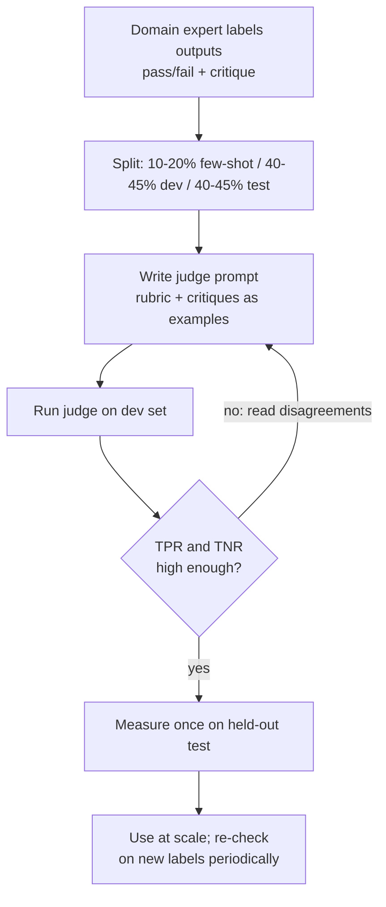

**LLM-as-judge** means using a language model as the grader in an [eval](llm-evaluation.md): it reads an output (and optionally the input, a reference answer, retrieved context or a second candidate) and returns a verdict against a rubric. It exists because open-ended qualities such as helpfulness, tone, faithfulness or task completion cannot be checked with string matching, and human grading does not scale. Strong judges can match human agreement levels (GPT-4 agreed with humans over 80% of the time on MT-Bench, about the human-human rate), but they carry systematic biases and must be validated against human labels before their scores are trusted ([Zheng et al.](../sources/judging-llm-as-a-judge.md), [OpenAI](../sources/openai-evaluation-best-practices.md)).

## Judging modes

| Mode | Judge sees | Output | Strengths | Weaknesses |
|---|---|---|---|---|
| Pointwise (single-answer) | one output + rubric | score (1-5) or pass/fail | absolute; scales linearly; works for monitoring a single system | scale drift; scores bunch on one value; Likert points are ill-defined |
| Pairwise | two outputs | A / B / tie | more reliable for "which is better"; matches A/B decisions | position bias; O(n²) for many systems; no absolute level |
| Reference-guided | output + gold answer | correct / incorrect or score | anchors the judge on facts and maths it would otherwise miss | needs references |
| Decomposed (claims) | output split into claims + context | fraction supported | fine-grained faithfulness for [RAG](retrieval-augmented-generation.md) | many calls; extraction errors |

Sources: [Zheng et al.](../sources/judging-llm-as-a-judge.md), [OpenAI](../sources/openai-evaluation-best-practices.md), [Ragas](../sources/es-2023-ragas.md). OpenAI recommends "pairwise comparison or pass/fail for more reliability" ([OpenAI](../sources/openai-evaluation-best-practices.md)). Practitioner guidance goes further: Likert scales are hard to act on (nobody can define the gap between 3 and 4), so use **binary pass/fail plus a written critique** ([Husain](../sources/husain-llm-judge-critique-shadowing.md)). Anthropic's docs accept either a correct/incorrect label or a 1-5 scale, as long as output is constrained rather than free-form ([Claude docs](../sources/anthropic-define-success-criteria-and-evals.md)). Pairwise human judging at scale is what Chatbot Arena does ([Chiang et al.](../sources/chiang-2024-chatbot-arena.md)).

## How a good judge prompt works

- **Explicit rubric** with concrete pass conditions, possibly several rubrics per criterion ([Claude docs](../sources/anthropic-define-success-criteria-and-evals.md)).
- **Reason, then score.** Let the judge [reason](chain-of-thought.md) (or use [thinking](extended-thinking.md)) before the verdict; this helps on complex judgments ([Claude docs](../sources/anthropic-define-success-criteria-and-evals.md), [OpenAI](../sources/openai-evaluation-best-practices.md)). G-Eval automates this: the model first writes its own evaluation steps from the criterion, then fills in a score form ([G-Eval](../sources/liu-2023-g-eval.md)).
- **[Structured output](structured-outputs.md)**, e.g. JSON `{score, reason}` so scores parse and reasons can be audited ([notebook](../sources/notebook-llm-evaluation.md)).
- **An "Unknown" escape** so the judge is not forced to guess when information is missing ([Anthropic](../sources/anthropic-demystifying-evals-for-ai-agents.md)).
- **A different model from the generator**, to reduce self-preference ([Claude docs](../sources/anthropic-define-success-criteria-and-evals.md)); the most capable judge available ([OpenAI](../sources/openai-evaluation-best-practices.md)).
- **Probability-weighted scores.** Integer scores bunch on one value and tie; G-Eval computes Σ p(s)·s over score tokens (estimated from 20 samples when log-probs are unavailable) for a continuous score, reaching Spearman 0.514 with humans on SummEval versus 0.474 for UniEval, the best prior evaluator ([G-Eval](../sources/liu-2023-g-eval.md)).
- **[Few-shot](few-shot-prompting.md) examples from expert critiques.** Few-shot raised GPT-4's position consistency from 65.0% to 77.5% at ~4x prompt cost ([Zheng et al.](../sources/judging-llm-as-a-judge.md)); expert critiques double as examples ([Husain](../sources/husain-llm-judge-critique-shadowing.md)).

## Known biases

| Bias | Evidence | Mitigation |
|---|---|---|
| Position | GPT-4 gave the same verdict after swapping order only 65% of the time; Claude-v1 favoured the first slot 75% ([Zheng](../sources/judging-llm-as-a-judge.md)). Order alone let Vicuna-13B "beat" ChatGPT on 66/80 queries ([Wang](../sources/wang-2023-llms-not-fair-evaluators.md)). Worse with 3-4 candidates ([CALM](../sources/ye-2024-calm-judge-biases.md)). | Judge both orders; disagreement = tie ([Zheng](../sources/judging-llm-as-a-judge.md)); balanced position calibration ([Wang](../sources/wang-2023-llms-not-fair-evaluators.md)) |
| Verbosity / length | Padding with rephrased list items fooled GPT-3.5 and Claude-v1 in 91% of 23 cases, GPT-4 in 9% ([Zheng](../sources/judging-llm-as-a-judge.md)) | Rubric penalising padding; regression length control raised AlpacaEval's Arena correlation from 0.94 to 0.98 ([Dubois](../sources/dubois-2024-length-controlled-alpacaeval.md)) |
| Self-preference | Judges rate their own outputs higher; strength tracks how well they recognise their own text ([Panickssery](../sources/panickssery-2024-self-preference.md)); G-Eval rated GPT-3.5 summaries above human ones humans preferred ([G-Eval](../sources/liu-2023-g-eval.md)) | Use a different model family as judge; multi-judge panels |
| Sentiment, authority, bandwagon, distraction | Negative emotional tone cut verdict robustness to ~0.24-0.38 for strong 2024 judges; fake citations and "majority opinion" also sway some judges ([CALM](../sources/ye-2024-calm-judge-biases.md)) | Strip irrelevant framing; test the judge with perturbations |
| Being misled by the answer | Judges accept wrong maths they could solve; a reference answer cut GPT-4's failure rate from 70% to 15% ([Zheng](../sources/judging-llm-as-a-judge.md)) | Reference-guided grading; have judge solve first |

CALM lists twelve biases in all, including compassion-fade (model names shown), refinement-aware and identity-marker sensitivity ([CALM](../sources/ye-2024-calm-judge-biases.md)).

## Calibration: validating the judge

A judge is itself a classifier and needs its own eval. The recipe ([Husain](../sources/husain-llm-judge-critique-shadowing.md), [Shankar et al.](../sources/shankar-2024-who-validates-the-validators.md)):

- Measure **true positive and true negative rates separately**, not raw agreement: if 5% of outputs fail, an always-pass judge has 95% agreement and catches nothing ([Husain](../sources/husain-llm-judge-critique-shadowing.md)).
- Sizing: start around 30 labelled examples, aim for ~100 per failure mode; under ~60 the confidence intervals are too wide ([Husain](../sources/husain-llm-judge-critique-shadowing.md)). The Honeycomb case passed 90% agreement in three prompt iterations, but its data were roughly balanced (about half failures), which is the case where raw agreement is meaningful.
- Criteria drift: labelling changes the expert's own criteria, so expect to revise the rubric and re-validate ([Shankar et al.](../sources/shankar-2024-who-validates-the-validators.md)).
- Correlation is not validation: in GroUSE's 144 unit tests over seven grounded-QA failure modes, automated RAG evaluation frameworks missed important failures even with GPT-4 as judge, and open-weight judges that correlated well with GPT-4 still failed the tests, so add per-failure-mode unit tests rather than relying on agreement with a reference judge ([Muller et al.](../sources/muller-2024-grouse.md)). A 2025 survey finds the same validation gap for every generation of automatic metric, LLM judges included, and recommends combining complementary evaluations ([Oliva et al.](../sources/oliva-2025-illusion-of-perfect-metric.md)).
- [Human-in-the-loop](human-in-the-loop.md) calibration: route examples where position-swapped verdicts disagree to humans ([Wang](../sources/wang-2023-llms-not-fair-evaluators.md)).

Synthesis: once TPR/TNR are known, a judge's raw pass rate can be corrected for its error rates, and a judge prompt change should be treated like any other change: re-run the judge eval before trusting new numbers.

## Limitations and failure modes

- **[Non-determinism](llm-non-determinism.md) and cost**: each grade is a model call, scores vary between runs, and pairwise or multi-sample schemes multiply cost ([Anthropic](../sources/anthropic-demystifying-evals-for-ai-agents.md)).
- **Shared blind spots**: a judge from the same family can share the generator's concepts of quality; using judges as reward signals risks self-reinforcement ([G-Eval](../sources/liu-2023-g-eval.md), [Panickssery](../sources/panickssery-2024-self-preference.md)).
- **Hard questions**: on items beyond the judge's ability, the judge is easily misled ([Zheng](../sources/judging-llm-as-a-judge.md)); this is why contamination-limited benchmarks such as LiveBench avoid judges entirely (see [benchmarks](benchmarks.md)).
- **Gaming**: verbosity and formatting tricks inflate scores when the judge is the target ([Zheng](../sources/judging-llm-as-a-judge.md), [Dubois](../sources/dubois-2024-length-controlled-alpacaeval.md)).

## When to use, when not

- **Use** for open-ended qualities (tone, helpfulness, faithfulness, rubric adherence), for sampled online scoring of production traces ([LLM observability](llm-observability.md)), and to triage transcripts for human review ([Anthropic](../sources/anthropic-demystifying-evals-for-ai-agents.md), [notebook](../sources/notebook-llm-evaluation.md)).
- **Do not use** when code can decide: schema validity, exact labels, unit tests, database state, [tool-call](function-calling.md) arguments. Code graders are faster, cheaper and deterministic ([Claude docs](../sources/anthropic-define-success-criteria-and-evals.md), [Husain](../sources/husain-llm-judge-critique-shadowing.md)).
- **Pairwise** when choosing between two prompts or models; **pointwise pass/fail** for regression gates and monitoring. Synthesis: pairwise results do not tell you whether either version is good enough to ship, so pair them with a pointwise gate.

## Sources

- [Judging LLM-as-a-Judge (Zheng et al.)](../sources/judging-llm-as-a-judge.md)
- [G-Eval (Liu et al.)](../sources/liu-2023-g-eval.md)
- [Large Language Models are not Fair Evaluators (Wang et al.)](../sources/wang-2023-llms-not-fair-evaluators.md)
- [Justice or Prejudice? CALM (Ye et al.)](../sources/ye-2024-calm-judge-biases.md)
- [LLM Evaluators Recognize and Favor Their Own Generations (Panickssery et al.)](../sources/panickssery-2024-self-preference.md)
- [Length-Controlled AlpacaEval (Dubois et al.)](../sources/dubois-2024-length-controlled-alpacaeval.md)
- [Using LLM-as-a-Judge (Husain)](../sources/husain-llm-judge-critique-shadowing.md)
- [Who Validates the Validators? (Shankar et al.)](../sources/shankar-2024-who-validates-the-validators.md)
- [Define success criteria and build evaluations (Claude docs)](../sources/anthropic-define-success-criteria-and-evals.md)
- [Evaluation best practices (OpenAI)](../sources/openai-evaluation-best-practices.md)
- [Demystifying evals for AI agents (Anthropic)](../sources/anthropic-demystifying-evals-for-ai-agents.md)
- [Chatbot Arena (Chiang et al.)](../sources/chiang-2024-chatbot-arena.md)
- [RAGAS (Es et al.)](../sources/es-2023-ragas.md)
- [Notebook: LLM Evaluation & Observability](../sources/notebook-llm-evaluation.md)
- [GroUSE (Muller et al.)](../sources/muller-2024-grouse.md)
- [The illusion of a perfect metric (Oliva et al.)](../sources/oliva-2025-illusion-of-perfect-metric.md)
