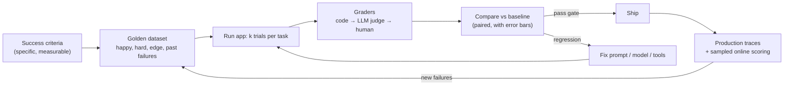

**LLM evaluation** ("evals") is the practice of measuring whether an LLM application does its job, using a fixed set of realistic tasks with checkable success criteria, scored by graders, and re-run on every change to a [prompt](prompt-management.md), model, tool or retrieval step. Because outputs are open-ended and vary between runs, evals replace exact-match unit tests with graded judgement over a dataset, and they are the only way to tell whether a change helped or quietly broke something ([notebook](../sources/notebook-llm-evaluation.md), [OpenAI](../sources/openai-evaluation-best-practices.md)). This page covers application evals; for public model leaderboards see [benchmarks](benchmarks.md), and for model graders see [LLM-as-judge](llm-as-judge.md). The agent-runtime side of checking work is in [verification and evals](verification-and-evals.md).

## Vocabulary

Anthropic's agent-eval post gives a precise vocabulary ([Anthropic, Jan 2026](../sources/anthropic-demystifying-evals-for-ai-agents.md)):

| Term | Meaning |
|---|---|
| Task | One test: inputs plus success criteria |
| Trial | One attempt at a task; run several because outputs vary |
| Grader | Logic scoring one aspect; a task can have several |
| Transcript (trace, trajectory) | Full record of a trial: outputs, tool calls, reasoning |
| Outcome | Final environment state (e.g. does the booking exist in the DB), which may differ from what the agent *says* it did |
| Eval harness | Runs tasks, records, grades, aggregates |
| Agent harness (scaffold) | What lets the model act; agent evals test model + scaffold together |
| Suite | Tasks measuring one capability or behaviour |

## The eval loop

Both vendors describe the same cycle: define success criteria, collect a dataset, choose metrics, run and compare against a baseline, then evaluate continuously and grow the set from production failures ([OpenAI](../sources/openai-evaluation-best-practices.md), [Claude docs](../sources/anthropic-define-success-criteria-and-evals.md), [notebook](../sources/notebook-llm-evaluation.md)).

Synthesis: the diagram combines those three descriptions.

**Success criteria** should be specific, measurable, achievable and relevant, and usually multi-dimensional: task fidelity, consistency, tone, privacy, context use, latency, cost. Even safety can be a number, such as a maximum flagged-output rate ([Claude docs](../sources/anthropic-define-success-criteria-and-evals.md)).

## Golden datasets

- **Start small, from real failures.** 20-50 tasks drawn from bug trackers, support queues and manual checks is a strong start, because early changes have large effects ([Anthropic](../sources/anthropic-demystifying-evals-for-ai-agents.md), [notebook](../sources/notebook-llm-evaluation.md)).
- **Cover the distribution.** Mirror production traffic and add edge cases: irrelevant, very long, harmful, ambiguous, multilingual, typo-ridden or multi-intent inputs, [jailbreaks](jailbreaks.md), and conflicts between system and user instructions ([Claude docs](../sources/anthropic-define-success-criteria-and-evals.md), [OpenAI](../sources/openai-evaluation-best-practices.md)).
- **Balance positives and negatives.** Test both when a behaviour should happen and when it should not (e.g. a search tool that over-triggers as well as under-triggers) ([Anthropic](../sources/anthropic-demystifying-evals-for-ai-agents.md)).
- **Make tasks unambiguous.** Two experts should agree on pass/fail; a 0% pass rate over many trials usually means the task or grader is broken, not the model ([Anthropic](../sources/anthropic-demystifying-evals-for-ai-agents.md)).
- **Synthetic inputs, real outputs.** [LLM-generated](synthetic-data-generation.md) user inputs along dimensions such as feature, scenario and persona are fine; the responses being graded must come from the real system ([Husain](../sources/husain-llm-judge-critique-shadowing.md)).
- **Keep it out of prompts.** Eval cases leaked into [few-shot examples](few-shot-prompting.md) measure memorisation ([notebook](../sources/notebook-llm-evaluation.md)).
- **Expect criteria drift.** Grading outputs changes what people think "good" means, so the rubric and dataset evolve together ([Shankar et al.](../sources/shankar-2024-who-validates-the-validators.md)).

## Grader types

| Grader | Examples | Strengths | Weaknesses |
|---|---|---|---|
| Code-based | exact/regex match, JSON-schema valid, unit tests pass, tool-call args, DB state, latency/cost | fast, cheap, deterministic, debuggable | brittle to valid variation; no nuance |
| Reference-based metric | ROUGE-L, BLEU, embedding cosine, F1 | cheap, needs a gold answer | weak proxy for quality; generic metrics alone are an anti-pattern |
| Model-based ([LLM-as-judge](llm-as-judge.md)) | rubric, pairwise, reference-guided, natural-language assertions | scalable, handles open-ended output | non-deterministic, biased, must be calibrated to humans |
| Human | SME review, spot checks, A/B tests | gold standard; calibrates judges | slow, expensive |

Sources: [Anthropic](../sources/anthropic-demystifying-evals-for-ai-agents.md), [OpenAI](../sources/openai-evaluation-best-practices.md), [Claude docs](../sources/anthropic-define-success-criteria-and-evals.md). The Claude docs order the choice: code first, then LLM grading (after testing its reliability), and humans only where unavoidable; they also prefer many automatically graded cases over few hand-graded ones. Combine graders as weighted (score above a threshold), binary (all must pass) or hybrid ([Anthropic](../sources/anthropic-demystifying-evals-for-ai-agents.md)).

**Grade outcomes, not paths.** For [agents](agent-evaluation.md), check the end state (files, database rows, page state) rather than demanding a specific tool sequence; give partial credit; harden graders against shortcuts. Grader bugs are common: one CORE-Bench run moved from 42% to 95% after grading fixes and a less constrained scaffold; one bug was a check that rejected "96.12" against "96.124991…" ([Anthropic](../sources/anthropic-demystifying-evals-for-ai-agents.md)). τ-bench shows the pattern: an open-ended conversation graded deterministically by comparing final database state to an annotated goal ([τ-bench](../sources/yao-2024-tau-bench.md)).

**Where to put evals** depends on architecture: single-turn calls need instruction-following and correctness evals; workflows need each call evaluated in isolation; agents add tool-selection and argument-precision evals; multi-agent systems add handoff accuracy ([OpenAI](../sources/openai-evaluation-best-practices.md)). For [RAG](retrieval-augmented-generation.md), score retrieval (recall, MRR, context precision) separately from generation (faithfulness to retrieved context), so a bad answer can be blamed on the right stage; see [RAGAS and DeepEval](ragas-and-deepeval.md) for metric libraries ([notebook](../sources/notebook-llm-evaluation.md), [Ragas](../sources/es-2023-ragas.md), [Ragas docs](../sources/ragas-docs-metrics.md)).

## Non-determinism: trials, pass@k and pass^k

Run each task several times. **pass@k** is the chance at least one of k trials succeeds (rises with k; right when one success is enough, e.g. a coding agent with tests). **pass^k** is the chance all k succeed (falls with k; right for customer-facing agents that must be consistent). At 75% per-trial success, pass^3 ≈ 0.75³ ≈ 42% ([Anthropic](../sources/anthropic-demystifying-evals-for-ai-agents.md), [τ-bench](../sources/yao-2024-tau-bench.md)). [Temperature](sampling-parameters.md) 0 does not make hosted inference deterministic: one study got 80 distinct outputs from 1,000 temperature-0 completions of one prompt ([Thinking Machines](../sources/defeating-nondeterminism-llm-inference.md)).

## Statistics: is the difference real?

An eval score is an estimate from a sample of questions ([Miller 2024](../sources/miller-2024-adding-error-bars-to-evals.md)):

- Report the standard error with every mean; 95% CI ≈ mean ± 1.96·SE. For 0/1 scores SE = √(p(1−p)/n).
- **Cluster** errors when questions share a passage or come in groups; on DROP the clustered SE was ~3x the naive one.
- **Compare paired**: score both versions on the same questions and analyse per-question differences; positive correlation between versions shrinks the variance.
- **Resample** each question K times to reduce noise (K=4 halved variance in the paper's example); do not lower temperature to fake stability.
- **Power analysis** before building: detecting a 3-point gap at 80% power took ~1,000 questions in the paper's example.

Synthesis: these two views conflict only on the surface. A 30-task suite is enough to see a broken prompt (large effect) but cannot certify a 2-point improvement; use small suites for fast iteration and larger, statistically planned ones for model-swap decisions.

## Capability vs regression suites

Capability evals start at a low pass rate and give a hill to climb; regression evals sit near 100% and catch backsliding. When a capability task saturates it "graduates" into the regression suite, which runs on every change, typically as a CI gate ("fail if pass rate < baseline − tolerance") ([Anthropic](../sources/anthropic-demystifying-evals-for-ai-agents.md), [notebook](../sources/notebook-llm-evaluation.md)). Change one variable at a time, or a score change cannot be attributed ([notebook](../sources/notebook-llm-evaluation.md)).

## Offline vs online

| | Offline | Online |
|---|---|---|
| When | before ship, in CI | on live traffic |
| Data | curated golden set | sampled production traces |
| Graders | code, judge, human | sampled LLM-judge scores, guardrail hits, implicit feedback (retries, edits, thumbs, abandonment), latency/cost drift |
| Answers | is this change safe? | what is actually happening? |

Sources: [notebook](../sources/notebook-llm-evaluation.md), [Anthropic](../sources/anthropic-demystifying-evals-for-ai-agents.md). Anthropic recommends layering automated evals, production monitoring, A/B tests, user feedback and manual transcript review so each catches what the others miss. Tracing infrastructure is covered in [LLM observability](llm-observability.md).

## Tooling (as of 2026-11)

| Tool | Model | Notes |
|---|---|---|
| [promptfoo](../sources/promptfoo-assertions-docs.md) | open-source CLI, YAML config | prompts × providers × tests matrix; deterministic, model-graded, tool-call and trajectory assertions with weights and thresholds; strong on [red-teaming](llm-red-teaming.md); see [promptfoo](promptfoo.md). OpenAI agreed to acquire it on 9 March 2026 (terms undisclosed; closing not confirmed in the sources) and said the open-source project continues ([TechCrunch](../sources/techcrunch-openai-acquires-promptfoo.md)). |
| [Braintrust](../sources/braintrust-eval-sdk-docs.md) | hosted platform + SDK | `Eval(data, task, scores)`; each run is an experiment compared to the previous; `autoevals` scorers; CI and production logging; see [Braintrust](braintrust.md). |
| [Inspect](../sources/inspect-ai-docs.md) | open-source Python (UK AI Security Institute, Meridian Labs) | Task = Dataset + Solver + Scorer; agents, Docker sandboxes, scorers report accuracy with stderr; 200+ prebuilt benchmarks. Best fit for agentic and safety evals. |
| [OpenAI Evals](../sources/openai-evals-github.md) | open-source registry (YAML/JSONL) | the hosted dashboard version goes read-only 31 Oct 2026 and shuts down 30 Nov 2026 ([OpenAI](../sources/openai-evaluation-best-practices.md)). |
| LangSmith, Langfuse, Arize Phoenix | tracing + evals | named by Anthropic as common choices; see [LangSmith](langsmith.md), [Langfuse](langfuse.md), [Arize Phoenix](arize-phoenix.md). |

Anthropic's view is that the framework matters less than the quality of the tasks ([Anthropic](../sources/anthropic-demystifying-evals-for-ai-agents.md)).

## Failure modes

- **Vibe checks** and evals added only after shipping ([OpenAI](../sources/openai-evaluation-best-practices.md)).
- **Unrepresentative datasets** or only generic metrics such as BLEU or perplexity ([OpenAI](../sources/openai-evaluation-best-practices.md)).
- **Broken tasks and graders** mistaken for model weakness; fix by reading transcripts ([Anthropic](../sources/anthropic-demystifying-evals-for-ai-agents.md)).
- **Shared state between trials** causing correlated failures or leaks (an agent reading git history of earlier trials) ([Anthropic](../sources/anthropic-demystifying-evals-for-ai-agents.md)).
- **Saturation**: a suite at 100% shows no further progress ([Anthropic](../sources/anthropic-demystifying-evals-for-ai-agents.md)).
- **Unvalidated judges** and raw-agreement metrics on imbalanced data ([Husain](../sources/husain-llm-judge-critique-shadowing.md)).
- **No error bars**, so noise is read as progress ([Miller](../sources/miller-2024-adding-error-bars-to-evals.md)).

## Practical guidance

Synthesis, for a [forward-deployed](forward-deployed-engineering.md) engagement:

- Write success criteria with the customer's domain expert before writing prompts; get 30-50 labelled cases from their real data in week one.
- Default to code graders (schemas, DB state, tests); add an LLM judge only for qualities code cannot see, and validate it against the expert's labels.
- Put the regression suite in CI from the first prompt; promote every production incident into it.
- For model swaps or vendor comparisons, use paired comparisons with error bars and enough questions to detect the gap that matters to the business; public [benchmarks](benchmarks.md) only shortlist candidates (see [model selection](model-selection.md)).

## Sources

- [Demystifying evals for AI agents (Anthropic)](../sources/anthropic-demystifying-evals-for-ai-agents.md)
- [Evaluation best practices (OpenAI)](../sources/openai-evaluation-best-practices.md)
- [Define success criteria and build evaluations (Claude docs)](../sources/anthropic-define-success-criteria-and-evals.md)
- [Adding Error Bars to Evals (Miller)](../sources/miller-2024-adding-error-bars-to-evals.md)
- [Using LLM-as-a-Judge (Husain)](../sources/husain-llm-judge-critique-shadowing.md)
- [Who Validates the Validators? (Shankar et al.)](../sources/shankar-2024-who-validates-the-validators.md)
- [τ-bench (Yao et al.)](../sources/yao-2024-tau-bench.md)
- [Promptfoo assertions docs](../sources/promptfoo-assertions-docs.md)
- [OpenAI acquires Promptfoo (TechCrunch)](../sources/techcrunch-openai-acquires-promptfoo.md)
- [Braintrust Eval SDK docs](../sources/braintrust-eval-sdk-docs.md)
- [openai/evals](../sources/openai-evals-github.md)
- [Inspect docs](../sources/inspect-ai-docs.md)
- [Defeating nondeterminism in LLM inference](../sources/defeating-nondeterminism-llm-inference.md)
- [RAGAS (Es et al.)](../sources/es-2023-ragas.md)
- [Ragas docs: metrics](../sources/ragas-docs-metrics.md)
- [Notebook: LLM Evaluation & Observability](../sources/notebook-llm-evaluation.md)
