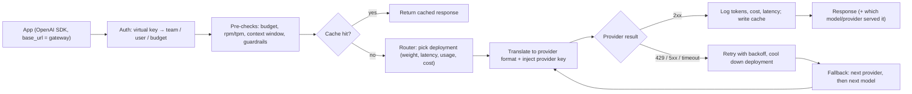

An **LLM gateway** (also "AI gateway" or "LLM proxy") is a service that sits between your application and one or more model providers. The application calls a single endpoint, almost always in the OpenAI Chat Completions shape, and the gateway translates the request to the chosen provider, injects the real provider credentials, and applies cross-cutting policy: per-team virtual keys and budgets, [rate limits, retries](rate-limits-and-retries.md), provider and model fallbacks, response caching, guardrails, and logging with cost attribution. It is the LLM-specific version of an API gateway. Routing *policy* (which model should answer) is covered in [model routing and fallbacks](model-routing-and-fallbacks.md); this page covers the layer that carries it out.

## What a gateway does, mechanically

Synthesis (from the products below): per request, a gateway runs roughly this pipeline.

The main functions:

- **Unified API and translation.** [LiteLLM](litellm.md) exposes one OpenAI-compatible endpoint for 100+ providers, so any OpenAI client works by changing `base_url` ([LiteLLM proxy](../sources/litellm-proxy-docs.md)). Vercel's gateway accepts OpenAI Chat Completions, [OpenAI Responses](openai-responses-api.md) and [Anthropic Messages](anthropic-messages-api.md) formats ([Vercel](../sources/vercel-ai-gateway-docs.md)). Envoy AI Gateway translates requests and responses across 16 providers ([Envoy v1.0](../sources/envoy-ai-gateway-v1-release.md)). Agent frameworks lean on this too: [Google ADK](google-adk.md) reaches non-Gemini models through LiteLLM ([notebook](../sources/notebook-adk.md)).
- **Key management.** The app holds a gateway key, not provider keys. LiteLLM mints *virtual keys* (`POST /key/generate`) scoped to models, with `max_budget`, `budget_duration`, `rpm_limit`/`tpm_limit`, owned by a user or team, and rotatable with a grace period; this needs Postgres ([LiteLLM proxy](../sources/litellm-proxy-docs.md)). Envoy's `BackendSecurityPolicy` injects API-key, AWS, Azure or GCP credentials upstream ([Envoy](../sources/envoy-ai-gateway-v1-release.md)). Vercel supports BYOK (your provider accounts) or its own system credentials, with OIDC for Vercel deployments ([Vercel](../sources/vercel-ai-gateway-docs.md)).
- **Cost tracking and budgets.** Gateways price every request from a model cost map (LiteLLM's `completion_cost()`) and aggregate by key, user, team or tag. Vercel budgets stack at team, project, API-key and user scope and reject with HTTP 402 once any is exceeded. They are *soft caps*: the check runs at request start, so the request that crosses the line still completes ([Vercel](../sources/vercel-ai-gateway-docs.md)).
- **Reliability.** Retries, cooldowns and fallbacks (detailed in [model routing and fallbacks](model-routing-and-fallbacks.md)).
- **Caching.** Exact-match and sometimes [semantic](semantic-caching.md) response caches (below). This is separate from provider-side [prompt caching](prompt-caching.md), which some gateways simply pass through (Vercel `caching: 'auto'`).
- **Observability and guardrails.** Request logs with tokens, latency, cost and every routing attempt. Kong adds prompt guards, semantic [jailbreak](jailbreaks.md) detection and PII redaction plugins ([Kong](../sources/kong-ai-gateway-docs.md)). See [LLM observability](llm-observability.md) and [guardrail tooling](guardrail-tooling.md).

## Product comparison (as of 2026-11)

| Gateway | Form | Pricing model | Distinctive mechanics |
|---|---|---|---|
| **LiteLLM** | Open-source Python SDK + self-hosted proxy (Docker/Helm), Postgres + Redis | Free OSS (you run it) | Router strategies (`simple-shuffle`, usage-, latency-, cost-based, least-busy); per-exception retry policy; cooldowns; virtual keys; exact and semantic caches ([router](../sources/litellm-router-docs.md), [proxy](../sources/litellm-proxy-docs.md)) |
| **OpenRouter** | Hosted aggregator/marketplace, one key for hundreds of models | Provider prices passed through; 5.5% fee on credit purchases; BYOK free up to a plan-dependent allowance ($25k/month of list-price usage on pay-as-you-go) then 5% ([FAQ](../sources/openrouter-faq.md)) | Load-balances one model across many inference providers; `provider` object (`order`, `only`, `sort`, `max_price`, `zdr`, `quantizations`) ([routing](../sources/openrouter-provider-routing-docs.md)) |
| **Portkey** | Hosted or self-hosted gateway, JSON "configs" | SaaS tiers; semantic cache Enterprise-only | Nested fallback / load-balance / conditional targets; retries honouring Retry-After with a 60 s cap ([Portkey](../sources/portkey-gateway-docs.md)) |
| **Vercel AI Gateway** | Hosted (`ai-gateway.vercel.sh`), usable from any cloud | Zero markup on tokens, incl. BYOK | `models` + `order` fallbacks with `modelAttempts` audit trail; stacked budgets ([Vercel](../sources/vercel-ai-gateway-docs.md)) |
| **Cloudflare AI Gateway** | Managed edge proxy, header-configured | Cloudflare plan | Exact-match cache (`cf-aig-cache-ttl`), retries (`cf-aig-max-attempts` ≤ 5), timeouts to first chunk, dynamic routes ([Cloudflare](../sources/cloudflare-ai-gateway-docs.md)) |
| **Kong AI Gateway** | Plugins/entities on the Kong API gateway | Kong licensing | Lowest-latency (EWMA), lowest-usage, semantic, priority balancers; circuit breaker; semantic cache; PII sanitiser ([Kong](../sources/kong-ai-gateway-docs.md)) |
| **Envoy AI Gateway / Agent Router** | Kubernetes CRDs on Envoy Gateway; v1.0 GA 2026-06-23, renamed Agent Router | Open source | Token-based `QuotaPolicy`, provider fallback, InferencePool for [self-hosted models](llm-inference-serving.md), [MCP](model-context-protocol.md) routing ([Envoy](../sources/envoy-ai-gateway-v1-release.md)) |

Synthesis: the axis that matters most is **who holds the keys and the data path**. Hosted aggregators (OpenRouter, Vercel) give instant access to many models and one bill, but every prompt transits a third party. Self-hosted proxies (LiteLLM, Kong, Envoy) keep traffic in your VPC and plug into existing API-gateway, Kubernetes and IAM practice, at the cost of running Postgres/Redis and owning upgrades.

## Semantic caching: useful but sharp

An exact-match cache keys on a hash of the full request. Cloudflare hashes provider, endpoint, model, auth header and body, so any change misses, and two identical concurrent requests can both miss ([Cloudflare](../sources/cloudflare-ai-gateway-docs.md)). A **semantic cache** [embeds](embeddings.md) the query and returns a stored answer when a past query is close enough:

- Portkey compares only user text (cosine, default threshold 0.95), requires model and parameters to match exactly, *ignores the [system prompt](system-prompts.md)*, and only works for requests under 8,191 tokens and at most 4 messages ([Portkey](../sources/portkey-gateway-docs.md)).
- LiteLLM offers `redis-semantic`, `valkey-semantic` and `qdrant-semantic`, and its own docs warn that semantic caching goes badly wrong on agentic traffic ([LiteLLM proxy](../sources/litellm-proxy-docs.md)).
- Measured error rates: GPTCache at threshold 0.7 served 39 wrong answers among 876 hits on paraphrases, and the authors judged about 99% hit precision without losing hit rate unlikely ([GPTCache](../sources/gptcache-2023.md)). Another study reported 61.6-68.8% hit rates with over 97% of hits judged correct on its narrow test categories ([Regmi & Pun](../sources/regmi-2024-gpt-semantic-cache.md)).

Synthesis: a semantic hit returns *someone else's answer*. That is fine for FAQ-style, user-independent questions. It is wrong for anything that depends on conversation state, tools, retrieved context, user identity or time. Because Portkey ignores the system prompt when matching, two tenants with different system prompts can be served each other's answers unless you set a cache namespace. Prefer provider [prompt caching](prompt-caching.md) for the cost win on repeated prefixes. It is exact and never changes the output.

## Failure modes and risks

- **Single point of failure and latency.** Every call now depends on the gateway. LiteLLM's docs warn that usage-based routing adds significant latency from its Redis operations and recommend the default `simple-shuffle` for production, and without Redis each proxy replica keeps its own cooldown and usage state, so limits and failover drift across replicas ([router](../sources/litellm-router-docs.md)).
- **Concentrated secrets = supply-chain target.** A gateway holds every provider key. In March 2026, LiteLLM PyPI releases 1.82.7 and 1.82.8 shipped a credential stealer (env vars, SSH keys, cloud creds, Kubernetes tokens) after a suspected CI/CD compromise via the Trivy scanning dependency; they were live for about 40 minutes, though LiteLLM asks anyone who installed between 10:39 and 16:00 UTC on 2026-03-24 to check. The pinned proxy Docker image was unaffected, and v1.83.0 was rebuilt from a new pipeline with cosign-signed images ([LiteLLM advisory](../sources/litellm-security-update-march-2026.md)). Pin versions, verify signed images, and treat the gateway host as tier-0.
- **Budgets are not hard stops.** Soft-cap semantics (Vercel) and per-process concurrency caps (LiteLLM's `max_parallel_requests` returns an immediate 429 and does not queue) mean spend and throughput limits are approximate ([Vercel](../sources/vercel-ai-gateway-docs.md), [router](../sources/litellm-router-docs.md)).
- **Lowest-common-denominator API.** Translating to the OpenAI shape can drop provider-specific features. OpenRouter's `require_parameters` exists precisely so requests are not silently routed to providers that ignore a parameter ([OpenRouter](../sources/openrouter-provider-routing-docs.md)). Synthesis: check that [structured outputs](structured-outputs.md), [prompt caching](prompt-caching.md) breakpoints, [thinking](extended-thinking.md) parameters and [tool](tools.md) schemas survive translation.
- **Silent model substitution.** Fallbacks mean the answering model can differ from the one requested. Log it: OpenRouter returns the serving `model`, Vercel returns `modelAttempts` ([OpenRouter](../sources/openrouter-provider-routing-docs.md), [Vercel](../sources/vercel-ai-gateway-docs.md)).
- **Data governance.** Third-party hosted gateways add a processor. OpenRouter's `data_collection: "deny"` and `zdr` filters restrict which providers may see the prompt ([OpenRouter](../sources/openrouter-provider-routing-docs.md)). See [PII and data privacy](pii-and-data-privacy.md).

## When to use one, and when not

Use a gateway (Synthesis) when:
- several teams or apps share provider accounts and you need per-team keys, budgets and chargeback;
- you need multi-provider failover or the freedom to swap models without code changes (see [model selection](model-selection.md));
- you must enforce org-wide policy (PII redaction, allowed models, logging) in one place, a common [enterprise deployment](enterprise-llm-deployment.md) requirement.

Skip it, or keep it thin, when there is one app on one provider and the provider SDK's own retries suffice; when you depend on provider-native features the gateway does not pass through; or when the extra hop's latency matters more than central control. For prototypes, a hosted aggregator (OpenRouter, Vercel) is the cheapest way to compare models. For regulated production, a self-hosted proxy in your VPC, or the cloud's own platform ([Amazon Bedrock](amazon-bedrock.md), [Vertex AI](google-vertex-ai.md), [Azure AI Foundry](azure-ai-foundry.md)), is more typical. Related: [cost and latency optimization](cost-and-latency-optimization.md).

## Sources

- [LiteLLM proxy docs](../sources/litellm-proxy-docs.md)
- [LiteLLM Router docs](../sources/litellm-router-docs.md)
- [LiteLLM security update, March 2026](../sources/litellm-security-update-march-2026.md)
- [OpenRouter provider routing docs](../sources/openrouter-provider-routing-docs.md)
- [OpenRouter FAQ](../sources/openrouter-faq.md)
- [Portkey gateway docs](../sources/portkey-gateway-docs.md)
- [Vercel AI Gateway docs](../sources/vercel-ai-gateway-docs.md)
- [Cloudflare AI Gateway docs](../sources/cloudflare-ai-gateway-docs.md)
- [Kong AI Gateway docs](../sources/kong-ai-gateway-docs.md)
- [Envoy AI Gateway v1.0 release notes](../sources/envoy-ai-gateway-v1-release.md)
- [GPTCache (Fu & Feng 2023)](../sources/gptcache-2023.md)
- [GPT Semantic Cache (Regmi & Pun 2024)](../sources/regmi-2024-gpt-semantic-cache.md)
- [Agent Development Kits (Loic's Notebook)](../sources/notebook-adk.md)
