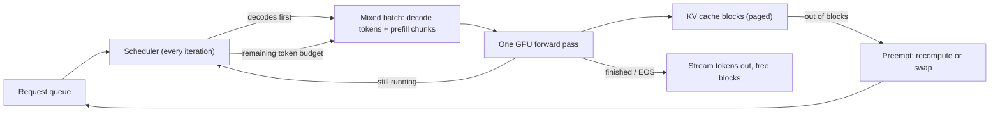

**LLM inference serving** is the systems work of turning a trained model into an endpoint that many users can call at the same time, with acceptable latency and cost. A request runs in two phases. **Prefill** processes the whole prompt in parallel and builds the [KV cache](kv-cache.md). **Decode** then generates output tokens one at a time, and each step reads all the weights plus that request's KV cache. A serving engine (vLLM, SGLang, TensorRT-LLM, and formerly TGI) decides which requests share each GPU forward pass, where their KV cache lives, and how the model is split across GPUs. Its job is to keep the GPU busy without breaking latency targets ([NVIDIA](../sources/nvidia-mastering-llm-inference-optimization.md), [Kwon et al.](../sources/vllm-pagedattention-paper.md)).

## Prefill vs decode: two different workloads

| | Prefill | Decode |
|---|---|---|
| Work per step | All prompt tokens at once (matrix-matrix) | One new token per sequence (matrix-vector at batch 1) |
| Bottleneck | Compute (saturates the GPU) | Memory bandwidth (weights + KV must be read every step) |
| Latency metric | TTFT | TPOT / inter-token latency |
| Scales with | Prompt length | Output length × per-step cost |

Sources: [NVIDIA](../sources/nvidia-mastering-llm-inference-optimization.md), [Sarathi-Serve](../sources/sarathi-serve-chunked-prefill.md).

Because decode is memory-bound, throughput depends on how many sequences fit in GPU memory at once. Batching more sequences into one decode step amortizes the cost of reading the weights. Anyscale estimated that a 13B model on a 40 GB A100 leaves room for only about 14k tokens of state ([Anyscale](../sources/anyscale-continuous-batching.md)). Output tokens are much more expensive than input tokens: on MPT models, 512 extra input tokens added less latency than 8 extra output tokens ([Databricks](../sources/databricks-llm-inference-performance-engineering.md)).

## Metrics

- **TTFT (time to first token):** queueing plus prefill. This is what users feel as responsiveness in [streaming](streaming.md) UIs.
- **TPOT / ITL (time per output token, inter-token latency):** decode step time as seen by one request.
- **End-to-end latency** = TTFT + TPOT × output tokens.
- **Throughput:** output tokens per second across all requests on the server.
- **Goodput:** the highest request rate per GPU at which both the TTFT and the TPOT SLOs are still met. DistServe argues this, not raw throughput, is the metric to optimize ([DistServe](../sources/distserve-disaggregated-prefill-decode.md)).
- **MBU (model bandwidth utilization):** (weight bytes + KV bytes) / TPOT, divided by the GPU's peak bandwidth. For example, a 7B FP16 model at 14 ms TPOT moves about 1 TB/s, which is 50% MBU on a 2 TB/s part ([Databricks](../sources/databricks-llm-inference-performance-engineering.md)).

The core trade-off is that larger batches raise throughput and also raise latency. On one A100, batch 64 instead of batch 1 gave about 14x the throughput at about 4x the latency. Past some batch size, decode becomes compute-bound and adding requests only adds latency ([Databricks](../sources/databricks-llm-inference-performance-engineering.md)).

## Continuous batching

With **static batching**, every request in a batch waits until the longest one finishes, so slots go idle when output lengths vary. **Iteration-level scheduling**, introduced by Orca (OSDI 2022), reschedules after every forward pass: finished sequences leave and queued ones join. Orca reported up to 36.9x the throughput of FasterTransformer on GPT-3 175B ([Orca](../sources/orca-iteration-level-scheduling.md)). Today this is called continuous or in-flight batching. In Anyscale's OPT-13B benchmark it gave about 8x over naive batching on its own, and up to 23x when combined with vLLM's memory management ([Anyscale](../sources/anyscale-continuous-batching.md)).

Synthesis: the diagram combines the vLLM V1 scheduler policy described in the [vLLM tuning docs](../sources/vllm-optimization-and-tuning-docs.md) with iteration-level scheduling from [Orca](../sources/orca-iteration-level-scheduling.md).

### Chunked prefill

A long prompt inserted into a running batch stalls every decode in that batch for the whole prefill, which shows up as latency spikes. Sarathi-Serve splits prefills into chunks and fills each iteration with decodes first, then prefill chunks up to a token budget ("stall-free scheduling"). Under tail-latency SLOs it reported 2.6x to 5.6x more serving capacity than vLLM at the time ([Sarathi-Serve](../sources/sarathi-serve-chunked-prefill.md)). vLLM V1 now enables chunked prefill by default and schedules all pending decodes before any prefill. Its `max_num_batched_tokens` setting is the main tuning knob: small values such as 2048 favor inter-token latency, and large values (above 8192) favor TTFT and throughput ([vLLM docs](../sources/vllm-optimization-and-tuning-docs.md)).

## PagedAttention (vLLM)

Before vLLM, engines reserved one contiguous KV region per request sized for the maximum length. Only 20.4% to 38.2% of KV memory held real tokens, and the rest was lost to reservation and fragmentation. PagedAttention works like OS virtual memory. The KV cache is split into fixed-size blocks (16 tokens by default) that are allocated on demand, and a per-request block table maps logical to physical blocks. Blocks can be shared through reference counts and copy-on-write, which serves parallel sampling, beam search and shared prefixes. The result was 2-4x the throughput of FasterTransformer and Orca at the same latency ([Kwon et al.](../sources/vllm-pagedattention-paper.md)). See [KV cache](kv-cache.md) for the memory math and prefix caching.

When blocks run out, the engine **preempts** sequences. vLLM V1 defaults to *recompute*, which drops the blocks and re-prefills the sequence later, rather than *swap*, which copies the blocks to CPU memory. Frequent preemption is a sign to raise `gpu_memory_utilization`, lower `max_num_seqs` or `max_num_batched_tokens`, or add tensor or pipeline parallelism ([vLLM docs](../sources/vllm-optimization-and-tuning-docs.md)).

## Disaggregated prefill/decode

Prefill and decode running on the same GPU interfere with each other, and they have to share one parallelism plan. DistServe runs them on separate GPU pools, picks a parallelism plan for each phase, and transfers the KV cache between pools. It reported 7.4x more requests served, or a 12.6x tighter SLO met ([DistServe](../sources/distserve-disaggregated-prefill-decode.md)). This design is now productized. NVIDIA Dynamo (v1.6 as of 2026-11) orchestrates separate prefill and decode pools over vLLM, SGLang or TensorRT-LLM. It also routes requests to the workers that already hold matching KV cache (the README cites 2x faster TTFT in one benchmark), and offloads KV cache to CPU, SSD or object storage ([Dynamo](../sources/nvidia-dynamo.md)). TensorRT-LLM ships disaggregated serving as a beta feature ([TensorRT-LLM](../sources/tensorrt-llm-overview.md)).

## Parallelism

- **Tensor parallelism (TP)** shards each layer's matrices across GPUs. Use it when the model does not fit on one GPU, or to free memory for KV cache. It needs fast interconnect, and latency gains diminish: going from 4 to 8 GPUs for Llama2-70B cut latency only to about 0.7x at small batch sizes ([Databricks](../sources/databricks-llm-inference-performance-engineering.md), [vLLM docs](../sources/vllm-optimization-and-tuning-docs.md)).
- **Pipeline parallelism (PP)** places groups of layers on different GPUs or nodes. It adds latency and pipeline bubbles, and is used once TP is maxed out ([NVIDIA](../sources/nvidia-mastering-llm-inference-optimization.md)).
- **Expert parallelism (EP)** spreads [MoE](mixture-of-experts.md) experts across GPUs. **Data parallelism (DP)** runs full replicas for more throughput ([vLLM docs](../sources/vllm-optimization-and-tuning-docs.md)).

## Engines compared (as of 2026-11)

| Engine | Core ideas | Strengths | Notes |
|---|---|---|---|
| **vLLM** | PagedAttention, continuous batching, chunked prefill, hash-based prefix caching | Broadest model/hardware/quantization coverage, OpenAI-compatible server, the de-facto default | V1 engine; recompute preemption; spec decoding via `speculative_config` |
| **SGLang** | RadixAttention (radix-tree KV reuse), cache-aware scheduling, compressed-FSM [structured decoding](constrained-decoding.md), frontend DSL | Multi-call programs, agents, shared prefixes, structured output; up to 6.4x vs then-SOTA in its paper | Runs on NVIDIA, AMD, TPU, Ascend and more; self-reports more than 400k GPUs in deployment |
| **TensorRT-LLM** | In-flight batching, paged KV with block reuse, FP8 (Hopper) / FP4 (Blackwell), EAGLE/MTP/n-gram speculation | Peak performance on NVIDIA hardware, low-precision kernels | Now PyTorch-based (TensorRT engine backend removed); `trtllm-serve` |
| **TGI** | Continuous batching, FlashAttention/PagedAttention, SSE streaming | Was Hugging Face's production server | **Maintenance mode**: Hugging Face recommends vLLM or SGLang |

Sources: [Kwon et al.](../sources/vllm-pagedattention-paper.md), [SGLang paper](../sources/sglang-paper.md), [LMSYS blog](../sources/lmsys-sglang-radixattention-blog.md), [SGLang docs](../sources/sglang-docs.md), [TensorRT-LLM](../sources/tensorrt-llm-overview.md), [TGI docs](../sources/tgi-docs.md).

For laptops and edge devices, llama.cpp and Ollama with GGUF models are the usual choice. See [local LLMs](local-llms.md) and [quantization](quantization.md).

## Failure modes

- **KV cache exhaustion:** this causes preemption storms, recompute work and a long tail of latency. Long contexts and high `max_num_seqs` make it worse ([vLLM docs](../sources/vllm-optimization-and-tuning-docs.md)).
- **Prefill interference:** a few very long prompts cause inter-token latency spikes for everyone else. Mitigate with chunked prefill or disaggregation ([Sarathi-Serve](../sources/sarathi-serve-chunked-prefill.md), [DistServe](../sources/distserve-disaggregated-prefill-decode.md)).
- **Benchmarking the wrong thing:** throughput at saturation hides TTFT and TPOT violations, so measure goodput against SLOs at realistic input and output length distributions ([DistServe](../sources/distserve-disaggregated-prefill-decode.md)).
- **Over-sharding:** extra TP degree buys little latency and costs GPUs ([Databricks](../sources/databricks-llm-inference-performance-engineering.md)).

## Practical guidance

Synthesis:
- Start with vLLM or SGLang behind an OpenAI-compatible API. Prefer SGLang when the workload reuses prefixes heavily (agents, [few-shot](few-shot-prompting.md), multi-turn chat) or depends on [structured outputs](structured-outputs.md). Choose TensorRT-LLM when you are committed to NVIDIA hardware and need FP8/FP4 peak performance. Do not start new projects on TGI.
- Size memory first (weights + KV budget, see [KV cache](kv-cache.md)), then tune `max_num_batched_tokens` and concurrency against explicit TTFT and TPOT SLOs.
- Use [quantization](quantization.md) to fit more KV cache or fewer GPUs, and [speculative decoding](speculative-decoding.md) to cut latency at low load.
- Consider disaggregation only at multi-node scale with strict SLOs. It adds KV-transfer infrastructure.
- For API-hosted models the same physics show up as pricing and limits. See [prompt caching](prompt-caching.md), [batch processing](batch-processing.md) and [cost and latency optimization](cost-and-latency-optimization.md).

## Sources

- [Mastering LLM Techniques: Inference Optimization (NVIDIA)](../sources/nvidia-mastering-llm-inference-optimization.md)
- [LLM Inference Performance Engineering: Best Practices (Databricks)](../sources/databricks-llm-inference-performance-engineering.md)
- [Orca (OSDI 2022)](../sources/orca-iteration-level-scheduling.md)
- [How continuous batching enables 23x throughput (Anyscale)](../sources/anyscale-continuous-batching.md)
- [PagedAttention / vLLM (SOSP 2023)](../sources/vllm-pagedattention-paper.md)
- [Sarathi-Serve](../sources/sarathi-serve-chunked-prefill.md)
- [DistServe](../sources/distserve-disaggregated-prefill-decode.md)
- [vLLM docs: Optimization and Tuning](../sources/vllm-optimization-and-tuning-docs.md)
- [SGLang paper](../sources/sglang-paper.md)
- [LMSYS: RadixAttention and SGLang](../sources/lmsys-sglang-radixattention-blog.md)
- [SGLang docs](../sources/sglang-docs.md)
- [TGI docs](../sources/tgi-docs.md)
- [TensorRT-LLM overview](../sources/tensorrt-llm-overview.md)
- [NVIDIA Dynamo](../sources/nvidia-dynamo.md)
