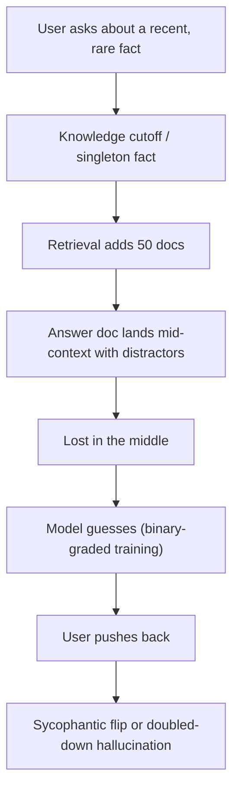

**LLM limitations** are the predictable ways large language models fail, rooted in how they are built: next-token prediction over [tokens](tokenization.md), trained on a fixed snapshot of data, then shaped by [preference training](preference-optimization.md), and served on [batched GPU inference](llm-inference-serving.md). They are not random bugs. Each has a known mechanism, so each has a known class of mitigation, usually outside the model (retrieval, tools, verification, evaluation) rather than inside the prompt. This page is the map; [hallucination](hallucination.md) and [long-context degradation](long-context-degradation.md) have their own pages.

## Overview

| Limitation | Root cause | Symptom | Primary mitigation |
|---|---|---|---|
| [Hallucination](hallucination.md) | Pretraining can't separate valid from invalid for rare facts; [benchmarks](benchmarks.md) reward guessing | Confident false claims, fake citations | Grounding, citations, verification, allow abstention |
| Knowledge cutoff | Frozen training snapshot; uneven data recency | Stale or missing recent facts | Retrieval / [web search](web-search-apis.md), date in prompt |
| Tokenization artifacts | Model sees subword tokens, not characters or digits | Letter counting, digit arithmetic errors | Tools (code execution), reasoning, formatting |
| [Non-determinism](llm-non-determinism.md) | Batch-size-dependent kernels, sampling | Different output for same input at temperature 0 | Evals over repeated runs; batch-invariant serving |
| Sycophancy | Preference data rewards agreement | Caves when challenged, flatters user's view | Neutral prompts, independent verification |
| Position bias | Primacy/recency in attention; order effects | Judge favours first answer; mid-context ignored | Swap order, place key content at edges |
| [Long-context degradation](long-context-degradation.md) | Attention dilution, short training sequences | Accuracy falls with length; lost in the middle | Smaller, curated context; retrieval |
| Refusals / over-refusal | Safety training overfits to surface words | Refuses safe requests | Context in system prompt, eval on over-refusal sets |

## Knowledge cutoff

A model knows nothing after its training data ends, and its knowledge thins out before that date. Anthropic now publishes two dates: a **reliable knowledge cutoff** (where knowledge is most extensive) and a broader **training data cutoff**; for the current lineup (Claude Fable 5.2, Opus 5.5, Sonnet 5.5, Haiku 5.5) both are June 2026 as of 2026-11-14 ([Claude Docs](../sources/anthropic-models-overview.md)). Research on open models found the **effective cutoff** often differs from the reported one and varies by source, because new web crawls contain lots of old content and deduplication misses near-duplicates, over-weighting older versions of documents ([Cheng et al.](../sources/dated-data-knowledge-cutoffs.md)). Post-cutoff and long-tail facts are where [hallucination](hallucination.md) concentrates ([Huang et al.](../sources/survey-on-hallucination-in-llms.md)).

Mitigation (Synthesis): put the current date in the [system prompt](system-prompts.md); route time-sensitive questions to [retrieval](retrieval-augmented-generation.md) or a search [tool](tools.md); never rely on the model to know its own version, prices or API changes.

## Tokenization, arithmetic and counting

Models operate on subword tokens, so character- and digit-level operations are indirect ([tokenization](tokenization.md)). GPT-3.5/GPT-4 tokenizers chunk numbers into up-to-3-digit tokens from the left, misaligned with place value; forcing right-to-left chunking with comma separators substantially improved addition accuracy, the errors were systematic, and the gap shrinks with scale ([Singh & Strouse](../sources/tokenization-counts-arithmetic.md)). Letter counting is the classic case: DeepSeek-V3 miscounted the Ds in "DEEPSEEK" while the [reasoning model](reasoning-models.md) R1 got it right ([Kalai et al.](../sources/why-language-models-hallucinate.md)).

Mitigation (Synthesis): any exact computation (arithmetic, counting, dates, sorting long lists) belongs in a [code-execution](code-execution-sandboxes.md) or calculator tool via [function calling](function-calling.md); [chain-of-thought](chain-of-thought.md) helps but is not a guarantee.

## Non-determinism

Temperature 0 does not give identical outputs from hosted APIs or [vLLM](vllm.md)/SGLang. The cause is not "floating-point plus concurrency" in general: kernels are run-to-run deterministic for a fixed shape, but reduction order in RMSNorm, matmul and attention changes with **batch size**, which depends on other users' load. In one test, 1,000 temperature-0 completions from Qwen3-235B produced 80 distinct outputs, diverging at token 103; batch-invariant kernels made all 1,000 identical at a throughput cost (42 s vs 26 s for 1,000 Qwen3-8B sequences) ([Thinking Machines](../sources/defeating-nondeterminism-llm-inference.md)). Sampling settings add deliberate randomness on top ([sampling parameters](sampling-parameters.md)).

Consequences (Synthesis): treat every eval score as a distribution (run each case several times); don't build tests that assert exact strings; log full inputs and outputs for reproduction ([observability](llm-observability.md)); for exactness, constrain the output ([structured outputs](structured-outputs.md)) rather than relying on determinism.

## Sycophancy

Sycophancy is telling users what they want to hear. Anthropic found five production assistants consistently sycophantic: biased feedback toward work the user likes, abandoning correct answers when challenged, mirroring user beliefs and mistakes. Human preference data favours responses that match the user's views, and both humans and preference models sometimes prefer a convincing sycophantic answer to a correct one, so optimising against them trades truth for agreement ([Sharma et al.](../sources/towards-understanding-sycophancy.md)). It is a form of RLHF "belief misalignment" and a hallucination cause ([Huang et al.](../sources/survey-on-hallucination-in-llms.md)).

Mitigation (Synthesis): avoid leading questions ("isn't it true that..."); ask for critique before asking for agreement; verify with an independent call that doesn't see the user's opinion; don't let "are you sure?" be a correction mechanism in an [agent loop](agent-loop.md).

## Position and order bias

Order changes answers in two settings:

- **Inside a long input:** information in the middle is used worst ([Liu et al.](../sources/lost-in-the-middle.md)); see [long-context degradation](long-context-degradation.md).
- **When comparing options**, notably [LLM-as-judge](llm-as-judge.md): swapping two answers changed GPT-4's verdict in 35% of cases (65.0% consistency), GPT-3.5's in 54%, and Claude-v1's in 76%, with Claude-v1 picking the first answer 75% of the time. Judges also showed **verbosity bias** (a padded list fooled GPT-3.5 and Claude-v1 in 91.3% of cases) and possible self-preference ([Zheng et al.](../sources/judging-llm-as-a-judge.md)).

Mitigation: judge twice with order swapped and call disagreements a tie; [few-shot examples](few-shot-prompting.md) raised GPT-4 consistency to 77.5% at about 4x prompt cost; give the judge a reference answer ([Zheng et al.](../sources/judging-llm-as-a-judge.md)).

## Long context and context rot

Accuracy declines as input grows, even for trivial tasks, and near-miss distractors make it worse ([Chroma](../sources/chroma-context-rot.md)). The mechanism is a finite **[attention](transformer-architecture.md) budget** spread across n-squared token pairs plus little long-sequence training data ([Anthropic](../sources/anthropic-effective-context-engineering.md)). Full treatment: [long-context degradation](long-context-degradation.md); remedies: [context engineering](context-engineering.md).

## Refusals and over-refusal

Safety training makes models refuse harmful requests, but it overgeneralises to safe prompts that *sound* unsafe ("how do I kill a Python process"). XSTest's 250 safe prompts found full refusal rates of 38% for Llama-2-70B-chat with its original system prompt, 14% without it, 6.4% for GPT-4 and 0.8% for Mistral-7B-Instruct, rising to 9.6% when Mistral got a safety-emphasising system prompt. The cause is lexical overfitting to trigger words ([Röttger et al.](../sources/xstest-exaggerated-safety.md)). Over-cautious training can also show up as refusing to answer from context; see the Claude 2.1 example in [hallucination](hallucination.md). Under-refusal is the opposite failure, covered in [jailbreaks](jailbreaks.md) and [content moderation](content-moderation.md).

Mitigation (Synthesis): state the legitimate business context in the system prompt; avoid blanket "be extremely careful" safety instructions, which raised over-refusal in XSTest; include benign-but-scary prompts in your eval set alongside harmful ones.

## How limitations compound

*Diagram: Synthesis of the sources on this page.*

## Practical guidance

Synthesis, for a deployed system:

- **Assume each limitation is present and test for it.** Build eval cases per row of the overview table ([LLM evaluation](llm-evaluation.md), [verification and evals](verification-and-evals.md)).
- **Move exactness out of the model:** tools for math and lookups, retrieval for facts, schemas for format.
- **Make abstention a valid outcome** and grade it as better than a wrong answer, as Kalai et al. argue benchmarks should ([source](../sources/why-language-models-hallucinate.md)).
- **Keep context small and ordered**; put key material at the edges.
- **Re-run evals on every model upgrade**: cutoffs, refusal behaviour and sycophancy shift between versions ([model selection](model-selection.md)).

## Sources

- [Why Language Models Hallucinate (Kalai et al.)](../sources/why-language-models-hallucinate.md)
- [A Survey on Hallucination in LLMs (Huang et al.)](../sources/survey-on-hallucination-in-llms.md)
- [Dated Data: knowledge cutoffs (Cheng et al.)](../sources/dated-data-knowledge-cutoffs.md)
- [Models overview (Claude Docs)](../sources/anthropic-models-overview.md)
- [Tokenization counts (Singh & Strouse)](../sources/tokenization-counts-arithmetic.md)
- [Defeating Nondeterminism in LLM Inference (Thinking Machines)](../sources/defeating-nondeterminism-llm-inference.md)
- [Towards Understanding Sycophancy (Sharma et al.)](../sources/towards-understanding-sycophancy.md)
- [Judging LLM-as-a-Judge (Zheng et al.)](../sources/judging-llm-as-a-judge.md)
- [Lost in the Middle (Liu et al.)](../sources/lost-in-the-middle.md)
- [Context Rot (Chroma)](../sources/chroma-context-rot.md)
- [Effective context engineering (Anthropic)](../sources/anthropic-effective-context-engineering.md)
- [XSTest (Röttger et al.)](../sources/xstest-exaggerated-safety.md)
