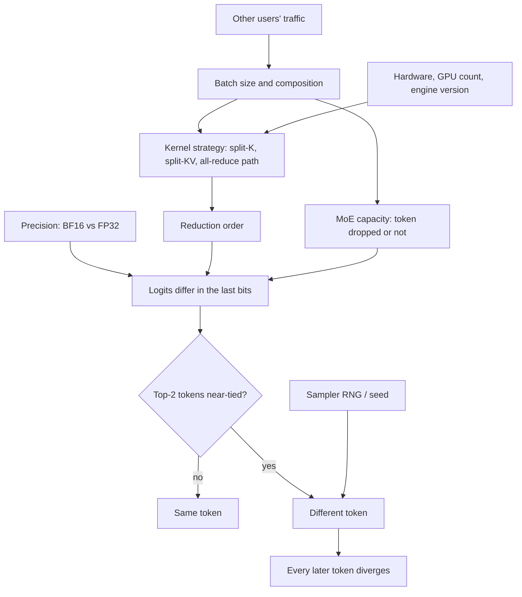

**LLM non-determinism** is the observation that an identical request (same model, prompt and parameters, even temperature 0 or a fixed seed) can produce different outputs on different calls. Two layers are involved. **Sampling randomness** is deliberate: at temperature > 0 the next token is drawn from a distribution ([sampling parameters](sampling-parameters.md)). **Numerical non-determinism** is the surprising part: greedy decoding should always pick the same argmax token, yet the logits themselves differ by tiny amounts between calls, and once one token flips, everything after it diverges. The main cause on modern servers is not "GPU concurrency" in general but a lack of **batch invariance**: the arithmetic a kernel performs for your request depends on how many other requests share the batch ([Thinking Machines](../sources/defeating-nondeterminism-llm-inference.md)).

## How big the effect is

- Thinking Machines ran Qwen3-235B-A22B-Instruct-2507 at temperature 0 on one prompt 1,000 times (1,000 tokens each): **80 unique completions**. All agreed for 102 tokens and split at token 103 ("Queens, New York" in 992 cases vs "New York City" in 8) ([Thinking Machines](../sources/defeating-nondeterminism-llm-inference.md)).
- Atil et al. ran five models (GPT-3.5 Turbo, GPT-4o, Llama-3-70B/8B-Instruct, Mixtral-8x7B-Instruct) ten times at temperature 0, top-p 1 and fixed seed on eight BBH/MMLU tasks: accuracy moved by **up to 15%** between runs, best-vs-worst possible gaps reached **70%**, and no model consistently produced identical strings. Longer outputs were less stable ([Atil 2024](../sources/atil-2024-non-determinism-deterministic-settings.md)).
- Yuan et al. changed only GPU type, GPU count and batch size under BF16 greedy decoding: DeepSeek-R1-Distill-Qwen-7B's AIME'24 accuracy had a **9.15%** standard deviation and its response length about **9,000 tokens**; in FP32 both were 0 ([Yuan 2025](../sources/yuan-2025-give-me-fp32.md)).

Synthesis: the effect scales with output length. Each extra token is another chance for a near-tie between the top two logits to flip, so long reasoning traces and agent trajectories ([reasoning models](reasoning-models.md)) diverge far more than one-word classifications.

## Mechanics

### Floating-point non-associativity (the ingredient)

Floating-point addition is not associative: in Python, `(0.1 + 1e20) - 1e20` gives `0` while `0.1 + (1e20 - 1e20)` gives `0.1`. Summing the same numbers in a different order gives a slightly different result. Every matmul, normalisation and attention softmax is a large reduction, so its result depends on the reduction order the kernel chooses ([Thinking Machines](../sources/defeating-nondeterminism-llm-inference.md)). Lower precision makes the rounding coarser: BF16 has far fewer mantissa bits than FP32, which is why Yuan et al. found BF16 the least reproducible format and FP32 near-perfectly reproducible ([Yuan 2025](../sources/yuan-2025-give-me-fp32.md)).

### Why "GPU concurrency" is the wrong explanation

The folk explanation is that parallel threads finish in random order and atomic adds accumulate in random order. Thinking Machines shows this is mostly false for inference: the forward pass of a typical LLM uses no atomic adds, and the same matmul on the same shapes is **bitwise reproducible** run to run. Run the same batch twice and you get the same bits ([Thinking Machines](../sources/defeating-nondeterminism-llm-inference.md)).

### Batch invariance (the real cause)

What changes between your two calls is the **batch**. An inference server ([LLM inference serving](llm-inference-serving.md)) packs concurrent requests into one forward pass, and the batch size depends on load from other users. Kernels pick different strategies for different shapes, and different strategies reduce in different orders:

| Kernel | What breaks invariance | Batch-invariant fix |
|---|---|---|
| RMSNorm | For small batches, splitting one row's reduction across cores to use idle cores | One reduction strategy at every batch size |
| Matmul | Split-K for small batches; different tensor-core instruction sizes; Stream-K | Compile one kernel configuration for all shapes (about 20% slower than cuBLAS) |
| Attention | Reducing the [KV cache](kv-cache.md) separately from new tokens during chunked prefill or [prefix caching](prompt-caching.md); split-KV decoding with a **fixed number** of splits | Write new K/V into the cache before attention; split KV into **fixed-size** chunks |

The server as a whole is deterministic for a fixed set of concurrent requests; but from one user's perspective the other users' traffic is an uncontrolled input, so outputs look random ([Thinking Machines](../sources/defeating-nondeterminism-llm-inference.md)). The same load dependence applies on CPU and TPU endpoints.

### Distributed and hardware effects

- **Tensor parallelism:** all-reduce algorithms can also switch with batch size. vLLM's batch-invariant mode pins a fixed-order custom all-reduce, but sizes that are not a multiple of 16 bytes can still flip between NCCL and the custom path ([vLLM batch invariance](../sources/vllm-batch-invariance-docs.md)). SGLang's deterministic mode was guaranteed only at TP1/TP2 at launch ([SGLang](../sources/sglang-deterministic-inference-blog.md)).
- **Hardware and software versions:** reproducibility in vLLM holds only on the same hardware and the same vLLM version ([vLLM reproducibility](../sources/vllm-reproducibility-docs.md)). GPU type and count alone shift BF16 results ([Yuan 2025](../sources/yuan-2025-give-me-fp32.md)).
- **Compilers and mixed precision:** Anthropic's September 2025 postmortem describes XLA:TPU promoting some bf16 operations to fp32, so parts of the sampler disagreed about which token was top-ranked; an approximate top-k bug surfaced only for some batch sizes and depended on surrounding code. The fix was exact top-k plus more fp32 ([Anthropic postmortem](../sources/anthropic-postmortem-three-issues-2025.md)).

### Mixture-of-experts routing

In an [MoE](mixture-of-experts.md), a router sends each token to its top-k experts. Two routing effects can couple a request to its batch-mates:

1. **Capacity limits and token dropping.** Switch Transformer caps each expert at (tokens per batch / experts) × capacity factor; overflow tokens skip the expert through the residual connection ([Switch](../sources/fedus-2021-switch-transformers.md), [HF MoE](../sources/hugging-face-moe-explained.md)). Whether your token is dropped then depends on what else is in the batch. A 2023 blog post hypothesised this explains why GPT-4 (rumoured to be MoE) gave about 11.7 unique outputs per 30 temperature-0 calls versus 3.7 for gpt-3.5-turbo, while explicitly flagging that it could not rule out other causes ([152334H](../sources/chann-2023-gpt4-nondeterminism-moe.md)).
2. **Near-tie routing.** Synthesis: a small logit perturbation from a non-invariant kernel can flip which expert wins a near-tie, giving a bigger jump in the hidden state than a dense layer would.

Not all MoEs drop tokens: DeepSeek-V3 drops none in training or inference ([DeepSeek-V3](../sources/deepseek-v3-technical-report.md)). Thinking Machines' 80-unique-outputs model is itself an MoE (Qwen3-235B-A22B), and batch-invariant kernels made all 1,000 completions identical ([Thinking Machines](../sources/defeating-nondeterminism-llm-inference.md)). Synthesis: without capacity-based dropping, MoE routing amplifies numerical non-determinism rather than causing it independently.

### Seeds and sampling

At temperature > 0, the sampler's random number generator is a separate source. Fixing the seed makes the random draws repeatable, but it cannot make the **logits** repeatable: if the probabilities differ in the last bits, the same random draw can land on a different token. SGLang makes seeded sampling deterministic by deriving Gumbel noise from a seeded hash, on top of batch-invariant kernels ([SGLang](../sources/sglang-deterministic-inference-blog.md)). vLLM V1 defaults the seed to 0 and does not let you unset it, partly because features such as [speculative decoding](speculative-decoding.md) need workers to sample identically ([vLLM reproducibility](../sources/vllm-reproducibility-docs.md)).

Synthesis: the diagram combines the mechanisms from the sources above; no single source draws it.

## What vendors guarantee (as of 2026-11)

| Provider / engine | Determinism controls | Guarantee |
|---|---|---|
| OpenAI API | `seed` (beta) + `system_fingerprint` | Best effort. Outputs "mostly" match with the same seed, parameters and fingerprint; the fingerprint changes a few times a year as the backend changes ([OpenAI cookbook](../sources/openai-reproducible-outputs-seed-cookbook.md), [OpenAI reference](../sources/openai-chat-completions-api-reference.md)) |
| Gemini API | `seed` (random if unset) | Documented as fixing the decoding seed; temperature, topP and topK are silently ignored on Gemini 3.6 Flash and newer, so (Synthesis) greedy decoding cannot be requested there ([Gemini](../sources/gemini-generate-content-api.md)) |
| Anthropic Claude API | No seed; temperature, top_p, top_k removed in API version 2026-10-21 | None. Requests sample at the default temperature 1.0 ([migration](../sources/anthropic-api-2026-10-21-sampling-removal.md)); the OpenAI-compatible endpoint ignores `seed` and returns an empty `system_fingerprint` ([compat](../sources/anthropic-openai-sdk-compatibility.md)) |
| [vLLM](vllm.md) (self-hosted) | Seed (default 0); `VLLM_ENABLE_V1_MULTIPROCESSING=0` offline; `VLLM_BATCH_INVARIANT=1` (beta) | Not reproducible by default; batch-invariant mode is the only option for online serving; same hardware and version required ([vLLM reproducibility](../sources/vllm-reproducibility-docs.md), [vLLM batch invariance](../sources/vllm-batch-invariance-docs.md)) |
| SGLang (self-hosted) | `--enable-deterministic-inference` + per-request seed | Deterministic across 50-trial tests on dense models at TP1/TP2 at launch (Sept 2025); MoE support planned at the time ([SGLang](../sources/sglang-deterministic-inference-blog.md)) |

Synthesis: no closed-model API offers bitwise reproducibility. If an audit or regulation requires that you be able to regenerate an exact output, the only route in these sources is an [open-weight model](open-weight-models.md) on a self-hosted engine with batch invariance enabled, pinned hardware and pinned engine version. Otherwise, **store** the output rather than plan to regenerate it.

## Cost of determinism

- Thinking Machines (Qwen3-8B, 1,000 sequences of 90-110 tokens): 26 s default vLLM, 55 s with unoptimised batch-invariant kernels, 42 s with an improved attention kernel ([Thinking Machines](../sources/defeating-nondeterminism-llm-inference.md)).
- SGLang (Qwen3-8B, H200, 256 requests): +24% to +55% latency depending on backend and sequence length; FlashInfer and FA3 average 34.35%. The team recommends the mode mainly for debugging and reproducibility ([SGLang](../sources/sglang-deterministic-inference-blog.md)).
- FP32 removes most precision-driven variance but costs memory and speed; LayerCast (BF16 storage, FP32 compute) cuts memory by about 34% relative to full FP32 ([Yuan 2025](../sources/yuan-2025-give-me-fp32.md)).

## Where it bites

- **Evals and benchmarks.** A single run of a benchmark is one sample from a distribution. Accuracy spreads of 9-15% from configuration or re-runs alone exceed many claimed model-vs-model gaps ([Atil 2024](../sources/atil-2024-non-determinism-deterministic-settings.md), [Yuan 2025](../sources/yuan-2025-give-me-fp32.md)). See [LLM evaluation](llm-evaluation.md).
- **LLM-as-judge.** The judge is an LLM, so its scores drift too ([LLM-as-judge](llm-as-judge.md)).
- **RL training.** If the sampler and trainer compute slightly different log-probabilities, "on-policy" RL is quietly off-policy. Thinking Machines saw reward collapse without correction; bitwise-identical sampling and training kept sampler-trainer KL at exactly 0 ([Thinking Machines](../sources/defeating-nondeterminism-llm-inference.md)). SGLang also needed deterministic training flags to reproduce whole runs ([SGLang](../sources/sglang-deterministic-inference-blog.md)). See [reinforcement fine-tuning](reinforcement-fine-tuning.md).
- **Compounding pipelines.** Four chained classifiers each 95% stable give about 81% end-to-end stability ([Atil 2024](../sources/atil-2024-non-determinism-deterministic-settings.md)).
- **Debugging production incidents.** A bug that depends on batch size is hard to reproduce, as Anthropic's top-k incident showed ([Anthropic postmortem](../sources/anthropic-postmortem-three-issues-2025.md)).
- **Caching and replay.** Synthesis: [durable agent execution](durable-agent-execution.md) frameworks replay recorded LLM results rather than re-calling the model, which is the correct design; re-calling would take a different path.

## Practical guidance

Synthesis, grounded in the sources cited inline:

1. **Decide what you actually need.** Most products need *consistent behaviour*, not *identical bytes*. Constrain the output space with [structured outputs](structured-outputs.md) or [constrained decoding](constrained-decoding.md), parse answers rather than comparing raw strings, and cap output length where possible; Atil et al. found longer outputs less stable.
2. **Measure distributions, not points.** Run each eval case several times; report mean plus spread (max-min or error bars). Yuan et al. recommend multiple non-zero-temperature runs with error bars when compute allows ([Yuan 2025](../sources/yuan-2025-give-me-fp32.md)). Write regression tests with tolerances, not exact-match assertions ([Atil 2024](../sources/atil-2024-non-determinism-deterministic-settings.md)); see [verification and evals](verification-and-evals.md).
3. **Pin and log everything you can.** Pin dated model versions, log the full request, response and (on OpenAI) `system_fingerprint`, and treat a fingerprint change as a possible regression trigger ([OpenAI cookbook](../sources/openai-reproducible-outputs-seed-cookbook.md)). See [LLM observability](llm-observability.md).
4. **Persist outputs that matter.** For audit trails, store the generated text and its inputs; do not rely on regenerating them.
5. **For bitwise reproducibility, self-host.** Use vLLM with `VLLM_BATCH_INVARIANT=1` or SGLang with `--enable-deterministic-inference`, fix seeds, pin the GPU type, parallelism layout and engine version, and budget for roughly 25-60% extra latency ([vLLM](../sources/vllm-batch-invariance-docs.md), [SGLang](../sources/sglang-deterministic-inference-blog.md)). For greedy single-run evals, consider FP32 or LayerCast ([Yuan 2025](../sources/yuan-2025-give-me-fp32.md)).
6. **Use variance as a signal.** Disagreement across repeated samples is itself useful, e.g. semantic entropy samples several answers and flags confabulation when their meanings disagree ([semantic entropy](../sources/semantic-entropy-hallucination-detection.md); see [hallucination](hallucination.md)).

## Limits and open questions

- Batch-invariant modes are young: vLLM labels its mode beta and lists tensor-parallel gaps; SGLang launched without MoE support and with incomplete radix-cache support ([vLLM batch invariance](../sources/vllm-batch-invariance-docs.md), [SGLang](../sources/sglang-deterministic-inference-blog.md)).
- Determinism does not mean correctness: a deterministic server gives the same wrong answer every time, and a model can be sensitive to tiny prompt changes (whitespace, ordering) that batch invariance does not address. Synthesis.
- The MoE-capacity explanation for closed models is a hypothesis from external observation, not a vendor statement ([152334H](../sources/chann-2023-gpt4-nondeterminism-moe.md)).

Related: [LLM limitations](llm-limitations.md), [sampling parameters](sampling-parameters.md), [quantization](quantization.md) (lower precision changes numerics), [semantic caching](semantic-caching.md).

## Sources

- [Defeating Nondeterminism in LLM Inference (Thinking Machines)](../sources/defeating-nondeterminism-llm-inference.md)
- [vLLM docs: Batch Invariance](../sources/vllm-batch-invariance-docs.md)
- [vLLM docs: Reproducibility](../sources/vllm-reproducibility-docs.md)
- [Towards Deterministic Inference in SGLang (LMSYS)](../sources/sglang-deterministic-inference-blog.md)
- [Give Me FP32 or Give Me Death? (Yuan et al., 2025)](../sources/yuan-2025-give-me-fp32.md)
- [Non-Determinism of "Deterministic" LLM Settings (Atil et al., 2024)](../sources/atil-2024-non-determinism-deterministic-settings.md)
- [A postmortem of three recent issues (Anthropic, 2025)](../sources/anthropic-postmortem-three-issues-2025.md)
- [Non-determinism in GPT-4 is caused by Sparse MoE (152334H, 2023)](../sources/chann-2023-gpt4-nondeterminism-moe.md)
- [Reproducible outputs with the seed parameter (OpenAI Cookbook)](../sources/openai-reproducible-outputs-seed-cookbook.md)
- [Chat Completions API reference (OpenAI)](../sources/openai-chat-completions-api-reference.md)
- [generateContent / GenerationConfig (Gemini)](../sources/gemini-generate-content-api.md)
- [Claude API 2026-10-21 migration: sampling parameters removed](../sources/anthropic-api-2026-10-21-sampling-removal.md)
- [Anthropic OpenAI SDK compatibility](../sources/anthropic-openai-sdk-compatibility.md)
- [Switch Transformers (Fedus et al., 2021)](../sources/fedus-2021-switch-transformers.md)
- [Mixture of Experts Explained (Hugging Face)](../sources/hugging-face-moe-explained.md)
- [DeepSeek-V3 technical report](../sources/deepseek-v3-technical-report.md)
- [Semantic entropy hallucination detection](../sources/semantic-entropy-hallucination-detection.md)
