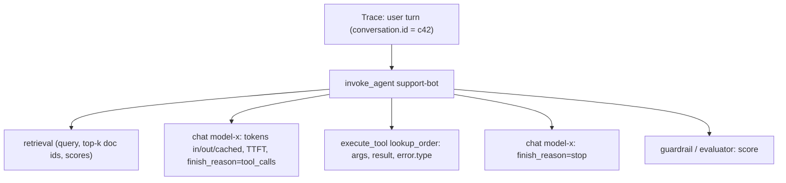

**LLM observability** is the practice of recording what an LLM application actually did on each request (the prompts and context sent, every model, tool and retrieval call, tokens, cost, latency, errors and outcome) as structured traces, then aggregating, searching and scoring them. Classic APM tells you a request was slow or failed; LLM observability also has to tell you *why the answer was wrong*, because outputs are open-ended and non-deterministic, and a prompt tweak or model upgrade can quietly break cases that used to work ([notebook](../sources/notebook-llm-evaluation.md)). Synthesis: a wrong answer usually still returns HTTP 200, so error-rate dashboards alone miss it. It is the production half of the eval loop: offline [evaluation](llm-evaluation.md) gates a change, observability shows what real traffic does and feeds failures back into the test set.

## The data model: traces, spans, sessions

Every tool in this space uses the same shape as distributed tracing:

| Concept | OpenTelemetry GenAI | LangSmith | Langfuse | Phoenix / OpenInference |
|---|---|---|---|---|
| One step (LLM call, tool, retrieval) | span | run | observation | span |
| One request end to end | trace | trace (root run) | trace | trace |
| Multi-turn conversation | `gen_ai.conversation.id` | thread (`thread_id` metadata) | session | `session.id` |
| Step type | `gen_ai.operation.name` (`chat`, `execute_tool`, `invoke_agent`, `retrieval`...) | `run_type` (`llm`, `tool`, `retriever`, `chain`, `prompt`, `parser`, `embedding`) | observation type (`generation`, `tool`, `agent`, `retriever`, `guardrail`, `evaluator`...) | `openinference.span.kind` (LLM, TOOL, AGENT, RETRIEVER, RERANKER, GUARDRAIL...) |
| Quality signal | (events / app-defined) | feedback (key + score) | score | annotation / eval |

Sources: [OTel](../sources/opentelemetry-genai-semantic-conventions.md), [LangSmith](../sources/langsmith-observability-docs.md), [Langfuse](../sources/langfuse-observability-docs.md), [Phoenix](../sources/arize-phoenix-docs.md).

For an agent, the trace mirrors the [agent loop](agent-loop.md): an `invoke_agent` span containing alternating `chat` spans and `execute_tool` spans. The owner's LangSmith example shows exactly this, with each LLM call and the calculator tool carrying its own latency, tokens and cost ([notebook](../sources/notebook-llm-apps.md)).

Synthesis: diagram assembled from the OTel operation names and the run trees shown by the sources above.

## OpenTelemetry GenAI semantic conventions

The OTel GenAI conventions are the vendor-neutral vocabulary; LangSmith, Langfuse and Phoenix all ingest OTLP, so instrumenting once with them avoids lock-in. As of 2026-11 they live in a dedicated repo (`open-telemetry/semantic-conventions-genai`) and **every GenAI-specific attribute is still "Development" stability** (only reused core attributes such as `error.type` and `server.address` are Stable), so names can still change ([source](../sources/opentelemetry-genai-semantic-conventions.md)).

Key rules from the spec:

- **Span name** `{operation} {model}`, e.g. `chat claude-sonnet-5-5`; kind `CLIENT`. The span covers the whole logical call *including automatic retries*.
- **Required:** `gen_ai.operation.name`, `gen_ai.provider.name` (`openai`, `aws.bedrock`, `gcp.vertex_ai`...). The provider is set from the client's view, so behind a gateway it may not be the true upstream.
- **Recommended request attributes:** `gen_ai.request.model`, `max_tokens`, `temperature`, `top_p`, stop sequences, `reasoning.level`. **Response:** `response.id`, `response.model` (the resolved snapshot, which can differ from the requested alias), `finish_reasons`, `time_to_first_chunk`.
- **Usage:** `gen_ai.usage.input_tokens`, `output_tokens`, `cache_read.input_tokens`, `cache_write.input_tokens`, `reasoning.output_tokens`, plus text/image/audio splits.
- **Correlation:** `gen_ai.conversation.id`, `gen_ai.prompt.name` + `gen_ai.prompt.version` (which template version produced this call), `gen_ai.conversation.compacted`.
- **Metrics:** `gen_ai.client.inference.duration` (histogram, seconds, buckets 0.01 to 81.92 s), `time_to_first_chunk`, `time_per_output_chunk`, and token histograms. Metrics are cheap to keep at 100% even when traces are sampled.
- **Agents and tools:** `create_agent`, `invoke_agent`, `invoke_workflow`, `plan`, `execute_tool`, memory operations, plus MCP and A2A conventions.

**Content capture is off by default.** Prompts, outputs, system instructions, tool arguments/results and retrieval queries are treated as sensitive and large. `OTEL_INSTRUMENTATION_GENAI_CAPTURE_CONTENT` = `NO_CONTENT` (default) / `SPAN_ONLY` / `EVENT_ONLY` / `SPAN_AND_EVENT`. For production the spec recommends an upload hook that writes content to separate storage (e.g. S3) and records only `gen_ai.input.messages_ref`-style URIs on the span, giving separate access control and retention for user data ([source](../sources/opentelemetry-genai-semantic-conventions.md)).

## What to log

| Layer | Log | Why |
|---|---|---|
| Identity | trace/span IDs, conversation/session ID, user or tenant ID, app version, environment | slice by customer, release, A/B arm |
| Prompt | template name + version, variables, system prompt hash, tool definitions | attribute regressions to a prompt change |
| Model call | provider, requested and resolved model, params (temperature, max_tokens, effort), `finish_reason` | `length` = truncation; `content_filter` = refusal; model alias drift |
| Usage | input, output, cache read/write, reasoning tokens; computed cost | cost per request/feature/tenant; cache hit rate |
| Latency | total duration, TTFT, time per output token, queue/retry time | streaming UX, provider degradation |
| RAG | query, retrieved doc IDs, scores, reranker output | separate retrieval bugs from generation bugs |
| Tools | name, arguments, result size, error type, retries | broken tools, loops, schema errors |
| Outcome | guardrail hits, eval/judge scores, user feedback (thumbs, edits, retries, abandonment) | online quality signal |

Synthesis: table combines the OTel attribute set with the notebook's checklist (trace full prompt, context, tool calls, model and params, output, latency, tokens, cost; watch implicit feedback, sampled judge scores, guardrail hits, and drift in latency, cost and refusal rate) ([notebook](../sources/notebook-llm-evaluation.md)). For RAG, keep retrieval and generation metrics separate: a bad answer from good context is a generation bug, from bad context a retrieval bug.

Provider-specific usage fields need normalising. Anthropic reports `input_tokens` as only the tokens *after* the last cache breakpoint, with `cache_creation_input_tokens` and `cache_read_input_tokens` separate ([source](../sources/anthropic-prompt-caching-docs.md)); OpenAI-style usage counts cached tokens *inside* prompt tokens (Langfuse's example: 17,903 prompt tokens of which 17,817 cached become `input: 86`). Langfuse requires non-overlapping buckets (`input` excludes cached input) and warns that overlapping buckets double-count cost ([source](../sources/langfuse-observability-docs.md)). In streams, Anthropic's usage in `message_delta` is cumulative, so take the last value, not the sum ([source](../sources/anthropic-streaming-docs.md)).

## The three main platforms (2026-11)

| | LangSmith | Langfuse | Arize Phoenix |
|---|---|---|---|
| Vendor / licence | LangChain, proprietary SaaS; self-host only on Enterprise | Open source (MIT outside `ee/`), cloud or self-host | Arize, Elastic License 2.0 (source-available), local/Docker/Helm or hosted |
| Instrumentation | LangSmith SDK (`@traceable`), zero-code for LangChain/LangGraph via `LANGSMITH_TRACING=true`; OTLP at `<api>/otel` | OTel-based SDKs (Python SDK v3+, JS/TS SDK v4+); any OTel instrumentation | OpenInference auto-instrumentors over OTLP |
| Self-host stack | Enterprise only | Web + Worker, Postgres + ClickHouse + Redis + S3 | single server process (`phoenix serve`), Docker, Helm |
| Cost tracking | `total_cost` per run | usage x regex-matched model price, with tiers; or ingested cost | per-span cost = token counts x model price table (built-in, overridable); not retroactive |
| Evals | datasets, evaluators, online evaluators, feedback | scores, LLM-as-judge, datasets, prompt management | LLM/code evals, datasets, experiments, playground with span replay |
| Notable limits | 25,000 runs per trace; base traces 14-day retention, extended 180-day; free tier 5k traces/month | must `flush()` in short-lived processes; only generation/embedding observations carry cost | source-available licence (ELv2), not OSI open source |

Sources: [LangSmith](../sources/langsmith-observability-docs.md), [Langfuse](../sources/langfuse-observability-docs.md), [Phoenix](../sources/arize-phoenix-docs.md). See also [LangSmith](langsmith.md).

Synthesis, choosing: LangSmith is the lowest-friction choice for teams already on [LangChain](langchain.md)/[LangGraph](langgraph.md). Langfuse fits when data must stay in your VPC or you want an open-source, OTel-first store with cost analytics. Phoenix is strong for local debugging and eval-heavy workflows, especially with LlamaIndex/DSPy. In regulated enterprise deployments, instrument with OTel GenAI attributes and send through an OTel Collector, which lets you switch or dual-ship backends (Langfuse documents teams running it alongside Datadog from the same OTel instrumentation, and filtering which spans reach it in the Collector).

## Failure modes and pitfalls

- **PII and secrets in traces.** Prompts carry user data; capturing content by default turns the trace store into a sensitive data store. Use the OTel opt-in, redaction hooks, or external storage with its own retention ([source](../sources/opentelemetry-genai-semantic-conventions.md)).
- **Lost spans.** Background batch exporters drop data when a serverless function exits before flush ([source](../sources/langfuse-observability-docs.md)). LangSmith's OTLP endpoint returns 200 before processing, and a span whose parent never arrives is dropped silently ([source](../sources/langsmith-observability-docs.md)).
- **Broken trees.** Async tasks and thread pools lose OTel context, producing orphan root spans; propagate context explicitly. Synthesis.
- **Sampling bias.** Head sampling (e.g. `LANGSMITH_TRACING_SAMPLING_RATE=0.1`) discards rare failures at the same rate as successes. Synthesis: keep metrics at 100%, and keep all error, guardrail-hit and negative-feedback traces.
- **Convention drift.** GenAI attributes are pre-stable; older instrumentations emit `gen_ai.system` or OpenInference `llm.token_count.*`. Backends map several dialects, but dashboards keyed on one name break silently ([LangSmith](../sources/langsmith-observability-docs.md)).
- **Cardinality.** Never put prompts, response IDs or user IDs in span names or metric labels; the spec keeps names low-cardinality ([source](../sources/opentelemetry-genai-semantic-conventions.md)).
- **Cost miscounting.** Wrong price tables, overlapping token buckets, or missing reasoning/cache tokens skew per-feature cost ([source](../sources/langfuse-observability-docs.md)).

## When to use / when not

- Turn on tracing from the first prototype; it is the fastest way to debug [agent](agent-loop.md) and [RAG](retrieval-augmented-generation.md) failures, and traces become the seed of your eval dataset.
- In production, trace everything or sample with failure-biased retention, compute cost per request, and alert on regressions in p50/p95 latency, cost and refusal rate ([notebook](../sources/notebook-llm-evaluation.md)). Synthesis: also alert on error rate, `length` finish-reason rate and cost per tenant.
- Do not treat observability as evaluation: traces show what happened; you still need scored datasets and [LLM-as-judge](llm-as-judge.md) checks to say whether it was good. Pair with [guardrails](agent-guardrails.md) and [cost and latency optimization](cost-and-latency-optimization.md), which depends on these numbers.

## Sources

- [OpenTelemetry GenAI semantic conventions](../sources/opentelemetry-genai-semantic-conventions.md)
- [LangSmith observability docs](../sources/langsmith-observability-docs.md)
- [Langfuse observability docs](../sources/langfuse-observability-docs.md)
- [Arize Phoenix and OpenInference docs](../sources/arize-phoenix-docs.md)
- [Notebook: LLM evaluation & observability](../sources/notebook-llm-evaluation.md)
- [Notebook: Build LLM Apps](../sources/notebook-llm-apps.md)
- [Anthropic prompt caching docs](../sources/anthropic-prompt-caching-docs.md)
- [Anthropic streaming docs](../sources/anthropic-streaming-docs.md)
