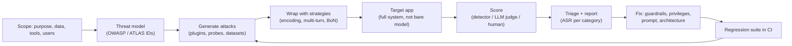

**LLM red teaming** is the practice of attacking your own LLM application, the way an adversary or a careless user would, to find failures before deployment: jailbreaks, [prompt injection](prompt-injection.md), data leakage, harmful [content](content-moderation.md), unauthorised [tool](tools.md) actions, and runaway cost. It differs from [benchmarks](benchmarks.md) and ordinary [evaluation](llm-evaluation.md) in intent: an eval measures how often the system does the right thing on representative inputs; a red team searches for the inputs that make it do the wrong thing, and keeps searching when the first attempt fails. Microsoft's AI Red Team, after more than 100 product engagements, states it plainly: red teaming is not safety benchmarking ([Bullwinkel et al.](../sources/bullwinkel-2025-lessons-red-teaming-100-products.md)).

## What is under test

The model is the smallest part of the attack surface. OWASP's GenAI Red Teaming Guide splits the work into four layers ([OWASP guide](../sources/owasp-genai-red-teaming-guide.md)):

| Layer | Questions | Typical findings |
|---|---|---|
| Model evaluation | What does the base model do when pushed? | jailbreak susceptibility, toxicity, bias, memorised data |
| Implementation | Do the [system prompt](system-prompts.md), [guardrails](agent-guardrails.md) and filters hold? | prompt extraction, filter bypass via encoding or multi-turn |
| System | What can the app reach? APIs, storage, retrieval, plugins, supply chain | [RAG](retrieval-augmented-generation.md) poisoning, BOLA/BFLA through tools, SSRF, cross-tenant leakage |
| Runtime / human and agentic | How do users and other agents manipulate the live system? | goal hijack, tool misuse, over-trust in agent output |

Microsoft's first lesson is the same idea from the other side: start from what the system can do and where it is deployed, because a model with tool access or customer data has different worst cases than a chat toy ([Bullwinkel et al.](../sources/bullwinkel-2025-lessons-red-teaming-100-products.md)).

## Threat taxonomies: scoping and reporting

Three taxonomies are used to decide what to test and to tag findings so security and compliance teams can read them.

- **OWASP Top 10 for LLM Applications.** The 2025 edition starts LLM01 Prompt Injection, LLM02 Sensitive Information Disclosure ([2025](../sources/owasp-llm-top-10-2025.md)). The 2026 edition (August 2026) moves Excessive Agency to #3, Unbounded Consumption to #6, and renames System Prompt Leakage to Hidden Context Exposure, widened to tool schemas and policy text ([2026](../sources/owasp-llm-top-10-2026.md)).
- **OWASP Top 10 for Agentic Applications** (December 2025): ASI01 Agent Goal Hijack, ASI02 Tool Misuse and Exploitation, ASI03 Identity and Privilege Abuse, ASI04 Agentic Supply Chain Vulnerabilities, ASI05 Unexpected Code Execution, ASI06 Memory and Context Poisoning, ASI07 Insecure Inter-Agent Communication, ASI08 Cascading Failures, ASI09 Human-Agent Trust Exploitation, ASI10 Rogue Agents ([Agentic Top 10](../sources/owasp-agentic-top-10-2026.md)).
- **MITRE ATLAS**, the ATT&CK-style matrix for AI. Release 2026.10 (28 October 2026) has 16 tactics, 129 techniques, 92 sub-techniques, 44 mitigations and 77 case studies. It ships monthly and has added many agent techniques in 2026, such as AI Agent Tool Poisoning, LLM Prompt Propagation and Discover AI Agent Runtime Capabilities ([ATLAS](../sources/mitre-atlas-data.md)). Synthesis: use ATLAS IDs when findings go into a threat-intel or SOC workflow, and OWASP IDs for application-security reporting.
- NIST AI 600-1 frames the governance side: current pre-deployment testing is often mismatched to the deployment context ([NIST](../sources/nist-ai-600-1-genai-profile.md)). See [AI governance and compliance](ai-governance-and-compliance.md).

Synthesis: a minimal mapping from test category to taxonomy entry:

| Test category | OWASP LLM 2026 | OWASP Agentic | Example tool hook |
|---|---|---|---|
| Direct/indirect injection | LLM01 | ASI01 | promptfoo `indirect-prompt-injection`; garak `promptinject` |
| PII / secret leakage | LLM02 | — | promptfoo `pii:*`, `cross-session-leak`; PyRIT data-leakage scenarios |
| Unauthorised tool actions | LLM03 Excessive Agency | ASI02, ASI03 | promptfoo `bola`, `bfla`, `rbac`, `excessive-agency` |
| System prompt / hidden context | LLM08 Hidden Context Exposure | — | promptfoo `prompt-extraction`; PyRIT system-prompt-extraction attack and scorer (v1.1.0) |
| Code/shell/SQL execution sinks | LLM10 Improper Output Handling | ASI05 | promptfoo `shell-injection`, `sql-injection`, `ssrf` |
| Cost blow-ups | LLM06 Unbounded Consumption | — (ASI08 Cascading Failures covers error propagation, not cost) | custom loop/turn-limit probes |

## Manual vs automated red teaming

**Manual** red teaming finds novel, context-specific failures. Anthropic's 2022 study gathered 38,961 human attacks on models from 2.7B to 52B parameters and found [RLHF](preference-optimization.md) models got harder to red team as they scaled while other model types stayed flat ([Ganguli et al.](../sources/ganguli-2022-red-teaming-reduce-harms.md)). Microsoft lists the human element as crucial, partly because responsible-AI harms are widespread yet hard to measure automatically ([Bullwinkel et al.](../sources/bullwinkel-2025-lessons-red-teaming-100-products.md)).

**Automated** red teaming uses an attacker LLM to generate and adapt attacks and a classifier or judge to score replies. Perez et al. introduced the pattern in 2022 and found tens of thousands of offensive replies, leaked training data and phone numbers in a 280B chatbot ([Perez et al.](../sources/perez-2022-red-teaming-lms-with-lms.md)). Automation buys coverage and regression testing, not judgment ([Bullwinkel et al.](../sources/bullwinkel-2025-lessons-red-teaming-100-products.md)).

Microsoft's second lesson matters for tool choice: you don't need gradients to break an AI system ([Bullwinkel et al.](../sources/bullwinkel-2025-lessons-red-teaming-100-products.md)). Black-box attacks work well:

- **Multi-turn escalation** (Crescendo): turns harmless questions into harmful ones over several turns, so per-message filters miss it ([Russinovich et al.](../sources/russinovich-2024-crescendo.md)).
- **Attacker-LLM refinement** (PAIR, TAP): often succeeds in under 20 queries ([Chao et al.](../sources/chao-2023-pair.md)).
- **Best-of-N sampling** over random augmentations: 89% ASR on GPT-4o at N=10,000, with success growing predictably with attacker compute ([Hughes et al.](../sources/hughes-2024-best-of-n-jailbreaking.md)).
- **Training-data extraction**: hundreds of verbatim sequences, including PII, were pulled from GPT-2 ([Carlini et al.](../sources/carlini-2021-extracting-training-data.md)).

See [jailbreaks](jailbreaks.md) for the attack families themselves.

Synthesis: the loop above combines the promptfoo and PyRIT workflows; manual testing feeds new cases into the generation step.

## Tools compared (as of November 2026)

| | garak | PyRIT | promptfoo redteam |
|---|---|---|---|
| Maintainer | NVIDIA, Apache-2.0 | Microsoft AI Red Team, MIT | Promptfoo (OpenAI acquisition announced March 2026), open source |
| Latest | v0.17.1 (2026-10-16) | v1.2.0 (2026-11-13) | continuous |
| Model | Scanner: fixed **probes** + **detectors** per probe, run by a harness | Framework: compose **targets**, **converters**, **attacks**, **scorers**, persisted to memory | Config-driven: **plugins** (what to test) × **strategies** (how to deliver) graded by an LLM |
| Strength | Broad known-vulnerability sweep of a model endpoint; repeatable | Custom multi-turn operations; human-in-the-loop GUI (CoPyRIT); research attacks (Crescendo, TAP, Skeleton Key, GOAT, Best-of-N) | App-level testing tailored by `purpose`; 157 plugins incl. BOLA/BFLA/RBAC/[MCP](model-context-protocol.md); framework presets; CI-friendly YAML |
| Weak spot | Mostly static prompts; adaptive probe only since v0.16 | Python code required; v1 broke APIs | Attack generation and grading depend on an LLM (default `openai:gpt-5`, or Promptfoo's remote service) |
| Output | `report.jsonl`, hit log, FAIL rate per detector, hit@k ASR (v0.17.1) | SQLite/Azure SQL memory, scores (true/false, Likert, undetermined), Findings | Web report by category and severity with failing inputs |

Sources: [garak](../sources/garak-docs.md), [PyRIT](../sources/pyrit-docs.md), [promptfoo overview](../sources/promptfoo-red-team-docs.md), [promptfoo plugins](../sources/promptfoo-red-team-plugins-docs.md), [acquisition](../sources/techcrunch-openai-acquires-promptfoo.md).

**Key knobs.**

- garak: `--target_type`/`--target_name`, `--spec probes.<family>[.<Probe>]`. Each prompt is sent several times (`--generations`; the README says 10 by default, but the shipped core config sets `generations: 5`), so failure rates are rates, not anecdotes ([garak](../sources/garak-docs.md)).
- promptfoo: `redteam.purpose` (improves both generation and grading), `numTests` (default 5 per plugin), `plugins`, `strategies` (default `basic`, `jailbreak:meta`, `jailbreak:composite`), `language`, `provider` (attacker and grader), `injectVar`, `frameworks` (`owasp:llm`, `owasp:agentic`, `mitre:atlas`, `nist:ai:measure`, `eu:ai-act`, `gdpr`…) ([overview](../sources/promptfoo-red-team-docs.md), [plugins](../sources/promptfoo-red-team-plugins-docs.md)). See [promptfoo](promptfoo.md).
- PyRIT: target class, converter chain, attack (single-turn `PromptSendingAttack` or multi-turn with an adversarial LLM), scorer type; v1.1 lets a scorer return "undetermined", which callers must check ([PyRIT](../sources/pyrit-docs.md)).

## Failure modes of red teaming itself

- **Static test sets give false confidence.** Adaptive attacks broke most of 12 published defences (above 90% success) that had reported near-zero ASR, and human attackers broke all of them ([Nasr et al.](../sources/nasr-2025-attacker-moves-second.md)). A clean scan proves only that those particular attacks failed.
- **Testing the model instead of the system.** Agent failures come from tools, permissions and retrieved content. AgentDojo-style suites, with realistic tasks and injection cases, test utility and security together ([AgentDojo](../sources/debenedetti-2024-agentdojo.md)). See [agent guardrails](agent-guardrails.md) and [code execution sandboxes](code-execution-sandboxes.md).
- **Judge error.** Detectors and LLM graders produce false positives and false negatives. Calibrate them on hand-labelled samples ([LLM-as-judge](llm-as-judge.md)), and expect "undetermined" outcomes ([PyRIT](../sources/pyrit-docs.md)).
- **Attacker-model refusals and ToS.** Commercial attacker models may refuse to produce harmful test cases, and providers may disable accounts that generate them ([promptfoo overview](../sources/promptfoo-red-team-docs.md)).
- **Data exposure through the tooling.** Remote attack generation sends your purpose and prompts to a third party; promptfoo can be forced local, at some cost in quality ([promptfoo overview](../sources/promptfoo-red-team-docs.md)).
- **Never done.** Security of AI systems is never complete; models, prompts and tools change ([Bullwinkel et al.](../sources/bullwinkel-2025-lessons-red-teaming-100-products.md)).

## Practical guidance

When to use what (Synthesis, grounded in the sources above):

- **Before any customer-facing launch**, run a scoped engagement. Write `purpose` and a threat model, pick OWASP/Agentic categories, run promptfoo against the real HTTP endpoint (not the bare model), and add manual multi-turn sessions on the highest-impact paths: tool calls that write, move money, or touch PII.
- **When choosing or upgrading a base model**, run a garak sweep for a quick, comparable model-level baseline.
- **For deep, bespoke campaigns** (multi-turn, [multimodal](multimodal-models.md), [browser-based](computer-use-agents.md) targets, or agents talking to agents over [A2A](agent2agent-protocol.md)), use PyRIT.
- **In CI**, keep a fixed regression set of past failures plus a small, freshly generated set, and track ASR per category with [error bars](llm-evaluation.md). Gate on regressions, not on zero.
- **Fix architecture, not just prompts.** The durable fixes are least-privilege tools, human approval for irreversible actions, output handling that never executes model text, and per-user retrieval scoping ([Notebook: web/AI security](../sources/notebook-web-ai-security.md)). See [LLM security risks](llm-security-risks.md), [human-in-the-loop](human-in-the-loop.md), [guardrail tooling](guardrail-tooling.md).
- **Not a substitute for** functional evals, privacy engineering ([PII and data privacy](pii-and-data-privacy.md)) or production monitoring ([observability](llm-observability.md)).

## Sources

- [Perez et al. 2022, Red Teaming LMs with LMs](../sources/perez-2022-red-teaming-lms-with-lms.md)
- [Ganguli et al. 2022, Red Teaming to Reduce Harms](../sources/ganguli-2022-red-teaming-reduce-harms.md)
- [Bullwinkel et al. 2025, Lessons from 100 products](../sources/bullwinkel-2025-lessons-red-teaming-100-products.md)
- [OWASP GenAI Red Teaming Guide](../sources/owasp-genai-red-teaming-guide.md)
- [OWASP LLM Top 10 2025](../sources/owasp-llm-top-10-2025.md) · [2026](../sources/owasp-llm-top-10-2026.md)
- [OWASP Top 10 for Agentic Applications](../sources/owasp-agentic-top-10-2026.md)
- [MITRE ATLAS data](../sources/mitre-atlas-data.md)
- [garak](../sources/garak-docs.md) · [PyRIT](../sources/pyrit-docs.md)
- [Promptfoo red team overview](../sources/promptfoo-red-team-docs.md) · [plugins](../sources/promptfoo-red-team-plugins-docs.md) · [OpenAI acquires Promptfoo](../sources/techcrunch-openai-acquires-promptfoo.md)
- [Crescendo](../sources/russinovich-2024-crescendo.md) · [PAIR](../sources/chao-2023-pair.md) · [Best-of-N](../sources/hughes-2024-best-of-n-jailbreaking.md) · [The Attacker Moves Second](../sources/nasr-2025-attacker-moves-second.md)
- [AgentDojo](../sources/debenedetti-2024-agentdojo.md) · [Carlini et al. 2021](../sources/carlini-2021-extracting-training-data.md)
- [NIST AI 600-1](../sources/nist-ai-600-1-genai-profile.md) · [Notebook: Web, API & AI Security](../sources/notebook-web-ai-security.md)
