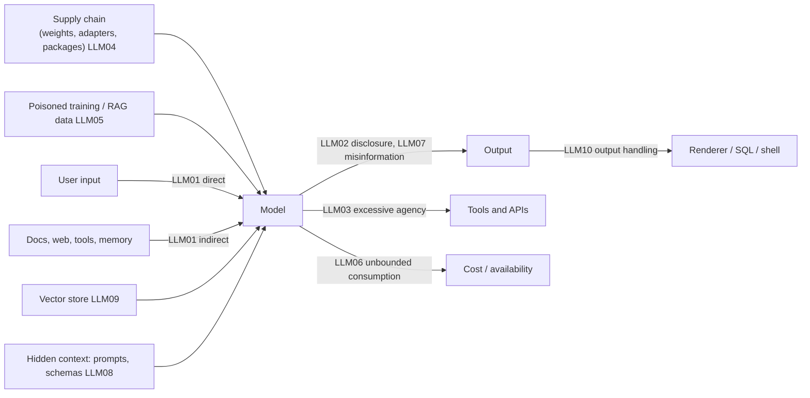

**LLM security risks** are the ways an application built on a language model can be made to leak data, take harmful actions, run up cost or mislead its users, beyond the classic web and API risks it also inherits. The shared root is that model inputs and outputs are untrusted: instructions and data share one channel, outputs are probabilistic, and agents turn text into actions ([Notebook](../sources/notebook-web-ai-security.md)). The reference taxonomy is the **OWASP Top 10 for LLM Applications**, maintained by the OWASP GenAI Security Project; the current edition is **2026** (v1.0, published 2026-08-03), which replaced the 2025 list ([OWASP 2026](../sources/owasp-llm-top-10-2026.md), [OWASP 2025](../sources/owasp-llm-top-10-2025.md)).

## The 2026 list and what moved (as of 2026-11)

| 2026 | Risk | 2025 rank | Change |
|---|---|---|---|
| LLM01 | Prompt Injection | 1 | Scope widened: tool outputs, memory, cross-modal, persistent payloads |
| LLM02 | Sensitive Information Disclosure | 2 | Adds tool logs, embeddings, RAG retrieval beyond the user's rights |
| LLM03 | Excessive Agency | 6 | Up three places, as agents gain authority over external systems |
| LLM04 | Supply Chain | 3 | Adds substituted weights, unsafe formats, tampered templates, hallucinated packages |
| LLM05 | Data and Model Poisoning | 4 | Absorbs fine-tuning and adapter compromise |
| LLM06 | Unbounded Consumption | 10 | Up four places (the largest climb); reframed as cost asymmetry: reasoning models and agent loops |
| LLM07 | Misinformation | 9 | Wrong output now drives automated actions |
| LLM08 | Hidden Context Exposure | 7 (System Prompt Leakage) | Renamed; covers tool schemas, policy text, workflow criteria |
| LLM09 | Vector and Embedding Weaknesses | 8 | Cross-tenant leakage, retrieval manipulation, embedding inversion |
| LLM10 | Improper Output Handling | 5 | Adds ANSI/terminal sinks and auto-fetching renderers |

Source: [OWASP 2026](../sources/owasp-llm-top-10-2026.md) (ranking cross-checked across three summaries, as the official PDF was not fetched). OWASP also publishes a separate **Top 10 for Agentic Applications** (2025-12-09), headed by ASI01 Agent Goal Hijack, and in 2026 received the **Agent Control Standard** (v0.1) for runtime enforcement: guardian-agent enforcement points, OpenTelemetry/OCSF tracing, and an Agent Bill of Materials ([OWASP 2026](../sources/owasp-llm-top-10-2026.md)). The owner's OWASP tutorial still shows the 2025 list ([Notebook OWASP](../sources/notebook-owasp.md)).

Synthesis: map of where each risk enters a typical RAG agent.

## Risk by risk

**LLM01 Prompt injection.** Untrusted text steers the model. Covered in depth on [prompt injection](prompt-injection.md); [jailbreaks](jailbreaks.md) are the model-safety cousin.

**LLM02 Sensitive information disclosure / PII leakage.** Three paths:
1. *Context leakage*: the model repeats data it was given, including other users' data when retrieval is not scoped per user ([OWASP 2025](../sources/owasp-llm-top-10-2025.md)).
2. *Memorisation*: query-only attacks recovered hundreds of verbatim GPT-2 training sequences, including names, phone numbers and emails, some seen in only one document; larger models leaked more ([Carlini et al.](../sources/carlini-2021-extracting-training-data.md)).
3. *Exfiltration via injection*: data encoded into an image URL or tool call (see the lethal trifecta below).
Controls: sanitise or redact before training and before prompting, least-privilege retrieval, differential privacy or federated training where training on user data is unavoidable, user opt-outs, and never relying on system-prompt rules alone ([OWASP 2025](../sources/owasp-llm-top-10-2025.md)). See [enterprise LLM deployment](enterprise-llm-deployment.md) and [AI governance and compliance](ai-governance-and-compliance.md).

**LLM03 Excessive agency.** Damage from manipulated, hallucinated or ambiguous outputs, caused by excessive *functionality* (tools the task does not need), *permissions* (a shared high-privilege identity) or *autonomy* (no approval on high-impact actions). Controls: fewer and narrower tools (no open-ended shell when a specific command will do), act in the user's security context with minimal OAuth scopes, enforce authorisation in downstream systems rather than asking the LLM to decide, human approval, logging and rate limits. OWASP's example: an email assistant with read-and-send rights forwards the inbox after reading a malicious email; fix with a read-only scope and per-send approval ([OWASP 2025](../sources/owasp-llm-top-10-2025.md)). The design rules that bound it are the **lethal trifecta** (private data + untrusted content + external communication) and Meta's **Rule of Two** (at most two of those per session) ([Willison](../sources/willison-2025-lethal-trifecta.md), [Meta](../sources/meta-2025-agents-rule-of-two.md)). Implementation lives in [agent guardrails](agent-guardrails.md) and [tools](tools.md).

**LLM04 Supply chain.** Third-party weights, datasets, adapters and packages. Cases OWASP cites: PoisonGPT (an edited model spreading misinformation), the Shadow Ray attack on Ray, a counterfeit WizardLM, malicious LoRA adapters, malware injected through a model-conversion service ([OWASP 2025](../sources/owasp-llm-top-10-2025.md)). Pickle checkpoints can execute arbitrary code on load, which is why safetensors exists ([safetensors](../sources/safetensors-and-pickle-security.md)). Code models hallucinate package names (at least 5.2% for commercial, 21.7% for open-source models, 205,474 unique fake names), which attackers can register ("slopsquatting") ([Spracklen et al.](../sources/spracklen-2024-package-hallucinations.md)). MCP servers are a new supply chain: tool descriptions can carry hidden instructions or change after approval ([Invariant Labs](../sources/invariant-2025-mcp-tool-poisoning.md)). Controls: verified sources with signatures and hashes, SBOM or AI-BOM, safetensors-only loading, pinning dependencies and tool descriptions, red-teaming third-party models on your own task. See [Hugging Face ecosystem](hugging-face-ecosystem.md) and [open-weight models](open-weight-models.md).

**LLM05 Data and model poisoning.** About 250 poisoned documents implanted a trigger-based backdoor in models from 600M to 13B parameters regardless of corpus size, so the absolute count matters, not the percentage. The experiment used a low-stakes gibberish backdoor, and it is unproven for larger models or harmful behaviours ([Anthropic poisoning](../sources/anthropic-2025-small-samples-poison.md)). For apps, the practical surface is RAG ingestion and [fine-tuning](fine-tuning.md) data: vet sources, isolate tenants, monitor the knowledge base ([Notebook](../sources/notebook-web-ai-security.md)).

**LLM06 Unbounded consumption.** Runaway tokens and tool calls, denial of wallet. Cap turns, tokens and spend, and rate-limit per user ([Notebook](../sources/notebook-web-ai-security.md)); see [cost and latency optimization](cost-and-latency-optimization.md).

**LLM07 Misinformation.** Confident wrong output relied on as fact; covered under [hallucination](hallucination.md).

**LLM08 Hidden context exposure (formerly system prompt leakage).** The system prompt is not a secret and not a security control. Leaking it matters only if it holds credentials, limits or role logic that the app relies on the model to enforce. Keep secrets out, enforce rules in code ([OWASP 2025](../sources/owasp-llm-top-10-2025.md)). See [system prompts](system-prompts.md).

**LLM09 Vector and embedding weaknesses.** Cross-tenant leakage, retrieval manipulation and embedding inversion in [vector databases](vector-databases.md) ([OWASP 2026](../sources/owasp-llm-top-10-2026.md)). Retrieval beyond the user's rights is also an LLM02 path ([OWASP 2025](../sources/owasp-llm-top-10-2025.md)). Synthesis: filter by tenant and permission at query time rather than after retrieval.

**LLM10 Improper output handling.** Treat model output like user input: never `eval` it or pass it unescaped to SQL, HTML or a shell ([Notebook](../sources/notebook-web-ai-security.md)). Renderers that auto-load Markdown images are an exfiltration channel; CSP allowlists have repeatedly been bypassed via allowed domains, expired domains and open redirects ([markdown exfiltration](../sources/willison-markdown-exfiltration.md)). [Structured outputs](structured-outputs.md) and schema validation shrink this surface.

## Practical guidance

- Threat-model per feature, not per model: list data the feature can read, content it ingests, and actions or outbound channels it has. Any feature with all three needs isolation or approval ([Meta](../sources/meta-2025-agents-rule-of-two.md)).
- Push authorisation, secrets and limits out of prompts into deterministic code ([OWASP 2025](../sources/owasp-llm-top-10-2025.md)).
- Layer controls: least privilege first, then output handling, then detection classifiers ([guardrail tooling](guardrail-tooling.md), [content moderation](content-moderation.md)), then monitoring ([LLM observability](llm-observability.md)).
- Use the OWASP list as an awareness checklist with an owner per item, and OWASP ASVS/WSTG for testable requirements ([Notebook OWASP](../sources/notebook-owasp.md)).
- Re-check when the list changes: the 2026 re-ranking moved excessive agency to #3 and output handling to #10, reflecting agent deployments ([OWASP 2026](../sources/owasp-llm-top-10-2026.md)).

## Sources

- [OWASP Top 10 for LLM Applications 2026](../sources/owasp-llm-top-10-2026.md)
- [OWASP Top 10 for LLM Applications 2025](../sources/owasp-llm-top-10-2025.md)
- [Notebook: OWASP](../sources/notebook-owasp.md)
- [Notebook: Web, API & AI Security](../sources/notebook-web-ai-security.md)
- [Willison: the lethal trifecta](../sources/willison-2025-lethal-trifecta.md)
- [Meta: Agents Rule of Two](../sources/meta-2025-agents-rule-of-two.md)
- [Willison: markdown exfiltration](../sources/willison-markdown-exfiltration.md)
- [Invariant Labs: MCP tool poisoning](../sources/invariant-2025-mcp-tool-poisoning.md)
- [Carlini et al., extracting training data](../sources/carlini-2021-extracting-training-data.md)
- [Anthropic: small samples can poison LLMs](../sources/anthropic-2025-small-samples-poison.md)
- [Spracklen et al., package hallucinations](../sources/spracklen-2024-package-hallucinations.md)
- [safetensors and pickle security](../sources/safetensors-and-pickle-security.md)
