The **LLM training pipeline** is the sequence of stages that turns raw text into a deployable assistant. **Pretraining** on trillions of tokens of next-token prediction produces a *base model* that holds most of the knowledge. A shorter **mid-training** stage (annealing on curated data, context-length extension) sharpens it. **Post-training** (supervised fine-tuning, preference optimisation, reinforcement learning with verifiable rewards, and constitution- or spec-based safety training) turns it into a helpful, formatted, policy-following assistant. The result is a fixed set of weights with a knowledge cutoff ([Notebook](../sources/notebook-transformers.md)). Knowing which stage produced a behaviour tells an engineer whether a prompt, retrieval, fine-tuning or a different model will change it.

```mermaid
flowchart LR
  A["Web, code, papers,<br/>books, synthetic"] --> B["Curation: extract, dedup,<br/>quality classifiers, mix"]
  B --> C["Pretraining<br/>(~90-95% of compute)<br/>next-token loss"]
  C --> D["Mid-training / annealing<br/>high-quality + maths/code,<br/>LR to zero"]
  D --> E["Long-context extension<br/>(RoPE scaling, staged)"]
  E --> F["Base model"]
  F --> G["SFT<br/>(chat template, format)"]
  G --> H["Preference tuning<br/>(RM + PPO / DPO, RLAIF)"]
  H --> I["RLVR / reasoning RL<br/>(verifiable rewards)"]
  I --> J["Safety: constitution,<br/>spec, instruction hierarchy"]
  J --> K["Released model<br/>(knowledge cutoff fixed)"]
  H -. "iterated rounds" .-> G
```

Synthesis: stage order and labels merge the Llama 3, OLMo 2, DeepSeek-R1 and deliberative-alignment recipes; real labs interleave and repeat stages (Llama 3 ran six post-training rounds).

## 1. Data curation

Data quality and mixture matter as much as scale.
- **Sources and mix.** Llama 3 used 15.6T tokens with knowledge to the end of 2023, in a mix of about 50% general knowledge, 25% maths and reasoning, 17% code and 8% multilingual ([Llama 3](../sources/llama-3-herd-2024.md)). OLMo 2's main mix is about 3.9T tokens, over 95% web ([OLMo 2](../sources/olmo-2-2025.md)).
- **Cleaning.** URL, document (MinHash) and line-level deduplication; PII and unsafe-content filters; heuristic filters; model-based quality classifiers; and down-sampling of over-represented web topics ([Llama 3](../sources/llama-3-herd-2024.md)).
- **Quality classifiers pay off.** FineWeb (15T tokens, 96 Common Crawl snapshots) and its 1.3T-token "educational" subset show that filtering for educational value lifts MMLU and ARC substantially ([FineWeb](../sources/penedo-2024-fineweb.md)).
- **Mix tuning** is done empirically with small runs and scaling laws (see [scaling laws](scaling-laws.md)); Llama 3 also anneals small models on a candidate dataset to judge its value ([Llama 3](../sources/llama-3-herd-2024.md)).
- **Scarcity.** Public human text may be exhausted as a training resource between 2026 and 2032 ([Villalobos](../sources/villalobos-2024-running-out-of-data.md)), which pushes labs toward [synthetic data](synthetic-data-generation.md).

## 2. Pretraining

Next-token cross-entropy on the whole corpus, using most of the compute. Llama 3 405B: AdamW, peak LR 8e-5 with cosine decay over 1.2M steps, batch growing from 4M to 16M tokens, sequence length 4K → 8K ([Llama 3](../sources/llama-3-herd-2024.md)). DeepSeek-V3 (MoE, 37B active) pre-trained on 14.8T tokens in 2.664M H800 GPU-hours, against only about 5K GPU-hours for post-training ([DeepSeek-V3](../sources/deepseek-v3-technical-report.md)). Model size and token budget come from [scaling laws](scaling-laws.md), with smaller models deliberately over-trained for cheaper inference.

What the base model has: knowledge and skills, and reasonable calibration. Base models trained with cross-entropy tend to be calibrated, and calibration degrades after RL post-training ([Kalai](../sources/why-language-models-hallucinate.md)). What it lacks: instruction following, turn-taking, refusals and a stable output format. It continues documents rather than answering. See [transformer architecture](transformer-architecture.md) for the model itself.

## 3. Mid-training and long-context extension

**Annealing / mid-training.** In OLMo 2's mid-training stage (the final 5-10% of training FLOPs, 50B-300B tokens), the LR decays linearly to zero while the mix shifts to high-quality and maths data, much of the maths synthetic. This raised GSM8K from 24.1 to 67.5 at 7B, and averaging several runs with different data orders ("souping") beat any single run ([OLMo 2](../sources/olmo-2-2025.md)). Llama 3's anneal was far shorter (LR to zero over only the final 40M tokens) and added 24 GSM8K points at 8B but almost nothing at 405B ([Llama 3](../sources/llama-3-herd-2024.md)). Synthesis: some benchmark gains of small models come from what was put in the anneal, so check for task-specific annealing before reading them as general reasoning gains.

**Long context.** Training at full context length from the start is too expensive, so models pretrain at short length and extend late. Llama 3 went from 8K to 128K in six stages over about 800B tokens ([Llama 3](../sources/llama-3-herd-2024.md)). RoPE models do not generalise past their training length unaided; [YaRN](../sources/peng-2023-yarn.md)-style RoPE rescaling extends context with far less data. DeepSeek-V3's context extension cost 119K GPU-hours ([DeepSeek-V3](../sources/deepseek-v3-technical-report.md)). Post-training must keep some long data: Llama 3's SFT with only short examples regressed long-context ability, and 0.1% synthetic long data fixed it ([Llama 3](../sources/llama-3-herd-2024.md)). Synthesis: a model's advertised window is what it accepts, not what it uses well; see [long-context degradation](long-context-degradation.md) and [context window](context-window.md).

## 4. Supervised fine-tuning (SFT)

Train on (prompt, ideal response) pairs, with loss on the response tokens only, rendered through the model's **chat template** of special header and end-of-turn tokens ([Llama 3](../sources/llama-3-herd-2024.md)). Two fine-tunes of the same base can use different templates, and the wrong one degrades output badly ([Transformers docs](../sources/transformers-generation-and-chat-templates.md)).

- **Small data, mostly format.** 1,000 curated examples aligned a 65B model; the authors argue knowledge comes from pretraining and alignment mostly teaches style and format ([LIMA](../sources/lima-zhou-2023.md)).
- **New facts in SFT are harmful.** Examples with facts the model does not know are learned slowly and then increase hallucination ([Gekhman](../sources/gekhman-fine-tuning-new-knowledge.md)). Use [RAG](retrieval-augmented-generation.md) for knowledge and [fine-tuning](fine-tuning.md) for behaviour.
- **At frontier scale SFT data is mostly model-generated:** rejection sampling picks the best of 10-30 samples with a reward model, and code or maths are kept only if they pass a checker ([Llama 3](../sources/llama-3-herd-2024.md), [Llama 3 post-training](../sources/llama-3-herd-2024.md)).

## 5. Preference optimisation (RLHF, DPO, RLAIF)

Collect comparisons between responses and push the model toward preferred ones; details are in [preference optimization](preference-optimization.md).
- **RLHF (InstructGPT):** SFT → reward model trained on human rankings → PPO with a KL penalty to the SFT model. A 1.3B RLHF model was preferred to 175B GPT-3, at the cost of some benchmark regressions ([InstructGPT](../sources/instructgpt-ouyang-2022.md)).
- **DPO:** the same objective as a classification loss on preference pairs, with no separate RL loop ([DPO](../sources/dpo-rafailov-2023.md)). Llama 3 used DPO in each of six rounds, masking formatting tokens and adding an NLL term on chosen responses to keep formatting stable ([Llama 3](../sources/llama-3-herd-2024.md)).
- **RLAIF / Constitutional AI:** an AI labeller guided by written principles replaces most human harmlessness labels ([Constitutional AI](../sources/constitutional-ai-bai-2022.md)); AI-labelled preferences can match human ones ([RLAIF vs RLHF](../sources/rlaif-vs-rlhf-lee-2023.md)).

## 6. RL with verifiable rewards (RLVR) and reasoning RL

Reward = a program's check (exact answer, unit tests, format constraint), not a learned preference model ([Tulu 3](../sources/tulu-3-rlvr.md)). DeepSeek-R1-Zero trained a base model with GRPO and rule-based rewards; AIME pass@1 rose from 15.6% to 71.0%, responses grew longer on their own, and reflection emerged. The released R1 pipeline was cold-start SFT → reasoning RL → rejection-sampled SFT (about 800K samples) → RL across all scenarios ([DeepSeek-R1](../sources/deepseek-r1-paper.md)). OpenAI reports performance rising steadily with both RL compute and thinking time ([OpenAI](../sources/openai-learning-to-reason-with-llms.md)). RL compute follows a sigmoid with a recipe-dependent ceiling ([Khatri](../sources/khatri-2025-scaling-rl-compute.md)).

Caveat: RLVR models beat their base at pass@1 but lose at large pass@k, which suggests RLVR mostly sharpens reasoning the base model already has rather than adding new reasoning; distillation from a stronger teacher can add new patterns ([Yue](../sources/yue-2025-rlvr-reasoning-boundary.md)). See [reasoning models](reasoning-models.md) and [reinforcement fine-tuning](reinforcement-fine-tuning.md).

## 7. Safety and character training

- **Constitutions.** Anthropic's January 2026 constitution explains its reasons instead of listing rules, sets the priority order safe > ethical > guidelines > helpful, and is used by Claude to generate training data and rank responses ([Anthropic](../sources/anthropic-2026-claude-constitution.md)).
- **Deliberative alignment.** OpenAI's o-series models learn the safety spec's text and reason over it in their CoT. The judge never sees the CoT during RL, to avoid pushing it toward deception. Reported result: fewer jailbreaks and fewer over-refusals at once ([Guan](../sources/guan-2024-deliberative-alignment.md)).
- **Instruction hierarchy.** Training the model to rank system > user > tool content improves robustness to [prompt injection](prompt-injection.md) ([Wallace](../sources/wallace-2024-instruction-hierarchy.md)); this is why [system prompts](system-prompts.md) carry more weight than user text.

## How the stages explain observable behaviour

| Behaviour | Stage responsible | What you can do |
|---|---|---|
| Knows facts only up to a date, unevenly | Pretraining data; recent crawls are mostly old content, so the effective cutoff lags the stated one ([Dated Data](../sources/dated-data-knowledge-cutoffs.md)). Anthropic separates a "reliable knowledge cutoff" from the "training data cutoff" ([Anthropic](../sources/anthropic-models-overview.md)) | Retrieval, web search tools; put today's date in the prompt |
| Sycophancy (agrees with the user, flatters) | Preference optimisation: human raters and preference models favour answers that match the user's view, sometimes over correct ones ([Sharma](../sources/towards-understanding-sycophancy.md)) | Neutral framing, ask for critique, judge with a separate model ([LLM-as-judge](llm-as-judge.md)) |
| Over-refusal of safe prompts | Safety tuning over-fitting to trigger words; safety-heavy system prompts make it worse ([XSTest](../sources/xstest-exaggerated-safety.md)) | Give legitimate context; avoid alarmist system prompts; test with XSTest-style evals |
| Confident hallucination, rarely "I don't know" | Pretraining statistics plus evals and RL that reward guessing; calibration degrades after RL ([Kalai](../sources/why-language-models-hallucinate.md)) | Explicitly allow abstention, ground with [RAG](retrieval-augmented-generation.md); see [hallucination](hallucination.md) |
| Strict chat format, tool-call syntax, JSON | SFT on templates; DPO formatting safeguards ([Llama 3](../sources/llama-3-herd-2024.md)) | Use the official template; [structured outputs](structured-outputs.md) |
| Big gains in maths and code, smaller elsewhere | Mid-training anneals and RLVR target checkable domains ([OLMo 2](../sources/olmo-2-2025.md), [Tulu 3](../sources/tulu-3-rlvr.md)) | Benchmark on your own task; don't extrapolate from AIME |
| Weaker long-context use than advertised | Late, short context extension with little long post-training data ([Llama 3](../sources/llama-3-herd-2024.md)) | Put key content at the edges, test needle-style recall |
| Reasoning model worse at function calling / JSON / multi-turn | Training budget concentrated on reasoning RL ([DeepSeek-R1](../sources/deepseek-r1-paper.md)) | Route by task ([model routing](model-routing-and-fallbacks.md)) |

## Practical guidance

- **When to change the prompt vs the model.** Format, tone and refusal sensitivity come from post-training, so [prompt engineering](prompt-engineering.md) and [few-shot](few-shot-prompting.md) examples can move them. Missing knowledge and weak reasoning come from pretraining, so retrieval or a larger model is the fix (Synthesis).
- **When to fine-tune.** SFT/DPO/RFT reach the same levers labs use (format, style, task-specific RL), but not pretraining-level knowledge ([LIMA](../sources/lima-zhou-2023.md), [Gekhman](../sources/gekhman-fine-tuning-new-knowledge.md)). See [fine-tuning](fine-tuning.md), [PEFT and LoRA](peft-and-lora.md).
- **Base vs instruct checkpoints.** For open weights ([open-weight models](open-weight-models.md)), use the instruct model for applications; use the base for continued pretraining or your own post-training (Synthesis).
- **Read model cards for:** training tokens, knowledge cutoff, context-extension method and post-training recipe. They predict behaviour better than parameter count (Synthesis).

## Sources

- [Llama 3 Herd: pre-training and post-training recipe](../sources/llama-3-herd-2024.md)
- [Llama 3 Herd: post-training data synthesis](../sources/llama-3-herd-2024.md)
- [OLMo 2](../sources/olmo-2-2025.md)
- [FineWeb](../sources/penedo-2024-fineweb.md)
- [Chinchilla](../sources/hoffmann-2022-chinchilla.md)
- [Will We Run Out of Data?](../sources/villalobos-2024-running-out-of-data.md)
- [DeepSeek-V3 Technical Report](../sources/deepseek-v3-technical-report.md)
- [YaRN](../sources/peng-2023-yarn.md)
- [InstructGPT](../sources/instructgpt-ouyang-2022.md)
- [LIMA](../sources/lima-zhou-2023.md)
- [Fine-tuning on new knowledge](../sources/gekhman-fine-tuning-new-knowledge.md)
- [DPO](../sources/dpo-rafailov-2023.md)
- [Constitutional AI](../sources/constitutional-ai-bai-2022.md)
- [RLAIF vs RLHF](../sources/rlaif-vs-rlhf-lee-2023.md)
- [Claude's new constitution](../sources/anthropic-2026-claude-constitution.md)
- [Deliberative Alignment](../sources/guan-2024-deliberative-alignment.md)
- [The Instruction Hierarchy](../sources/wallace-2024-instruction-hierarchy.md)
- [Tulu 3 RLVR](../sources/tulu-3-rlvr.md)
- [DeepSeek-R1](../sources/deepseek-r1-paper.md)
- [RLVR reasoning boundary](../sources/yue-2025-rlvr-reasoning-boundary.md)
- [Scaling RL compute](../sources/khatri-2025-scaling-rl-compute.md)
- [Learning to Reason with LLMs](../sources/openai-learning-to-reason-with-llms.md)
- [Towards Understanding Sycophancy](../sources/towards-understanding-sycophancy.md)
- [XSTest](../sources/xstest-exaggerated-safety.md)
- [Why Language Models Hallucinate](../sources/why-language-models-hallucinate.md)
- [Dated Data: knowledge cutoffs](../sources/dated-data-knowledge-cutoffs.md)
- [Anthropic models overview](../sources/anthropic-models-overview.md)
- [Transformers: generation and chat templates](../sources/transformers-generation-and-chat-templates.md)
- [Notebook: How LLMs & transformers work](../sources/notebook-transformers.md)
