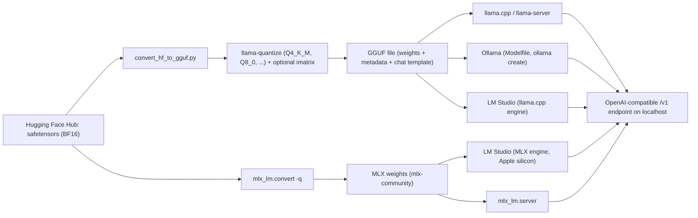

A **local LLM** is an [open-weight model](open-weight-models.md) that runs on hardware you control, such as a laptop, a workstation or an on-prem server, instead of being called through a vendor API. The model is usually [quantized](quantization.md) so it fits in RAM or VRAM. Four runtimes cover most use: **llama.cpp** (the C/C++ engine and its GGUF format), **Ollama** (a model manager and server, built around GGUF models), **LM Studio** (a desktop GUI and server that runs llama.cpp everywhere and MLX on Apple silicon), and **MLX / mlx-lm** (Apple's array framework and its LLM package). All four expose OpenAI-compatible HTTP endpoints, so application code written against a hosted API can usually point at `localhost` with only a base-URL change ([Ollama](../sources/ollama-docs.md), [llama.cpp](../sources/llama-cpp-docs.md), [LM Studio](../sources/lm-studio-docs.md), [mlx-lm](../sources/mlx-and-mlx-lm.md)).

## How the stack fits together

Synthesis: the diagram combines the conversion steps in the [llama.cpp quantize docs](../sources/llama-cpp-docs.md), the import flow in the [Ollama docs](../sources/ollama-docs.md) and the engines named in the [LM Studio](../sources/lm-studio-docs.md) and [mlx-lm](../sources/mlx-and-mlx-lm.md) docs.

- **GGUF** is a single binary file that holds the tensors plus standardized metadata, such as the tokenizer and the chat template. Safetensors files hold tensors only. llama.cpp, Ollama, LM Studio and GPT4All all read GGUF ([HF GGUF docs](../sources/hugging-face-gguf-docs.md)). The [owner's quantization tutorial](../sources/notebook-quantization-pruning.md) describes GGUF as llama.cpp's way to ship a model at several bit widths for CPU and edge devices.
- **MLX** stores arrays in unified memory that the CPU and GPU share, so nothing is copied between devices. Evaluation is lazy and graphs are dynamic. mlx-lm loads [Hub](hugging-face-ecosystem.md) repos directly, and the `mlx-community` organization hosts pre-quantized conversions ([MLX](../sources/mlx-and-mlx-lm.md)).

## The runtimes compared

| | llama.cpp (`llama-server`) | Ollama | LM Studio | MLX / mlx-lm |
|---|---|---|---|---|
| What it is | C/C++ engine with no dependencies, plus CLI and server | Model manager and daemon wrapping a GGUF engine | Desktop GUI, `lms` CLI, headless `llmster` daemon | Apple's array framework plus a Python LLM package |
| Weight format | GGUF | GGUF (imports GGUF or Safetensors) | GGUF; MLX on Apple silicon | MLX safetensors (often 4-bit) |
| Hardware | Metal, CUDA, HIP, Vulkan, SYCL, CPU SIMD; hybrid CPU+GPU offload | Same family (GPU or CPU split shown by `ollama ps`) | macOS 14+ (Apple silicon only), Windows x64/ARM64, Linux x64/ARM64 | Apple silicon; CUDA backend on Linux |
| Default endpoint | 127.0.0.1; flag table lists port 9931 (examples use 8080) | 127.0.0.1:11434 | localhost:1234 | `mlx_lm.server` |
| API surface | OpenAI chat/embeddings, `/completion`, `/rerank`, `/infill`, `/metrics`, [MCP](model-context-protocol.md) tools (stdio) | Native API plus OpenAI `/v1` chat, completions, embeddings, stateless responses | OpenAI-compatible, [Anthropic-compatible Messages](anthropic-messages-api.md), REST, JS/Python SDKs | Python API (`load`, `generate`, `stream_generate`) plus server |
| Distinctive features | GBNF/JSON-schema [constrained decoding](constrained-decoding.md), draft-model [speculative decoding](speculative-decoding.md), per-tensor quant control | `ollama pull/run/push`, Modelfile packaging, keep-alive model residency | JIT loading with idle TTL and auto-evict, offline document chat | [LoRA](peft-and-lora.md) and full [fine-tuning](fine-tuning.md) on-device, prompt-cache files, distributed across Macs |

Sources: [llama.cpp](../sources/llama-cpp-docs.md), [Ollama](../sources/ollama-docs.md), [LM Studio](../sources/lm-studio-docs.md), [MLX](../sources/mlx-and-mlx-lm.md).

## Memory math: what fits

Weights take roughly *parameters × bits-per-weight / 8* bytes. llama.cpp's own table for Llama-3.1-8B gives 14.96 GiB at F16 (16 bpw), 7.95 GiB at Q8_0 (8.5 bpw) and 4.58 GiB at Q4_K_M (4.89 bpw). At Q4_K_M a 70B model is about 43 GB and a 405B model about 249 GB ([llama.cpp](../sources/llama-cpp-docs.md)). Google's guide puts Gemma 4 31B at about 70 GB in BF16, 35 GB at 8-bit and 17.5 GB at 4-bit ([Gemma 4](../sources/gemma-4-docs.md)). gpt-oss ships its [MoE](mixture-of-experts.md) weights in MXFP4 so that the 120B model fits on one 80 GB GPU ([gpt-oss](../sources/gpt-oss-model-card.md)). K-quants and I-quants have slightly odd bits-per-weight values because each block stores scale metadata, for example Q4_K at 4.5 bpw and IQ2_XXS at 2.06 bpw ([HF GGUF docs](../sources/hugging-face-gguf-docs.md)).

The [KV cache](kv-cache.md) comes on top and grows with context. In Ollama, memory grows with `OLLAMA_NUM_PARALLEL × context length`: four parallel slots at 2K context allocate the equivalent of 8K. A q8_0 KV cache halves that memory with very small quality loss. q4_0 quarters it, with a more noticeable loss at long contexts ([Ollama](../sources/ollama-docs.md)). llama.cpp exposes the same choice through `--cache-type-k/-v` ([llama.cpp](../sources/llama-cpp-docs.md)).

**Speed is mostly bandwidth.** Decode streams all the weights (plus the KV cache) once per token, so single-stream speed is bounded by memory bandwidth divided by model bytes ([Databricks](../sources/databricks-llm-inference-performance-engineering.md)). That is why llama.cpp's 8B benchmark generates about 29 tok/s at F16, about 51 at Q8_0 and about 72 at Q4_K_M, while prompt processing, which is compute-bound, barely changes across types ([llama.cpp](../sources/llama-cpp-docs.md)). Synthesis: when you size hardware, aim for the largest model whose quantized weights plus KV cache fit entirely in fast memory. Spilling layers to CPU RAM (partial `-ngl`, or Ollama's "48%/52% CPU/GPU") makes the slowest memory the bottleneck. The Ollama docs explicitly advise against CPU offload when you want speed. On Apple silicon, unified memory lets the GPU address most of system RAM, and mlx-lm documents raising the wired-memory limit (`iogpu.wired_limit_mb`) for models that are large relative to RAM ([MLX](../sources/mlx-and-mlx-lm.md)).

## Key settings that change behaviour

- **Context length.** Ollama picks a default by VRAM: 4k under 24 GiB, 32k for 24-48 GiB, 256k at 48 GiB or more. Its docs recommend at least 64k for agents and [coding tools](coding-agents.md). The docs are inconsistent, though: the FAQ still says the default is 4096 tokens and the Modelfile table lists `num_ctx` 2048, so check the actual value with `ollama ps` or the server log rather than trusting one page ([Ollama](../sources/ollama-docs.md)). The OpenAI-compatible API has no `num_ctx` field, so you set context through `OLLAMA_CONTEXT_LENGTH` or a Modelfile. llama-server's `-c 0` takes the context size from the model, and with auto slots a single unified KV buffer is shared across all parallel sequences rather than split into fixed per-slot windows ([llama.cpp](../sources/llama-cpp-docs.md)). Synthesis: a too-small window silently truncates long prompts and [RAG](retrieval-augmented-generation.md) context, which makes this the most common "the local model is dumb" bug. See [context window](context-window.md).
- **Residency.** Ollama unloads an idle model after 5 minutes (`keep_alive`; `-1` keeps it loaded). LM Studio unloads JIT-loaded models after a 60-minute idle TTL, and auto-evict keeps only one JIT-loaded model at a time ([Ollama](../sources/ollama-docs.md), [LM Studio](../sources/lm-studio-docs.md)). Reloading a multi-GB model costs seconds, which shows up as cold-start latency on the first request.
- **Concurrency.** Ollama defaults to one request per model (`OLLAMA_NUM_PARALLEL=1`), with a queue of 512 that returns 503 when full. llama-server has continuous batching on and auto slots ([Ollama](../sources/ollama-docs.md), [llama.cpp](../sources/llama-cpp-docs.md)). Both are designed for one or a few users, not for multi-tenant throughput. For that, use a serving engine (see below).
- **Sampling defaults differ by runtime.** Ollama's Modelfile defaults are temperature 0.8, top_k 40, top_p 0.9 and repeat_penalty off ([Ollama](../sources/ollama-docs.md)). Transformers `generate()` is greedy and stops at 20 new tokens unless the model's generation config says otherwise ([Transformers](../sources/transformers-generation-and-chat-templates.md)). Set [sampling parameters](sampling-parameters.md) explicitly so that runs can be compared across runtimes.
- **Structured output and tools.** llama.cpp constrains decoding with GBNF grammars or a JSON schema. Ollama and LM Studio accept tools and JSON schemas through their OpenAI-compatible endpoints ([llama.cpp](../sources/llama-cpp-docs.md), [Ollama](../sources/ollama-docs.md), [LM Studio](../sources/lm-studio-docs.md)). See [structured outputs](structured-outputs.md) and [function calling](function-calling.md).

## Failure modes

- **Wrong chat template.** Chat models need their own control tokens, and the wrong format "drastically" degrades output. If you render a template to text and [tokenize](tokenization.md) it later, BOS/EOS tokens can be added twice ([Transformers](../sources/transformers-generation-and-chat-templates.md)). GGUF carries the template in its metadata, and llama-server's Jinja engine applies it. Ollama uses its own Go-template `TEMPLATE` ([Ollama](../sources/ollama-docs.md)). gpt-oss produces wrong outputs unless it is given its harmony format ([gpt-oss](../sources/gpt-oss-model-card.md)). Synthesis: when a model loops, leaks role tags or ignores the [system prompt](system-prompts.md), suspect the template before the weights.
- **Quantization damage.** Requantizing an already-quantized GGUF can severely reduce quality. Multimodal projectors should stay at bf16 or q8_0 ([llama.cpp](../sources/llama-cpp-docs.md)). Very low-bit I-quants trade quality for size ([HF GGUF docs](../sources/hugging-face-gguf-docs.md)). Evaluate the quantized artefact you will actually ship, not the BF16 model card's [benchmarks](benchmarks.md).
- **Silent CPU offload or swapping.** If a model or its context grows past VRAM, it partly runs on the CPU. Check `ollama ps` or llama.cpp's layer-offload logs ([Ollama](../sources/ollama-docs.md)).
- **API-compatibility gaps.** Ollama's OpenAI layer lacks logprobs, `tool_choice`, `logit_bias`, `n` and stateful [Responses](openai-responses-api.md) ([Ollama](../sources/ollama-docs.md)). SDKs or frameworks that rely on these break or silently degrade.
- **Exposure.** Every runtime binds to loopback by default. Synthesis: setting `OLLAMA_HOST=0.0.0.0` or `--host 0.0.0.0` exposes an unauthenticated model server, so put it behind a proxy that has authentication.

## Local runtime vs serving engine vs API

Local runtimes optimise for one machine and a few users: easy install, quantized GGUF/MLX weights, CPU and Apple support. [Serving engines](llm-inference-serving.md) such as vLLM and SGLang optimise for GPU throughput across many concurrent requests. Hugging Face itself now steers server workloads to vLLM/SGLang and local ones to llama.cpp/MLX, and TGI is in maintenance mode ([TGI docs](../sources/tgi-docs.md)).

**When to use local:**
- Data cannot leave the device or network ([regulated data](pii-and-data-privacy.md), air-gapped sites, offline field work). LM Studio and llama.cpp run fully offline ([LM Studio](../sources/lm-studio-docs.md)).
- Development and [evals](llm-evaluation.md) without per-token cost or [rate limits](rate-limits-and-retries.md); prototyping with a fixed, pinned model that will not be deprecated under you.
- On-device and edge products, and small specialised models such as [embeddings](embeddings.md), [rerankers](reranking.md), classifiers or a LoRA-tuned SLM.

**When not to:**
- You need frontier-level reasoning or very long reliable context. Synthesis: the open models that fit on a laptop are far below hosted frontier models (see [frontier model landscape](frontier-model-landscape.md) and [model selection](model-selection.md)).
- Many concurrent users. Use vLLM/SGLang on GPUs, or a managed endpoint.
- The team cannot own patching, eval regression and hardware. Synthesis: for a [Forward Deployed Engineer](forward-deployed-engineering.md) the usual pattern is to prototype against an API, then move a workload local only when a privacy, cost or latency requirement forces it, and re-run the eval suite on the quantized model before switching.

## Sources

- [llama.cpp README, llama-server and llama-quantize docs](../sources/llama-cpp-docs.md)
- [Ollama documentation](../sources/ollama-docs.md)
- [LM Studio documentation](../sources/lm-studio-docs.md)
- [MLX and mlx-lm READMEs](../sources/mlx-and-mlx-lm.md)
- [Hugging Face Hub docs: GGUF](../sources/hugging-face-gguf-docs.md)
- [Transformers docs: Text generation and Chat templates](../sources/transformers-generation-and-chat-templates.md)
- [Databricks: LLM inference performance engineering](../sources/databricks-llm-inference-performance-engineering.md)
- [Gemma 4 model overview and card](../sources/gemma-4-docs.md)
- [gpt-oss model card](../sources/gpt-oss-model-card.md)
- [TGI docs](../sources/tgi-docs.md)
- [Notebook: Quantization & Pruning](../sources/notebook-quantization-pruning.md)
