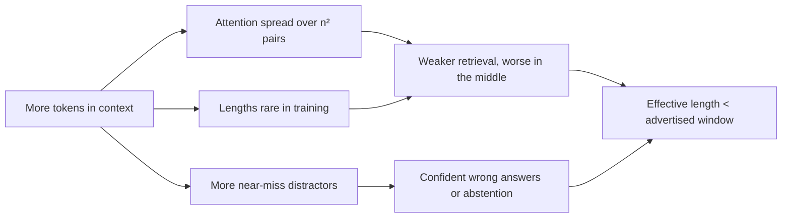

**Long-context degradation** is the drop in an LLM's ability to find and use information as its input grows, and its sensitivity to *where* in the input that information sits. A model's advertised [context window](context-window.md) (1M tokens for current Claude models as of 2026-11 ([Claude Docs](../sources/anthropic-models-overview.md))) is the most it will accept, not the length at which it works reliably. Three linked findings define the topic: the **lost-in-the-middle** U-curve ([Liu et al.](../sources/lost-in-the-middle.md)), the gap between **claimed and effective context length** ([RULER](../sources/ruler-benchmark.md), [NoLiMa](../sources/nolima-benchmark.md)), and **context rot**, a gradual decline with length even on trivial tasks ([Chroma](../sources/chroma-context-rot.md)). It is one of the core [LLM limitations](llm-limitations.md) and the main reason [context engineering](context-engineering.md) exists.

## Lost in the middle

Liu et al. (2023) gave models 10, 20 or 30 retrieved passages with exactly one containing the answer, and moved that passage through the input ([source](../sources/lost-in-the-middle.md)):

- Accuracy is highest when the relevant passage is first (**primacy**) or last (**recency**) and lowest in the middle: a U-shaped curve.
- GPT-3.5-Turbo dropped by more than 20 points; with the answer mid-context in the 20- and 30-document settings it scored *below its closed-book accuracy* (56.1%), i.e. worse than being given no documents.
- Extended-context variants (16K, 100K) performed almost identically to their shorter siblings on inputs both could hold. A bigger window does not mean better use of it.
- Repeating the query before and after the documents fixed a synthetic key-value lookup but barely helped real multi-document QA.
- In a retriever-reader setup, reader accuracy saturated long before retriever recall: 50 documents instead of 20 added only about 1-1.5 points.

Synthesis: these were 2023 models; newer models show flatter curves on simple retrieval, but the later benchmarks below show the underlying problem persists once tasks need more than literal lookup.

## Needle-in-a-haystack and why it overstates ability

**Needle-in-a-haystack (NIAH)** inserts one fact into filler text and asks for it. It became the default long-context demo, but it is easy:

- **RULER** (NVIDIA, 2024) added multiple needles, multi-hop variable tracing and aggregation across 13 tasks. Of 17 models claiming 32K+ context, nearly all were near perfect on vanilla NIAH, yet only about half stayed satisfactory at 32K ([source](../sources/ruler-benchmark.md)).
- **NoLiMa** (ICML 2025) removed the word overlap between question and needle, so the model must make an associative hop. Of 13 models claiming 128K+, 11 fell below half their short-context score by 32K; GPT-4o went from 99.3% to 69.7% ([source](../sources/nolima-benchmark.md)). The authors attribute this to attention depending on literal matches to retrieve.
- NIAH also conflates retrieval with willingness to answer: Claude 2.1 often found an out-of-place needle but declined to treat it as the answer; a one-line prefill took the score from 27% to 98% ([Anthropic](../sources/claude-2-1-long-context-prompting.md)).

**Effective context length** (RULER's term): the longest input at which a model still meets a quality bar on your kind of task. Synthesis: it is task-dependent, typically far below the advertised window for reasoning and aggregation, and must be measured.

## Context rot

Chroma's 2025 report held task difficulty constant and varied only length across 18 models (Claude Opus 4, Sonnet 4/3.7/3.5, Haiku 3.5; o3, GPT-4.1 family, GPT-4o and older GPTs; Gemini 2.5 and 2.0; Qwen3) ([source](../sources/chroma-context-rot.md)):

| Factor varied | Finding |
|---|---|
| Question-needle similarity | Lower similarity degrades faster as length grows |
| Distractors (similar but wrong facts) | One distractor hurts; four compound; some hurt more than others |
| Haystack structure | Shuffled, incoherent haystacks scored *better* than coherent text |
| Focused vs full history (LongMemEval) | ~300-token focused prompts beat ~113k-token full prompts for every model |
| Repeating a word sequence | Accuracy falls with length; refusals, random tokens, runaway output |

Model families fail differently: Claude models hallucinated least under distractors but abstained more; GPT models gave the most confident wrong answers ([source](../sources/chroma-context-rot.md)). See [hallucination](hallucination.md).

## Why it happens

Anthropic's explanation ([source](../sources/anthropic-effective-context-engineering.md)):

- **Attention budget.** Self-attention relates every token to every other token (n-squared pairs for n tokens); each added token dilutes the model's finite capacity to attend, with diminishing returns. See [transformer architecture](transformer-architecture.md).
- **Training distribution.** Training sequences are mostly short, so models have less experience with very long-range dependencies.
- **Position-encoding extension.** Interpolation techniques stretch a model to longer windows but blur positional precision: a gradient of decline, not a cliff.

Synthesis: the U-curve fits this picture: the start of the input is a strong attention anchor (primacy), the end is closest to the generated tokens (recency), and the middle competes with everything else.

*Diagram: Synthesis of Anthropic, Liu et al. and Chroma.*

## Practical guidance

- **Put long documents first, the query last.** Anthropic reports queries at the end improve quality by up to 30% on complex multi-document inputs; wrap each document in `<document>` tags with source metadata ([Anthropic prompting guide](../sources/anthropic-prompting-best-practices.md)).
- **Quote, then answer.** Have the model extract relevant quotes before reasoning ([Anthropic prompting guide](../sources/anthropic-prompting-best-practices.md)).
- **Retrieve less, rank better.** Liu et al.'s saturation result argues for a small, well-ordered top-k over stuffing; put the strongest evidence at the edges (Synthesis from [Liu et al.](../sources/lost-in-the-middle.md); see [reranking](reranking.md) and [RAG](retrieval-augmented-generation.md)).
- **Strip distractors.** Near-duplicates and stale versions of the same fact are the most damaging content ([Chroma](../sources/chroma-context-rot.md)); deduplicate and filter before injection.
- **Keep agent context small.** [Compaction](context-compaction.md), tool-result clearing, notes outside the window, [subagents](subagents.md) with clean contexts, and just-in-time retrieval ([Anthropic](../sources/anthropic-effective-context-engineering.md); see [agent memory](agent-memory.md)).
- **Measure on your own task.** Build an eval that varies length and position with realistic distractors rather than trusting NIAH scores ([Chroma](../sources/chroma-context-rot.md), [RULER](../sources/ruler-benchmark.md)); see [LLM evaluation](llm-evaluation.md) and [benchmarks](benchmarks.md).

**Long context vs RAG.** Synthesis: whole-document long context is attractive when the corpus fits, needs cross-document reasoning, and can be [prompt-cached](prompt-caching.md); retrieval wins when the corpus is large, mostly irrelevant to each query, or cost and latency matter. Given context rot, "fits in the window" is not on its own a reason to skip retrieval.

## Sources

- [Lost in the Middle (Liu et al.)](../sources/lost-in-the-middle.md)
- [Context Rot (Chroma)](../sources/chroma-context-rot.md)
- [RULER (NVIDIA)](../sources/ruler-benchmark.md)
- [NoLiMa](../sources/nolima-benchmark.md)
- [Long context prompting for Claude 2.1](../sources/claude-2-1-long-context-prompting.md)
- [Effective context engineering for AI agents (Anthropic)](../sources/anthropic-effective-context-engineering.md)
- [Prompting best practices (Anthropic)](../sources/anthropic-prompting-best-practices.md)
- [Models overview (Claude Docs)](../sources/anthropic-models-overview.md)
