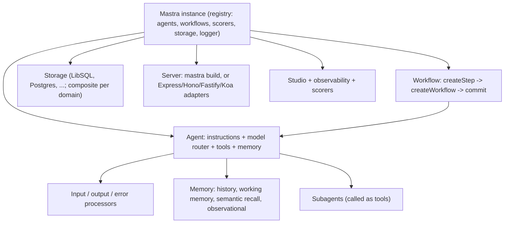

**Mastra** is an open-source TypeScript framework for building AI agents and agent-powered applications. One package gives you agents with [tools](tools.md), graph-style workflows, memory, [RAG](retrieval-augmented-generation.md), evals (called "scorers"), observability and a local developer UI (Studio) ([docs](../sources/mastra-docs-agents.md)). Version 1.0 went stable on 2026-01-20. At that point it reported over 300k weekly npm downloads and production users including Replit, PayPal and Sanity ([1.0 announcement](../sources/mastra-1-0-announcement.md)). By 2026-11-12 `@mastra/core` had reached 1.83.0 ([repo](../sources/mastra-github-repo.md)). Most code is Apache 2.0; anything under an `ee/` directory is under a separate enterprise licence ([repo](../sources/mastra-github-repo.md)). Mastra is to TypeScript roughly what [LangChain](langchain.md) plus [LangGraph](langgraph.md) is to Python: an opinionated, batteries-included layer above a model SDK. It is compatible with [Vercel AI SDK](vercel-ai-sdk.md) v6 models ([1.0 announcement](../sources/mastra-1-0-announcement.md)).

## Architecture

*Synthesis: assembled from the agents, workflows, memory, processors and 1.0 pages listed in Sources.*

Everything registers on a central `new Mastra({ agents, workflows, scorers, storage })`. The docs tell you to fetch agents and workflows from the instance (`mastra.getAgentById`, `mastra.getWorkflow`) rather than importing them directly. Only registered primitives get shared storage, logging, full type inference, and persisted scores ([docs](../sources/mastra-docs-agents.md), [workflows](../sources/mastra-workflows-docs.md), [evals](../sources/mastra-evals-docs.md)).

## Agents

An `Agent` has `id`, `name`, `instructions`, a `model` and a `tools` map ([docs](../sources/mastra-docs-agents.md)):

- **Model router.** Models are `provider/model` strings, and each provider reads its own API-key environment variable, so you need no provider import. `model`, `instructions` and `tools` can also be functions of the per-request `RequestContext`. That lets you pick the model by tenant, or inject instructions per user.
- **Tools.** Built with `createTool({ id, description, inputSchema, outputSchema?, execute })` using Zod or another Standard Schema library. Plain objects won't execute. In 1.0, `execute` takes `(inputData, context)` ([1.0 announcement](../sources/mastra-1-0-announcement.md)). Agent-level `hooks.beforeToolCall` / `afterToolCall` intercept calls.
- **Loop.** `generate()` waits for the whole tool loop and returns `text`, `toolCalls`, `toolResults`, `steps` and `usage`. `stream()` exposes `textStream`, with the same fields as promises ([docs](../sources/mastra-docs-agents.md)). See [agent loop](agent-loop.md) and [streaming](streaming.md).
- **Supervisor / subagents.** Put agents in the `agents` map (from 1.8.0). The supervisor calls them as tools, choosing among them by their `description`. Each delegation gets a fresh thread. `messageFilter` controls how much of the parent's context the subagent sees. `onDelegationStart` / `onDelegationComplete` [hooks](agent-hooks-and-middleware.md) can approve, rewrite or replace a delegation. A subagent's step budget is capped at its own `maxSteps` default, so the supervisor can't raise it ([supervisor docs](../sources/mastra-supervisor-agents-docs.md)). See [subagents](subagents.md).

### Processors (middleware and guardrails)

Processors are Mastra's hook system around the loop ([processors](../sources/mastra-processors-docs.md)):

| Hook | Runs | Typical use |
|---|---|---|
| `processInput` | once, before the first model call | PII redaction, [prompt-injection](prompt-injection.md) check |
| `processInputStep` | before every loop step | swap model or tools mid-loop, trim context |
| `processLLMRequest` / `processLLMResponse` | around each provider call | transient prompt rewrites, cache writes |
| `processOutputStream` | per streamed chunk | drop or redact chunks |
| `processOutputStep` / `processOutputResult` | after each step / at the end | validate and request a retry, transform final output |
| `processAPIError` | on provider error | repair and retry |

Built-ins include `ModerationProcessor` ([content moderation](content-moderation.md)), `PromptInjectionDetector`, `PIIDetector`, `TokenLimiter`, `ToolCallFilter`, `ToolSearchProcessor` and `TokenCostControl`. `abort()` raises a **tripwire**, which reaches clients as a `tripwire` stream chunk or `result.tripwire`. Step retries only happen if `maxProcessorRetries` is set ([processors](../sources/mastra-processors-docs.md)). See [agent guardrails](agent-guardrails.md) and [guardrail tooling](guardrail-tooling.md).

## Workflows

Workflows are typed graphs. You define steps with `createStep({ id, inputSchema, outputSchema, execute })`, compose them with `createWorkflow(...).then(...)` and other control-flow methods, and finalise with `.commit()`. Steps can call agents or tools, nested workflows can be used as steps, and a `stateSchema` gives shared state that survives suspend and resume ([workflows](../sources/mastra-workflows-docs.md)).

- **Runs.** `createRun()` then `start()` or `stream()`. The result `status` is `success`, `failed`, `suspended`, `tripwire` or `paused`. A suspended run exposes a `suspendPayload`, and `resumeStream({ resumeData })` continues it. This is the hook for [human-in-the-loop](human-in-the-loop.md) steps.
- **Crash recovery.** Runs are persisted and hold a storage lease. On boot, `restartAllActiveWorkflowRuns()` restarts unfinished runs from their last active step. A restarted step may run twice, so side-effecting steps need idempotency keys built from `runId`, `workflowId` and the step id. Recovery concurrency defaults to 5 ([workflows](../sources/mastra-workflows-docs.md)). See [durable agent execution](durable-agent-execution.md).

## Memory

`Memory` combines four mechanisms, scoped by **resource** (a user or entity) and **thread** (a conversation) ([memory](../sources/mastra-memory-docs.md)):

| Mechanism | What it injects | Default scope |
|---|---|---|
| Message history | last N messages (`lastMessages`, 10 by default since 1.0) | thread |
| Working memory | persistent structured facts as a system message | resource |
| Semantic recall | vector-retrieved past messages (off by default since 1.0) | resource |
| Observational Memory | background-agent "observations" and "reflections" replacing old messages | thread |

Sources: [memory](../sources/mastra-memory-docs.md), [1.0 defaults](../sources/mastra-1-0-announcement.md). Memory needs a storage adapter. Semantic recall also needs a [vector store](vector-databases.md) and an [embedder](embeddings.md). Since 1.0, `MastraCompositeStore` can put memory, workflows and scores on different backends ([1.0 announcement](../sources/mastra-1-0-announcement.md)). Observational Memory is a form of continuous [context engineering](context-engineering.md) [compaction](context-compaction.md). See [agent memory](agent-memory.md).

## Evals and observability

Scorers (`@mastra/evals`) attach to agents or workflow steps. Each is configured as `{ scorer, sampling: { type: 'ratio', rate } }` and samples live traffic deterministically by trace ID. Offline, `runEvals()` and dataset **experiments** run an agent or workflow over versioned test cases. Studio lists scores along with [judge](llm-as-judge.md) reasons ([evals](../sources/mastra-evals-docs.md)). Scores persist only if storage is configured and the scorer is registered on `Mastra`. The 1.0 observability schema exports to [Langfuse](langfuse.md), [Braintrust](braintrust.md), Arize and [LangSmith](langsmith.md) ([1.0 announcement](../sources/mastra-1-0-announcement.md)). See [agent evaluation](agent-evaluation.md) and [LLM observability](llm-observability.md).

## Comparison

| | Mastra | [Vercel AI SDK](vercel-ai-sdk.md) | [LangGraph](langgraph.md) | [OpenAI Agents SDK](openai-agents-sdk.md) / [Claude Agent SDK](claude-agent-sdk.md) |
|---|---|---|---|---|
| Language | TypeScript | TypeScript | Python, JS | Python, TS |
| Layer | Full app framework (agents, workflows, memory, evals, server, UI) | Model/agent toolkit (`ToolLoopAgent`, `WorkflowAgent`) | Low-level state graph + checkpointer | Vendor-centred agent loop |
| Durable state | Persisted workflow runs, suspend/resume, restart on boot | `WorkflowAgent` persistence | Checkpointers, interrupts | Sessions |
| Memory | Built-in 4-tier memory | Bring your own | Store + checkpointer | Sessions |
| Evals | Built-in scorers, datasets | External | LangSmith | Vendor tracing |

Sources: Mastra pages above, [AI SDK docs](../sources/ai-sdk-docs.md), [LangGraph persistence](../sources/langgraph-persistence-docs.md), [OpenAI Agents SDK docs](../sources/openai-agents-sdk-docs.md), [Claude Agent SDK overview](../sources/claude-agent-sdk-overview-docs.md). Synthesis: pick the AI SDK when you want primitives and will assemble memory, evals and workflows yourself. Pick Mastra when you want them integrated, with one registry and one Studio, and accept its abstractions and release cadence.

## Limitations and failure modes

- **Very fast release cadence.** There were 83 minor versions in about ten months after 1.0 ([repo](../sources/mastra-github-repo.md)), and 1.0 itself renamed core APIs (`RuntimeContext` became `RequestContext`, `.get*` became `.list*`) ([1.0 announcement](../sources/mastra-1-0-announcement.md)). Pin versions and read changelogs.
- **Silent degradations.** Observational Memory silently turns off on unsupported storage adapters. Its lock only works within one process, so multi-instance deployments need a shared PubSub. Background buffering loses work unless you `await memory.settled()` ([memory](../sources/mastra-memory-docs.md)). Unregistered scorers drop their scores with only a warning ([evals](../sources/mastra-evals-docs.md)).
- **Memory scoping bugs.** Resource-scoped working memory and recall are shared across a user's threads by default. Reusing a thread ID across resources causes errors ([memory](../sources/mastra-memory-docs.md)). Get `resource`/`thread` from authenticated identity, never from client input. See [PII and data privacy](pii-and-data-privacy.md).
- **Replayed side effects.** Workflow recovery can re-run steps, so you need idempotency ([workflows](../sources/mastra-workflows-docs.md)).
- **Subagent limits.** Subagents can't run client-side tools, and their tool results are hidden from the parent unless you opt in ([supervisor docs](../sources/mastra-supervisor-agents-docs.md)).
- **Licensing nuance.** Enterprise modules under `ee/` (auth, the editor) are not Apache 2.0 ([repo](../sources/mastra-github-repo.md)). Check them before embedding Mastra in a product.

## When to use it, and when not

- **Use** it for TypeScript/Node teams that want an integrated stack: agents in a Next.js or Express app, persisted human-approval workflows, built-in memory and evals, and a local Studio for debugging. It fits FDE-style prototypes that must grow into production services without changing language.
- **Don't** use it for Python or .NET estates (use [LangGraph](langgraph.md), [Pydantic AI](pydantic-ai.md) or [Microsoft Agent Framework](microsoft-agent-framework.md)), for thin single-vendor loops (use the vendor SDK), or when you only need streaming chat plus a few tools (use the [Vercel AI SDK](vercel-ai-sdk.md) alone).

## Sources

- [Mastra docs: getting started, agents, Agent reference](../sources/mastra-docs-agents.md)
- [Announcing Mastra 1.0](../sources/mastra-1-0-announcement.md)
- [Mastra workflows](../sources/mastra-workflows-docs.md)
- [Mastra memory](../sources/mastra-memory-docs.md)
- [Mastra processors](../sources/mastra-processors-docs.md)
- [Mastra supervisor agents](../sources/mastra-supervisor-agents-docs.md)
- [Mastra evals](../sources/mastra-evals-docs.md)
- [mastra-ai/mastra repository and licence](../sources/mastra-github-repo.md)
- [Vercel AI SDK docs](../sources/ai-sdk-docs.md)
- [LangGraph persistence](../sources/langgraph-persistence-docs.md)
- [OpenAI Agents SDK docs](../sources/openai-agents-sdk-docs.md)
- [Claude Agent SDK overview](../sources/claude-agent-sdk-overview-docs.md)
