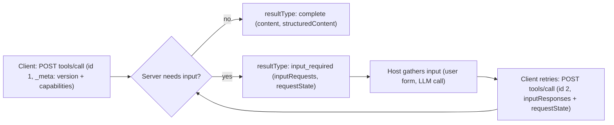

**MCP in practice** covers the engineering detail behind the [Model Context Protocol](model-context-protocol.md): JSON-RPC 2.0 messages between a **host** (the LLM app), the **client** connectors inside it, and **servers** that expose capabilities. LSP was the model for the design ([spec](../sources/mcp-specification-2026-07-28.md)). An integration written once as a server can be reused by any host. That turns M×N bespoke adapters into M+N ([notebook](../sources/notebook-mcp-build.md)). This page explains how the protocol works as of revision **2026-07-28**, how to deploy and secure it, and when it is the wrong tool.

## Primitives

| Primitive | Who controls it | What it is | Key methods |
|---|---|---|---|
| Tools | Model | Functions with a JSON Schema `inputSchema` (optional `outputSchema`) | `tools/list`, `tools/call` |
| Resources | Application | Read-only context addressed by URI (files, records) | `resources/list`, `resources/read`, templates |
| Prompts | User | Reusable templated messages/workflows | `prompts/list`, `prompts/get` |
| Elicitation | Server asks the user via the client | Form/URL input requests | delivered as `inputRequests` (MRTR) |

The "who controls it" column comes from [notebook-api-mcp](../sources/notebook-api-mcp.md) and the [spec](../sources/mcp-specification-2026-07-28.md). Tool details from the [tools spec](../sources/mcp-tools-spec.md):

- **Names:** 1–128 characters from `A-Za-z0-9_-.`. They are unique only within one server, so a host that aggregates servers should prefix names with a server ID.
- **Results:** `content` blocks (text, image, audio, `resource_link`, embedded resource) plus optional `structuredContent`. If the tool declares an `outputSchema`, `structuredContent` must conform to it. This is server data and is separate from model [structured outputs](structured-outputs.md).
- **Two error channels:** JSON-RPC protocol errors (unknown tool, malformed request) and `isError: true` results. The model should see `isError` results so it can correct itself.
- **Annotations:** hints such as read-only or destructive are **untrusted** unless the server is.
- **Ordering:** `tools/list` should be deterministic so tool definitions stay [prompt-cache](prompt-caching.md) friendly. List results now carry `ttlMs`/`cacheScope` caching hints ([changelog](../sources/mcp-specification-2026-07-28.md)).

How MCP relates to plain [function calling](function-calling.md): function calling declares tools inside one app. MCP moves them into reusable servers that any host can discover at runtime ([notebook-api-mcp](../sources/notebook-api-mcp.md)). The host still turns MCP tools into the model's native [tool](tools.md) definitions.

## The 2026-07-28 revision: MCP went stateless

Most tutorials, including the [owner's](../sources/notebook-mcp-build.md), show the older connection-oriented protocol: `initialize`, sessions and server-initiated requests. The current revision removes all three ([changelog](../sources/mcp-specification-2026-07-28.md)):

- **No handshake.** Every request carries `io.modelcontextprotocol/protocolVersion` and `io.modelcontextprotocol/clientCapabilities` in `_meta`, and clients should also send `clientInfo`. A version mismatch returns `UnsupportedProtocolVersionError`. Servers must implement `server/discover` so clients can choose a version up front.
- **No sessions.** `Mcp-Session-Id` is gone. A server that needs state (a cart, a browser context, a DB transaction) mints an opaque handle and receives it back as an ordinary tool argument. The spec's (non-normative) guidance is to keep handles opaque, re-check authorization on every call and state the handle's lifetime in the tool description ([tools spec](../sources/mcp-tools-spec.md)).
- **Multi Round-Trip Requests (MRTR).** A server can no longer push `sampling/createMessage`, `elicitation/create` or `roots/list`. It returns `resultType: "input_required"` with `inputRequests` and an opaque `requestState`. The client gathers the input and retries the original call with `inputResponses` (plus `requestState`) and a new JSON-RPC id. Every result now carries `resultType`, and results from older servers that omit it are treated as `complete`.
- **`subscriptions/listen`** replaces the GET stream and `resources/subscribe`, carrying only the change notifications the client opts in to.
- **Deprecated:** Roots, Sampling, Logging (twelve-month minimum window). Migration: pass paths as tool parameters, call LLM APIs directly, log to stderr or OpenTelemetry. **Removed:** `ping`, `logging/setLevel` (log level is now set per request in `_meta`), SSE resumption via `Last-Event-ID`. Tasks became an opt-in extension (`tasks/get` polling, `tasks/update`).

The Python SDK v2 serves both eras from one app. Calling `ctx.elicit()` or sampling on a 2026 connection raises `NoBackChannelError` ([SDK docs](../sources/mcp-sdks-docs.md)).

## Transports

| | stdio | Streamable HTTP |
|---|---|---|
| Shape | Host launches the server as a subprocess; newline-delimited JSON-RPC on stdin/stdout | One endpoint (e.g. `/mcp`); each message is its own POST; reply is JSON or a request-scoped SSE stream |
| Cancellation | `notifications/cancelled` | Close the response stream |
| Auth | Credentials from environment; OAuth spec does not apply | OAuth 2.1 profile (below) |
| Scaling | One process per host session | Stateless, so any replica can answer ([SDK docs](../sources/mcp-sdks-docs.md)) |
| Typical use | Local dev tools, filesystem, CLIs | Shared/remote SaaS servers |

Sources: [transports spec](../sources/mcp-streamable-http-transport-spec.md), [authorization spec](../sources/mcp-authorization-spec.md).

Streamable HTTP details that matter when you deploy:

- Clients must send `Accept: application/json, text/event-stream`, plus `MCP-Protocol-Version` and `Mcp-Method` on every POST, and `Mcp-Name` on `tools/call`, `resources/read` and `prompts/get`. These copy values from the body so gateways can route without parsing JSON. If a header and the body disagree, the server rejects the request (400, `HeaderMismatch` -32020).
- A tool can mark a primitive parameter with `x-mcp-header` to copy it into an `Mcp-Param-*` header, for example to route by region. Never mark secrets this way.
- Servers must validate `Origin` to stop DNS rebinding. Local servers should bind to 127.0.0.1.
- Send `X-Accel-Buffering: no` so nginx-style proxies don't buffer SSE.
- Statelessness only helps modern clients: 2025-era clients still open sessions and need sticky routing. In the Python SDK, MRTR `requestState` is protected with a per-process key by default, so scaled deployments must share keys (`RequestStateSecurity(keys=[...])`) ([SDK docs](../sources/mcp-sdks-docs.md)).
- A dropped stream loses the request, and the client re-issues it. Design `tools/call` handlers to be idempotent, or use the Tasks extension for long-running work.
- The 2024-11-05 HTTP+SSE transport is deprecated. Clients detect older servers by sending a modern request and inspecting the 400 body ([transports spec](../sources/mcp-streamable-http-transport-spec.md)).

## Authorization (remote servers)

A protected server is an **OAuth 2.1 resource server** ([authorization spec](../sources/mcp-authorization-spec.md)):

1. An unauthenticated request gets `401` with `WWW-Authenticate: Bearer resource_metadata="…", scope="…"`.
2. The client fetches the server's RFC 9728 Protected Resource Metadata, picks an authorization server, and discovers its metadata via RFC 8414 or OIDC.
3. The client registers in one of three ways: a **Client ID Metadata Document** (an HTTPS URL used as `client_id`, now preferred), pre-registration, or Dynamic Client Registration (deprecated).
4. Authorization code flow with PKCE, sending the **`resource`** parameter (the server's canonical URI, RFC 8707) in both the authorization and token requests. Before redeeming the code, the client validates `iss` (RFC 9207) against the issuer it recorded; an absent `iss` is rejected only if the authorization server advertises support for it.
5. `Authorization: Bearer` on every request. The server checks that the token's audience is itself. **Token passthrough is forbidden.**
6. If a later call needs more scope, the server returns `403 insufficient_scope`. The client re-authorizes with the union of its old and new scopes, with a bounded number of retries. Clients acting for themselves (`client_credentials`) may abort instead.

Synthesis: for enterprise deployments, the spec's "least privilege, step up later" model fits an IdP-fronted gateway. Expose a minimal `scopes_supported`, issue audience-bound tokens per server, and have the MCP server use its own credentials downstream rather than forwarding the user's token. See [enterprise LLM deployment](enterprise-llm-deployment.md).

## Registries and distribution

The official **MCP Registry** (still in preview as of 2026-11) stores only metadata (`server.json`): a reverse-DNS name such as `io.github.user/server`, where the package or remote URL lives, and how to run it. Namespace ownership is verified via GitHub, DNS or HTTP. The registry does not host code or scan it. Scanning is left to npm/PyPI/Docker and to downstream aggregators. Host apps are meant to consume aggregators or private registries that implement the same OpenAPI spec. Private servers do not belong in the public registry ([registry docs](../sources/mcp-registry-docs.md)).

## Building servers with the SDKs

Tier 1 SDKs as of 2026-11: TypeScript, Python, C#, Go, Rust, Ruby. Java is Tier 2. Swift, PHP and Kotlin are Tier 3. Each SDK adopts new spec revisions on its own schedule ([SDK docs](../sources/mcp-sdks-docs.md)). In Python v2, `FastMCP` became `MCPServer`. You decorate type-hinted functions with `@mcp.tool()` (the docstring becomes the description) and `@mcp.resource("scheme://{param}")`. v2 requires Python 3.11+. You test with `uv run mcp dev server.py` (the Inspector) and serve with `uv run mcp run server.py --transport streamable-http`. Caveat: `Client(mcp)` in tests negotiates 2026-07-28 by default, so v1 tests that relied on elicitation or sampling can fail unless run with `mode="legacy"` ([SDK docs](../sources/mcp-sdks-docs.md)). The owner's [build tutorial](../sources/notebook-mcp-build.md) shows the full server/client loop with the v1 API. The concepts are unchanged; the names and handshake are different.

Practical server design:

- Write descriptions the model can act on, and return `isError` text that says how to fix the call ([tools spec](../sources/mcp-tools-spec.md)).
- Keep tool count small and namespaced. Treat the server as a thin adapter over an existing API ([notebook](../sources/notebook-api-mcp.md)).
- For stdio servers, log to stderr: stdout carries the newline-delimited protocol stream, and MCP-level Logging is deprecated in favour of stderr or OpenTelemetry ([transports spec](../sources/mcp-streamable-http-transport-spec.md), [changelog](../sources/mcp-specification-2026-07-28.md)).

## Security failure modes

| Threat | Mechanism | Mitigation |
|---|---|---|
| Tool poisoning | Hidden instructions in a tool description make the agent read `~/.ssh/id_rsa` and exfiltrate it through a parameter ([Invariant](../sources/invariant-2025-mcp-tool-poisoning.md)) | Show full descriptions and arguments to the user; treat descriptions as untrusted; see [prompt injection](prompt-injection.md) |
| Rug pull | Description changes after approval | Pin/hash tool definitions; re-approve on change |
| Shadowing | One server's description rewrites how the agent uses another server's tools | Isolate servers; cross-server data-flow controls |
| Confused deputy | Proxy with a static third-party client ID + consent cookie ([best practices](../sources/mcp-security-best-practices.md)) | Per-client consent before forwarding, exact redirect URIs, single-use `state` |
| SSRF | Malicious metadata URLs pointing at `169.254.169.254` | HTTPS only, block private ranges, egress proxy |
| Handle hijack | Guessable state handles | Random handles bound to the token's user ID |
| Local server compromise | One-click config runs arbitrary commands | Show the full command, require consent, sandbox |
| Malicious auth URL | `javascript:` or shell-injected URL opened by the client | Allow only http(s), never open URLs via a shell |

The spec's own principles require explicit user consent before tool invocation and data sharing, but MCP cannot enforce them. The host must ([spec](../sources/mcp-specification-2026-07-28.md)). Synthesis: the combination of private-data tools, untrusted-content tools and outbound tools in one agent is the dangerous one. Gate it with [guardrails](agent-guardrails.md) and human approval rather than relying on descriptions. See also [LLM security risks](llm-security-risks.md).

## When to use MCP, and when not

- **Use it** when many hosts (IDE, desktop assistant, your agents) should reuse the same integration, when you publish a capability for other people's agents, or when tools should be discovered at runtime ([notebook-api-mcp](../sources/notebook-api-mcp.md)).
- **Skip it** when only your own code calls your own service. Use direct [function calling](function-calling.md) or the API, since MCP adds a layer with no reuse benefit ([notebook-api-mcp](../sources/notebook-api-mcp.md)).
- **Use A2A instead** when the remote party is an autonomous agent that holds multi-turn state, not a tool. See [Agent2Agent protocol](agent2agent-protocol.md) ([notebook-webmcp-a2a](../sources/notebook-webmcp-a2a.md)).

## Sources

- [MCP Specification 2026-07-28 and Changelog](../sources/mcp-specification-2026-07-28.md)
- [MCP Transports and Streamable HTTP](../sources/mcp-streamable-http-transport-spec.md)
- [MCP Authorization Specification](../sources/mcp-authorization-spec.md)
- [MCP Tools Specification](../sources/mcp-tools-spec.md)
- [MCP Security Best Practices](../sources/mcp-security-best-practices.md)
- [The MCP Registry](../sources/mcp-registry-docs.md)
- [MCP SDKs and Python SDK v2](../sources/mcp-sdks-docs.md)
- [Invariant Labs: MCP Tool Poisoning Attacks](../sources/invariant-2025-mcp-tool-poisoning.md)
- [Notebook: Build MCP From Scratch](../sources/notebook-mcp-build.md)
- [Notebook: APIs vs MCP](../sources/notebook-api-mcp.md)
- [Notebook: WebMCP & A2A](../sources/notebook-webmcp-a2a.md)
