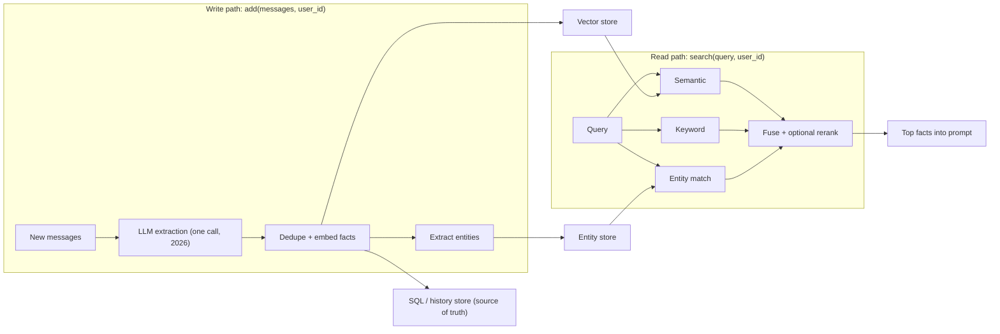

**Mem0** is a memory layer that sits beside an agent rather than inside it. The application passes conversation messages to `add`; an LLM distils them into short, standalone facts ("prefers aisle seats", "allergic to peanuts"), which are embedded and stored. Before answering, the application calls `search` with the user's query and puts the top facts into the prompt. The agent never manages memory itself: Mem0 is a passive write and read pipeline you call around each turn. It ships as an open-source library (Python and Node), a self-hosted server, and a managed Platform ([Mem0 docs](../sources/mem0-docs-memory.md), [deployment docs](../sources/mem0-platform-vs-oss-docs.md)). For the wider design space see [agent memory](agent-memory.md).

## How it works

### Storage

The current docs describe three layers: a SQL database holding facts and metadata as the source of truth, a [vector database](vector-databases.md) holding their [embeddings](embeddings.md), and an entity store that boosts memories sharing entities with the query ([Mem0 docs](../sources/mem0-docs-memory.md)). OSS library defaults are OpenAI `gpt-5-mini` for extraction, `text-embedding-3-small` for embeddings, a local Qdrant at `/tmp/qdrant`, and SQLite history at `~/.mem0/history.db`. The self-hosted server uses Postgres with pgvector ([deployment docs](../sources/mem0-platform-vs-oss-docs.md)).

### Write path, version 1 (2025 paper): extract, then reconcile

The [2025 paper](../sources/chhikara-2025-mem0.md) used two LLM passes per exchange:

1. **Extract.** Input: a periodically refreshed conversation summary, the last 10 messages, and the new message pair. Output: candidate facts.
2. **Update.** For each candidate, retrieve the 10 most similar stored memories and let the LLM pick, via [function calling](function-calling.md), one of ADD, UPDATE, DELETE (the new fact contradicts an old one) or NOOP.

This kept the store small and current. Its weakness was that the reconciliation step was slow and could overwrite or delete information that later turned out to matter ([Mem0 2026](../sources/mem0-2026-token-efficient-algorithm.md)).

### Write path, version 2 (April 2026): single-pass, ADD-only

The redesign collapses extraction into one LLM call that only adds. A changed fact is stored next to the old one, so history survives and time-based questions can use it. Facts the agent states (a confirmed booking) now count as much as user facts. Mem0 says extraction latency roughly halves. There is no dedicated temporal module ([Mem0 2026](../sources/mem0-2026-token-efficient-algorithm.md)). The docs confirm the practical consequence: extraction is additive, and corrections need explicit `update` or `delete` calls ([Mem0 docs](../sources/mem0-docs-memory.md)).

Synthesis: ADD-only moves conflict resolution from write time to read time. The store grows faster, and the answering model sees both "lives in Paris" and "moved to Berlin" and must work out which is current from timestamps. That works with a strong reader model and clear timestamps, and is risky with a weak one.

### Read path

`search` fuses semantic similarity, keyword match (with verb normalisation), entity match and temporal metadata, with an optional [reranker](reranking.md) ([Mem0 docs](../sources/mem0-docs-memory.md), [Mem0 2026](../sources/mem0-2026-token-efficient-algorithm.md)). Synthesis: this is [hybrid search](hybrid-search.md) over small extracted facts rather than over document chunks.

### Key API surface

| Call / parameter | What it does |
|---|---|
| `add(messages, user_id=..., agent_id=..., run_id=..., metadata=...)` | Extract and store facts; at least one scope id should be set |
| `infer=False` | Store the content verbatim and skip LLM extraction (default is inference) |
| `search(query, user_id=..., filters=...)` | Ranked facts for one scope; always scope searches |
| `get_all`, `update`, `delete` | Read and edit stored memories explicitly (needed for corrections under ADD-only) |
| `Memory` / `AsyncMemory` (OSS), `MemoryClient` / `AsyncMemoryClient` (Platform) | Sync and async clients |

Scoping by `user_id`, `agent_id` and `run_id` (plus custom metadata such as tenant) is how multi-tenancy is enforced ([Mem0 docs](../sources/mem0-docs-memory.md), [deployment docs](../sources/mem0-platform-vs-oss-docs.md)). Synthesis: scoping is a filter you pass in, not an access control the store enforces for you, so a bug that drops `user_id` leaks memory across users. Treat it like row-level security in your own code. See [PII and data privacy](pii-and-data-privacy.md).

## Graph memory

The paper's **Mem0g** variant stored entity-relation triplets in Neo4j. A conflict detector marked outdated edges invalid instead of deleting them, which helped temporal questions. It cost about twice the memory tokens of plain Mem0 and more latency ([paper](../sources/chhikara-2025-mem0.md)). The graph has since changed shape. The Platform now runs a native, always-on entity graph built from co-occurrence (memories sharing an entity are linked; relations are not typed), and it feeds ranking rather than being queried directly. The `relations` response field is now always empty, and `enable_graph=True` only adds that empty key for backward compatibility. The external graph-store integration (Neo4j, Memgraph, Kuzu, Apache AGE, Neptune via `enable_graph` / `graph_store`) has been replaced by this native graph on the Platform and was removed from the OSS library in the v3 pipeline; OSS still extracts entities for ranking but has no queryable graph ([deployment docs](../sources/mem0-platform-vs-oss-docs.md)). If you need multi-hop reasoning over typed relations, look at [GraphRAG](graphrag.md)-style systems instead.

## Benchmarks and the disputes

| Claim | Who | Number |
|---|---|---|
| Mem0 / Mem0g on [LoCoMo](benchmarks.md) (J) | Mem0 paper, 2025 | 66.88% / 68.44%; full context 72.90%; Zep 65.99% |
| p95 total latency | Mem0 paper | Mem0 1.44 s, Mem0g 2.59 s, full context 17.12 s |
| Zep rerun on LoCoMo | Zep, May 2025 | 75.14% ± 0.17 |
| Filesystem-only agent (GPT-4o mini) | Letta, Aug 2025 | 74.0% |
| New algorithm, LoCoMo / LongMemEval | Mem0, Apr 2026 | 92.5 / 94.4, about 7k tokens per query |

Sources: [paper](../sources/chhikara-2025-mem0.md), [Zep](../sources/zep-2025-is-mem0-sota.md), [Letta](../sources/letta-2025-filesystem-memory-benchmark.md), [Mem0 2026](../sources/mem0-2026-token-efficient-algorithm.md).

The disputes in brief:

- **Baseline configuration.** Zep says Mem0 misconfigured Zep: both speakers were given the user role, timestamps were put in the text instead of `created_at`, and searches ran sequentially, inflating latency ([Zep](../sources/zep-2025-is-mem0-sota.md)). Letta says it could not reproduce how Mem0 ran MemGPT on LoCoMo, and that Mem0 did not answer requests to explain ([Letta](../sources/letta-2025-filesystem-memory-benchmark.md)).
- **The benchmark itself.** LoCoMo conversations are about 16k–26k tokens and fit in a [context window](context-window.md), which is why full context beat every memory system in the 2025 paper. It has no knowledge-update questions, and it has label noise ([Zep](../sources/zep-2025-is-mem0-sota.md)). An agent with only generic file tools (grep plus a semantic `search_files` over the embedded history) beating specialised systems suggests LoCoMo mostly measures agent search behaviour ([Letta](../sources/letta-2025-filesystem-memory-benchmark.md)). LongMemEval is longer and tests knowledge updates, temporal reasoning and abstention ([Wu et al.](../sources/wu-2024-longmemeval.md)).
- **The 2026 numbers** are self-reported, come from the Platform (which has proprietary optimisations not in OSS), don't name the answer or [judge model](llm-as-judge.md), and carry about ±1 point of judge noise. Mem0 itself says LoCoMo and LongMemEval can be inflated, and points to BEAM, where it scores 64.1 at 1M tokens and 48.6 at 10M ([Mem0 2026](../sources/mem0-2026-token-efficient-algorithm.md)).

Synthesis: no vendor memory benchmark here is independently replicated. The durable result is about cost, not accuracy: putting about 7k tokens of retrieved facts in the prompt is much cheaper and faster than the full history. On short histories it is not more accurate than full context. Run your own [evaluation](agent-evaluation.md) on your own conversation logs.

## Platform vs open source, cost

| | OSS library / self-hosted server | Platform |
|---|---|---|
| Infra | You run the LLM, embedder, vector DB and history DB | Managed |
| Graph | No queryable graph; entities used for ranking | Native entity graph, always on per the docs; the pricing page lists graph memory only on the Custom tier |
| Lifecycle extras | None (no batch ops; loop over `update` / `delete`) | Webhooks, export, batch update/delete (1000 per call), Dream consolidation (Custom tier per pricing), memory decay, temporal reasoning, custom categories, `app_id` scoping |
| Cost model | Your LLM and DB bills | Free tier: 10k adds and 1k retrievals per month for 30 days, then BYO key with 50k / 10k; custom tier for graph, SSO, SLA, on-prem (Nov 2026) |

Sources: [deployment docs](../sources/mem0-platform-vs-oss-docs.md), [pricing](../sources/mem0-pricing.md).

Synthesis on cost and latency: every `add` is at least one LLM call plus embedding calls, so writing costs more than reading. Run `add` asynchronously after the response is sent so it stays off the user's critical path. The cost of that is that a fact from turn *n* may not be searchable at turn *n+1*. `search` costs embeddings plus a vector query plus an optional rerank, which is sub-second when the store is co-located.

## Failure modes

- **Extraction misses or hallucinates.** Whatever the extractor drops is gone. Its [hallucinations](hallucination.md) become persistent "facts". Use `infer=False` for content that must be stored exactly. (Synthesis.)
- **Stale or conflicting facts.** In v1 a wrong DELETE loses data. Under ADD-only, contradictions pile up and the reader model must resolve them ([Mem0 2026](../sources/mem0-2026-token-efficient-algorithm.md)).
- **Memory poisoning.** Anything a user or a tool result says can be extracted and replayed in later sessions. This is persistent [prompt injection](prompt-injection.md); see the poisoning discussion in [agent memory](agent-memory.md). (Synthesis.)
- **Scope leaks** from a missing `user_id` (see above).
- **Platform-OSS drift.** Benchmarks and features advertised for the Platform may not hold for the OSS library ([deployment docs](../sources/mem0-platform-vs-oss-docs.md)).

## When to use, when not

Synthesis:

- **Use Mem0** for user-level personalisation across sessions in chat assistants, support bots and copilots, when you want memory as a service call rather than an agent behaviour. It also fits when your agent framework has no long-term memory, or when you need per-user facts with low added prompt tokens.
- **Prefer [Letta](letta.md)** when the agent itself should decide what to remember, keep a curated, always-in-context profile, or run as a long-lived stateful service.
- **Roll your own** with a [vector database](vector-databases.md), or a [LangGraph](langgraph.md) store, when memory is document-like (that is [RAG](retrieval-augmented-generation.md)), when you need strict schemas (a typed profile table beats free-text facts), or when compliance demands that you control exactly what is stored. Mem0's extraction prompt is the main thing you'd be reimplementing.
- **Skip memory entirely** when histories fit comfortably in context: full context beat Mem0 on LoCoMo ([paper](../sources/chhikara-2025-mem0.md)). Use [prompt caching](prompt-caching.md) to make that cheap.

## Sources

- [Mem0 paper (Chhikara et al., 2025)](../sources/chhikara-2025-mem0.md)
- [Mem0, the token-efficient memory algorithm (2026)](../sources/mem0-2026-token-efficient-algorithm.md)
- [Mem0 docs: memory concepts](../sources/mem0-docs-memory.md)
- [Mem0 docs: OSS overview and Platform vs OSS](../sources/mem0-platform-vs-oss-docs.md)
- [Mem0 pricing](../sources/mem0-pricing.md)
- [Zep: Is Mem0 really SOTA?](../sources/zep-2025-is-mem0-sota.md)
- [Letta: Is a filesystem all you need?](../sources/letta-2025-filesystem-memory-benchmark.md)
- [LongMemEval (Wu et al., 2024)](../sources/wu-2024-longmemeval.md)
