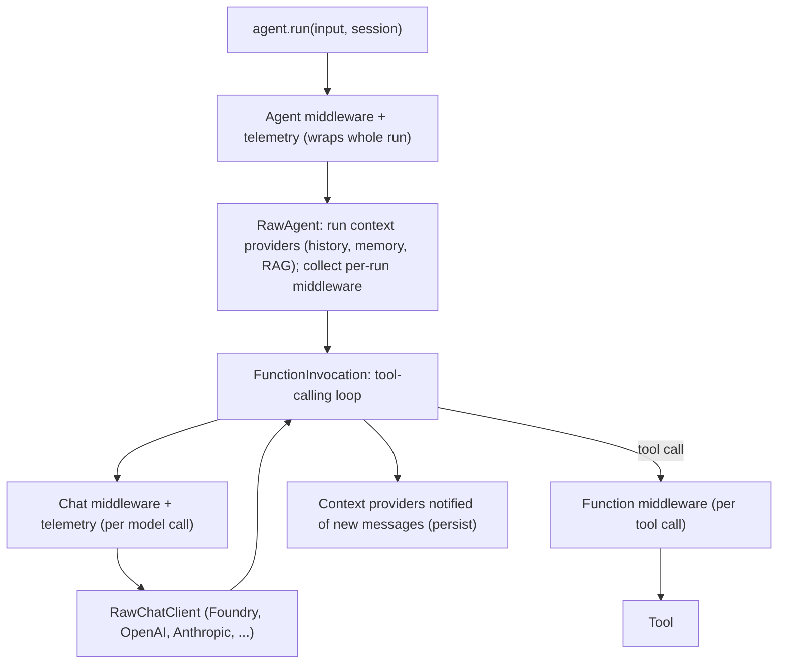

**Microsoft Agent Framework (MAF)** is Microsoft's open-source SDK for building agents and multi-agent workflows in .NET and Python, with Go in public preview. The AutoGen and Semantic Kernel teams built it as the next generation of both projects. It takes AutoGen's simple agent abstractions and Semantic Kernel's enterprise features (sessions, type safety, middleware, telemetry), and adds typed graph workflows ([overview](../sources/microsoft-agent-framework-overview.md)). Version 1.0 went GA for .NET and Python on 2026-04-03 with a long-term-support commitment ([1.0 announcement](../sources/microsoft-agent-framework-1-0-announcement.md)). The Python package was at 1.26.0 on 2026-11-12 ([README](../sources/microsoft-agent-framework-github-readme.md)). Semantic Kernel's own README now calls MAF its successor ([SK README](../sources/semantic-kernel-github-readme.md)). The AutoGen lineage, the AutoGen-to-MAF mapping and the five built-in orchestrations are covered on [AutoGen and Microsoft Agent Framework](autogen.md). This page covers MAF's internals: the agent abstraction, the run pipeline, sessions, CodeAct, and what Semantic Kernel users must change.

## Core abstractions

| Abstraction | .NET | Python | Role |
|---|---|---|---|
| Agent base | `AIAgent` | `BaseAgent` / `SupportsAgentRun` protocol | One run interface for every agent kind |
| Model-backed agent | `ChatClientAgent` over any `IChatClient` | `Agent(client=...)` over any `SupportsChatGetResponse` client | Instructions + [tools](tools.md) + loop |
| Remote / managed agents | `A2AAgent`, `CopilotStudioAgent`, `GitHubCopilotAgent` | `FoundryAgent`, `A2AAgent`, `GitHubCopilotAgent`, `ClaudeAgent` | Proxy a runtime you don't own |
| Conversation state | `AgentSession` | `AgentSession` | Local history or a service conversation ID |
| Context injection | `ChatHistoryProvider` + `AIContextProviders` | one `context_providers` list | History, memory, RAG, dynamic instructions |
| Interception | agent / chat-client middleware | agent, chat and function middleware | Logging, policy, rewriting |
| Orchestration | `Workflow` (graph) | `WorkflowBuilder` graph or experimental `@workflow` | Explicit multi-step / multi-agent paths |

Sources: [pipeline docs](../sources/microsoft-agent-framework-agent-pipeline-docs.md), [SK migration guide](../sources/microsoft-agent-framework-semantic-kernel-migration-guide.md), [workflows](../sources/microsoft-agent-framework-workflows-docs.md).

In .NET the key design choice is building on `Microsoft.Extensions.AI`. Any inference SDK that implements `IChatClient` can back an agent, and message and content types are shared with the wider .NET AI stack ([SK migration guide](../sources/microsoft-agent-framework-semantic-kernel-migration-guide.md)). Stable connectors at 1.0: Microsoft Foundry, Azure OpenAI, OpenAI, Anthropic Claude, [Amazon Bedrock](amazon-bedrock.md), [Google Gemini](gemini-api.md) and Ollama ([1.0 announcement](../sources/microsoft-agent-framework-1-0-announcement.md)).

## The run pipeline

A run is a stack of layers, and you customise behaviour by choosing the right one ([pipeline docs](../sources/microsoft-agent-framework-agent-pipeline-docs.md)):

*Diagram follows the Python pipeline in the [pipeline docs](../sources/microsoft-agent-framework-agent-pipeline-docs.md). .NET has the same three layers: agent middleware, context layer, then `IChatClient` and its decorators.*

What follows from this structure:

- **Agent middleware works on any agent**, including remote ones such as `A2AAgent` or `GitHubCopilotAgent`. Because it can't assume what it wraps, it should only touch common concerns. **Chat-client middleware** isn't available on agents that have no local `IChatClient` ([pipeline docs](../sources/microsoft-agent-framework-agent-pipeline-docs.md)).
- **Function middleware runs once per tool call**, so it is the natural place for approval, argument validation or auditing. **Chat middleware runs once per model call**, which suits prompt rewriting and caching.
- In .NET, `ChatClientAgent` adds [function calling](function-calling.md) to the chat client by default. Setting `UseProvidedChatClientAsIs = true` turns this off when you have already built your own pipeline ([pipeline docs](../sources/microsoft-agent-framework-agent-pipeline-docs.md)).
- Telemetry layers emit [OpenTelemetry](llm-observability.md) spans, events and metrics, and do nothing until configured ([pipeline docs](../sources/microsoft-agent-framework-agent-pipeline-docs.md)). Optional **Agent Hooks** install one fail-closed policy bundle across the agent, chat and function layers, and hold back streamed or persisted output until a verdict allows it.
- Unlike AutoGen's `AssistantAgent`, the `Agent` keeps [looping over tool calls](agent-loop.md) until it can answer ([AutoGen migration guide](../sources/microsoft-agent-framework-autogen-migration-guide.md)).

Synthesis: this is the same split that [LangChain](langchain.md) 1.0 middleware and the [Vercel AI SDK](vercel-ai-sdk.md) `wrapLanguageModel` make: one hook around the loop, one around each model call, one around each tool call. MAF's addition is a separate context-provider layer for history and memory. That keeps [agent memory](agent-memory.md) and [RAG](retrieval-augmented-generation.md) injection out of middleware.

## Sessions and memory

`AgentSession` holds conversation state. The agent creates it (`create_session()` / `CreateSessionAsync()`), and you pass it into every run. To persist it, serialize it (`session.to_dict()` / `SerializeSession`) or resume it by service conversation ID (`get_session(service_session_id=...)`) ([conversations docs](../sources/microsoft-agent-framework-conversations-docs.md)). A session is either **local**, where history is stored by a history provider such as `InMemoryHistoryProvider`, or **service-managed**, where it holds an opaque server-side ID such as an [OpenAI Responses](openai-responses-api.md) conversation. There is no delete API, because not every provider hosts history. If you need deletion, track sessions yourself and delete them through the provider SDK ([SK migration guide](../sources/microsoft-agent-framework-semantic-kernel-migration-guide.md)). Memory backends at 1.0 include Foundry Agent Service, [Mem0](mem0.md), Redis and Neo4j ([1.0 announcement](../sources/microsoft-agent-framework-1-0-announcement.md)).

**Multi-tenant pitfall:** service conversation IDs are scoped to the API key or project, not to the end user. A hosted agent that shares one key across users must store IDs server-side and check the caller's user or tenant before resuming a conversation ([conversations docs](../sources/microsoft-agent-framework-conversations-docs.md)). Otherwise one user can read another user's conversation. See [agent authentication and authorization](agent-authentication-and-authorization.md).

## Workflows, hosting and tooling

- **Workflows.** Typed executors joined by edges, with fan-out/fan-in, superstep checkpoints, request/response pauses for [human-in-the-loop](human-in-the-loop.md), and `.as_agent()` to wrap a workflow as an agent. There are five built-in orchestrations: sequential, concurrent, handoff, group chat and Magentic ([workflows](../sources/microsoft-agent-framework-workflows-docs.md)). See [AutoGen and MAF](autogen.md) for detail.
- **Declarative agents and workflows** in YAML are stable at 1.0. **[MCP](model-context-protocol.md)** is stable. **DevUI**, **Foundry hosted agents**, AG-UI, skills and the **Agent Harness** were still preview at GA ([1.0 announcement](../sources/microsoft-agent-framework-1-0-announcement.md)). The harness agent adds planning and todos, [context compaction](context-engineering.md), file access and memory, and tool approval ([overview](../sources/microsoft-agent-framework-overview.md)).
- **CodeAct.** An `execute_code` tool, backed by Hyperlight (Python/.NET), Monty (Python) or a local .NET executor, lets the model write one program that calls several tools instead of making one model turn per call ([CodeAct docs](../sources/microsoft-agent-framework-codeact-docs.md)). This is the same idea as [smolagents](smolagents.md) code agents. See [code execution sandboxes](code-execution-sandboxes.md).
- **Integration with the Azure estate.** Foundry is the default in quickstarts, and a Foundry agent record can be loaded with `AsAIAgent(agentRecord)` ([SK migration guide](../sources/microsoft-agent-framework-semantic-kernel-migration-guide.md), [README](../sources/microsoft-agent-framework-github-readme.md)). See [Azure AI Foundry](azure-ai-foundry.md).

## Migrating from Semantic Kernel

| Semantic Kernel | Agent Framework |
|---|---|
| Every agent needs a `Kernel` | No kernel. `chatClient.AsAIAgent(...)` / `Agent(client=...)` |
| `ChatCompletionAgent`, `OpenAIAssistantAgent`, `AzureAIAgent` | `ChatClientAgent` (.NET) / `Agent` (Python) for all chat-client services |
| `[KernelFunction]` + plugin + kernel | Plain functions, `@tool`, `AIFunctionFactory.Create`, passed as `tools=` |
| Caller builds a provider-specific `AgentThread` | Agent creates an `AgentSession` |
| `invoke` returns an async stream of messages | `run` returns one `AgentResponse`. `run(stream=True)` / `RunStreamingAsync` yields `AgentResponseUpdate` |
| `PromptExecutionSettings` in `KernelArguments` | TypedDict `default_options` / `options` (Python), `ChatClientAgentRunOptions` (.NET) |

Source: [SK migration guide](../sources/microsoft-agent-framework-semantic-kernel-migration-guide.md). For incremental migration, `KernelFunction.as_agent_framework_tool()` (semantic-kernel 1.38+) wraps existing SK functions, including SK vector-store search functions, as MAF tools.

## Comparison with peers

| | MAF | [LangGraph](langgraph.md) | [OpenAI Agents SDK](openai-agents-sdk.md) | [Claude Agent SDK](claude-agent-sdk.md) |
|---|---|---|---|---|
| Languages | .NET, Python, Go (preview) | Python, JS | Python, TS | Python, TS |
| Core unit | `AIAgent` + typed `Workflow` graph | State graph with checkpointer | Agent + Runner loop, handoffs | Claude Code agent loop |
| Model scope | Any `IChatClient` / chat client | Any (via LangChain) | OpenAI-first (Responses API) | Claude |
| Durable state | Superstep checkpoints. Single-process runtime | Checkpointers with durability modes | Sessions | Sessions |
| Enterprise hook | Azure/Foundry, OpenTelemetry, .NET DI | [LangSmith](langsmith.md) | OpenAI platform tracing | Claude Code permissions/hooks |

Sources: this page's MAF sources, [LangChain/LangGraph 1.0](../sources/langchain-langgraph-1-0-announcement.md), [OpenAI Agents SDK docs](../sources/openai-agents-sdk-docs.md), [Claude Agent SDK overview](../sources/claude-agent-sdk-overview-docs.md). Synthesis: MAF's main differentiator is first-class .NET with dependency-injection-friendly `AIAgent` registration. No other major agent SDK covers .NET as fully.

## Limitations and failure modes

- **Partly preview.** At GA, DevUI, hosted agents, skills and the harness were preview. [A2A](agent2agent-protocol.md) 1.0 was "coming soon" ([1.0 announcement](../sources/microsoft-agent-framework-1-0-announcement.md)). The .NET Hyperlight CodeAct package depends on a NuGet package that isn't yet published ([CodeAct docs](../sources/microsoft-agent-framework-codeact-docs.md)). Check the status of each feature before relying on it.
- **Single-process workflows.** Distributed execution is planned, not shipped ([AutoGen migration guide](../sources/microsoft-agent-framework-autogen-migration-guide.md)). For durability across processes, see [durable agent execution](durable-agent-execution.md).
- **Language parity lags.** Python-only features (functional workflows, FIDES information-flow security) exist, and Go repeatedly marks features as "coming soon" ([workflows](../sources/microsoft-agent-framework-workflows-docs.md), [CodeAct docs](../sources/microsoft-agent-framework-codeact-docs.md)).
- **CodeAct weakens per-tool controls.** Host tools called from inside the sandbox skip function middleware, and approval covers the whole `execute_code` call ([CodeAct docs](../sources/microsoft-agent-framework-codeact-docs.md)).
- **Fast API churn.** The Python package went from 1.0 in April 2026 to 1.26.0 in November 2026 ([1.0 announcement](../sources/microsoft-agent-framework-1-0-announcement.md), [README](../sources/microsoft-agent-framework-github-readme.md)), and docs disagree in places (see the contradiction note on [AutoGen and MAF](autogen.md)).
- **Async resource leaks in Python.** MCP tools and clients hold connections, so use `async with agent` or `open()`/`close()` ([pipeline docs](../sources/microsoft-agent-framework-agent-pipeline-docs.md)).

## When to use it, and when not

- **Use** it for .NET shops, teams on Semantic Kernel or AutoGen (this is the supported path forward), Azure/Foundry deployments that need OpenTelemetry and Entra-based credentials, and workloads that mix agents with typed, checkpointed workflows and human approval steps.
- **Don't** use it if a plain function or a single LLM call will do. Microsoft's own guidance says so ([overview](../sources/microsoft-agent-framework-overview.md)). Python-first teams that want mature durable graphs may prefer [LangGraph](langgraph.md). TypeScript teams should look at [Mastra](mastra.md) or the [Vercel AI SDK](vercel-ai-sdk.md). For a thin loop tied to one vendor, use the [OpenAI Agents SDK](openai-agents-sdk.md) or the [Claude Agent SDK](claude-agent-sdk.md).

## Sources

- [Microsoft Agent Framework overview](../sources/microsoft-agent-framework-overview.md)
- [Agent Framework 1.0 announcement](../sources/microsoft-agent-framework-1-0-announcement.md)
- [Semantic Kernel to Agent Framework migration guide](../sources/microsoft-agent-framework-semantic-kernel-migration-guide.md)
- [AutoGen to Agent Framework migration guide](../sources/microsoft-agent-framework-autogen-migration-guide.md)
- [Agent concepts and pipeline architecture](../sources/microsoft-agent-framework-agent-pipeline-docs.md)
- [Conversations & memory overview](../sources/microsoft-agent-framework-conversations-docs.md)
- [Workflows and orchestrations](../sources/microsoft-agent-framework-workflows-docs.md)
- [CodeAct](../sources/microsoft-agent-framework-codeact-docs.md)
- [microsoft/agent-framework README](../sources/microsoft-agent-framework-github-readme.md)
- [microsoft/semantic-kernel README](../sources/semantic-kernel-github-readme.md)
- [LangChain and LangGraph 1.0](../sources/langchain-langgraph-1-0-announcement.md)
- [OpenAI Agents SDK docs](../sources/openai-agents-sdk-docs.md)
- [Claude Agent SDK overview](../sources/claude-agent-sdk-overview-docs.md)
