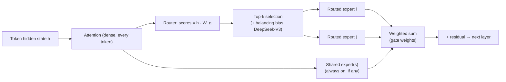

A **mixture-of-experts (MoE)** model replaces the dense feed-forward (FFN) block of some or all [transformer](transformer-architecture.md) layers with many parallel FFNs, called **experts**, plus a small learned **router** (gate). For each token, the router scores every expert and only the top-k run. The token's output is the gate-weighted sum of those experts. Parameter count, and with it capacity, therefore grows much faster than compute per token. The idea dates to 1991. Shazeer et al. made it work at scale in 2017 with a sparsely gated layer holding thousands of experts, reporting more than 1000x capacity gains for small efficiency losses ([Shazeer 2017](../sources/shazeer-2017-sparsely-gated-moe.md), [HF explainer](../sources/hugging-face-moe-explained.md)). The key distinction is **total parameters**, all of which must sit in memory, versus **active parameters**, which are used per token and set the FLOPs. Names like "235B-A22B" encode both numbers.

## Mechanics

- **Gate.** Mixtral computes `Softmax(TopK(h·W_g))`, so the softmax runs only over the selected logits ([Mixtral](../sources/jiang-2024-mixtral.md)). gpt-oss does the same with k = 4 ([gpt-oss card](../sources/gpt-oss-arxiv-model-card.md)). DeepSeek-V3 uses sigmoid affinities and normalises them over the 8 selected experts ([DeepSeek-V3](../sources/deepseek-v3-technical-report.md)). Shazeer's original gate added tunable noise to the logits before top-k ([HF explainer](../sources/hugging-face-moe-explained.md)).
- **What experts are.** Experts are ordinary SwiGLU FFNs. Attention, embeddings and norms are shared. In gpt-oss-120b, the MLPs hold 114.7B of the 116.8B parameters, while attention is under 1B ([gpt-oss card](../sources/gpt-oss-arxiv-model-card.md)).
- **Top-1 vs top-k.** Switch Transformer showed that k = 1 works and is cheaper in router compute, capacity and communication ([Switch](../sources/fedus-2021-switch-transformers.md)).
- **Fine-grained and shared experts.** DeepSeekMoE splits experts into many small ones and activates more of them, which allows many more combinations. It also isolates **shared experts** that every token passes through, so routed experts don't each relearn common knowledge. At 16B it matched LLaMA2 7B with about 40% of the compute ([DeepSeekMoE](../sources/dai-2024-deepseekmoe.md)). Llama 4 Maverick uses 1 shared expert plus 1 routed expert, and alternates dense and MoE layers ([Llama 4](../sources/meta-llama-4-announcement.md)). Qwen3 kept fine-grained experts but **dropped** shared experts ([Qwen3](../sources/qwen3-technical-report.md)).
- **Does routing specialise by topic?** Not much. In Mixtral, ArXiv, PubMed and PhilPapers text route almost identically. Routing is more syntactic: Python `self` and indentation tokens go to consistent experts, and consecutive tokens often reuse the same expert ([Mixtral](../sources/jiang-2024-mixtral.md)). Synthesis: don't expect to identify a "legal expert" to prune or fine-tune in isolation.

## Load balancing

Left alone, a router collapses. A few experts win early, get more gradient and win more ([HF explainer](../sources/hugging-face-moe-explained.md)). Imbalance also wastes hardware, because the slowest, most-loaded expert gates each step. The main fixes:

| Technique | How it works | Used by |
|---|---|---|
| Auxiliary loss | `α·N·Σ f_i·P_i`: the fraction of tokens routed to expert i times its mean router probability, with α = 1e-2 | Switch ([Switch](../sources/fedus-2021-switch-transformers.md)) |
| Capacity factor + token dropping | Each expert accepts at most (tokens/experts) × CF. Overflow tokens skip the expert through the residual connection | Switch (CF 1.0–1.25 worked well) |
| Global-batch balance loss | The balance loss is computed over the whole batch, not per sequence, which leaves room for specialisation | Qwen3 ([Qwen3](../sources/qwen3-technical-report.md)) |
| Auxiliary-loss-free bias | A per-expert bias is added to scores **only for top-k selection** and nudged ±γ each step against load. A tiny sequence-wise loss (α = 1e-4) remains. No token dropping | DeepSeek-V3 ([DeepSeek-V3](../sources/deepseek-v3-technical-report.md)) |

DeepSeek reports that the bias method beat the auxiliary loss on most [benchmarks](benchmarks.md) at 229B scale (HumanEval 40.2 → 46.3) and produced more specialised experts. Batch-wise balancing beat sequence-wise because it constrains the model less. Its cost is that small batches or domain-shifted traffic can be imbalanced at inference, which DeepSeek handles with redundant experts ([DeepSeek-V3](../sources/deepseek-v3-technical-report.md)).

## Model landscape (as of 2026-11)

| Model (release) | Total / active | Experts per MoE layer (routed active + shared) | Notes |
|---|---|---|---|
| Mixtral 8x7B (2024-01) | ~47B / ~13B | 8 (2 + 0) | 32k context, Apache 2.0 ([Mixtral](../sources/jiang-2024-mixtral.md)) |
| DeepSeek-V3 / R1 (2024-12 / 2025-01) | 671B / 37B | 256 (8 + 1) | First 3 layers dense, MLA attention ([V3](../sources/deepseek-v3-technical-report.md)) |
| Qwen3-235B-A22B / 30B-A3B (2025-04) | 235B / 22B; 30B / 3B | 128 (8 + 0) | ([Qwen3](../sources/qwen3-technical-report.md)) |
| Llama 4 Scout / Maverick (2025-04) | 109B / 17B; 400B / 17B | 16; 128 (1 + 1) | Maverick alternates dense and MoE layers ([Llama 4](../sources/meta-llama-4-announcement.md)) |
| gpt-oss-120b / 20b (2025-08) | 116.8B / 5.1B; 20.9B / 3.6B | 128; 32 (4 + 0) | MXFP4 experts ([gpt-oss](../sources/gpt-oss-arxiv-model-card.md)) |
| Gemma 4 26B A4B (2026) | 25.2B / 3.8B | 128 (8 + 1) | 30 layers, 256K context ([Gemma 4](../sources/gemma-4-docs.md)) |
| Mistral Large 4 (2026-09) | ~1T / 49B | 128 (4 + 1) | NVFP4 checkpoint ([Mistral](../sources/mistral-large-4-model-card.md)) |
| Qwen3.8-2.4T-A95B (2026-08) | 2.4T / 95B | 512 (10 + 1) | ([Qwen3.8](../sources/qwen3-8-model-cards.md)) |
| Kimi K3.1 Pro (2026-11) | 2.8T / 104B | 896 (16 + 2) | MXFP4 QAT ([Kimi](../sources/kimi-k3-1-pro-model-card.md)) |

The trend runs toward more, smaller experts and active fractions of roughly 3–5%. DeepSeek-V4 cards list ~1.65T stored parameters but no active count ([DeepSeek V4](../sources/deepseek-v4-model-cards.md)). See [open-weight models](open-weight-models.md) and the [frontier landscape](frontier-model-landscape.md).

## Why MoE dominates open-weight releases

- **Quality per training FLOP.** Switch-Base reached T5-Base quality about 7x faster ([Switch](../sources/fedus-2021-switch-transformers.md)). Qwen reports that MoE base models match dense ones with 1/5 or fewer of the active parameters. Qwen3-30B-A3B matches Qwen2.5-32B ([Qwen3](../sources/qwen3-technical-report.md)). DeepSeek-V3's [pre-training](llm-training-pipeline.md) took 2.664M H800 GPU-hours, and the full run, including context extension and post-training, took 2.788M ([V3](../sources/deepseek-v3-technical-report.md)).
- **Cheap decoding per token at scale.** Per-token FLOPs and weight reads track active parameters. DeepSeek served V3/R1 at about 14.8k output tokens/s per 8-GPU H800 node and estimated a theoretical cost-profit margin of 545% at R1 prices ([DeepSeek inference](../sources/deepseek-v3-r1-inference-system.md)).
- **Laptop-class models with large-model knowledge.** gpt-oss-20b runs in 16GB, and Google says Gemma 4 26B A4B runs almost as fast as a 4B model ([gpt-oss](../sources/gpt-oss-model-card.md), [Gemma 4](../sources/gemma-4-docs.md)).
- Synthesis: open-weight labs face tight training budgets and users who run models on their own hardware. Both pressures favour the architecture with the best quality per FLOP. Memory is the cost, and it is pushed onto the deployer.

## Memory footprint and serving

**Memory follows total parameters.** Mixtral needs VRAM for a ~47B dense model even though it computes like a ~12–13B one ([HF explainer](../sources/hugging-face-moe-explained.md), [Mixtral](../sources/jiang-2024-mixtral.md)). Synthesis: weight memory ≈ total params × bytes per param. DeepSeek-V3 in FP8 is about 671 GB before [KV cache](kv-cache.md), so it needs a multi-GPU node. Llama 4 Scout at Int4 is about 55 GB, which fits one H100 ([Llama 4](../sources/meta-llama-4-announcement.md)).

**MoE prefers big batches.** At batch size 1, each token reads only its experts' weights, so decoding is fast. As the batch grows, the union of selected experts approaches all experts. Meanwhile each expert sees only about k/N of the tokens, so experts stay underutilised unless the global batch is very large. DeepSeek uses wide **expert parallelism (EP)** for this reason: EP enlarges the effective batch per expert and cuts the expert bytes each GPU reads ([DeepSeek inference](../sources/deepseek-v3-r1-inference-system.md)). Mixtral's authors make the same point: MoE suits high-arithmetic-intensity batched serving ([Mixtral](../sources/jiang-2024-mixtral.md)). Sparse models fit high-throughput, many-GPU serving, and dense models fit low-VRAM, low-throughput settings ([HF explainer](../sources/hugging-face-moe-explained.md)).

**Expert parallelism in practice** (see [LLM inference serving](llm-inference-serving.md)):

- Attention runs data-parallel and experts are sharded across GPUs. Each MoE layer then needs two all-to-all exchanges, *dispatch* (sending tokens to their experts' GPUs) and *combine* (returning the results). In [vLLM](vllm.md): `--enable-expert-parallel`, EP size = TP × DP, `--all2all-backend deepep_high_throughput` for prefill or `deepep_low_latency` for decode ([vLLM EP](../sources/vllm-expert-parallel-deployment.md)).
- **Hot experts** are replicated. DeepSeek re-picks redundant experts from live load statistics about every 10 minutes ([V3](../sources/deepseek-v3-technical-report.md)). vLLM's EPLB does the same through `--enable-eplb` with `num_redundant_experts`, `window_size` and `step_interval`, at the cost of extra memory ([vLLM EP](../sources/vllm-expert-parallel-deployment.md)).
- At production scale, prefill and decode use different layouts: EP32 over 4 nodes for prefill and EP144 over 18 nodes for decode. Communication is hidden behind compute with two micro-batches in prefill and a 5-stage pipeline in decode ([DeepSeek inference](../sources/deepseek-v3-r1-inference-system.md)). The V3 report described a larger decode unit, EP320 over 40 nodes. The production write-up came later and reports EP144 ([V3](../sources/deepseek-v3-technical-report.md)). DeepSeek-V3 limits each token to experts on at most 4 nodes to bound cross-node traffic ([V3](../sources/deepseek-v3-technical-report.md)).
- **Local/hybrid serving.** In [llama.cpp](local-llms.md), keep attention and shared experts on the GPU and put routed experts in system RAM (`-ngl 999 --cpu-moe`, or `--n-cpu-moe N`, or `-ot "exps=CPU"`). For prompts above a threshold (32 tokens by default), llama.cpp copies the CPU-held expert weights to the GPU, so prefill depends on PCIe bandwidth ([llama.cpp MoE guide](../sources/llamacpp-moe-offload-guide.md)). Synthesis: decode then reads routed experts from system RAM, so CPU memory bandwidth largely sets its speed.

## Quantization

Experts are most of the bytes, so quantising only the experts captures most of the savings. gpt-oss stores MoE weights, 90%+ of its parameters, in MXFP4 at 4.25 bits, which gives a 60.8 GiB checkpoint for a 117B model ([gpt-oss](../sources/gpt-oss-arxiv-model-card.md)). Kimi K3.1 Pro is quantisation-aware trained to MXFP4 weights ([Kimi](../sources/kimi-k3-1-pro-model-card.md)), and Mistral Large 4 ships an NVFP4 checkpoint ([Mistral](../sources/mistral-large-4-model-card.md)). DeepSeek-V3 was trained in FP8 with block-wise scaling and stayed within 0.25% of BF16 loss ([V3](../sources/deepseek-v3-technical-report.md)). Switch Transformer found routers numerically fragile and kept the router in float32 ([Switch](../sources/fedus-2021-switch-transformers.md)). Synthesis: keep the router and attention at higher precision when quantising, and evaluate after quantising, because a perturbed router can change which experts fire. See [quantization](quantization.md).

## Fine-tuning

- MoEs overfit more easily than dense models. Switch used dropout 0.4 inside experts and 0.1 elsewhere ([Switch](../sources/fedus-2021-switch-transformers.md)). Instruction tuning helps MoEs more than dense models ([HF explainer](../sources/hugging-face-moe-explained.md)).
- Freezing all non-expert weights hurts badly. Freezing only the MoE layers is nearly as good as full fine-tuning ([HF explainer](../sources/hugging-face-moe-explained.md)).
- Unsloth freezes the router by default and applies LoRA to the attention layers plus `gate_up_proj` and `down_proj`, which covers the experts. It advises against 4-bit QLoRA for MoE because bitsandbytes doesn't support it. Reported VRAM: gpt-oss-20b needs about 12.8 GB, and Qwen3-30B-A3B with bf16 LoRA needs 63 GB ([Unsloth MoE](../sources/unsloth-faster-moe.md)). Synthesis: fine-tuning memory scales with *total* parameters, so a "3B-active" model costs about as much to fine-tune as a 30B dense model. See [PEFT and LoRA](peft-and-lora.md) and [fine-tuning](fine-tuning.md).
- Distilling an MoE into a dense student keeps about 30% of the sparse model's gain at 1/20th the size ([Switch](../sources/fedus-2021-switch-transformers.md)). See [knowledge distillation](knowledge-distillation.md).

## Failure modes and limitations

- **Router collapse / imbalance:** a few experts get trained while the rest stay idle. Throughput is gated by the hottest GPU.
- **Token dropping:** with a capacity factor, overflow tokens skip the layer. Switch kept drops below about 1% ([Switch](../sources/fedus-2021-switch-transformers.md)). DeepSeek-V3 drops none ([V3](../sources/deepseek-v3-technical-report.md)).
- **Training instability:** bf16 Switch models diverged until the router ran in float32 and initialisation was scaled down ([Switch](../sources/fedus-2021-switch-transformers.md)).
- **Batch-dependent behaviour:** routing and balancing depend on batch composition, and domain-shifted traffic can overload a few experts at inference ([V3](../sources/deepseek-v3-technical-report.md)). Synthesis: this is one source of run-to-run [nondeterminism](llm-limitations.md) in served MoEs.
- **Communication-bound serving:** all-to-all over slow interconnects can erase the FLOP savings. MoE gains depend on NVLink/IB bandwidth ([vLLM EP](../sources/vllm-expert-parallel-deployment.md), [DeepSeek inference](../sources/deepseek-v3-r1-inference-system.md)).
- **Reasoning vs knowledge:** Switch's pre-training gains transferred better to knowledge tasks than to reasoning tasks ([Switch](../sources/fedus-2021-switch-transformers.md)).

## When to use / when not

Synthesis, grounded in the sections above:

- **Pick an MoE** when you serve many concurrent users on a multi-GPU node with fast interconnect (best quality per dollar per token), or when you run locally with plenty of system RAM but limited VRAM (expert offload).
- **Pick a dense model** for single-GPU, VRAM-bound deployments where all weights must fit fast memory, for low-concurrency latency-critical endpoints where an under-used MoE wastes memory, and for cheap fine-tuning, where cost scales with total parameters.
- **Sizing rule:** budget memory from *total* parameters, plus [KV cache](kv-cache.md), plus redundant experts. Budget latency and throughput from *active* parameters, then discount for communication. Compare candidates with [model selection](model-selection.md) and [cost and latency optimization](cost-and-latency-optimization.md).
- On hosted APIs the architecture is hidden. MoE matters most when you self-host [open-weight models](open-weight-models.md).

## Sources

- [Shazeer et al. 2017, sparsely-gated MoE](../sources/shazeer-2017-sparsely-gated-moe.md)
- [Fedus et al., Switch Transformers](../sources/fedus-2021-switch-transformers.md)
- [Jiang et al., Mixtral of Experts](../sources/jiang-2024-mixtral.md)
- [Dai et al., DeepSeekMoE](../sources/dai-2024-deepseekmoe.md)
- [DeepSeek-V2 (MLA)](../sources/deepseek-v2-mla.md)
- [DeepSeek-V3 Technical Report](../sources/deepseek-v3-technical-report.md)
- [DeepSeek-V3/R1 inference system overview](../sources/deepseek-v3-r1-inference-system.md)
- [Qwen3 Technical Report and blog](../sources/qwen3-technical-report.md)
- [Meta, The Llama 4 herd](../sources/meta-llama-4-announcement.md)
- [gpt-oss arXiv model card](../sources/gpt-oss-arxiv-model-card.md) · [gpt-oss Hugging Face card](../sources/gpt-oss-model-card.md)
- [Hugging Face, Mixture of Experts Explained](../sources/hugging-face-moe-explained.md)
- [vLLM expert parallel deployment](../sources/vllm-expert-parallel-deployment.md)
- [Unsloth faster MoE](../sources/unsloth-faster-moe.md)
- [llama.cpp MoE offload guide](../sources/llamacpp-moe-offload-guide.md)
- [Qwen3.8 model cards](../sources/qwen3-8-model-cards.md) · [Kimi K3.1 Pro](../sources/kimi-k3-1-pro-model-card.md) · [Mistral Large 4](../sources/mistral-large-4-model-card.md) · [DeepSeek V4](../sources/deepseek-v4-model-cards.md) · [Gemma 4](../sources/gemma-4-docs.md)
