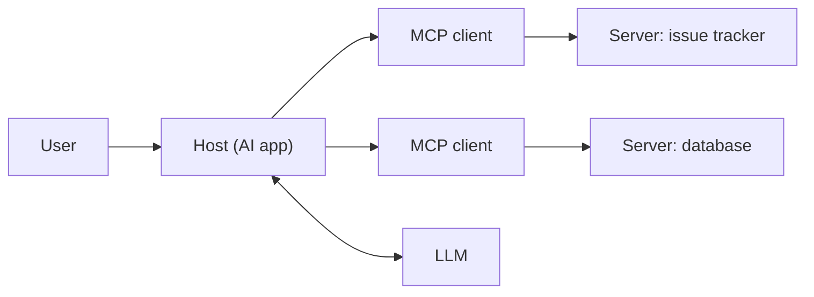

The **Model Context Protocol (MCP)** is an open standard for connecting agents to external capabilities. A service runs an **MCP server** that exposes [tools](tools.md), resources and prompts once, and any MCP-compatible agent (the client) can use them. The current revision is **2026-07-28**, which made the protocol stateless ([spec](../sources/mcp-specification-2026-07-28.md)); wire-level detail is in [MCP in practice](mcp-in-practice.md).

## Why it matters

- **Before MCP**, every agent framework had its own [tool format](function-calling.md), so each integration was rebuilt for each framework.
- **With MCP**, an integration is built once and reused everywhere. The source compares this to USB for hardware: standardise the plug and the ecosystem grows on its own ([anatomy](../sources/anatomy-of-a-modern-ai-agent.md)).
- **In practice**, function calling declares tools inside one app, while MCP moves them into reusable servers that a host discovers at runtime, so adding an integration means pointing the host at a server rather than writing new tool code ([notebook-api-mcp](../sources/notebook-api-mcp.md)). Platforms go further: [AgentCore Gateway](amazon-bedrock.md) turns existing APIs and Lambda functions into MCP tools ([AWS](../sources/aws-agentcore-overview.md)).

## How it works

Three roles: the **host** (the AI app), a **client** inside it holding a 1:1 connection to each server, and the **server**, which wraps an API, database or filesystem ([notebook-api-mcp](../sources/notebook-api-mcp.md)). Messages are JSON-RPC ([spec](../sources/mcp-specification-2026-07-28.md)).

| Primitive | Controlled by | What it is |
|---|---|---|
| Tools | Model | Functions with a JSON Schema input the model chooses to call |
| Resources | Application | Read-only context addressed by URI |
| Prompts | User | Reusable templated messages or workflows |

Control column from [notebook-api-mcp](../sources/notebook-api-mcp.md) and the [spec](../sources/mcp-specification-2026-07-28.md). The host still converts MCP tools into the model's native [function-calling](function-calling.md) definitions.

### The 2026-07-28 revision

Most tutorials describe the older connection-oriented protocol. The current revision changes it ([spec changelog](../sources/mcp-specification-2026-07-28.md)):

- **No `initialize` handshake.** Each request carries its protocol version and client capabilities in `_meta`; servers implement `server/discover`.
- **No sessions.** `Mcp-Session-Id` is removed. A server that needs state mints an opaque handle passed back as a tool argument.
- **Multi Round-Trip Requests (MRTR).** Instead of pushing sampling, elicitation or roots requests, a server returns `resultType: "input_required"` and the client retries with the answers.
- **Deprecated:** Roots, Sampling, Logging and the old HTTP+SSE transport (12-month minimum window). Tasks moved to an opt-in extension. `tools/list` should be deterministic so tool definitions stay [prompt-cache](prompt-caching.md) friendly.

Transports are **stdio** (local subprocess) and **Streamable HTTP** (remote); see [MCP in practice](mcp-in-practice.md).

### Authorization and distribution

- A protected remote server is an **OAuth 2.1 resource server**: audience-bound tokens (RFC 8707 `resource`), PKCE, and **no token passthrough** ([authorization spec](../sources/mcp-authorization-spec.md)). Clients obtain a `client_id` preferably via a Client ID Metadata Document; Dynamic Client Registration is deprecated ([client registration](../sources/mcp-client-registration-spec.md)). Background: [agent authentication and authorization](agent-authentication-and-authorization.md).
- The **Enterprise-Managed Authorization** extension lets the corporate IdP decide which servers employees reach, via ID-JAG tokens and no per-server consent screens ([extension](../sources/mcp-enterprise-managed-authorization.md)).
- The official **MCP Registry** (preview as of 2026-11) stores metadata only. It does not host or scan code ([registry docs](../sources/mcp-registry-docs.md)).

## Where MCP shows up

- **Managed gateways.** AgentCore Gateway fronts existing MCP servers and enforces Policy rules on every tool call ([AWS](../sources/aws-agentcore-overview.md)). Foundry **Toolboxes** bundle web search, code interpreter, MCP servers and OpenAPI tools behind one managed MCP endpoint with central auth ([Microsoft](../sources/microsoft-foundry-agent-service.md); see [Azure AI Foundry](azure-ai-foundry.md)).
- **Hosted in model APIs.** OpenAI's [Responses API](openai-responses-api.md) can call remote MCP servers as a hosted tool ([migration guide](../sources/openai-migrate-to-responses-guide.md)).
- **Code execution with MCP.** Presenting MCP servers as code modules an agent imports in a [sandbox](code-execution-sandboxes.md), instead of loading every tool definition into context, cut one workflow from about 150k to about 2k tokens. The cost is running a secure sandbox ([Anthropic](../sources/anthropic-code-execution-with-mcp.md)).

## Security

The spec requires user consent before tool use and data sharing, and treats tool descriptions and annotations as untrusted unless the server is trusted, but MCP cannot enforce this; the host must ([spec](../sources/mcp-specification-2026-07-28.md)). Known attacks ([Invariant](../sources/invariant-2025-mcp-tool-poisoning.md)):

- **Tool poisoning:** hidden instructions in a tool description make the agent read secrets and exfiltrate them through a parameter.
- **Shadowing:** one server's description changes how the agent uses another server's tools.
- **Rug pull:** a server changes its descriptions after the user approved it. Mitigation: pin descriptions by hash and re-approve on change.

A single server can also complete the [lethal trifecta](lethal-trifecta.md): GitHub's MCP server read an attacker-written public issue, then leaked private repo names in a public pull request ([Willison](../sources/willison-2025-github-mcp-exploit.md)).

## When not to use it

If only your own code calls your own service, plain function calling or the API is simpler; MCP pays off when many hosts reuse an integration or tools are published for other people's agents ([notebook-api-mcp](../sources/notebook-api-mcp.md)). For agent-to-agent delegation with multi-turn state, A2A is the complement: MCP is "vertical" (agent to tools), A2A "horizontal" (agent to agent) ([A2A docs](../sources/a2a-and-mcp-docs.md)).

## Related

[Tools](tools.md) · [Agent guardrails](agent-guardrails.md): content returned by MCP servers is data, not instructions (see [prompt injection](prompt-injection.md)).

## Going deeper

- [MCP in practice](mcp-in-practice.md): the wire protocol, the stateless 2026-07-28 revision, transports, registries, SDKs and security failure modes.
- [Agent2Agent protocol](agent2agent-protocol.md): the counterpart standard for agent-to-agent delegation.
- [Agent authentication and authorization](agent-authentication-and-authorization.md): OAuth for remote MCP servers and keeping credentials out of tool parameters.
- [Agent skills](agent-skills.md): MCP supplies the connection, a skill teaches how to use it.
- [Claude Agent SDK](claude-agent-sdk.md): custom tools served as in-process MCP servers, with deferred schema loading.
- [Code execution sandboxes](code-execution-sandboxes.md): calling MCP tools from code to cut context usage.
- [LLM security risks](llm-security-risks.md): tool poisoning and other threats that MCP widens.
- [LLM gateways](llm-gateways.md) and [enterprise LLM deployment](enterprise-llm-deployment.md): where MCP servers sit in a governed stack.

## Sources

- [The Anatomy of a Modern AI Agent](../sources/anatomy-of-a-modern-ai-agent.md)
- [Notebook: APIs vs MCP](../sources/notebook-api-mcp.md)
- [MCP Specification 2026-07-28 and Changelog](../sources/mcp-specification-2026-07-28.md)
- [MCP Authorization Specification](../sources/mcp-authorization-spec.md)
- [MCP Client Registration](../sources/mcp-client-registration-spec.md)
- [MCP Enterprise-Managed Authorization Extension](../sources/mcp-enterprise-managed-authorization.md)
- [The MCP Registry](../sources/mcp-registry-docs.md)
- [Invariant Labs: MCP Tool Poisoning Attacks](../sources/invariant-2025-mcp-tool-poisoning.md)
- [GitHub MCP exploited (Willison)](../sources/willison-2025-github-mcp-exploit.md)
- [Code execution with MCP (Anthropic)](../sources/anthropic-code-execution-with-mcp.md)
- [Amazon Bedrock AgentCore: Overview](../sources/aws-agentcore-overview.md)
- [Microsoft Foundry: Agent Service Overview](../sources/microsoft-foundry-agent-service.md)
- [OpenAI: Migrate to the Responses API](../sources/openai-migrate-to-responses-guide.md)
- [A2A and MCP (A2A docs)](../sources/a2a-and-mcp-docs.md)
