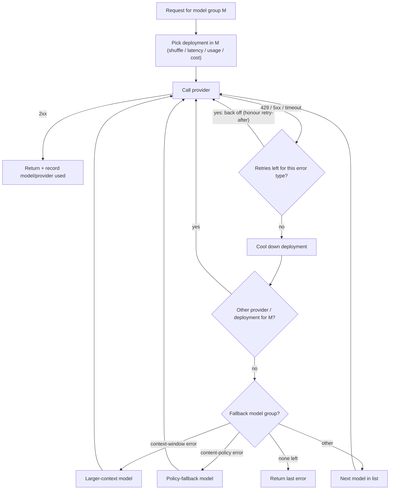

**Model routing** decides, per request, which model and which provider endpoint will answer. It has two separate jobs that often share one config. **Reliability routing** (load balancing, retries, fallbacks) keeps requests succeeding when a provider is slow, rate-limited or down; the intended model stays the same, or a declared substitute takes over. **Cost-quality routing** (cascades, learned routers, difficulty-based routing) deliberately sends easy queries to cheap models and hard ones to expensive models, to cut cost at a target quality. Both usually run inside an [LLM gateway](llm-gateways.md). Picking the candidate models in the first place is [model selection](model-selection.md).

## Part 1: Reliability routing

### Know the failure signals

Retry logic has to respect the provider's contract. For the Claude API ([Anthropic rate limits](../sources/anthropic-rate-limits-docs.md)):

- Limits are RPM, input tokens/min and output tokens/min per model class, enforced by a **token bucket** that refills continuously. A "60 RPM" limit may be enforced as 1 request/s, so bursts can 429 below the nominal rate.
- A 429 carries `retry-after` when waiting will help. `anthropic-ratelimit-*-remaining/reset` headers expose headroom, so a client can slow down *before* it gets a 429.
- **Ramp limits** 429 on sharp usage spikes even under the limit (`ramp_limit_exceeded`). Wait the `retry-after`, then ramp up by at most one step per minute; retrying harder does not help.
- **Spend-cap 429s have no `retry-after`** (`enforced_spend_limit_reached`), and retrying never succeeds. A spend limit you set yourself below the tier cap returns HTTP 400 `invalid_request_error` instead. Synthesis: classify 429s by error code. A blind retry loop turns a billing stop into a retry storm.
- Cached input tokens do not count toward ITPM, so [prompt caching](prompt-caching.md) raises effective throughput.

### Mechanisms and how gateways implement them

Synthesis: a composite of the LiteLLM, Portkey, OpenRouter and Vercel flows described below.

- **Load balancing across deployments.** LiteLLM's default `simple-shuffle` does weighted random selection. The alternatives are latency-based, usage-based (lowest current-minute TPM), least-busy and cost-based ([LiteLLM](../sources/litellm-router-docs.md)). Kong's lowest-latency balancer uses an EWMA and still sends roughly 0.1-5% of traffic to slower targets so their scores stay fresh ([Kong](../sources/kong-ai-gateway-docs.md)). OpenRouter's default weighting does the same across providers of one model, scoring price, throughput, TTFT, 429 rate and tool-call quality ([OpenRouter](../sources/openrouter-provider-routing-docs.md)).
- **Retries with backoff.** Portkey retries up to 5 times on 429/500/502/503/504/529 with exponential 1-16 s waits. Optionally it honours `retry-after`, capping total wait at 60 s ([Portkey](../sources/portkey-gateway-docs.md)). LiteLLM backs off exponentially only on rate-limit errors, sets per-exception retry counts with `retry_policy`, and, for calls through its router, pins the provider client's own retries to 0 so retries do not multiply ([LiteLLM](../sources/litellm-router-docs.md)).
- **Cooldowns / circuit breaking.** With no `allowed_fails` configured, LiteLLM cools a deployment down (default 5 s) immediately on a 429 or a 401/404/408, or when more than 50% of calls fail in the current minute; setting `allowed_fails` switches to counting failures instead. Kong's `max_fails`/`fail_timeout` does the same job ([LiteLLM](../sources/litellm-router-docs.md), [Kong](../sources/kong-ai-gateway-docs.md)).
- **Provider fallback, then model fallback.** Vercel tries each model across its provider `order` before moving to the next entry in `models`, and records every attempt in `modelAttempts` ([Vercel](../sources/vercel-ai-gateway-docs.md)). OpenRouter's `models` array falls back on any error by default, including context-length errors, moderation flags and rate limits, and bills the model that answered ([OpenRouter](../sources/openrouter-provider-routing-docs.md)).
- **Typed fallbacks.** LiteLLM separates `context_window_fallbacks` (with `enable_pre_call_checks` it can skip a too-small model up front), `content_policy_fallbacks` and generic `fallbacks` ([LiteLLM](../sources/litellm-router-docs.md)).
- **What triggers failover.** Kong never fails over on client errors and requires opting in per code (`http_429`, `http_502`), plus `non_idempotent` for POST ([Kong](../sources/kong-ai-gateway-docs.md)). Portkey's `on_status_codes` narrows triggers ([Portkey](../sources/portkey-gateway-docs.md)).

### Reliability failure modes (Synthesis)

- **Retry amplification.** Client SDK retries × gateway retries × fallback depth multiply load on a provider that is already struggling. Keep exactly one retry layer, as LiteLLM's zeroing of SDK retries does.
- **Fallback to a non-equivalent model.** The substitute may be weaker, lack a feature (tools, JSON schema, vision), use a different tokenizer and context limit, or need a different prompt. Run your evals on every model in the chain ([LLM evaluation](llm-evaluation.md)), and use OpenRouter's `require_parameters` or equivalents to avoid providers that drop parameters.
- **Streaming.** A failure after tokens have started streaming cannot be transparently retried. Cloudflare's request timeout counts only until the first chunk ([Cloudflare](../sources/cloudflare-ai-gateway-docs.md)). See [streaming](streaming.md).
- **Cache loss on switch.** Moving a conversation to another model or provider discards its prompt cache. OpenRouter's Auto Router changes models mid-session only when the gain beats the cache-rebuild cost ([Auto Router](../sources/openrouter-auto-router-docs.md)). LiteLLM's session affinity pins a session to one deployment ([LiteLLM](../sources/litellm-router-docs.md)).
- **Non-idempotent side effects.** In agent loops, retrying a turn whose tool call already ran can repeat the action. See [durable agent execution](durable-agent-execution.md).

## Part 2: Cost-quality routing

The premise: prices span orders of magnitude, and many queries do not need the frontier model. RouterBench quantifies the headroom. An *oracle* that picks the cheapest correct model per query scores 0.957 on MMLU at about 1/14 of GPT-4's cost, versus GPT-4 alone at 0.828 ([RouterBench](../sources/hu-2024-routerbench.md)). Real routers capture only part of that.

| Approach | When it decides | How | Reported result | Main risk |
|---|---|---|---|---|
| **Cascade** (FrugalGPT) | After generation | Call a cheap model, score its answer, escalate if unreliable | Matches GPT-4 with up to 98% cost reduction, or +4% accuracy at equal cost (2023 models) ([FrugalGPT](../sources/frugalgpt.md)) | Pays latency and tokens twice on escalation; depends on the scorer |
| **Learned binary router** (RouteLLM) | Before generation | Classifier trained on preference data predicts whether the weak model suffices; threshold sets the strong-call share | MT Bench: 95% of GPT-4 quality with 26% GPT-4 calls (14% with judge-augmented data); over 85% cheaper than GPT-4-only on MT Bench, over 45% on MMLU, over 35% on GSM8K ([LMSYS blog](../sources/lmsys-routellm-blog.md), [paper](../sources/routellm.md)) | Distribution shift: Arena-trained routers were near-random on MMLU without in-domain labels |
| **Difficulty / quality-gap router** (Hybrid LLM) | Before generation | Predict query difficulty against a tunable quality target | Up to 40% fewer large-model calls with no quality drop ([Hybrid LLM](../sources/ding-2024-hybrid-llm.md)) | Same as above |
| **Hosted multi-model router** (OpenRouter Auto) | Before generation | Fast decision model rates 11 request aspects; policy weighs live price, cache status and benchmarks; also picks reasoning effort | No extra fee; pay the chosen model's rate ([Auto Router](../sources/openrouter-auto-router-docs.md)) | Opaque policy; harder to evaluate or reproduce |
| **Rule / semantic routing** | Before generation | Explicit rules (task type, tenant, length) or embedding similarity to route exemplars, e.g. Kong's semantic balancer ([Kong](../sources/kong-ai-gateway-docs.md)) | No published benchmark here | Brittle rules; drift |

RouteLLM details worth knowing: four router types (similarity-weighted Elo ranking, matrix factorization, BERT classifier, causal-LLM classifier). Matrix factorization was the strongest on MT Bench. The routers transferred to an unseen pair (Claude 3 Opus / Llama 3 8B) without retraining. A small amount of in-domain golden data (about 1,500 MMLU samples, under 2% of training data) fixed the MMLU result ([LMSYS blog](../sources/lmsys-routellm-blog.md)).

### The sobering evidence

- RouterBench found simple predictive routers (KNN, MLP) do **not significantly beat** a "Zero router", meaning the best fixed mix of single models on the cost-quality frontier. They win on some tasks (MMLU, Winogrande) and lose on others (ARC-Challenge, MBPP) ([RouterBench](../sources/hu-2024-routerbench.md)).
- Cascades are only as good as their judge. They beat the baseline by a wide margin at judge error ≤ 0.1, but may deteriorate rapidly past 0.2 ([RouterBench](../sources/hu-2024-routerbench.md)).
- Most headline numbers come from 2023-2024 model pairs with a huge price gap (GPT-4 vs Mixtral). Synthesis: with current small models much closer to frontier quality and with [prompt caching](prompt-caching.md) and [batch processing](batch-processing.md) discounts, the marginal saving from routing is smaller, and re-measuring on your own traffic is mandatory.

### Practical guidance (Synthesis)

1. **Start with reliability routing.** Fallback chains, one retry layer that honours `retry-after`, cooldowns, and logging of which model answered. Every production system needs this. Cost routing is optional.
2. **Before a learned router, try a static split.** Route by task type or endpoint (classification and extraction to a small model, multi-step reasoning to a frontier or [reasoning model](reasoning-models.md)). RouterBench's Zero-router result says this is a strong baseline.
3. **Cascade when answers are cheaply verifiable.** Schema validation, unit tests, SQL execution or exact-match checks make good judges. An LLM-as-judge scorer adds cost and error ([LLM-as-judge](llm-as-judge.md)).
4. **Learned router when volume is high and the mix is diverse.** Collect in-domain labels (preferences or graded outcomes), calibrate the threshold to a target strong-model call share, and monitor quality per route over time ([LLM observability](llm-observability.md)).
5. **Account for full cost.** Include escalation double-spend, router inference, lost prompt-cache hits and latency, not just per-token price ([cost and latency optimization](cost-and-latency-optimization.md)). [Knowledge distillation](knowledge-distillation.md) of the frontier model into a small one is the alternative to routing between them.

## Sources

- [LiteLLM Router docs](../sources/litellm-router-docs.md)
- [OpenRouter provider routing and model fallbacks](../sources/openrouter-provider-routing-docs.md)
- [OpenRouter Auto Router docs](../sources/openrouter-auto-router-docs.md)
- [Portkey gateway docs](../sources/portkey-gateway-docs.md)
- [Vercel AI Gateway docs](../sources/vercel-ai-gateway-docs.md)
- [Kong AI Gateway docs](../sources/kong-ai-gateway-docs.md)
- [Cloudflare AI Gateway docs](../sources/cloudflare-ai-gateway-docs.md)
- [Anthropic rate limits docs](../sources/anthropic-rate-limits-docs.md)
- [FrugalGPT (Chen et al. 2023)](../sources/frugalgpt.md)
- [RouteLLM paper (Ong et al. 2024)](../sources/routellm.md)
- [RouteLLM LMSYS blog](../sources/lmsys-routellm-blog.md)
- [Hybrid LLM (Ding et al. 2024)](../sources/ding-2024-hybrid-llm.md)
- [RouterBench (Hu et al. 2024)](../sources/hu-2024-routerbench.md)
