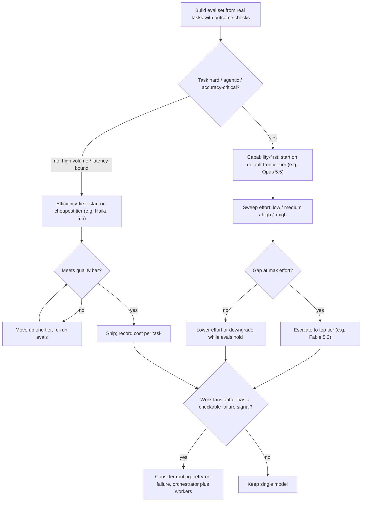

**Model selection** means choosing which model, at which reasoning setting, serves each step of an LLM application. You weigh capability, latency, cost and constraints such as [data residency](data-retention-and-residency.md), licence and modality. The current vendor guidance converges on four rules:

1. Pick using **evals on your own prompts and data**, not public [leaderboards](benchmarks.md).
2. Tune the **effort/reasoning dial** on one model before you switch models.
3. Compare **cost per completed task**, not price per token.
4. Add multi-model **[routing](model-routing-and-fallbacks.md)** only when it beats a single tuned model.

The models themselves are covered in [frontier model landscape](frontier-model-landscape.md) and [open-weight models](open-weight-models.md).

## Criteria

| Criterion | What to measure | Notes |
|---|---|---|
| Capability | Task success on a representative eval set | Anthropic calls the eval set "the most important step" ([LLM evaluation](llm-evaluation.md), [verification and evals](verification-and-evals.md)) |
| Latency | Time to first token, end-to-end turn time, p90 | Reasoning effort adds latency; Claude fast mode buys up to 2.5x output speed at a premium |
| Cost | Cost per completed task, including retries, cache reads/writes and thinking tokens | List prices span 80x within one vendor (Haiku 5.5 $0.10 vs Fable 5.2 $8 input) |
| [Context](context-window.md) | Prompt size distribution, especially the tail | Long-context price steps: OpenAI above 272K, xAI at 200K, Haiku 5.5 above 100K |
| Modality and tools | Image, audio and video input; [computer use](computer-use-agents.md); grounding | Differ by vendor and tier |
| Constraints | Data residency, retention, licence, cloud of record | US-only Claude inference costs 1.1x; open-weight licences may forbid MaaS |

## A selection process

Synthesis, combining Anthropic's two starting strategies with its measured cost guidance:

1. **Efficiency-first** (prototypes, tight latency, high-volume simple tasks): start with the cheapest tier and move up only for a proven gap.
2. **Capability-first** (complex reasoning, high-autonomy agents, accuracy over cost): start with the default frontier model, optimise prompts, then lower effort or downgrade. Move to the top tier only when evals at `xhigh`/`max` still fall short.

OpenAI frames the same split differently: [reasoning models](reasoning-models.md) act as "planners" for ambiguous, multi-step work, and fast GPT models act as "workhorses" for well-defined tasks. A common pattern plans with one and executes with the other.

## Effort before model

Within one model, the effort/reasoning parameter trades thinking tokens for quality (see [test-time compute](test-time-compute.md)). Anthropic says tuning effort is often a better lever than switching models. Its measurements support this:

- Opus 5.5 at `low` effort matched Sonnet 5.5 at its default (`high`) on a SWE-bench Pro subset (87.4% vs 87.6%, within run-to-run noise), for about 7% more per *solved* task.
- For single dependent chains, or work that fits in one context, a single model at lower effort beat every multi-model setup they measured.

Synthesis: defaults differ by model (Opus 5.5 and Haiku 5.5 default to `medium`, the others to `high`), so a model swap without resetting effort confounds the comparison.

## Cost per completed task

Price each token category at its own rate and sum across all requests in the task: uncached input, 5-minute and 1-hour cache writes (1.25x and 2x on Claude), cache reads, and output including thinking. Two warnings from Anthropic's measurements:

- **The tail dominates.** On one run, two of 20 problems carried 43% of spend. Compare candidate models on your hardest tenth of tasks.
- **Cheaper per token can be dearer per task.** A stronger model may finish in fewer turns.

Synthesis: caching changes the ranking. Cache reads cost 0.025x to 0.1x of input on Claude and 0.05x to 0.1x on GPT-6, and Anthropic does not document cache reuse across models (it advises verifying with cache diagnostics), so assume splitting traffic across models can forfeit cache hits. See [prompt caching](prompt-caching.md), [batch processing](batch-processing.md) (50% off at Anthropic, OpenAI and Google) and [cost and latency optimization](cost-and-latency-optimization.md).

## Multi-model routing patterns

| Pattern | How it works | Evidence | Use when |
|---|---|---|---|
| **Retry-on-failure** (effort or tier escalation) | Run cheap, verify, re-run failures at higher effort or tier | SWE-bench Pro (Opus 5.5): low then high on failures solved ~97% at ~$0.17/task vs 95.3% at ~$0.29 all-high | You have a reliable failure signal (tests, validators); you can tolerate extra latency on failures |
| **Cascade** (FrugalGPT) | Query cheap models first; a scorer decides whether to escalate | Matched GPT-4 with up to 98% cost reduction (2023 models) | High-volume Q&A or classification with a trainable answer-quality scorer |
| **Learned router** (RouteLLM) | A classifier picks strong or weak model *before* generation, trained on preference data | Over 2x cost reduction without quality loss in some cases on standard benchmarks; kept working when the strong/weak pair was swapped | Mixed-difficulty traffic, no cheap way to verify answers afterwards |
| **Orchestrator plus workers** | Frontier model plans and synthesises; cheaper models do independent subtasks ([subagents](subagents.md)) | Opus 5.5 orchestrating Sonnet 5.5 cost about a third less at similar score on work larger than one context; Haiku 5.5 workers cut cost 32% but lost ~4 points of pass rate | Work fans out across independent files or documents, or exceeds one context window |
| **Advisor** | Cheap executor calls a stronger model only on hard decisions | Mixed: +1.7 points at 2.1x cost on coding; no gain or a loss elsewhere when rarely consulted | Long serial tasks hard in only a few spots; measure the consult rate first |

Synthesis: routing adds failure modes:

- **Misrouting:** hard queries go to the weak model, and the router's errors are invisible without evals.
- **Coordination overhead:** orchestrator tokens and extra [tool](tools.md) definitions.
- **Cache fragmentation** across models.
- **Behavioural drift** between models: different prompt sensitivity, tool-call formats and refusal behaviour.

Re-validate the routing policy whenever a vendor ships a new tier, because relative prices shift. For example, Gemini 4 Carbon doubles in price on 2026-12-01.

## Practical guidance for FDE work

Synthesis:

- **Start from the customer's constraints.** Cloud of record ([Bedrock](amazon-bedrock.md), [Vertex](google-vertex-ai.md), [Foundry](azure-ai-foundry.md)), residency, retention and licence often eliminate options before any capability question. See [enterprise LLM deployment](enterprise-llm-deployment.md).
- **Make the model a config value.** Pin snapshot IDs, store effort per route, and keep the eval harness runnable in CI so a new release can be assessed in hours ([LLM-as-judge](llm-as-judge.md) for open-ended outputs).
- **Default stack:**
  - one frontier default (e.g. Opus 5.5, GPT-6.1 Sol, Gemini 4 Argon) for agentic and reasoning steps;
  - one cheap tier (Haiku 5.5, GPT-6 Luna, Flash-Lite) for classification, extraction and routing;
  - escalate to the top tier (Fable 5.2, Astra, Carbon) only on measured gaps.
- **Report the decision as a curve, not a point:** score vs cost per task across effort levels and models. That makes a later downgrade or upgrade a data question rather than a debate.

## When not to over-engineer

If traffic is low or the task fits one context with a single dependent chain, Anthropic's measurements favour one model at a tuned effort level. Build a router only when the volume makes the savings worth the extra eval and operations burden.

## Sources

- [Choosing the right model (Anthropic)](../sources/anthropic-choosing-a-model.md)
- [Optimizing for cost and intelligence (Anthropic)](../sources/anthropic-optimizing-cost-and-intelligence.md)
- [Claude models overview](../sources/anthropic-models-overview.md)
- [Anthropic pricing](../sources/anthropic-pricing.md)
- [OpenAI models](../sources/openai-models-docs.md)
- [OpenAI pricing](../sources/openai-api-pricing.md)
- [OpenAI reasoning best practices](../sources/openai-reasoning-best-practices.md)
- [Gemini API pricing](../sources/google-gemini-api-pricing.md)
- [xAI models and pricing](../sources/xai-grok-models-docs.md)
- [Mistral Large 4 model card](../sources/mistral-large-4-model-card.md)
- [FrugalGPT](../sources/frugalgpt.md)
- [RouteLLM](../sources/routellm.md)
