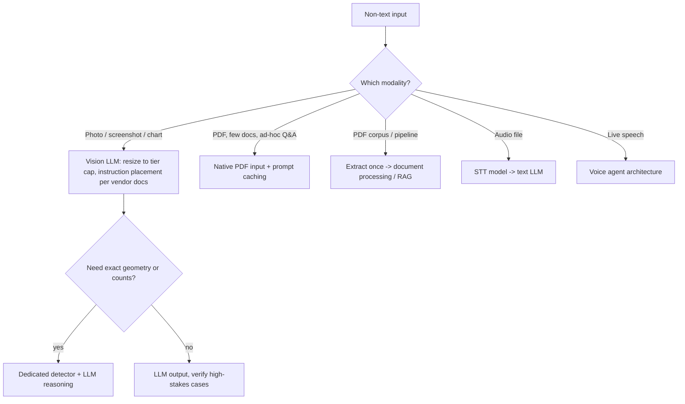

A **multimodal model** accepts (and possibly emits) more than text: images, document pages, audio, video frames. For an engineer the key fact is that every modality is turned into tokens that share the [context window](context-window.md) with text, so it is billed and limited like text, and the conversion step (resizing, tiling, page rasterization, audio chunking) decides both cost and accuracy. In practice "multimodal" covers four distinct capabilities, often served by different models or endpoints: **understanding** (image/PDF/audio in, text out), **image generation**, **speech-to-text (STT)** and **text-to-speech (TTS)**. Real-time speech-in/speech-out is covered in [voice agents](voice-agents.md); acting on screenshots is covered in [computer-use agents](computer-use-agents.md).

## How images become tokens

Vision-language models cut an image into patches or tiles and embed each as a token. The vendors expose this differently, and the numbers determine cost (as of 2026-11):

| | Anthropic Claude | Google Gemini |
|---|---|---|
| Unit | 28x28-px patch = 1 "visual token"; cost `ceil(w/28) * ceil(h/28)` | ≤384 px both sides: 258 tokens; else 768x768 tiles at 258 each |
| Max native size | High-res tier (Claude 4.7+): 2,576 px long edge, 4,784 tokens. Standard: 1,568 px, 1,568 tokens. Larger images are downscaled | `media_resolution` caps tokens per image/frame |
| Formats | JPEG, PNG, GIF (first frame), WebP | PNG, JPEG, WEBP, HEIC, HEIF |
| Per request | up to 600 images (100 on 200k-context models); 10 MB per image base64; 128 MB request | up to 3,600 images; 20 MB inline request, Files API beyond |
| Example | 1920x1080: ~1,560 tokens (standard) or ~2,691 (high-res) | 960x540: 6 tiles |

Sources: [Anthropic vision](../sources/anthropic-vision-docs.md), [Gemini image understanding](../sources/gemini-image-understanding-docs.md).

Consequences:

- **Resolution is a cost/accuracy dial.** High-res tiers can cost about 3x the tokens of the same image on a standard tier; Anthropic recommends downsampling when you don't need the fidelity of dense documents or screenshots ([Anthropic vision](../sources/anthropic-vision-docs.md)). Gemini's `media_resolution` makes the same trade explicit ([Gemini](../sources/gemini-image-understanding-docs.md)).
- **Silent downscaling eats small text.** An image above the cap is shrunk, which can make fine print illegible. Crop or tile yourself instead of sending one huge image ([Anthropic vision](../sources/anthropic-vision-docs.md)).
- **Many-image requests get stricter limits.** Above 20 images per request Claude applies a lower per-image dimension cap (stay at or below 3,000 px per side), and screenshots inside tool results count ([Anthropic vision](../sources/anthropic-vision-docs.md)).
- **Lossy compression helps latency but hurts text.** Repeated JPEG passes create artifacts that degrade reading ([Anthropic vision](../sources/anthropic-vision-docs.md)).
- **Order matters.** Both Anthropic and Google recommend putting the text instruction before a single image (Gemini) and documents before the question (Claude PDFs); for computer-use screenshots Anthropic puts instructions before the image to improve click accuracy ([Gemini](../sources/gemini-image-understanding-docs.md), [Anthropic PDF](../sources/anthropic-pdf-support-docs.md), [computer use](../sources/anthropic-computer-use-tool-docs.md)).
- Images are prompt content, so they can be cached with [prompt caching](prompt-caching.md) and sent through [batch processing](batch-processing.md) like text.

### Localization outputs

Gemini returns bounding boxes natively as `box_2d = [ymin, xmin, ymax, xmax]` normalized to 0-1000, and segmentation masks from Gemini 2.5 on; you must rescale to the original image ([Gemini](../sources/gemini-image-understanding-docs.md)). Claude returns absolute pixel coordinates in the *resized* image, so if the API downscaled your image, coordinates are off unless you pre-resize and rescale ([Anthropic vision](../sources/anthropic-vision-docs.md)). Both describe localization as approximate. Synthesis: when exact geometry matters, use a dedicated detector (YOLO-class) and let the LLM do the reasoning on top.

## Documents (PDFs)

Claude's PDF support is a concrete example of how "native document understanding" works: each page is rasterized to an image **and** its text layer is extracted, and the model gets both. That is why it can read charts and layout, and why each page costs text tokens (typically 1,500-3,000) plus image tokens ([Anthropic PDF](../sources/anthropic-pdf-support-docs.md)). Limits as of 2026-11: 600 pages per request (100 below a 1M context), 128 MB. Dense PDFs fill the context window before the page limit, so split them. PDF input inherits every vision limitation ([Anthropic PDF](../sources/anthropic-pdf-support-docs.md)).

Synthesis: native PDF input is the right default for one-off Q&A over a handful of documents. For large corpora, extraction pipelines, or when you need page-level citations at scale, convert once into structured text and use [document processing](document-processing.md) plus [retrieval](retrieval-augmented-generation.md); paying image tokens for every page on every query is expensive.

## Known failure modes of vision understanding

From Anthropic's stated limitations ([Anthropic vision](../sources/anthropic-vision-docs.md)):

- **Low quality inputs**: rotated, blurry, or tiny images (under 200 px) produce [hallucinations](hallucination.md).
- **Counting**: approximate, worse for many small objects.
- **Spatial reasoning / coordinates**: approximate.
- **People identification**: refused by policy.
- **Synthetic-image detection**: unreliable; do not use the model as a deepfake detector.
- **Medical imaging**: not designed for CT/MRI diagnosis.
- Image metadata (EXIF) is not read.

Images are also an injection channel: text rendered inside a screenshot or page can carry instructions (see [prompt injection](prompt-injection.md), and [computer-use agents](computer-use-agents.md)).

## Image generation

Claude does not generate or edit images ([Anthropic vision](../sources/anthropic-vision-docs.md)). OpenAI's GPT Image family is a representative generation API ([OpenAI image generation](../sources/openai-image-generation-guide.md)):

- **Two surfaces.** The Image API (Generations, Edits) for one-shot calls; the Responses API `image_generation` tool for conversational, multi-turn editing where a mainline model may rewrite your prompt (`revised_prompt`).
- **Edits.** Multiple reference images; masks are *prompt-guided*, so the output may not respect the mask's exact shape; newer models add "markup" annotation layers.
- **Models (2026-11).** `gpt-image-2.5`/`2.6` in Sunburst (editing precision) and Flare (fast generation) variants, plus the older `gpt-image-2`; parameter ranges differ by model.
- **Parameters.** `size` (fixed presets or custom within multiples of 16, aspect 1:3 to 3:1, edge at most 3840 px), `quality` (`low`/`medium`/`high`/`auto` on `gpt-image-2`; adds `xhigh` and `max` on the 2.6 variants), `complexity`, `background` (transparent needs png/webp), `output_format` (png/jpeg/webp, plus svg and gif on newer models), `output_compression`, `n`, `partial_images` (0-3) for streamed previews, `moderation` (`auto`/`low`).
- **Cost and latency (2026-11).** Billed per image token (e.g. $30 per million output tokens for GPT-Image-2.5/2.6); `gpt-image-2` at 1024x1024 is about $0.006 low, $0.053 medium, $0.211 high (the guide gives no per-image table for the 2.6 variants; use OpenAI's calculator). Complex prompts can take up to 2 minutes; JPEG returns faster than PNG; each streamed partial adds 100 tokens.
- **Stated weaknesses.** Precise text rendering, consistency of recurring characters and brand elements, and exact layout placement.

Synthesis: treat image generation as a slow, asynchronous job (queue it, stream partials for UX), use `low` quality for drafts and gate final renders, and never rely on it for pixel-exact layouts such as UI mockups with real copy.

## Audio: speech-to-text and text-to-speech

**STT.** Modern ASR descends from Whisper, trained on about 680,000 hours of weakly supervised multilingual audio and robust zero-shot ([Whisper](../sources/whisper-radford-2022.md)). As of 2026-11 OpenAI's recommended models are `gpt-transcribe` for recorded audio (it can also stream results for a file with `stream=true`) and `gpt-live-transcribe` for live audio through Realtime transcription sessions, with `whisper-1` and the `gpt-4o-*-transcribe` family deprecated for shutdown on 2027-02-26 ([OpenAI STT](../sources/openai-speech-to-text-guide.md)). Practical parameters and limits:

- 25 MB per file; split long recordings at sentence boundaries.
- Domain vocabulary via `prompt`, `keywords` and `languages`. Keywords are hints and can occasionally insert words that were not spoken; `whisper-1` prompts are capped at 224 tokens, and a text LLM post-pass is a common fix for terminology.
- Diarization (`diarized_json`, up to 4 known speakers from 2-10 s reference clips) exists only on the file endpoint, not in realtime sessions; word timestamps only on the deprecated `whisper-1`.

**TTS.** OpenAI's Speech endpoint offers built-in voices, `instructions` to steer tone, accent and pace, and output formats where WAV/PCM (raw 24 kHz 16-bit) are fastest; audio streams via chunked transfer so playback can start early. OpenAI is retiring its Speech-endpoint TTS models (`tts-1`, `tts-1-hd`, `gpt-4o-mini-tts`; shutdown 2027-01-06) in favour of `gpt-realtime-2.1-mini` on the Realtime API, a workflow change rather than a drop-in model swap, and its policy requires telling users the voice is AI-generated ([OpenAI TTS](../sources/openai-text-to-speech-guide.md)). Google's Live API streams 16 kHz PCM in and 24 kHz PCM out over WebSocket ([Gemini Live](../sources/gemini-live-api-docs.md)).

## When to use what

Synthesis: this routing follows from the limits and costs above, not from a single source.

- **Use** native multimodal input when layout or visuals carry meaning (charts, forms, screenshots), when the volume is moderate, and when approximate answers are acceptable or human-reviewed.
- **Don't** use it for exact counts, precise coordinates, identity, forensic or diagnostic judgments, or for re-reading the same large document on every call without caching.
- For model choice across vendors see [model selection](model-selection.md) and [frontier model landscape](frontier-model-landscape.md); evaluate on your own images with [LLM evaluation](llm-evaluation.md), because vendor limits change quickly.

## Sources

- [Anthropic Vision Docs](../sources/anthropic-vision-docs.md)
- [Anthropic PDF Support Docs](../sources/anthropic-pdf-support-docs.md)
- [Gemini Image Understanding Docs](../sources/gemini-image-understanding-docs.md)
- [OpenAI Image Generation Guide](../sources/openai-image-generation-guide.md)
- [OpenAI Speech-to-Text Guide](../sources/openai-speech-to-text-guide.md)
- [OpenAI Text-to-Speech Guide](../sources/openai-text-to-speech-guide.md)
- [Gemini Live API Docs](../sources/gemini-live-api-docs.md)
- [Whisper paper (Radford et al. 2022)](../sources/whisper-radford-2022.md)
- [Anthropic Computer Use Tool Docs](../sources/anthropic-computer-use-tool-docs.md)
