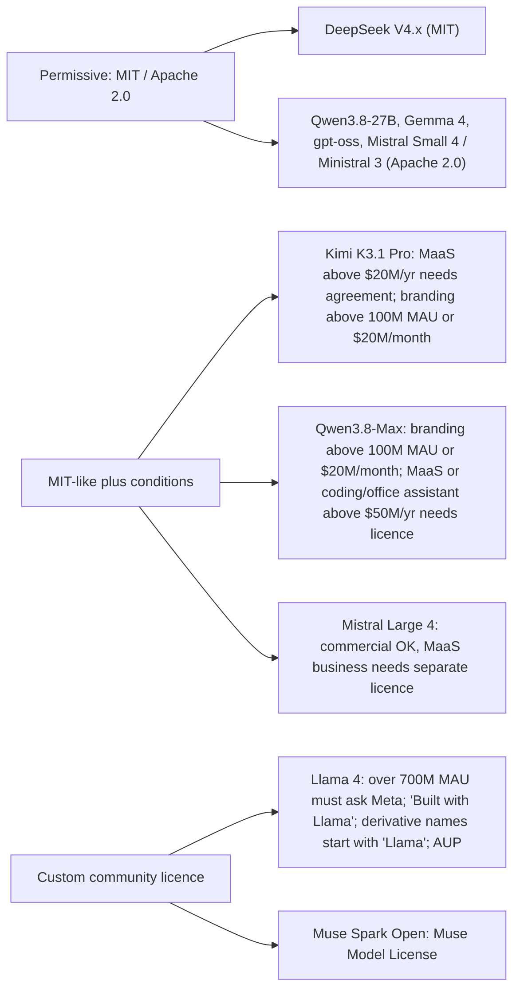

An **open-weight model** is an LLM whose trained parameters are published for download, usually on [Hugging Face](hugging-face-ecosystem.md), so you can run, [fine-tune](fine-tuning.md), [quantize](quantization.md) and serve it on your own hardware. That is not the same as **open source**. The OSI's Open Source AI Definition 1.0 also requires the complete training and inference code and enough information about the training data to rebuild a substantially equivalent system. A weights-only release does not qualify. In practice, "open" models range from truly permissive (MIT, Apache 2.0) to custom licences with revenue caps, branding rules and bans on running a Model-as-a-Service business. **Read the licence before you read the benchmarks.** This page is a snapshot read on **2026-11-14**. For the proprietary side, see [frontier model landscape](frontier-model-landscape.md).

## Current families (snapshot, 2026-11-14)

| Family (vendor) | Latest flagship checkpoint | Total / active params | Context | Licence |
|---|---|---|---|---|
| Kimi (Moonshot AI) | Kimi K3.1 Pro (2026-11-02) | 2.8T / 104B MoE | 1M | Kimi K3.1-Pro licence (MIT-like plus conditions) |
| Qwen (Alibaba) | Qwen3.8-2.4T-A95B (2026-08) | 2.4T / 95B MoE | 262K native, up to ~1M | Qwen3.8-Max licence (MIT-like plus conditions) |
| Qwen | Qwen3.8-27B (2026-08) | 27B dense | 262K native, up to ~1M | Apache 2.0 |
| DeepSeek | DeepSeek-V4-Pro-0813 | ~1.65T stored params (HF metadata) MoE | 1M (API) | MIT |
| DeepSeek | DeepSeek-V4.1-Flash-1017 | ~763B stored params MoE | 1M | MIT |
| Mistral | Mistral Large 4 (v26.10) | ~1T / 49B active (52B incl. embeddings) MoE | 1M | Mistral Ecosystem Open-Weight License (modified MIT, no MaaS) |
| Mistral | Mistral Small 4, Ministral 3 (3B/8B/14B) | small | n/a on page | Apache 2.0 |
| Meta | Muse Spark Open (2026-10-15) | 816B / 42B MoE | 1M | Muse Model License (custom) |
| Meta (older) | Llama 4 Scout / Maverick (2025-04) | 17B active; 16 / 128 experts (~400B total for Maverick) | Scout up to 10M | Llama 4 Community License |
| Google | Gemma 4 (E2B, E4B, 12B, 26B A4B, 31B) | up to 31B dense; 25.2B / 3.8B MoE | 128K (small) / 256K | Apache 2.0 (per HF card) |
| OpenAI | gpt-oss-120b / 20b (2025-08) | 117B / 5.1B; 21B / 3.6B MoE | n/a on card | Apache 2.0 |

## Architecture trends worth knowing

Large open models are now almost all sparse **[mixture-of-experts](mixture-of-experts.md)** (MoE) models. Each token passes through only a few experts, so compute per token scales with the *active* parameter count, while memory still scales with the *total*. Gemma's documentation makes the point explicitly: the 26B A4B model runs almost as fast as a 4B model, but all 26B parameters must be loaded. Expert counts are rising: Qwen3.8-Max uses 512 experts (10 routed + 1 shared active), and Kimi K3.1 Pro uses 896 (16 + 2 shared).

**Hybrid attention for long context.** To make 256K to 1M contexts affordable, vendors interleave cheap layers with full-[attention](transformer-architecture.md) layers:

- **Qwen3.8:** three Gated DeltaNet (linear-attention) layers for every gated full-attention layer.
- **Kimi K3.1 Pro:** 69 KDA linear layers plus 24 gated sparse (DSA) layers.
- **Gemma 4:** local sliding-window layers interleaved with global layers.
- **DeepSeek V4.1-Flash:** its paper's title stresses KV cache compression.

All of these shrink the [KV cache](kv-cache.md) (see also [context window](context-window.md)).

**Built-in speculative decoding.** Several checkpoints ship draft or multi-token-prediction heads: DeepSeek's DSpark module, Mistral Large 4's embedded DSpark head, MTP in Qwen3.8 and Gemma 4, and Gemma 4's drafter models. Serving engines enable them with a flag. See [speculative decoding](speculative-decoding.md).

**Low-precision native weights.** gpt-oss MoE weights are post-trained in MXFP4, which lets 120b fit on one 80GB GPU. Kimi K3.1 Pro is quantization-aware trained to MXFP4 weights with MXFP8 activations. Mistral ships an NVFP4 checkpoint for Blackwell. Gemma ships QAT GGUF and w4a16 checkpoints. See [quantization](quantization.md).

**Thinking controls.** Open models copy the frontier API surface:

- **Qwen3.8:** `enable_thinking`, `reasoning_effort` and `preserve_thinking`.
- **DeepSeek V4-Pro:** `reasoning_effort` with `low`, `high` and `max`.
- **gpt-oss:** low, medium or high effort.
- **Gemma 4:** configurable thinking.

Some can't turn thinking off at all: Qwen3.8-2.4T-A95B is thinking-only. See [reasoning models](reasoning-models.md).

## Licence landscape (the part that bites)

Key points:

- **Internal use is usually exempt** from the conditional clauses. The Kimi licence exempts internal use (use that does not make the software, its outputs or capabilities available to third parties) from both its MaaS and branding clauses; the Qwen-Max licence applies the same exemption to its separate-licence ($50M) clause.
- **"Model as a Service" clauses** matter if you plan to resell inference or fine-tuning through an API in a way that gives third parties meaningful control over inputs, parameters or training data. Merely relaying requests to models hosted by others is excluded in both the Kimi and Qwen texts.
- **Flow-down obligations.** Llama 4 requires derivative model names to start with "Llama" and incorporates an acceptable-use policy by reference.
- Synthesis: for an enterprise customer, the safe default shortlist is the MIT/Apache families (DeepSeek, Qwen dense models, Gemma 4, gpt-oss, Mistral Small/Ministral). The conditional licences still need legal review against the customer's business model. See [AI governance and compliance](ai-governance-and-compliance.md).

## Self-hosting vs the vendor's API

Most open-weight vendors also sell hosted inference: DeepSeek's API, `mistral-large-4` on the Mistral API, and the hosted Qwen3.8-Max (which adds vision input, non-thinking mode, 1M default context and built-in [tools](tools.md) not in the text-only, thinking-only open checkpoint). DeepSeek's API is cheap: $0.30 input (cache miss) / $1.20 output per MTok for Flash at peak, and half that off-peak. Note that DeepSeek's peak window is short (01:00-04:00 and 06:00-10:00 UTC on weekdays), so most traffic pays the off-peak rate.

Synthesis: what self-hosting costs you in practice:

- **Hardware.** DeepSeek's V4-Pro vLLM recipe targets a 4xGB300 node, and frontier-scale MoEs (0.8T to 2.8T parameters) need multi-GPU nodes even at 4-bit. Single-GPU or laptop deployment is realistic only for about 30B-class models: Gemma 4 31B needs ~17.5GB at 4-bit (weights only, before KV cache), gpt-oss-120b fits one 80GB GPU, and the gpt-oss-20b and Gemma E2B/E4B models run on device. See [local LLMs](local-llms.md) and [LLM inference serving](llm-inference-serving.md).
- **Prompt formats.** gpt-oss works only with the harmony format. DeepSeek V4 ships no Jinja chat template, just a Python encoder. Recommended [sampling settings](sampling-parameters.md) differ by mode (Qwen thinking vs non-thinking). A wrong template silently degrades quality.
- **Ops ownership.** You own scaling, upgrades, evals and safety filtering. Meta notes it added extra safety post-training to Muse Spark Open specifically because open weights may run without system guardrails. See [guardrail tooling](guardrail-tooling.md).

## Limitations and failure modes

- **[Benchmarks](benchmarks.md) are vendor-reported**, usually in a chosen harness (often [Claude Code](coding-agents.md)) at max effort. DeepSeek's and Qwen's own tables still show the top proprietary models of mid-2026 ahead on several agentic benchmarks (Qwen's table reports the hosted Qwen3.8-Max, not the open checkpoint). Re-run on your own tasks ([LLM evaluation](llm-evaluation.md)).
- **"Extensible to 1M"** (Qwen3.8) means context extension beyond the native 262K. Expect weaker recall there ([long-context degradation](long-context-degradation.md)).
- **Thinking-only models** can't serve low-latency routes.
- **Version churn.** DeepSeek has already retired the `deepseek-v4-flash` names, and Mistral lists deprecations for Large 3 (retires 2027-04-30) and others. Pin checkpoint hashes.
- **No new Llama checkpoints since Llama 4 (April 2025).** Meta's newer open releases are the Muse family, under a different licence.

## When to use / when not

Use open weights when:

- data cannot leave your boundary (on-prem, air-gapped, sovereign cloud);
- you need to fine-tune or distil the weights themselves ([PEFT and LoRA](peft-and-lora.md), [knowledge distillation](knowledge-distillation.md));
- unit economics at very high volume favour owning GPUs;
- you need offline or edge inference (Gemma E2B/E4B, gpt-oss-20b);
- you want independence from a single vendor's deprecation schedule.

Prefer a [frontier API](frontier-model-landscape.md) when you need the top capability tier, have no GPU operations capacity, or have spiky low volume. Synthesis: a common hybrid is a frontier API for hard steps plus a self-hosted open model for bulk extraction or classification (see [model selection](model-selection.md)).

## Sources

- [OSI Open Source AI Definition](../sources/osi-open-source-ai-definition.md)
- [Qwen3.8 model cards](../sources/qwen3-8-model-cards.md)
- [DeepSeek V4 model cards](../sources/deepseek-v4-model-cards.md)
- [DeepSeek API pricing](../sources/deepseek-api-pricing.md)
- [Kimi K3.1 Pro model card](../sources/kimi-k3-1-pro-model-card.md)
- [Mistral Large 4 model card](../sources/mistral-large-4-model-card.md)
- [Mistral models overview](../sources/mistral-models-overview.md)
- [Muse Spark Open (PyTorch blog)](../sources/pytorch-muse-spark-open.md)
- [Llama 4 licence](../sources/llama-4-license.md)
- [Gemma 4 docs](../sources/gemma-4-docs.md)
- [gpt-oss model card](../sources/gpt-oss-model-card.md)
