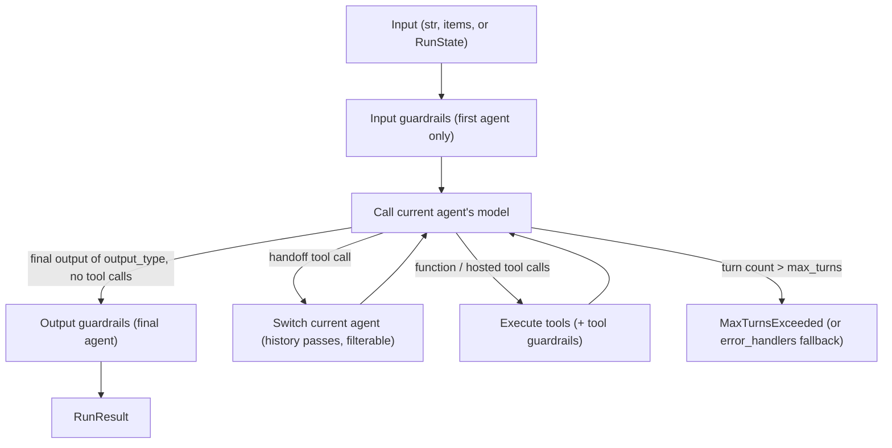

The **OpenAI Agents SDK** (`pip install openai-agents`, with a separate JS/TS package) is OpenAI's open-source framework for building agents from a deliberately small set of primitives. An **Agent** is an LLM with instructions and [tools](tools.md). It can delegate through **[handoffs](agent-handoffs.md)** or **agents-as-tools**, and **guardrails** validate its inputs and outputs. A **Runner** drives the [agent loop](agent-loop.md), and sessions, tracing, [MCP](model-context-protocol.md), [human-in-the-loop](human-in-the-loop.md), [sandbox](code-execution-sandboxes.md), realtime and voice agents are built on top ([docs](../sources/openai-agents-sdk-docs.md), [README](../sources/openai-agents-python-readme.md)). It launched in March 2025 alongside the [Responses API](openai-responses-api.md) as the production successor to the experimental Swarm library ([InfoQ, 2025](../sources/infoq-2025-openai-responses-api-agents-sdk.md)). It is MIT-licensed, needs Python 3.10+, and claims support for the Responses and Chat Completions APIs plus 100+ other LLMs ([README](../sources/openai-agents-python-readme.md)).

## The Runner loop

`Runner.run()` (async), `run_sync()` and `run_streamed()` all execute the same loop ([running agents](../sources/openai-agents-sdk-running-agents-docs.md)):

The run is final when the model returns text of the declared `output_type` with no tool calls. Exceeding `max_turns` raises `MaxTurnsExceeded` unless an `error_handlers["max_turns"]` fallback is configured. `RunConfig` overrides the model, provider, guardrails, handoff filters and tracing for a single run. `call_model_input_filter` can rewrite the exact model input on every turn, which is a useful hook for [context engineering](context-engineering.md). Runs can pause when a tool needs approval and resume later from a serialisable `RunState` ([running agents](../sources/openai-agents-sdk-running-agents-docs.md)).

## Agent configuration

| Field | Purpose |
|---|---|
| `instructions` | String, or a (sync/async) function of context and agent, so prompts can be dynamic |
| `model`, `model_settings` | Model and [sampling settings](sampling-parameters.md) such as temperature and `tool_choice` |
| `tools` | `@function_tool` functions ([function calling](function-calling.md); schema from signature, Pydantic validation), hosted tools, MCP, `agent.as_tool()` |
| `handoffs` | Agents or `handoff()` objects this agent may transfer to |
| `output_type` | Pydantic/dataclass/TypedDict, which switches on [structured outputs](structured-outputs.md) |
| `input_guardrails`, `output_guardrails` | Validation functions with tripwires |
| `tool_use_behavior` | `run_llm_again` (default), `stop_on_first_tool`, `StopAtTools`, custom |
| `reset_tool_choice` | Default true; resets forced tool choice after a call, to avoid infinite tool loops |
| `hooks` | `AgentHooks` per agent; `RunHooks` for the whole run |

The **context** object passed to `Runner.run(context=...)` is a typed dependency-injection container available to tools, [hooks](agent-hooks-and-middleware.md) and handoffs. It is never sent to the LLM ([agents](../sources/openai-agents-sdk-agents-docs.md)). Synthesis: this cleanly separates application state (database handles, user IDs) from conversation state, which keeps secrets out of prompts.

## Two multi-agent patterns: handoffs vs agents-as-tools

A **handoff** is exposed to the model as a tool named `transfer_to_<agent_name>`. When the model calls it, the Runner makes the target agent current, and by default the target sees the full prior conversation. `handoff()` adds `on_handoff` callbacks, a typed `input_type` for small metadata (such as a reason or priority), an `input_filter` to trim history (for example, removing tool items), and `is_enabled` for runtime gating ([handoffs](../sources/openai-agents-sdk-handoffs-docs.md)). **Agents-as-tools** (`agent.as_tool()`) run a specialist as a nested call. The caller keeps control and receives only the result ([agents](../sources/openai-agents-sdk-agents-docs.md)).

| | Handoff (decentralised) | Agent-as-tool (manager) |
|---|---|---|
| Who owns the rest of the conversation | The target agent | The calling agent |
| History seen by specialist | Full history by default (filterable) | Only the tool input |
| Typical use | Triage then specialist (support desks) | Orchestrator–workers, parallel sub-tasks |
| Guardrail coverage | Input guardrails don't run on handed-off agents | Caller's guardrails still wrap the run |

These map onto the routing and orchestrator–worker patterns in [agent design patterns](agent-design-patterns.md) and onto [subagents](subagents.md).

## Guardrails

Guardrails return a `GuardrailFunctionOutput` with a `tripwire_triggered` flag. A tripped wire raises an exception and stops the run ([guardrails](../sources/openai-agents-sdk-guardrails-docs.md)).

- **Input guardrails** run only on the *first* agent. By default they run **in parallel** with the agent for lower latency, so a tripwire can fire after tokens were spent or tools already ran. Set `run_in_parallel=False` to block until the check passes.
- **Output guardrails** run only on the agent that produces the final output.
- **Tool guardrails** wrap function tools on every invocation. They don't cover handoff calls, hosted tools ([web search](web-search-apis.md)), computer or shell tools, or `as_tool()` agents.

Common pattern: a cheap, fast model screens requests before an expensive agent runs. See [agent guardrails](agent-guardrails.md) and [guardrail tooling](guardrail-tooling.md) for the wider design space.

## Conversation state and sessions

There are four mutually constraining options ([running agents](../sources/openai-agents-sdk-running-agents-docs.md)): manage history yourself with `result.to_input_list()`; use an SDK **session**; or let OpenAI hold state server-side with `conversation_id` or `previous_response_id`. Sessions can't be combined with the server-side IDs, and handoff input filters don't work with server-managed conversations ([handoffs](../sources/openai-agents-sdk-handoffs-docs.md)). A session loads its history before each run and appends the new items afterwards. Backends: SQLite (default), async SQLite, Redis, SQLAlchemy, MongoDB, Dapr, the OpenAI Conversations API, an encryption wrapper, and a [compaction](context-compaction.md) wrapper that summarises history through the Responses API. All items are loaded unless `SessionSettings(limit=N)` caps them ([sessions](../sources/openai-agents-sdk-sessions-docs.md)). This is short-term [agent memory](agent-memory.md) only. Long-term memory is up to you.

## Tracing

Tracing is **on by default**. It records a trace per run, with spans for agents, LLM generations, function calls, guardrails and handoffs, and sends them to OpenAI's Traces dashboard. Custom processors can add or replace exporters, and integrations exist for [LangSmith](langsmith.md), [Langfuse](langfuse.md), [Arize Phoenix](arize-phoenix.md), MLflow, Datadog and others. Inputs and outputs are stored unless `trace_include_sensitive_data=False`. Tracing isn't available under [Zero Data Retention](data-retention-and-residency.md) ([tracing](../sources/openai-agents-sdk-tracing-docs.md)). See [LLM observability](llm-observability.md).

## Limitations and failure modes

- **Guardrail gaps in multi-agent runs.** Handed-off agents skip input guardrails, and hosted and built-in execution tools bypass tool guardrails ([guardrails](../sources/openai-agents-sdk-guardrails-docs.md)).
- **Parallel input guardrails can be too late.** Side-effecting tools may already have run by the time a tripwire fires ([guardrails](../sources/openai-agents-sdk-guardrails-docs.md)).
- **Handoffs carry the full history.** That costs tokens and exposes sensitive tool outputs to the next agent and its provider. Nested-history summarisation reshapes the history but doesn't redact it ([handoffs](../sources/openai-agents-sdk-handoffs-docs.md)).
- **Sessions aren't access control.** Session IDs select history but don't authorise. SQLite rows aren't tamper-checked, and encryption doesn't guarantee integrity ([sessions](../sources/openai-agents-sdk-sessions-docs.md)).
- **Default data egress.** Default tracing sends prompts and outputs to OpenAI ([tracing](../sources/openai-agents-sdk-tracing-docs.md)).
- **Vendor gravity.** It is provider-agnostic in principle, but hosted tools, the Conversations API and tracing tie you to OpenAI. Developers raised lock-in concerns at launch ([InfoQ, 2025](../sources/infoq-2025-openai-responses-api-agents-sdk.md)).
- **No durable workflow engine.** There is no graph or checkpointed workflow layer comparable to [LangGraph](langgraph.md), ADK 2.0 or Agent Framework workflows. Synthesis, from the primitives documented here: long-running, multi-step business processes need external orchestration or careful `RunState` handling.

## When to use it, and when not

Use it when you want a thin, readable layer over the Responses API with first-class handoffs, guardrails and tracing. It suits support triage, tool-using assistants and orchestrator–worker research flows, especially on OpenAI models or with [voice agents](voice-agents.md). Use the Responses API directly when you want to own the loop, or for short single-response workflows ([docs](../sources/openai-agents-sdk-docs.md)).

Prefer [LangGraph](langgraph.md), [Google ADK](google-adk.md) 2.0 or [Agent Framework](autogen.md) workflows when you need deterministic, durable, checkpointed graphs. Prefer the [Claude Agent SDK](claude-agent-sdk.md) when the agent needs a full computer environment with a mature permission system.

## Sources

- [OpenAI Agents SDK docs (overview)](../sources/openai-agents-sdk-docs.md)
- [openai-agents-python README](../sources/openai-agents-python-readme.md)
- [Agents](../sources/openai-agents-sdk-agents-docs.md)
- [Handoffs](../sources/openai-agents-sdk-handoffs-docs.md)
- [Guardrails](../sources/openai-agents-sdk-guardrails-docs.md)
- [Running agents](../sources/openai-agents-sdk-running-agents-docs.md)
- [Sessions](../sources/openai-agents-sdk-sessions-docs.md)
- [Tracing](../sources/openai-agents-sdk-tracing-docs.md)
- [InfoQ: OpenAI launches new API, SDK and tools](../sources/infoq-2025-openai-responses-api-agents-sdk.md)
